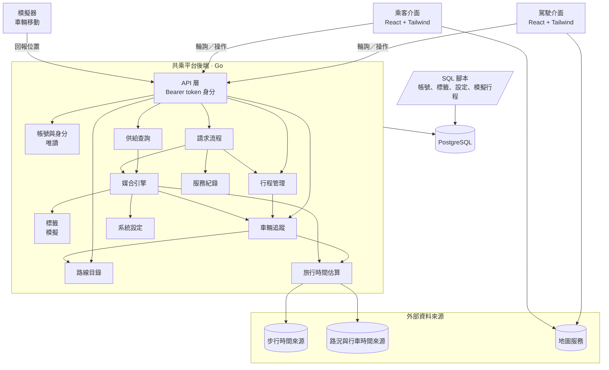
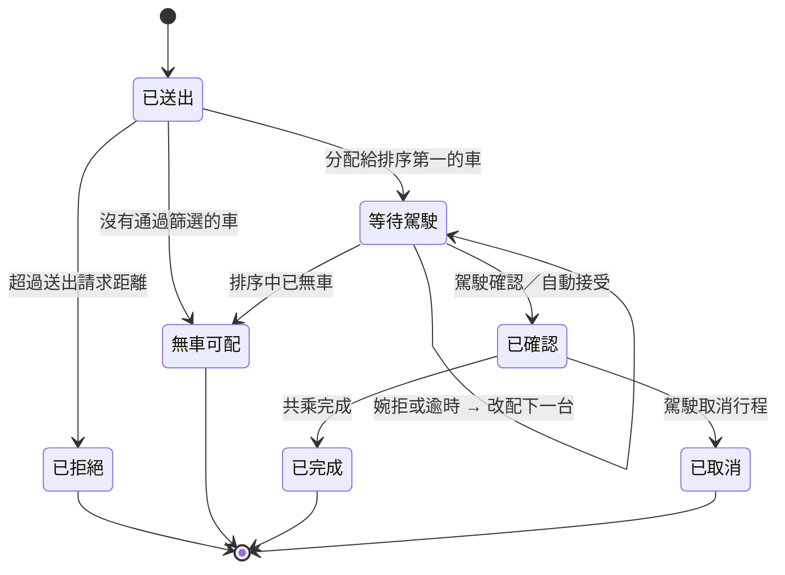
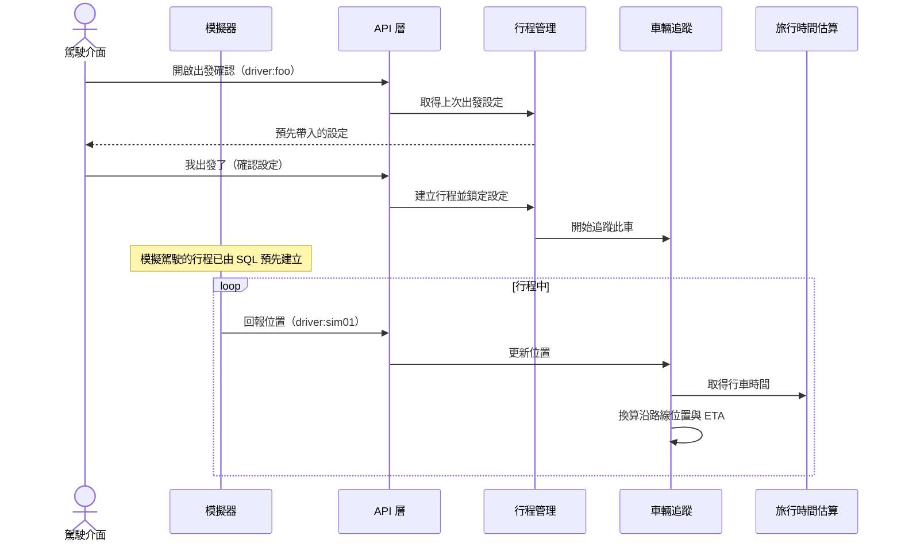
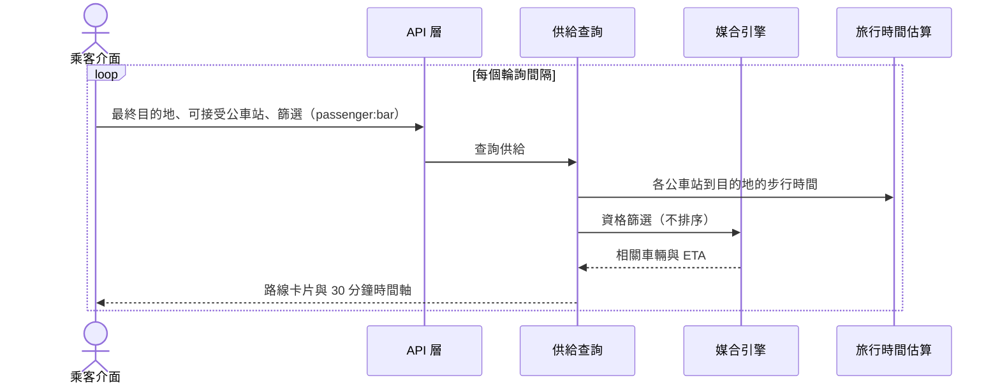
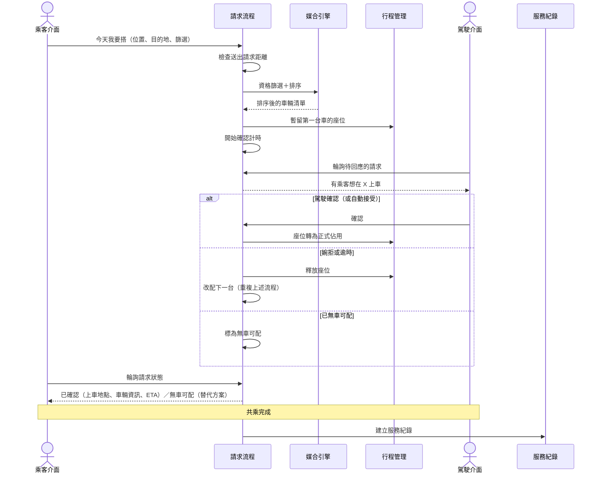
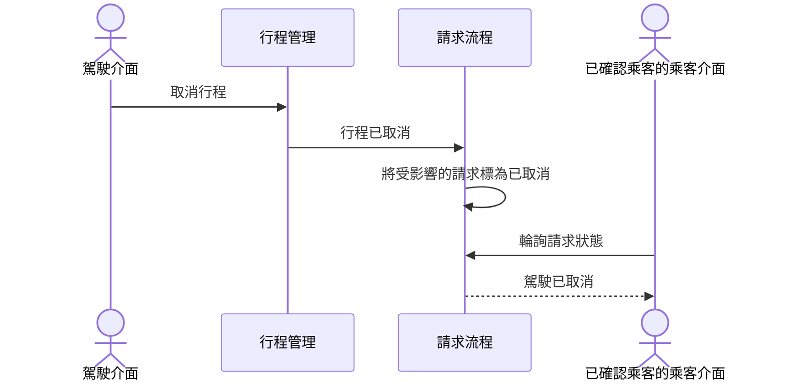

# 內科順路共乘 — 第一層設計：系統架構

議題 #4 · 來源文件：[點子發想（proposal.md）](proposal.md)、[需求規格（requirement.md）](requirement.md)

> [!NOTE]
> **第一層設計**只描述系統架構、元件與元件之間的互動。各元件的細部設計（資料結構、演算法細節、介面規格）之後另外補上。

## 目錄

1. [設計範圍與前提](#1-設計範圍與前提)
   - [1.1 PoC 交付範圍](#11-poc-交付範圍)
2. [文件慣例](#2-文件慣例)
3. [系統架構](#3-系統架構)
   - [3.1 架構圖](#31-架構圖)
   - [3.2 架構層級的設計決定](#32-架構層級的設計決定)
4. [元件](#4-元件)
   - [4.1 駕駛介面](#41-駕駛介面)
   - [4.2 乘客介面](#42-乘客介面)
   - [4.3 API 層](#43-api-層)
   - [4.4 帳號與身分](#44-帳號與身分)
   - [4.5 標籤（模擬）](#45-標籤模擬)
   - [4.6 路線目錄](#46-路線目錄)
   - [4.7 行程管理](#47-行程管理)
   - [4.8 車輛追蹤](#48-車輛追蹤)
   - [4.9 旅行時間估算](#49-旅行時間估算)
   - [4.10 供給查詢](#410-供給查詢)
   - [4.11 媒合引擎](#411-媒合引擎)
   - [4.12 請求流程](#412-請求流程)
   - [4.13 服務紀錄](#413-服務紀錄)
   - [4.14 系統設定](#414-系統設定)
   - [4.15 資料庫](#415-資料庫)
   - [4.16 模擬器](#416-模擬器)
   - [4.17 PoC 不交付的元件](#417-poc-不交付的元件)
5. [主要互動流程](#5-主要互動流程)
   - [5.1 駕駛出發與車輛移動](#51-駕駛出發與車輛移動)
   - [5.2 乘客查看供給](#52-乘客查看供給)
   - [5.3 搭車請求、媒合與確認](#53-搭車請求媒合與確認)
   - [5.4 駕駛臨時取消](#54-駕駛臨時取消)
6. [需求對應](#6-需求對應)
7. [待討論議題](#7-待討論議題)

## 1. 設計範圍與前提

- **時程**：10/24 一天內做出可現場操作的 PoC（G6），架構要簡單、能快速完成。
- **技術選型**：後端 Go、資料庫 PostgreSQL、前端 React + Tailwind（DD-15～DD-17）。
- **資料**：駕駛、乘客、企業、標籤都是模擬資料；帳號資料與系統設定以 SQL 直接寫入。不使用真實個資（REQ-063、REQ-064）。
- **範圍外**：金流與點數、真實定位、真實身分驗證、法規處理。服務紀錄要保留足夠資訊，讓之後的點數分配可以建立在上面。
- **路線固定且少**：媒合不需要任意地點的路徑規劃，只需在少數固定路線上比對（REQ-001）。

### 1.1 PoC 交付範圍

PoC 只交付**駕駛介面**與**乘客介面**。以下需求在 PoC 中只部分滿足或延後：

| 需求 | PoC 狀態 | 說明 |
|---|---|---|
| REQ-005～REQ-007 | 部分 | 帳號與登記資料以 SQL 寫入，沒有註冊畫面（DD-19） |
| REQ-008～REQ-011 | 延後 | 標籤以模擬資料提供，不能新增、移除或撤銷（DD-05） |
| REQ-012 | 部分 | 模擬的企業標籤仍以已認證標示呈現 |
| REQ-020 | 部分 | 只支援單一操作，不支援語音 |
| REQ-049、REQ-052～REQ-054 | 部分 | 通知以輪詢取得，有最多一個輪詢間隔的延遲（DD-03） |
| REQ-056～REQ-059 | 延後 | 供需狀況頁不在 PoC 範圍內 |
| REQ-060 | 部分 | 參數以 SQL 設定，沒有營運設定介面（DD-20） |
| REQ-062 | 部分 | 模擬企業以模擬標籤資料呈現，由 SQL 寫入，不由模擬器建立 |

## 2. 文件慣例

- **元件**：第 4 節逐一說明每個元件的職責、負責的需求與互動對象。
- **設計決定**：編號為 `DD-nn`，放在所屬的元件下（架構層級的決定放在 [3.2](#32-架構層級的設計決定)）。每個決定的句子以「**決定**」開頭，並列出理由、考慮過的替代方案（含未採用原因）與需求連結。編號是永久的，不會重新編號。
- **待討論議題**：編號為 `carpool-oi-nn`，見 [第 7 節](#7-待討論議題)。
- 顯而易見、沒有實際替代方案的做法不另立設計決定；實作細節由實作者決定。

## 3. 系統架構

### 3.1 架構圖

**分層說明：**

- **用戶端**：駕駛介面與乘客介面是兩個分開的介面，都以輪詢向後端取得狀態。
- **模擬器**：Demo 用的獨立程式，只負責讓車輛沿路線移動，以和真實駕駛相同的方式回報位置。
- **後端**：單一 Go 服務，內部依職責切成元件。核心是兩條鏈：
  - **供給鏈**：行程管理 → 車輛追蹤（位置與 ETA）
  - **媒合鏈**：請求流程 → 媒合引擎
  - **參考資料**：帳號與身分、標籤、路線目錄、系統設定、旅行時間估算
- **資料層**：單一 PostgreSQL 資料庫。帳號、標籤、系統設定與模擬行程由 SQL 腳本寫入，後端對這些資料唯讀。
- **外部資料來源**：步行時間、路況與行車時間由旅行時間估算存取；地圖底圖由用戶端直接取得。

### 3.2 架構層級的設計決定

#### DD-01 單一後端服務

決定後端以單一可部署的 Go 服務實作，內部依第 4 節的元件切分模組，模組之間只透過明確的介面互動。

- 理由：一天內要完成並部署；單一服務最容易開發、除錯與 Demo。依元件切分模組，日後仍可拆分。
- 考慮過的替代方案：
  - 微服務：部署、服務間通訊與除錯的成本，在黑客松時程內不划算。
  - 只用後端即服務（BaaS）加用戶端邏輯：媒合、逾時改配、座位競爭需要伺服器端一致的判斷，放在用戶端無法保證先到先得與公平性。
- 需求連結：
  - REQ-036
  - REQ-048
  - REQ-065

#### DD-02 依角色分開的使用者介面，PoC 只交付駕駛與乘客

決定每種角色各有自己的介面，不在同一個介面中切換角色；PoC 只交付駕駛介面與乘客介面，企業管理與營運設定介面不交付。兩個介面是否共用程式碼由實作者決定。

- 理由：每個介面只需處理一種角色的流程，畫面與狀態都更單純；駕駛介面尤其需要極簡（G5）。PoC 只需展示駕駛與乘客的共乘流程。
- 考慮過的替代方案：
  - 單一介面依角色切換：要處理角色切換與兩套流程並存的狀態，對 PoC 沒有額外價值。
  - 交付全部四種介面：企業與營運功能在 PoC 中以 SQL 處理即可，做介面會排擠核心流程的時間。
- 需求連結：
  - REQ-019
  - REQ-020
  - REQ-065

#### DD-03 用戶端輪詢取得狀態

決定用戶端以固定間隔向後端輪詢取得狀態：駕駛介面輪詢是否有待回應的搭車請求，乘客介面輪詢供給狀態與請求狀態。後端不主動推送事件，也不使用發布／訂閱機制。

- 理由：輪詢只需要一般的 HTTP API，實作與除錯最簡單；所有狀態都保存在後端，用戶端斷線重連後下一次輪詢即可恢復。
- 考慮過的替代方案：
  - 發布／訂閱或持久連線（WebSocket、SSE）推送：延遲較低，但要處理連線管理與重連，PoC 時程內不划算。
  - 手機系統推播：需要推播服務設定與使用者授權，風險高。
- 影響：通知最多延遲一個輪詢間隔；「駕駛確認時限」必須明顯大於駕駛介面的輪詢間隔，否則駕駛來不及看到請求就逾時。App 不在前景時不會收到通知，PoC 接受此限制。
- 需求連結：
  - REQ-029
  - REQ-030
  - REQ-049
  - REQ-050
  - REQ-052
  - REQ-053
  - REQ-054

#### DD-15 資料庫使用 PostgreSQL

決定所有後端資料存放在單一 PostgreSQL 資料庫。

- 理由：帳號、行程、請求、座位之間是關聯式資料；座位暫留（DD-12）需要交易保證一致；帳號與設定以 SQL 維護（DD-19、DD-20）也最直接。日後若需要地理查詢，可加上 PostGIS。
- 考慮過的替代方案：
  - 記憶體內資料：最快，但服務重啟就遺失，Demo 時風險高，也無法以 SQL 寫入資料。
  - SQLite：單機簡單，但多個連線同時寫入座位時的交易能力較弱。
- 需求連結：
  - REQ-048
  - REQ-055

#### DD-16 後端使用 Go

決定後端 API 服務以 Go 實作。

- 理由：單一執行檔容易部署；內建的並行能力適合處理每筆請求的確認計時（DD-13）與多個用戶端同時輪詢。
- 考慮過的替代方案：
  - Node.js、Python：同樣可行，團隊選擇以 Go 統一後端。
- 需求連結：
  - REQ-050
  - REQ-065

#### DD-17 前端使用 React + Tailwind

決定駕駛介面與乘客介面以 React 搭配 Tailwind 實作，以行動裝置優先的版面設計。

- 理由：元件化適合路線卡片、時間軸、請求狀態等重複出現的畫面；Tailwind 能快速做出一致的行動版樣式。
- 考慮過的替代方案：
  - 原生 App：開發與發佈時間不允許，Demo 也不方便讓觀眾使用。
  - 其他前端框架或純 HTML：同樣可行，團隊選擇 React + Tailwind。
- 需求連結：
  - REQ-003
  - REQ-065

#### DD-18 以簡化的 Bearer token 表示身分

決定 API 只以 `Authorization: Bearer <角色>:<帳號>` 判斷呼叫者，例如 `driver:foo` 代表以駕駛角色操作帳號 `foo`。API 只檢查帳號存在、具備該角色，且呼叫的是該角色可用的 API，不做其他驗證。

- 理由：PoC 不做真實身分驗證；這個格式足以讓後端知道「誰、以什麼角色」呼叫，Demo 時也能快速切換帳號，模擬器也用同樣方式代表模擬駕駛。
- 考慮過的替代方案：
  - 帳號密碼登入加簽章 token（例如 JWT）：要做登入流程與金鑰管理，對 PoC 沒有價值。
  - 完全不辨識呼叫者：無法知道請求屬於哪位乘客、哪位駕駛。
- 影響：任何人都可以冒用任何帳號，只能用在不含真實資料的 Demo 環境（REQ-064）。
- 需求連結：
  - REQ-005
  - REQ-064

## 4. 元件

### 4.1 駕駛介面

**職責：** 出發確認（目的地、可載人數、上車點、標籤篩選、自動接受）、今天不載、行程中的搭車請求與確認／婉拒、臨時取消。以地圖服務顯示路線與站點。

**負責需求：** REQ-003、REQ-015、REQ-017、REQ-019、REQ-020、REQ-021、REQ-063

**互動：** 以駕駛 token 呼叫 API 層；行程中輪詢待回應的搭車請求。

#### DD-04 駕駛行程中只呈現單一操作畫面

決定駕駛介面在行程進行中只呈現「有沒有搭車請求」與對應的確認／婉拒操作，不提供任何設定的入口；所有設定集中在出發確認畫面。

- 理由：駕駛安全原則已定（G5）；從介面結構上就移除行程中的設定入口，比在每個設定畫面加上限制更可靠。
- 考慮過的替代方案：
  - 行程中保留設定入口但加警告：仍然鼓勵駕駛在開車時操作。
- 需求連結：
  - REQ-019
  - REQ-020

### 4.2 乘客介面

**職責：** 目的地與可接受公車站輸入、標籤篩選、路線卡片與 30 分鐘時間軸、「今天我要搭」、請求狀態（含放寬標示、確認後的上車資訊、無車可配時的替代方案）。以地圖服務顯示路線與站點。

**負責需求：** REQ-003、REQ-024、REQ-031、REQ-032、REQ-035、REQ-047、REQ-051、REQ-052、REQ-053、REQ-063

**互動：** 以乘客 token 呼叫 API 層；輪詢供給狀態與請求狀態。

### 4.3 API 層

**職責：** 駕駛介面、乘客介面與模擬器的唯一入口。依 Bearer token 辨識帳號與角色（DD-18），把請求轉給對應元件。

**負責需求：** 無直接對應；支撐所有需求。

**互動：** 用戶端、模擬器 → API 層 → 後端各元件。

### 4.4 帳號與身分

**職責：** 提供帳號、角色（駕駛、乘客或兩者）與登記資料（路線、時段、可載人數、常用目的地、可接受公車站）的查詢。

**負責需求：** REQ-005、REQ-006、REQ-007、REQ-025

**互動：** 供 API 層辨識身分、行程管理取得登記的可載人數、供給查詢取得乘客預設值。

#### DD-19 帳號資料只能查詢，由 SQL 寫入

決定帳號與登記資料在 API 上只提供查詢；新增與修改一律以 SQL 直接寫入資料庫。

- 理由：盡量縮小帳號功能的範圍，把時間留給共乘核心流程；PoC 的帳號都是預先準備的模擬帳號。
- 考慮過的替代方案：
  - 提供註冊與編輯 API 與畫面：需要表單、驗證與錯誤處理，對 Demo 沒有價值。
- 影響：駕駛「上一次的出發設定」屬於行程資料，不屬於帳號資料，仍由行程管理透過 API 寫入（REQ-016）。
- 需求連結：
  - REQ-005
  - REQ-006
  - REQ-007

### 4.5 標籤（模擬）

**職責：** 提供每個帳號的標籤（自填或企業標籤），以及「某人是否符合某組標籤篩選條件」的判斷。PoC 中標籤資料是模擬的，沒有管理功能。

**負責需求：** REQ-012、REQ-013、REQ-014；REQ-008～REQ-011 延後

**互動：** 媒合引擎向標籤元件詢問篩選是否符合；駕駛與乘客介面取得可選的標籤。

#### DD-05 標籤以模擬資料提供，介面保留

決定標籤元件在 PoC 中以模擬資料實作：標籤資料由 SQL 預先寫入，不提供新增、移除或撤銷的功能；但「取得標籤」與「判斷是否符合篩選」的介面照常提供給媒合引擎使用。

- 理由：標籤管理與企業後台不是 Demo 的重點，但強制／建議篩選會影響媒合結果，需要在 Demo 中看得到。保留介面，日後換成真正的實作時媒合引擎不需改動。
- 考慮過的替代方案：
  - 完全不做標籤：媒合中的強制條件與建議加分無法展示。
  - 完整實作標籤管理與企業後台：佔用核心流程的時間。
- 需求連結：
  - REQ-013
  - REQ-014
  - REQ-040
  - REQ-045
  - REQ-062

### 4.6 路線目錄

**職責：** 預先定義的路線，每條路線的上車點、沿途公車站與終點區域，以及它們在路線上的位置與路線的幾何形狀。

**負責需求：** REQ-001、REQ-002、REQ-004

**互動：** 提供路線資料給車輛追蹤、供給查詢、媒合引擎、用戶端地圖與模擬器。

#### DD-06 以「沿路線的距離」表示位置

決定所有站點與車輛位置都表示為「在某條路線上、距起點多遠」；順路判斷、尚未經過判斷與排序都以這個一維位置進行。

- 理由：路線固定，不需要一般的路徑規劃；「會不會經過、經過了沒」變成簡單的距離比較（proposal 第 7 節）。
- 考慮過的替代方案：
  - 每次查詢都呼叫路徑規劃服務：慢、花錢，對固定路線沒有額外價值。
  - 只用經緯度與直線距離：無法判斷「已經過」，也無法判斷沿途會經過哪些公車站。
- 需求連結：
  - REQ-001
  - REQ-004
  - REQ-037
  - REQ-038

### 4.7 行程管理

**職責：** 駕駛當天的行程：出發（目的地、可載人數、上車點、標籤篩選、自動接受）、今天不載、行程狀態、已確認的乘客與剩餘座位、臨時取消，以及上一次的出發設定。

**負責需求：** REQ-015、REQ-016、REQ-018、REQ-019、REQ-021、REQ-039、REQ-054

**互動：** 出發時從帳號與身分取得登記資料、從上一次行程取得預設值；開始行程後交給車輛追蹤；請求流程向行程管理暫留、確認與釋放座位；取消行程時通知請求流程。

#### DD-07 行程開始後設定即鎖定

決定行程一經開始，其標籤篩選、意圖與自動接受設定在後端即鎖定，任何修改請求都會被拒絕。

- 理由：駕駛介面隱藏設定入口（DD-04）只是介面層的保護；後端鎖定才能保證媒合依據在行程中不變，也讓媒合結果可以預期。
- 考慮過的替代方案：
  - 只在用戶端限制：其他呼叫者仍可修改，無法保證 REQ-019。
- 需求連結：
  - REQ-019

### 4.8 車輛追蹤

**職責：** 接收行程中車輛的位置，換算成沿路線的位置（DD-06），並估算到達尚未經過之上車點的時間（ETA）與到各下車點的乘車時間。

**負責需求：** REQ-023

**互動：** 從行程管理得知哪些車在行程中；從模擬器（日後為真實定位）接收位置；向旅行時間估算取得行車時間；提供 ETA 給供給查詢與媒合引擎。

#### DD-08 位置來源抽象化

決定車輛追蹤只透過一個「位置回報」API 接收位置，不區分來源；模擬器與日後的真實定位都是這個 API 的使用者。

- 理由：PoC 使用模擬車輛，但其餘系統不應因此改變；日後換成真實定位時只需換掉位置來源。
- 考慮過的替代方案：
  - 由模擬器直接寫入 ETA：繞過車輛追蹤，換成真實定位時要重寫；也無法驗證 ETA 估算本身。
  - 由用戶端計算 ETA：不同用戶端的結果可能不一致，媒合無法依賴。
- 需求連結：
  - REQ-023
  - REQ-061

### 4.9 旅行時間估算

**職責：** 提供三種時間：公車站到乘客最終目的地的步行時間、上車點到下車點的乘車時間、車輛到上車點的行車時間。每個估算值都標記來源是真實資料或模擬估算。

**負責需求：** REQ-026、REQ-027、REQ-063

**互動：** 呼叫外部的步行時間來源與路況來源；供車輛追蹤、供給查詢與媒合引擎使用。

#### DD-09 以轉接介面隔離外部資料來源，並提供模擬備援

決定旅行時間估算以統一介面對內提供時間，對外透過可替換的轉接器呼叫各資料來源；外部來源不可用時，改用簡化估算並把結果標記為模擬。估算結果可以快取。

- 理由：步行與路況來源尚未定案（[carpool-oi-02](#7-待討論議題)），有費用與頻率限制，Demo 現場也可能斷線；隔離後可以替換來源，且 Demo 不因外部服務中斷而失敗。路線與公車站固定且少，快取效果好。
- 考慮過的替代方案：
  - 媒合引擎直接呼叫外部 API：來源一換就要改媒合；外部服務失敗會直接讓媒合失敗。
  - 全部預先計算成固定表：無法反映即時路況；最終目的地是任意地址，無法事先算好。
- 需求連結：
  - REQ-027
  - REQ-042
  - REQ-063

### 4.10 供給查詢

**職責：** 乘客到站前的即時供給：依乘客的最終目的地、可接受公車站與篩選條件，找出相關車輛，產生路線卡片（數量、最快到達、剩餘座位）與 30 分鐘時間軸；建議可作為下車點的公車站。每次乘客介面輪詢時重新計算。

**負責需求：** REQ-024、REQ-026、REQ-028、REQ-029、REQ-030、REQ-032、REQ-033

**互動：** 使用媒合引擎的資格篩選（DD-10）找出相關車輛；向旅行時間估算取得步行時間；從帳號與身分取得乘客預設值。

### 4.11 媒合引擎

**職責：** 無狀態的判斷邏輯，提供兩項能力：
1. **資格篩選**：硬性條件（順路且尚未經過、目的地相關、有空位、雙向強制標籤、等待不超過上限）。
2. **排序**：對通過篩選的車計算感受成本（含建議標籤的優先幅度），選定下車點，依成本與同分規則排序。

**負責需求：** REQ-037、REQ-038、REQ-039、REQ-040、REQ-041、REQ-042、REQ-043、REQ-044、REQ-045、REQ-046

**互動：** 從車輛追蹤取得位置與 ETA；從旅行時間估算取得步行與乘車時間；向標籤判斷篩選；從系統設定讀取參數；被供給查詢與請求流程呼叫。

#### DD-10 供給查詢與媒合共用同一套資格篩選

決定「相關車輛」的判斷只在媒合引擎實作一次，供給查詢與請求流程都呼叫同一套資格篩選；供給查詢只是不做排序與分配。

- 理由：乘客看到的車必須和實際可能被分配的車一致（REQ-028、REQ-033 與 REQ-037～REQ-041 使用同一組條件）；兩處各寫一套，很容易出現「看得到卻配不到」的情況。
- 考慮過的替代方案：
  - 供給查詢自行實作簡化篩選：實作較快，但兩套規則會慢慢不一致。
- 需求連結：
  - REQ-028
  - REQ-033
  - REQ-037
  - REQ-038
  - REQ-039
  - REQ-040
  - REQ-041

#### DD-11 媒合引擎不保存狀態

決定媒合引擎只根據呼叫當下的輸入（請求、車輛狀態、參數）產出排序結果，不保存請求或分配狀態；分配、逾時、改配由請求流程負責。

- 理由：排序規則需要依實際情境反覆調整（α、β、標籤加分上限），無狀態的計算最容易測試與用模擬情境驗證（proposal 7.3 的模擬表可以直接當成測試案例）。
- 考慮過的替代方案：
  - 由媒合引擎同時管理請求的生命週期：計分邏輯與逾時、座位等狀態混在一起，難以單獨驗證。
- 需求連結：
  - REQ-042
  - REQ-044
  - REQ-045
  - REQ-060

### 4.12 請求流程

**職責：** 每一筆搭車請求的生命週期：檢查送出距離、取得排序、分配給第一台車、等待駕駛回應或自動接受、逾時或婉拒時改配、無車可配時回覆替代方案、行程取消時處理受影響的請求、完成後建立服務紀錄。提供駕駛「待回應的請求」與乘客「請求狀態」的查詢，供兩個介面輪詢。

**負責需求：** REQ-022、REQ-034、REQ-035、REQ-036、REQ-047、REQ-048、REQ-049、REQ-050、REQ-051、REQ-052、REQ-053、REQ-054、REQ-055

**互動：** 呼叫媒合引擎排序；向行程管理暫留、確認與釋放座位；完成時寫入服務紀錄。

#### DD-12 分配時即暫留座位

決定請求分配給某台車時，立即在該行程暫留一個座位；駕駛婉拒或逾時就釋放，確認後轉為正式佔用。座位的暫留與釋放依請求送出的先後順序處理。

- 理由：保證「先送出請求的先」（REQ-048）；也讓其他乘客看到的剩餘座位與實際一致。
- 考慮過的替代方案：
  - 駕駛確認時才佔用座位：兩位乘客可能同時被分配到最後一個座位，後確認的一方會被拒絕，違反先到先得。
- 需求連結：
  - REQ-039
  - REQ-048

#### DD-13 逾時由後端計時

決定駕駛確認時限由後端為每一筆等待中的請求計時，時間到即改配，不依賴駕駛介面回報。

- 理由：駕駛可能沒開 App、網路中斷或根本沒看到請求，這正是逾時要處理的情況；改用輪詢後（DD-03），駕駛介面沒有輪詢時後端仍必須推進流程。
- 考慮過的替代方案：
  - 由駕駛介面倒數後回報逾時：駕駛介面失聯時請求會永遠卡住。
- 需求連結：
  - REQ-050

### 4.13 服務紀錄

**職責：** 保存每次完成的共乘（駕駛、乘客、路線、上下車點、時間）。

**負責需求：** REQ-055

**互動：** 由請求流程寫入；日後的點數分配、供需統計與「減少車次」統計讀取。

### 4.14 系統設定

**職責：** 保存媒合參數（送出請求距離、地址相符距離、等待上限、等待加重、步行加重、標籤加分上限、駕駛確認時限），供媒合引擎與請求流程讀取。

**負責需求：** REQ-060

**互動：** 媒合引擎、請求流程讀取參數。

#### DD-20 系統設定以 SQL 維護

決定系統設定在 API 上只供後端元件讀取；營運者以 SQL 直接修改，修改後在之後的媒合中生效。

- 理由：PoC 不交付營運設定介面（DD-02）；Demo 前調參數只需改資料庫。
- 考慮過的替代方案：
  - 寫死在程式碼或設定檔：每次調整都要重新部署，無法在 Demo 前快速調校 α、β 等參數。
  - 提供營運設定介面：PoC 時程內不划算。
- 需求連結：
  - REQ-060

### 4.15 資料庫

**職責：** PostgreSQL，保存帳號、標籤、路線、行程、車輛位置、請求、服務紀錄與系統設定（DD-15）。帳號、標籤、系統設定與模擬行程由 SQL 腳本寫入；其餘由後端寫入。各元件只存取自己負責的資料。

**負責需求：** 無直接對應；支撐所有需求。

**互動：** 後端各元件讀寫；SQL 腳本寫入預先準備的資料。

### 4.16 模擬器

**職責：** Demo 用：讓模擬車輛依預先定義的路線、以設定的速度移動，並定時回報位置。只負責車輛移動，不負責出發、確認、婉拒或其他駕駛操作。

**負責需求：** REQ-061、REQ-064、REQ-065

**互動：** 從 API 層取得路線幾何；以模擬駕駛的 token 透過位置回報 API（DD-08）回報位置。

#### DD-14 模擬器只模擬車輛移動，走公開 API

決定模擬器是獨立的程式，只做一件事：讓已在行程中的車輛沿所屬路線、以每台車設定的速度前進，並透過位置回報 API 回報位置。模擬駕駛的帳號與行程由 SQL 腳本預先建立，並啟用自動接受，使它們不需人工操作即可被媒合。

- 理由：模擬器的範圍越小越可靠；Demo 時位置、ETA、媒合與座位都經過正式路徑；之後換成真實定位，系統不需要任何改動。啟用自動接受，模擬駕駛被分配時就不會一路逾時。
- 考慮過的替代方案：
  - 模擬器也模擬出發、確認、婉拒等駕駛行為：範圍擴大，且與駕駛介面重複；Demo 時真人操作駕駛介面就能展示確認流程。
  - 直接寫入資料庫或在後端內建假資料：快，但繞過車輛追蹤，Demo 看到的行為不代表真實系統。
- 需求連結：
  - REQ-022
  - REQ-061
  - REQ-065

### 4.17 PoC 不交付的元件

以下元件屬於完整系統，但 PoC 不交付（見 [1.1](#11-poc-交付範圍)）：

- **企業管理介面**：邀請、移除員工與企業標籤（REQ-009～REQ-011）。PoC 以 SQL 寫入模擬標籤。
- **營運設定介面**：PoC 以 SQL 修改系統設定（DD-20）。
- **供需統計與供需狀況頁**：REQ-056～REQ-059。資料來源尚待決定（[carpool-oi-01](#7-待討論議題)）。

## 5. 主要互動流程

### 5.1 駕駛出發與車輛移動

### 5.2 乘客查看供給

### 5.3 搭車請求、媒合與確認

### 5.4 駕駛臨時取消

## 6. 需求對應

| 主題（requirement.md） | 主要負責元件 | PoC |
|---|---|---|
| 4. 路線與站點 | 路線目錄、駕駛介面、乘客介面 | 交付 |
| 5. 帳號與身分 | 帳號與身分 | 部分（SQL 寫入） |
| 6. 標籤與企業認證 | 標籤（模擬） | 部分（模擬資料） |
| 7. 駕駛出發 | 行程管理、駕駛介面、請求流程（自動接受） | 交付 |
| 8. 乘客查看供給 | 供給查詢、車輛追蹤、旅行時間估算、媒合引擎（資格篩選） | 交付 |
| 9. 搭車請求與媒合 | 請求流程、媒合引擎 | 交付 |
| 10. 確認與行程 | 請求流程、行程管理、服務紀錄 | 交付（輪詢） |
| 11. 供需狀況 | 供需統計 | 不交付 |
| 12. 系統設定 | 系統設定 | 部分（SQL 維護） |
| 13. Demo 與模擬資料 | 模擬器、旅行時間估算（模擬標記）、SQL 腳本 | 交付 |

## 7. 待討論議題

| ID | 標題 | 說明 | 狀態 | 決定 |
|---|---|---|---|---|
| carpool-oi-01 | 供需統計的資料來源 | 使用登記資料（路線、平常時段）、服務紀錄，或使用者事先登記隔天的角色？冷啟動時如何呈現？（requirement Q-05） | 待討論（PoC 不交付） | – |
| carpool-oi-02 | 步行時間與路況的資料來源 | 步行：Google Maps Routes、OpenRouteService、自架 OSRM／Valhalla 或簡化估算；路況：TDX 即時車速或路線規劃 API。需考慮費用、頻率限制與 Demo 穩定度。 | 待討論 | – |
| carpool-oi-03 | App 不在前景時的駕駛通知 | 駕駛開車時 App 可能在背景，是否需要手機系統推播或語音提示？ | 已決定 | PoC 以輪詢取得狀態（DD-03），App 必須在前景；手機推播日後再評估 |
| carpool-oi-04 | 乘客位置的取得方式 | 真實定位不在範圍內，但送出請求距離（REQ-034）需要乘客位置。Demo 時是否由乘客在地圖上指定位置，並標示為模擬？ | 待討論 | – |
| carpool-oi-05 | 共乘完成的判定 | 由駕駛、乘客、車輛到達下車點，或其他事件觸發完成並建立服務紀錄？（requirement Q-11） | 待討論 | – |
| carpool-oi-06 | 指定標籤請求的優先順序 | 「有指定標籤的請求優先媒合」是否仍存在？若存在，會影響請求流程的座位暫留順序（DD-12）。（requirement Q-08） | 待討論 | – |
| carpool-oi-07 | 技術選型 | 後端與前端的語言、框架與資料儲存。 | 已決定 | 後端 Go、資料庫 PostgreSQL、前端 React + Tailwind（DD-15～DD-17） |
| carpool-oi-08 | 部署平台 | 後端、資料庫與前端部署在哪裡，Demo 當天如何讓觀眾開啟。 | 待討論 | – |
| carpool-oi-09 | 輪詢間隔與確認時限 | 駕駛介面、乘客介面的輪詢間隔，以及對應的駕駛確認時限預設值（DD-03）。 | 待討論 | – |
