# 內科順路共乘 — 第一層設計：系統架構

議題 #4 · 來源文件：[點子發想（proposal.md）](proposal.md)、[需求規格（requirement.md）](requirement.md)、[範圍決定（OVERVIEW.md 第 9 節）](../OVERVIEW.md#9-範圍決定)

> [!NOTE]
> **第一層設計**只描述系統架構、元件與元件之間的互動。各元件的細部設計（資料結構、演算法細節、介面規格）之後另外補上。

## 目錄

1. [設計範圍與前提](#1-設計範圍與前提)
   - [1.1 PoC 交付範圍](#11-poc-交付範圍)
2. [文件慣例](#2-文件慣例)
3. [系統架構](#3-系統架構)
   - [3.1 架構圖](#31-架構圖)
   - [3.2 架構層級的設計決定](#32-架構層級的設計決定)
4. [元件](#4-元件)
   - [4.1 駕駛介面](#41-駕駛介面)
   - [4.2 乘客介面](#42-乘客介面)
   - [4.3 API 層](#43-api-層)
   - [4.4 帳號與身分](#44-帳號與身分)
   - [4.5 標籤](#45-標籤)
   - [4.6 上車點與站點](#46-上車點與站點)
   - [4.7 行程管理](#47-行程管理)
   - [4.8 位置追蹤](#48-位置追蹤)
   - [4.9 路線與旅行時間估算](#49-路線與旅行時間估算)
   - [4.10 供給查詢](#410-供給查詢)
   - [4.11 媒合引擎](#411-媒合引擎)
   - [4.12 請求流程](#412-請求流程)
   - [4.13 服務紀錄](#413-服務紀錄)
   - [4.14 系統設定](#414-系統設定)
   - [4.15 資料庫](#415-資料庫)
     - [資料表歸屬](#資料表歸屬)
   - [4.16 模擬器](#416-模擬器)
   - [4.17 PoC 不交付的元件](#417-poc-不交付的元件)
   - [4.18 車流與天氣（Phase 2）](#418-車流與天氣phase-2)
   - [4.19 供需統計（Phase 2）](#419-供需統計phase-2)
   - [4.20 市府管理介面（Phase 2）](#420-市府管理介面phase-2)
5. [主要互動流程](#5-主要互動流程)
   - [5.1 駕駛出發與車輛移動](#51-駕駛出發與車輛移動)
   - [5.2 乘客查看供給](#52-乘客查看供給)
   - [5.3 搭車請求、媒合與確認](#53-搭車請求媒合與確認)
6. [需求對應](#6-需求對應)
7. [待討論議題](#7-待討論議題)

## 1. 設計範圍與前提

- **時程**：10/24 一天內做出可現場操作的 PoC（G6），架構要簡單、能快速完成。
- **技術選型**：後端 Go、資料庫 PostgreSQL、前端 React + Tailwind（DD-15～DD-17）。
- **資料**：帳號、預先定義的標籤、上車點與系統設定由 SQL 腳本預先建立；駕駛與乘客都是模擬帳號（2 個乘客、5 個駕駛）。不使用真實個資（REQ-063、REQ-064）。
- **範圍外**：金流與點數的兌換、分配，真實定位、真實身分驗證、法規處理。服務紀錄要保留足夠資訊，讓之後的點數分配可以建立在上面；點數的累積屬於 Phase 2（DD-34）。
- **上車點固定，路線動態決定**：預先定義的只有上車點；每段行程的路線由上車點與內科內的終點決定（REQ-001）。媒合只需比對「同一個上車點、時間接近、目的地相關」，不需要任意地點叫車。

### 1.1 PoC 交付範圍

PoC 只交付**駕駛介面**與**乘客介面**。Phase 1 的需求全部由本設計滿足；以下需求不在 PoC 中交付：

| 需求 | 原因 | 說明 |
|---|---|---|
| REQ-009～REQ-012 | Phase 2 | 企業標籤（US-04）；標籤模型保留發行者，日後加入時媒合不需改動（DD-05） |
| REQ-026 | Phase 2 | 不建議下車公車站，由乘客自行選擇 |
| REQ-056、REQ-057 | Phase 2 | 依歷史統計的上車點載客次數（US-19），設計見 [4.19](#419-供需統計phase-2)；REQ-057 見 [carpool-oi-14](#7-待討論議題) |
| REQ-071～REQ-075 | Phase 2 | 駕駛點數與駕駛資訊（US-24、US-25），設計見 [4.1](#41-駕駛介面)、[4.4](#44-帳號與身分)（DD-34、DD-35） |
| REQ-076、REQ-077 | Phase 2 | 歷史車流與天氣（US-26），設計見 [4.18](#418-車流與天氣phase-2) 與 DD-38 |
| REQ-078～REQ-082 | Phase 2 | 市府管理儀表板（US-27），設計見 [4.20](#420-市府管理介面phase-2) |
| REQ-083、REQ-084 | Phase 2 | 模擬資料彼此一致與 Demo 模擬時間（US-21），見 DD-40、DD-41 |
| REQ-051 | 範圍決定 | 無車可配時只告知「目前沒有可搭的車」，不顯示接駁公車或步行的替代方案 |

REQ-069 在 PoC 中只由乘客介面防止重複送出（範圍決定）；請求流程不檢查乘客是否已有尚未結束的請求，直接呼叫 API 仍可送出多筆。

路線預覽保存後不清除（範圍決定，DD-21）：PoC 的資料量小，不實作清理；之後以批次作業清理過期的預覽，過期的條件到時再定。

PoC 不提供取消請求（範圍決定，[carpool-oi-13](#7-待討論議題)）：乘客介面在請求尚未結束時顯示「取消請求」按鈕作為示意，按下不做任何事。

## 2. 文件慣例

- **元件**：第 4 節逐一說明每個元件的職責、負責的需求與互動對象。
- **設計決定**：編號為 `DD-nn`，放在所屬的元件下（架構層級的決定放在 [3.2](#32-架構層級的設計決定)）。每個決定的句子以「**決定**」開頭，並列出理由、考慮過的替代方案（含未採用原因）與需求連結。編號是永久的，不會重新編號。
- **待討論議題**：編號為 `carpool-oi-nn`，見 [第 7 節](#7-待討論議題)。
- 顯而易見、沒有實際替代方案的做法不另立設計決定；實作細節由實作者決定。

## 3. 系統架構

### 3.1 架構圖

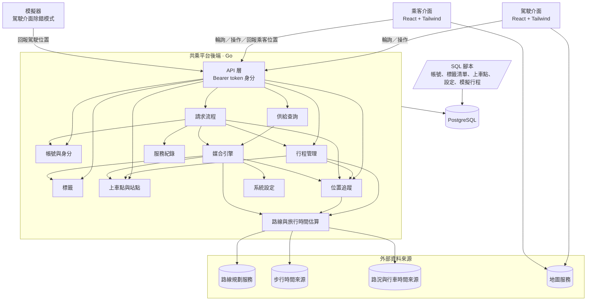

**分層說明：**

- **用戶端**：駕駛介面與乘客介面是兩個分開的介面，都以輪詢向後端取得狀態。
- **模擬器**：Demo 用，做在駕駛介面的除錯模式中（DD-14），不是獨立程式。替選定的駕駛帳號沿預先定義的路徑持續回報模擬位置，以和真實定位相同的方式回報。乘客的位置由乘客介面的除錯模式提供（DD-26）。
- **後端**：單一 Go 服務，內部依職責切成元件。核心是兩條鏈：
  - **供給鏈**：行程管理（含行程路線）→ 位置追蹤（位置與 ETA）
  - **媒合鏈**：請求流程 → 媒合引擎
  - **參考資料**：帳號與身分、標籤、上車點與站點、系統設定、路線與旅行時間估算
- **資料層**：單一 PostgreSQL 資料庫。帳號、標籤清單、上車點、系統設定與模擬行程由 SQL 腳本寫入；使用者選擇的標籤、從共乘累積的常用資料、行程與請求由後端寫入。
- **外部資料來源**：路線規劃、步行時間、路況與行車時間由路線與旅行時間估算存取；地圖底圖由用戶端直接取得。
- **Phase 2 元件**：上圖只畫 PoC 交付的元件。車流與天氣、供需統計、市府管理介面見 [4.18](#418-車流與天氣phase-2)～[4.20](#420-市府管理介面phase-2)；駕駛點數屬於帳號與身分（DD-34）。

### 3.2 架構層級的設計決定

#### DD-01 單一後端服務

決定後端以單一可部署的 Go 服務實作，內部依第 4 節的元件切分模組，模組之間只透過明確的介面互動。

- 理由：一天內要完成並部署；單一服務最容易開發、除錯與 Demo。依元件切分模組，日後仍可拆分。
- 考慮過的替代方案：
  - 微服務：部署、服務間通訊與除錯的成本，在黑客松時程內不划算。
  - 只用後端即服務（BaaS）加用戶端邏輯：媒合、逾時改配、座位競爭需要伺服器端一致的判斷，放在用戶端無法保證先到先得與公平性。
- 需求連結：
  - REQ-036
  - REQ-048
  - REQ-065

#### DD-02 依角色分開的使用者介面，PoC 只交付駕駛與乘客

決定每種角色各有自己的介面，不在同一個介面中切換角色；PoC 只交付駕駛介面與乘客介面。企業管理介面與市府管理介面（DD-39）屬於 Phase 2，營運設定以 SQL 處理（DD-20）。介面之間是否共用程式碼由實作者決定；Phase 2 的通勤資訊畫面由駕駛與乘客介面共用（DD-38）。

- 理由：每個介面只需處理一種角色的流程，畫面與狀態都更單純；駕駛介面尤其需要極簡（G5、REQ-066）。PoC 只需展示駕駛與乘客的共乘流程。
- 考慮過的替代方案：
  - 單一介面依角色切換：要處理角色切換與兩套流程並存的狀態，對 PoC 沒有額外價值。
  - 交付全部四種介面：企業標籤屬於 Phase 2，營運設定以 SQL 處理即可，做介面會排擠核心流程的時間。
- 需求連結：
  - REQ-019
  - REQ-066
  - REQ-065

#### DD-03 用戶端輪詢取得狀態

決定用戶端以固定間隔向後端輪詢取得狀態：駕駛介面輪詢是否有待回應的搭車請求，乘客介面輪詢供給狀態與請求狀態。後端不主動推送事件，也不使用發布／訂閱機制。

- 理由：輪詢只需要一般的 HTTP API，實作與除錯最簡單；所有狀態都保存在後端，用戶端斷線重連後下一次輪詢即可恢復。
- 考慮過的替代方案：
  - 發布／訂閱或持久連線（WebSocket、SSE）推送：延遲較低，但要處理連線管理與重連，PoC 時程內不划算。
  - 手機系統推播：需要推播服務設定與使用者授權，風險高。
- 影響：通知最多延遲一個輪詢間隔；「駕駛確認時限」必須明顯大於駕駛介面的輪詢間隔，否則駕駛來不及看到請求就逾時（[carpool-oi-09](#7-待討論議題)）。App 不在前景時不會收到通知，PoC 接受此限制。
- 需求連結：
  - REQ-029
  - REQ-030
  - REQ-036
  - REQ-049
  - REQ-050
  - REQ-052
  - REQ-053

#### DD-15 資料庫使用 PostgreSQL

決定所有後端資料存放在單一 PostgreSQL 資料庫。

- 理由：帳號、行程、請求、座位之間是關聯式資料；座位暫留（DD-12）需要交易保證一致；預先建立的資料以 SQL 維護（DD-19、DD-20）也最直接。上車點與公車站的地理判斷可加上 PostGIS。
- 考慮過的替代方案：
  - 記憶體內資料：最快，但服務重啟就遺失，Demo 時風險高，也無法以 SQL 寫入資料。
  - SQLite：單機簡單，但多個連線同時寫入座位時的交易能力較弱。
- 需求連結：
  - REQ-048
  - REQ-055

#### DD-16 後端使用 Go

決定後端 API 服務以 Go 實作。

- 理由：單一執行檔容易部署；內建的並行能力適合處理每筆請求的確認計時（DD-13）與多個用戶端同時輪詢。
- 考慮過的替代方案：
  - Node.js、Python：同樣可行，團隊選擇以 Go 統一後端。
- 需求連結：
  - REQ-050
  - REQ-065

#### DD-17 前端使用 React + Tailwind

決定駕駛介面與乘客介面以 React 搭配 Tailwind 實作，以行動裝置優先的版面設計。

- 理由：元件化適合上車點卡片、時間軸、請求狀態等重複出現的畫面；Tailwind 能快速做出一致的行動版樣式。
- 考慮過的替代方案：
  - 原生 App：開發與發佈時間不允許，Demo 也不方便讓觀眾使用。
  - 其他前端框架或純 HTML：同樣可行，團隊選擇 React + Tailwind。
- 需求連結：
  - REQ-003
  - REQ-065

#### DD-18 以簡化的 Bearer token 表示身分

決定 API 只以 `Authorization: Bearer <角色>:<帳號>` 判斷呼叫者，例如 `driver:foo` 代表以駕駛角色操作帳號 `foo`。API 只檢查帳號存在、具備該角色，且呼叫的是該角色可用的 API，不做其他驗證。

- 理由：PoC 不做真實身分驗證；這個格式足以讓後端知道「誰、以什麼角色」呼叫，Demo 時也能快速切換帳號，模擬器也用同樣方式代表模擬駕駛。
- 考慮過的替代方案：
  - 帳號密碼登入加簽章 token（例如 JWT）：要做登入流程與金鑰管理，對 PoC 沒有價值。
  - 完全不辨識呼叫者：無法知道請求屬於哪位乘客、哪位駕駛。
- 影響：任何人都可以冒用任何帳號，只能用在不含真實資料的 Demo 環境（REQ-064）。
- 需求連結：
  - REQ-005
  - REQ-064

#### DD-24 Demo 時所有元件在同一台機器上本地執行

決定 Demo 時後端服務、PostgreSQL（docker-compose）、駕駛介面（含模擬器）、乘客介面全部在同一台機器上本地執行，不部署到雲端；駕駛與乘客介面以瀏覽器開啟本機網址操作。

- 理由：Demo 由團隊現場操作，不需要讓觀眾連線；本地執行不必處理部署、網域與網路，現場斷網也不影響 Demo，重設資料也最簡單。
- 考慮過的替代方案：
  - 部署到雲端平台：觀眾可以用手機開啟，但要多處理部署、設定與費用，現場網路不穩時 Demo 會失敗。
  - 前端部署到雲端、後端留在本機：仍需處理跨網路連線，沒有實際好處。
- 影響：觀眾無法自行開啟操作；要同時展示駕駛與乘客畫面，需在同一台機器開兩個瀏覽器視窗。外部資料來源（路線規劃、步行時間、路況）仍需網路，斷線時改用模擬備援（DD-09）。
- 需求連結：
  - REQ-064
  - REQ-065

#### DD-29 Demo 重設以 API 提供，只在 Demo 環境啟用

決定後端提供 Demo 重設 API（`POST /api/demo/reset`），只在環境變數啟用時註冊，免 token。重設只動 Demo 帳號（`users.simulated`）：刪除這些帳號的請求與服務紀錄、把常用資料還原為 SQL 種子的狀態（含替 `driver4` 新增一趟和種子相同的已結束行程，DD-19）、把尚未結束的行程標為已取消（沒有抵達目的地，和 DD-30 抵達時的已完成區分），並以新的行程重新開始 SQL 預先建立的模擬行程。位置紀錄只新增、不刪除（DD-06），所以舊的行程與位置紀錄保留，以「重新開始」取代清空。

- 理由：Demo 要能在現場一個操作就重來（REQ-065）；乘客介面不讓已有請求的乘客再送出（REQ-069），也沒有取消（1.1），重設是 Demo 重來的唯一方式。展示頁的重設按鈕要能接真正的後端。位置紀錄只新增不刪除（DD-06），所以重設以結束舊行程、建立新行程的方式回到初始狀態，而不是清空資料表。只在環境變數啟用時提供，正式環境不會出現這個 API。
- 考慮過的替代方案：
  - 只用指令重跑種子資料：最簡單，但介面上的重設按鈕無法使用，Demo 時要切到終端機操作；而且位置紀錄不能刪除，重跑種子資料會失敗。
  - 刪除並重建資料庫：要停後端，Demo 現場來不及。
- 影響：DD-18 的「除 ping 外都需要 token」多一個例外；這個例外只在 Demo 環境存在。
- 需求連結：
  - REQ-064
  - REQ-065

## 4. 元件

### 4.1 駕駛介面

**職責：**

- **出發前**：選擇適用於駕駛的標籤；出發確認（目的地（以 Google Places 搜尋，DD-32）、可載人數、上車點、只載的標籤（以適用於乘客的標籤篩選，一律強制，DD-42）、自動接受），預先帶入上次的設定，不需修改時一次操作即可出發；確認時在地圖上顯示由上車點到目的地的行程路線與沿途公車站。
- **行程中**：只呈現是否有搭車請求、該請求的上車點與下車點、已確認乘客的下車點與是否已上車，以及確認／婉拒、標記乘客已上車（DD-27）與替乘客結束共乘的操作（DD-04）。行程啟用自動接受時，收到請求即自動送出確認（DD-33）。沒有結束行程的操作：抵達目的地時行程自動結束（DD-30）。
- **行程結束後**：顯示行程已結束與這趟完成的共乘人數，再回到出發確認。
- **同企業標示**：「我的標籤」與搭車請求顯示模擬的同企業標示（DD-43）。
- **PoC 除錯模式**（網址帶 `?debug=1` 才出現，標示為模擬）：選擇主畫面的駕駛身分；承載模擬器（[4.16](#416-模擬器)、DD-14）。
- **Phase 2**：出發確認與行程結束畫面提供駕駛資訊抽屜（DD-35），抽屜內有通勤資訊畫面的入口（DD-38）；行程中都不提供（DD-04）。

**負責需求：** REQ-003、REQ-008、REQ-015、REQ-017、REQ-019、REQ-020、REQ-021、REQ-022、REQ-062、REQ-063、REQ-066、REQ-067、REQ-068、REQ-070、REQ-086；Phase 2：REQ-056、REQ-074、REQ-077

**互動：** 以駕駛 token 呼叫 API 層；行程中輪詢待回應的搭車請求。

#### DD-04 駕駛行程中只呈現單一極簡畫面

決定駕駛介面在行程進行中只呈現一個畫面，內容只有「有沒有搭車請求」、該請求的上車點與下車點、已確認乘客的下車點與是否已上車，以及確認／婉拒、標記乘客已上車、替乘客結束共乘的單一操作；不顯示地圖、統計、提示或動畫，也不提供任何設定的入口。所有設定與路線顯示集中在出發確認畫面。

- 理由：駕駛安全原則已定（G5）；從介面結構上就移除行程中的其他資訊與設定入口，比在每個畫面加上限制更可靠。路線在出發確認時已經顯示（REQ-003），行程中不需要再顯示。
- 考慮過的替代方案：
  - 行程中保留地圖與設定入口但加警告：仍然讓駕駛在開車時分心，違反 REQ-066。
- 例外：PoC 除錯模式（DD-14）是 Demo 工具，不屬於駕駛產品；只在網址帶除錯參數時出現，不受本決定限制。
- 例外：搭車請求旁的「同企業乘客」標示（DD-43）是一行文字，不增加操作，與上車點、下車點一起呈現。
- 需求連結：
  - REQ-003
  - REQ-019
  - REQ-020
  - REQ-066

#### DD-33 自動接受由駕駛介面送出確認

決定自動接受由駕駛介面執行：駕駛在出發時啟用，設定隨行程保存（`trips.auto_accept`，DD-07）；行程中駕駛介面輪詢到分配給自己的請求時，若行程已啟用自動接受，就自動送出確認，呼叫的是駕駛按下「確認」時的同一個 API。後端不依此設定確認請求，分配後的請求一律等待駕駛確認或逾時（DD-13）。

- 理由：確認請求只有一條路徑，就是駕駛送出確認；自動接受只是替駕駛按下確認，屬於介面的行為，請求流程不必區分自動與手動確認。
- 考慮過的替代方案：
  - 由後端在分配時直接確認：送出請求與改配兩處都要另外處理確認，確認的邏輯分散在多條路徑。
- 影響：從分配到確認最多延遲一個輪詢間隔（DD-03）。SQL 預先建立的模擬行程沒有人操作駕駛介面，改由模擬器替這些帳號送出確認（DD-14）；模擬器未啟動時，分配給模擬行程的請求要等到逾時才改配，Demo 前須先啟動模擬器。
- 需求連結：
  - REQ-021
  - REQ-022

#### DD-35 駕駛資訊以側邊抽屜呈現，只在沒有進行中行程的畫面開啟

決定駕駛介面在出發確認畫面與行程結束畫面的帳號標示可以點擊，點擊後從側邊滑出抽屜，顯示駕駛的名稱、車牌、車輛描述、累積點數與最近 5 筆點數紀錄（時間、點數、原因），並提供通勤資訊畫面的入口（DD-38）。行程中的畫面不提供抽屜。資料取自 `GET /api/driver/profile`（加上名稱、車輛資訊與累積點數）與 `GET /api/driver/points`（最近的點數紀錄）；名稱與 `GET /api/me` 的 `display_name` 相同，抽屜需要的駕駛資料都由 `/api/driver/profile` 一次取得。

- 理由：駕駛資訊不屬於出發流程，放在抽屜不佔出發確認畫面的空間，也不改變一次操作就能出發的流程（REQ-015）；只在沒有進行中行程時提供，符合 REQ-066 與 DD-04。
- 考慮過的替代方案：
  - 獨立的駕駛資訊頁：多一層導覽與返回，資訊量不多，不值得一整頁。
  - 直接顯示在出發確認畫面：擠壓設定與地圖，出發確認是最常用的畫面。
  - 行程中也提供：違反 DD-04。
- 需求連結：
  - REQ-066
  - REQ-074

### 4.2 乘客介面

**職責：**

- 選擇適用於乘客的標籤。
- 最終目的地與可接受的下車公車站輸入（預先帶入從共乘累積的常用設定；目的地以 Google Places 搜尋，DD-32）、標籤篩選（以適用於駕駛的標籤篩選，DD-42）與意圖。
- 上車點選擇（預設為離目前位置最近的上車點，DD-26；可改選）；該上車點的卡片（相關車輛數量、最快到達時間、剩餘座位）與時間軸（範圍為「等待上限」）；不提供選車操作。
- 「今天我要搭」：先建立乘客的參與主檔，再送出請求並附上乘客當下的位置；同一位置以非同步方式回報為主檔的第一筆回報（DD-25）。送出時可再調整篩選；立即顯示分配結果或「目前沒有可搭的車」。
- 已有尚未結束的請求時，不提供送出，改顯示該請求（REQ-069；PoC 只在乘客介面防止，見 [1.1](#11-poc-交付範圍)）。
- 請求尚未結束時顯示「取消請求」按鈕；PoC 只作示意，按下不做任何事（範圍決定，見 [1.1](#11-poc-交付範圍)）。
- 請求狀態：等待中、已確認（上車地點、車輛資訊、ETA 與其模擬標示；車輛尚未經過上車點時在地圖上顯示車輛目前位置與行進方向，已經過時顯示「車已到上車點」，DD-31；並在地圖上顯示該行程路線與沿途公車站，以及「已上車」操作，DD-27）、已上車（只顯示「結束共乘」操作）、已放寬標示、無車可配。
- 下車後的「結束共乘」操作，這是結束共乘的主要方式（DD-23）。
- 同企業標示：標籤篩選與已確認的請求顯示模擬的同企業標示（DD-43）。
- **PoC 除錯模式**：設定乘客的目前位置；參與主檔建立後持續送出位置（DD-26）。
- **Phase 2**：從最終目的地輸入畫面進入通勤資訊畫面（DD-38）。已確認請求的車輛資訊不含駕駛的累積點數（REQ-075）。

**負責需求：** REQ-003、REQ-008、REQ-024、REQ-025、REQ-029、REQ-030、REQ-031、REQ-032、REQ-035、REQ-036、REQ-047、REQ-052、REQ-053、REQ-062、REQ-063、REQ-067、REQ-068、REQ-069、REQ-086；Phase 2：REQ-056、REQ-075、REQ-077

**互動：** 以乘客 token 呼叫 API 層；輪詢供給狀態與請求狀態；參與主檔建立後透過位置回報 API（DD-08）回報乘客位置。

#### DD-26 PoC 的乘客位置由乘客介面的除錯模式提供

決定乘客介面提供「除錯模式」，取代日後的真實定位，只做兩件事：

1. **設定目前位置**：由操作者指定乘客當下的位置（例如上車點附近）。
2. **持續送出位置**：參與主檔建立後（DD-25），定時把目前位置透過位置回報 API 回報（DD-08）。

乘客介面透過單一的「目前位置」來源取得位置，PoC 由除錯模式提供；按下「今天我要搭」時以目前位置送出請求。除錯模式在介面中標示為模擬（REQ-063）。

- 理由：按下「今天我要搭」時就需要乘客當下的位置；位置在乘客介面內設定，不需要另一個程式，也不必向後端查詢。乘客送出請求時基本上已在上車點（REQ-034），不需要模擬沿路徑移動，指定位置即可；操作者改變目前位置時，持續送出的位置也跟著改變。乘客介面和使用真實定位時一樣，自己取得位置並回報，日後換成手機定位只需替換「目前位置」的來源，後端不需改動。
- 考慮過的替代方案：
  - 另寫獨立的乘客模擬器程式：乘客介面要另外向它取得當下位置，Demo 時也要多啟動、操作一個程式。
  - 在乘客介面內沿預先定義的路徑模擬移動：Demo 只需要乘客在上車點附近，路徑與速度的設定用不到。
  - 由模擬器（DD-14）一併回報乘客位置：乘客介面不知道自己當下的位置；模擬器還要在送出請求前就開始回報。
  - 瀏覽器定位：得到的是 Demo 現場的位置，不在上車點附近。
- 需求連結：
  - REQ-034
  - REQ-061
  - REQ-063

### 4.3 API 層

**職責：** 駕駛介面、乘客介面與模擬器的唯一入口。依 Bearer token 辨識帳號與角色（DD-18），把請求轉給對應元件。Phase 2 加入市府管理介面，以 `city:<帳號>` 呼叫 `/api/city/*`（DD-39）。

**負責需求：** 無直接對應；支撐所有需求。

**互動：** 用戶端、模擬器 → API 層 → 後端各元件。

### 4.4 帳號與身分

**職責：** 帳號與角色（駕駛、乘客或兩者）、駕駛車輛資訊的查詢；保存並提供從共乘紀錄累積的常用資料：

- **駕駛**：常用上車點、常用的最終目的地、可載人數
- **乘客**：平常抵達時段、常用的最終目的地、可接受的下車公車站

Phase 2 另外保存駕駛的累積點數與點數紀錄（DD-34），並新增市府管理者角色（DD-39）。

**負責需求：** REQ-005、REQ-006、REQ-007、REQ-025；Phase 2：REQ-071、REQ-072、REQ-073、REQ-074

**互動：** 供 API 層辨識身分；行程管理與供給查詢取得常用資料作為預設值；請求流程在共乘完成時通知更新常用資料，Phase 2 起一併記點（DD-34）。

**資料表：**

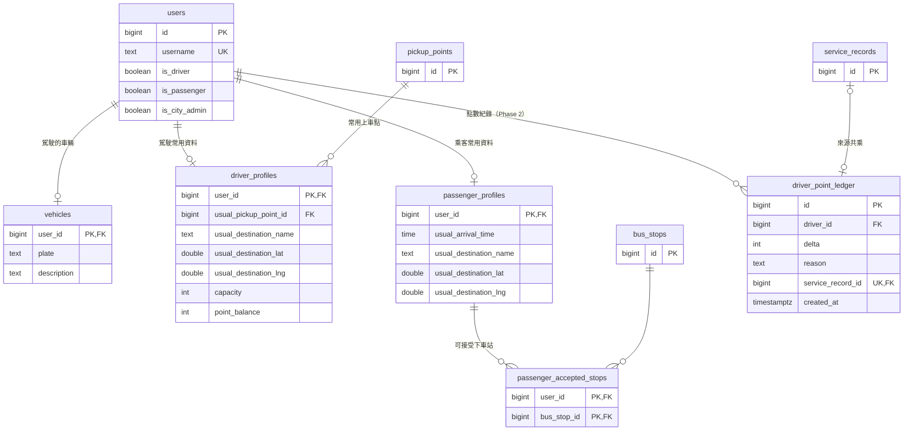

- `vehicles` 保存駕駛的車輛資訊（車牌、車輛描述，例如顏色與車款），在駕駛確認請求時提供給乘客（REQ-052）。與帳號一樣由 SQL 預先建立（DD-19）；不放在 `driver_profiles`，因為常用資料會依共乘紀錄重新計算。

#### DD-19 帳號由 SQL 預先建立，常用資料由共乘紀錄累積

決定帳號與角色只由 SQL 腳本預先建立，API 不提供註冊或編輯帳號的功能；常用資料由後端在每次共乘完成時，依該使用者累積的服務紀錄重新計算並保存，使用者不能直接填寫。

重新計算時，每個欄位取該使用者所有已完成共乘中出現最多次的值，次數相同時取最近一次共乘的值；例外是平常抵達時段與可接受的下車公車站。服務紀錄本身沒有的欄位，由服務紀錄對應的行程與請求取得：

- **駕駛**：常用上車點、常用的最終目的地、可載人數，取自對應行程的上車點、目的地與可載人數。
- **乘客**：常用的最終目的地取自對應請求的最終目的地；平常抵達時段取各次共乘完成時間在台北時間（Asia/Taipei）的時刻的中位數；可接受的下車公車站為曾經實際下車的所有公車站（下車點是行程目的地的不計）；計算結果沒有任何公車站時（例如至今的共乘都在行程目的地下車），保留原本的值，不清空。

- 理由：需求已決定不提供註冊（US-02），而常用資料必須由共乘累積（REQ-006、REQ-007）。在完成時更新一次，查詢預設值時只需讀取，不必每次輪詢都重新彙整。在行程目的地下車的共乘無法說明哪些公車站可以接受，若因此清空，乘客下一次就沒有預先帶入的公車站（REQ-025），必須重新選擇。
- 考慮過的替代方案：
  - 提供註冊與個人資料編輯：違反 US-02 與 REQ-006、REQ-007 的「不由使用者直接提供」。
  - 每次查詢時才從服務紀錄即時彙整：結果相同，但乘客介面每次輪詢都要重算，負擔較重。
  - Demo 帳號也從空的常用資料開始：要先完成一趟共乘才看得到預先帶入，約 2 分鐘的 Demo 來不及展示。
- 影響：沒有共乘紀錄的帳號，常用資料是空的，第一次出發或查詢不會有預先帶入的值。Demo 例外：SQL 種子預先寫入 `passenger1` 的常用資料（常用目的地與可接受的下車公車站），以及 `driver4` 一趟已結束的行程，讓 Demo 一開始就能展示預先帶入（REQ-016、REQ-025）；`passenger2`、`driver5` 不寫入，用來展示第一次使用。種子寫入的常用資料，在該帳號第一次完成共乘時，會被依服務紀錄重新計算的結果取代（可接受的下車公車站算不出任何公車站時，保留種子的值）；Demo 重設（DD-29）會把它還原為種子的值。重設不刪除行程，而駕駛的預先帶入取自最近一趟行程，所以重設時另外替 `driver4` 新增一趟和種子相同、已結束的行程，讓每次重設後帶入的都是種子的設定。
- 需求連結：
  - REQ-005
  - REQ-006
  - REQ-007
  - REQ-016
  - REQ-025

#### DD-34 累積點數保存在 driver_profiles，與點數紀錄在同一個交易中更新

決定點數分兩部分保存：`driver_point_ledger` 每次點數變動一筆，`reason` 為 `ride`（共乘完成）或 `seed`（Demo 的初始點數）；`driver_profiles.point_balance` 保存目前的累積點數。共乘完成時，請求流程在建立服務紀錄的同一個交易中，新增一筆 `ride` 紀錄（點數取自系統設定 `points_per_ride`，預設 10，DD-20），並把 `point_balance` 加上同樣的點數。`service_record_id` 唯一，同一次共乘不會重複記點；`seed` 紀錄沒有服務紀錄。

- 理由：讀取點數只需讀一個欄位，駕駛資訊（DD-35）與日後的排行不必每次加總；同一個交易寫入，累積點數一定等於點數紀錄的加總（REQ-071）。以服務紀錄為記點的來源，同一次共乘只完成一次（REQ-067），也就只記一次點（REQ-072）。
- 考慮過的替代方案：
  - 只保存點數紀錄，查詢時加總：最不會不一致，但開發者決定保留累積點數欄位，方便查詢與日後排行。
  - 放在 `users`：`users` 是所有角色共用的，乘客沒有點數。
  - 另開一張累積點數表：多一張表；只要保證每位駕駛都有一列 `driver_profiles` 即可（見影響）。
- 影響：
  - DD-19 重新計算常用資料時，只更新常用資料的欄位，不動 `point_balance`。
  - 每位駕駛都有一列 `driver_profiles`：目前這一列在駕駛第一次完成共乘時才建立，改為 Demo 種子替每位模擬駕駛建立（常用資料欄位為空），其他駕駛在第一次記點時建立；沒有共乘前常用資料欄位仍為空，`GET /api/driver/profile` 的常用資料照舊回傳空值。
  - Demo 種子替每位模擬駕駛建立數筆 `seed` 紀錄，累積點數不為零（REQ-073）；`driver4` 的紀錄較多，用來展示駕駛資訊。
  - Demo 重設（DD-29）不再刪除模擬駕駛的 `driver_profiles` 列：改為清空常用資料欄位後再寫回種子；在刪除服務紀錄之前刪除 Demo 帳號的 `ride` 紀錄；並把 `point_balance` 重設為 `seed` 紀錄的加總。
- 需求連結：
  - REQ-055
  - REQ-071
  - REQ-072
  - REQ-073

### 4.5 標籤

**職責：** 預先定義的標籤清單，含每個標籤適用的一方與各方的用語；每位使用者選擇適用於自己角色的標籤；檢查標籤篩選條件只用對方適用的標籤，且駕駛的篩選只有強制；「某人是否符合某組標籤篩選條件」的判斷。

**負責需求：** REQ-008、REQ-013、REQ-014、REQ-085、REQ-086；REQ-009～REQ-012 為 Phase 2

**互動：** 駕駛與乘客介面取得標籤清單與用語，並選擇或取消選擇自己的標籤；行程管理（出發）、供給查詢與請求流程向標籤元件檢查篩選條件；媒合引擎向標籤元件詢問篩選是否符合。

**資料表：**

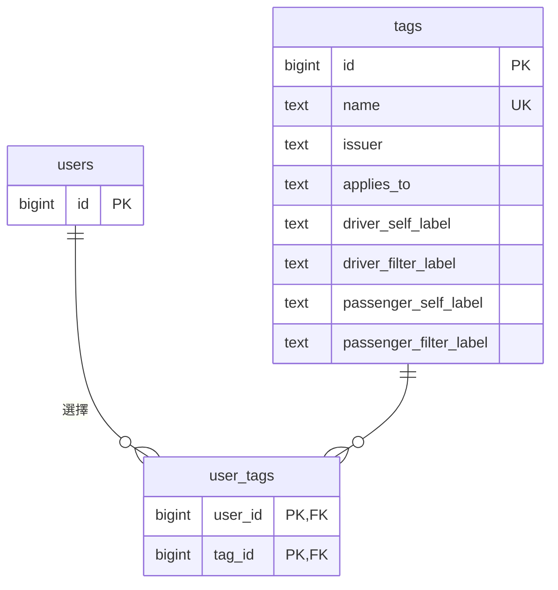

#### DD-05 標籤以預先定義的清單提供，使用者自選；模型保留發行者

決定標籤清單由 SQL 預先建立，使用者只能從清單中選擇或取消選擇適用於自己的標籤，不能新增標籤內容。每個標籤記錄發行者；PoC 只有「使用者自選」一種，篩選比對只看標籤本身、不看發行者。

- 理由：REQ-008 要求預先定義的清單與使用者自選；共用同一份清單，篩選時雙方的標籤才比對得起來。保留發行者，Phase 2 加入企業標籤（US-04）時，只需加入新的發行者與已認證的呈現（REQ-012），媒合不需改動，也維持標籤一視同仁（REQ-014）。
- 考慮過的替代方案：
  - 自由輸入的標籤：同一意思會有不同寫法，篩選比對不起來，也違反 REQ-008。
  - 標籤全部由 SQL 指派給使用者：使用者無法自己選擇，違反 REQ-008。
  - 把公司當成使用者欄位、標籤另存：媒合要分兩套邏輯，容易違反 REQ-014。
- 需求連結：
  - REQ-008
  - REQ-013
  - REQ-014
  - REQ-040
  - REQ-045

#### DD-42 標籤記錄適用的一方與各方的用語，比對仍用同一個標籤

決定每個標籤記錄適用的一方（`applies_to`：`driver`、`passenger` 或 `both`），以及四種用語：駕駛描述自己（`driver_self_label`）、駕駛篩選乘客（`driver_filter_label`）、乘客描述自己（`passenger_self_label`）、乘客篩選駕駛（`passenger_filter_label`）。用語只在適用時才有：標籤適用於駕駛時有駕駛描述自己與乘客篩選駕駛的用語，適用於乘客時有乘客描述自己與駕駛篩選乘客的用語，由 `CHECK` 保證。`name` 只供系統內部辨識，不呈現給使用者。

- 標籤清單 API 依 token 的角色（DD-18）回傳每個標籤描述自己與篩選對方的用語，不適用的用語為空；介面只列出有用語的標籤。
- 使用者選擇不適用於自己角色的標籤，以及篩選條件含有不適用於對方的標籤，後端以 `400` 拒絕（REQ-008、REQ-085）；檢查由標籤元件提供，出發、供給查詢與送出請求共用。
- 駕駛篩選的意圖只能是強制：出發時帶建議意圖的篩選以 `400` 拒絕，`trip_tag_filters.intent` 另以 `CHECK` 限制為 `required`（REQ-013）。乘客的篩選仍可指定強制或建議。
- 比對只看 `tag_id`：駕駛篩選「不抽菸的乘客」與乘客勾選「我不抽菸」是同一個標籤。媒合引擎不讀用語與適用的一方，資格篩選與排序不變（DD-10、DD-11）。
- 每位使用者只有一份標籤紀錄（`user_tags`），同時是駕駛與乘客的使用者，在每一方以該方的用語呈現。

PoC 的標籤清單：

| 標籤（`name`） | 適用 | 駕駛描述自己 | 駕駛篩選乘客 | 乘客描述自己 | 乘客篩選駕駛 |
|---|---|---|---|---|---|
| 不抽菸 | 雙方 | 我不抽菸 | 不抽菸的乘客 | 我不抽菸 | 不抽菸 |
| 安靜通勤 | 雙方 | 開車喜歡安靜 | 喜歡安靜的乘客 | 喜歡安靜 | 安靜坐車 |
| 可聊天 | 雙方 | 可以聊天 | 可以聊天的乘客 | 可以聊天 | 可以聊天 |
| 可載行李 | 駕駛 | 車上能放大件行李 | — | — | 能放大件行李 |

- 理由：同一份清單同時用來描述自己與篩選對方，駕駛與乘客看到一樣的清單，會出現沒有意義的選項（例如駕駛要求乘客「可載行李」），也看不出標籤的方向（REQ-008、REQ-085、REQ-086）。用語與適用的一方記在標籤上，比對仍是同一個 `tag_id`，DD-05 的模型與媒合都不必改。後端也做檢查，其他呼叫者無法繞過介面送出不合理的篩選。
- 考慮過的替代方案：
  - 每一方各建一個標籤，再以對應表連結（例如「駕駛：能放行李」對應「乘客：要能放行李」）：媒合要多一層換算，也容易漏建對應。
  - 只在介面上分開清單與用語：後端仍接受不合理的篩選，無法保證 REQ-085。
  - 每個標籤只存一句用語：無法交代方向，違反 REQ-086。
  - 依角色分開使用者的標籤紀錄：同時是駕駛與乘客的使用者要選兩次；PoC 的帳號都只有一種角色，用不到。
- 需求連結：
  - REQ-008
  - REQ-013
  - REQ-085
  - REQ-086

#### DD-43 「同企業」是介面上的模擬標示，不進入標籤模型

決定「同企業」只由駕駛與乘客介面呈現：模擬企業的名稱「內科示範科技」是兩個介面共用的常數，Demo 的所有帳號都視為這家企業的員工。不建立企業資料、不新增標籤、不改 API；後端、篩選與媒合都不知道有這個標示。

| 介面 | 位置 | 呈現 |
|---|---|---|
| 駕駛 | 出發確認的「我的標籤」 | 已選取、不能取消的「同企業・內科示範科技」 |
| 駕駛 | 行程中的搭車請求 | 「同企業乘客」 |
| 乘客 | 標籤篩選 | 已選取、不能取消的「同企業」 |
| 乘客 | 已確認的請求 | 「駕駛與你同企業：內科示範科技」 |

每個位置都以小字標示為模擬（REQ-063）。標示不能點選：可以切換卻不影響媒合，會讓人誤以為篩選有效。

乘客標籤篩選中的「同企業」不顯示強制或建議，也不送進篩選條件；與可操作的篩選標籤分開呈現（例如列在篩選清單上方）。

- 理由：Demo 要展示「搭同企業同事的車更放心」（G3），但企業標籤（US-04）在 PoC 之後才交付。只在介面呈現，媒合與資料都不必改，也不影響標籤一視同仁（REQ-014）。
- 考慮過的替代方案：
  - 以 SQL 建立一個企業發行的標籤（DD-05 保留的發行者），掛給 Demo 帳號，雙方設為篩選條件：篩選真的有效，但要改後端、種子資料與介面的已認證呈現，Demo 前時間不夠。
  - 在使用者上加公司欄位，比對雙方是否同企業：媒合要多一套邏輯，DD-05 已否決。
- 影響：Phase 2 交付企業標籤（US-04）時，改以真的企業標籤呈現，移除這個常數與標示。畫面顯示模擬企業的名稱只為了 Demo，不代表 OI-03（標籤隱私）已有結論。
- 需求連結：
  - REQ-062
  - REQ-063

### 4.6 上車點與站點

**職責：** 預先定義的上車點（REQ-002）、內湖科學園區的範圍（GeoJSON 檔 `backend/config/park/boundary.geojson`，不存資料庫，由後端載入），以及園區內的公車站；判斷一個地點是否在園區內（出發時的檢查，以及供用戶端查詢，DD-32）、哪些公車站位在某段行程路線的沿途。

**負責需求：** REQ-001、REQ-002、REQ-004、REQ-024

**互動：** 行程管理在出發時檢查上車點與目的地；媒合引擎判斷下車點；用戶端取得上車點清單與地圖標示，並查詢選定的目的地（駕駛的目的地、乘客的最終目的地）是否在園區內。

**資料表：** 兩張表彼此沒有關聯，由 SQL 腳本寫入。

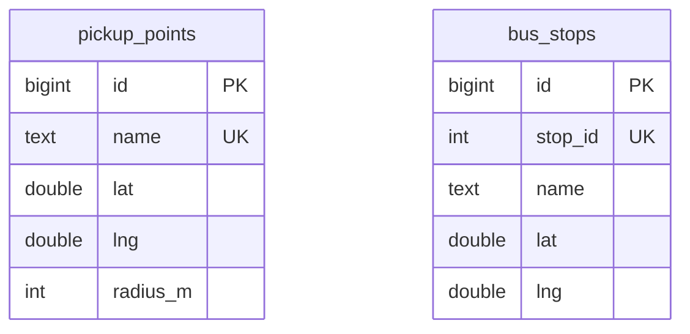

#### DD-32 目的地以 Google Places 搜尋，園區範圍由後端判斷

決定駕駛的目的地與乘客的最終目的地，由用戶端以 Google Places 的自動完成依名稱或地址搜尋選取，選定後取得名稱與經緯度。後端不保存地點清單，另提供 API 判斷一個經緯度是否在內科園區內，用戶端在使用者選定地點後即時提示不在園區內的地點；後端仍在出發時由行程管理檢查目的地、在送出搭車請求時由請求流程檢查最終目的地，不在園區內就拒絕（REQ-001）。

- 理由：REQ-024 要求確切地址，Google Places 已提供依名稱或地址的部分文字搜尋並回傳經緯度；前端已使用 Google Maps，路線來源也是 Google（carpool-oi-02），不增加新的服務商。搜尋結果是公開的地點資料，不含個資（REQ-064）。Places 只能以矩形或圓形限制搜尋範圍，和園區的多邊形不同，所以是否在園區內仍由後端以同一份 GeoJSON 判斷，和出發時的檢查一致。
- 考慮過的替代方案：
  - 以 SQL 預先建立園區地點清單，並自建搜尋 API：要另外維護資料表、搜尋 API 與真實的公開大樓資料，只涵蓋收錄的地點，而 Google Places 已有同樣的能力。
  - Google Geocoding：要輸入完整地址才能轉換成經緯度，不支援輸入部分文字時搜尋。
  - 讓使用者在地圖上點選：手機上操作慢，點選的位置也不是地址（REQ-024）。
  - 用戶端自行以園區多邊形判斷：園區範圍要在前後端各存一份，可能不一致。
  - 不提供判斷 API，出發時才拒絕：駕駛填完整個出發確認才知道目的地不在園區內。
  - 乘客的最終目的地不在園區內時只提示、仍接受請求：行程都在園區內結束（REQ-001），這樣的請求找不到合理的下車點。
- 影響：搜尋目的地需要網路與 Google 金鑰；Google 不可用時無法搜尋新的目的地，預先帶入的設定（REQ-016、REQ-025）仍可使用。
- 需求連結：
  - REQ-001
  - REQ-015
  - REQ-024
  - REQ-064

### 4.7 行程管理

**職責：**

- 駕駛當天的行程：出發（目的地、可載人數、上車點、只載的標籤（一律強制，DD-42）、自動接受），預先帶入上一次的出發設定。
- 出發前預覽「上車點 → 目的地」的行程路線與沿途公車站，不建立行程，保存預覽供出發時引用（DD-21）。
- 出發時檢查上車點是預先定義的上車點之一、目的地位於內科園區內，並建立「上車點 → 目的地」的行程路線（DD-21）。
- 開始行程即代表駕駛表示今天要載人：由位置追蹤建立駕駛的參與主檔並關聯到該行程（DD-25）。
- 行程狀態、已確認的乘客與剩餘座位。
- 位置追蹤判定車輛抵達目的地時結束行程（DD-30）。

**負責需求：** REQ-001、REQ-003、REQ-015、REQ-016、REQ-019、REQ-021、REQ-039、REQ-070

**互動：** 出發時從駕駛上一次的行程取得預設值（首次出發的駕駛沒有預設值）；向上車點與站點檢查地點；向路線與旅行時間估算取得行程路線；開始行程時由位置追蹤建立駕駛的參與主檔；請求流程向行程管理暫留、確認與釋放座位。

**資料表：**

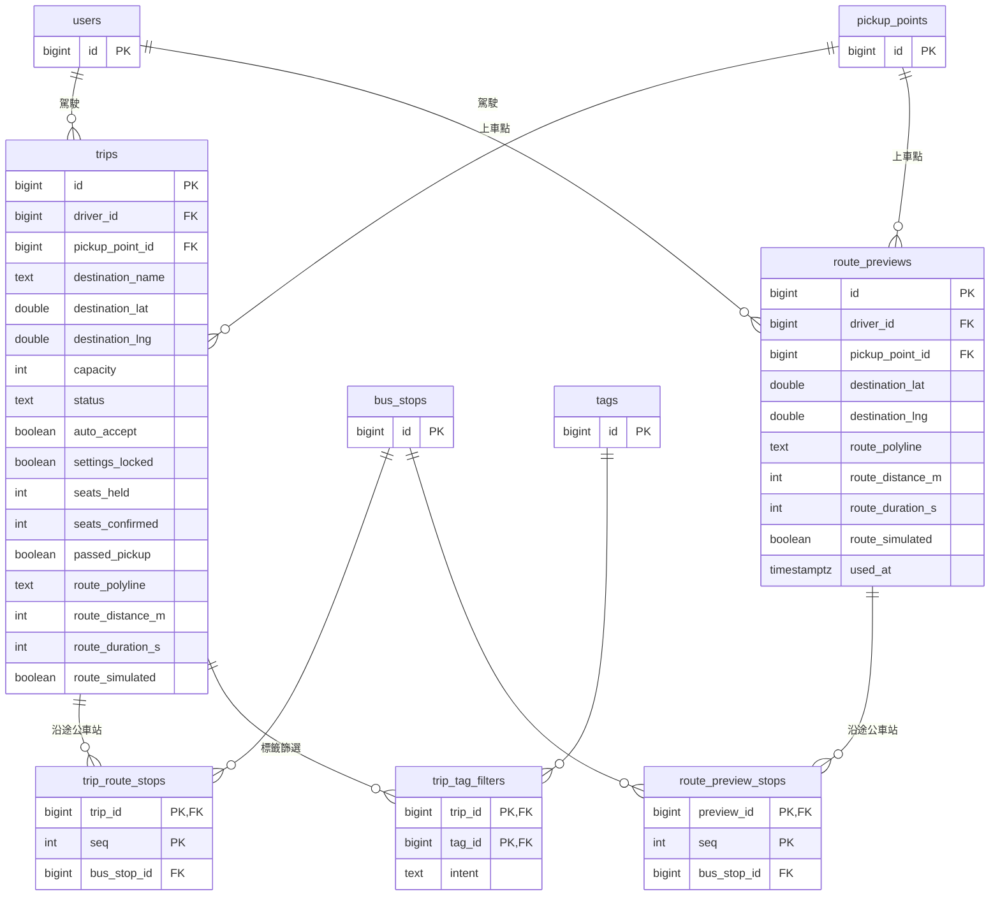

- 座位以 `seats_held`、`seats_confirmed` 計數，並以 `CHECK` 限制總和不超過 `capacity`，使暫留在單一交易內完成（DD-12）。
- `passed_pickup` 由位置追蹤寫入（DD-06）。
- 每位駕駛同一時間只能有一段進行中的行程，由 `trips` 上的部分唯一索引（`driver_id`，限 `status = 'active'`）保證，兩個同時送出的出發請求只有一個會成功，另一個回 `409 already_active`。
- 路線由 `RouteProvider` 介面取得（4.9），連同沿途公車站（距路線 50 公尺內，依行進順序）一起保存。駕駛預覽時呼叫，結果保存在 `route_previews`、`route_preview_stops`；出發時帶預覽編號就複製到 `trips` 的路線欄位與 `trip_route_stops` 並標記預覽已使用（`used_at`），不再呼叫，沒帶預覽編號才呼叫（DD-21）。

#### DD-07 行程開始後設定即鎖定

決定行程的標籤篩選與自動接受設定是出發時的快照，只在出發時寫入；後端沒有任何修改這些設定的 API，因此行程一經開始（出發即開始），設定即鎖定（`settings_locked`）。對設定路徑的修改請求都找不到對應的 API，一律被拒絕（`404`）。

- 理由：駕駛介面不提供行程中的設定入口（DD-04）只是介面層的保護；後端不提供修改設定的 API，才能保證媒合依據在行程中不變，也讓媒合結果可以預期。
- 考慮過的替代方案：
  - 只在用戶端限制：其他呼叫者仍可修改，無法保證 REQ-019。
  - 提供修改 API，但行程開始後以鎖定旗標拒絕：行程一建立就是開始狀態，未鎖定的分支在產品中走不到，只是多餘的程式。
- 需求連結：
  - REQ-019

#### DD-21 出發時建立「上車點 → 目的地」的行程路線並保存

決定每段行程在出發時保存「上車點 → 目的地」的行程路線：路線由路線與旅行時間估算向路線規劃服務取得——出發前預覽時取得並在出發時沿用，出發時沒有帶預覽才在出發時取得。行程路線用來在地圖上顯示（REQ-003），以及判斷沿途會經過哪些公車站、先後順序（REQ-004、REQ-038、REQ-043）。車輛從出發位置到上車點怎麼開不在規劃之內（DD-06）。由 SQL 預先建立的模擬行程，在第一次被使用時補建路線。

出發前，駕駛在出發確認畫面選定上車點與目的地時，行程管理以同樣的方式規劃路線與沿途公車站，供地圖顯示（REQ-003）。預覽不建立行程，但連同沿途公車站保存為一筆預覽，並回傳預覽編號。出發時帶上預覽編號，行程管理就把該預覽的路線與沿途公車站（含是否為模擬估算）複製到行程，不再向路線規劃服務取得，不論預覽是多久之前建立的，讓駕駛出發後的路線一定是預覽時看到的那條。每筆預覽只能被一次出發引用：建立行程時，在同一個交易內把預覽標記為已使用（`used_at`），出發失敗時交易回滾，預覽仍可使用。預覽編號不存在、不屬於該駕駛、已被使用，或預覽的上車點、目的地經緯度與出發設定不同（目的地名稱不列入比對）時，拒絕出發（`400 invalid_route_preview`），不改為重新規劃；出發時沒有帶預覽編號（例如預覽失敗）才重新規劃。出發後行程保有自己的路線與沿途公車站，與預覽不再有關聯；PoC 不清除預覽（見 [1.1](#11-poc-交付範圍)）。

- 理由：路線不預先定義，而是由上車點與終點決定（REQ-001）；在出發時建立一次並保存，媒合、地圖顯示都使用同一條路線，結果一致，也不必每次查詢都呼叫外部服務。媒合只考慮尚未經過上車點的車，所以只需要上車點之後的路線。預覽以編號保存在資料庫，出發時明確引用，後端重啟或有多個執行個體都找得到，也能從外部驗證出發沿用了哪一筆預覽。每筆預覽只對應一次出發確認；再次出發時重新預覽，駕駛看到的是當下規劃的路線。
- 考慮過的替代方案：
  - 預先定義固定路線：違反 REQ-001。
  - 每次查詢時重新規劃路線：慢、花錢，而且同一台車在不同查詢中可能得到不同路線，媒合結果不一致。
  - 連同「出發位置 → 上車點」一起規劃並追蹤：到上車點前怎麼開與媒合無關，只會多出偏離偵測與重新規劃的負擔。
  - 出發前不預覽，出發後才顯示路線：駕駛確認設定時看不到路線（REQ-003）；行程一經出發設定就鎖定（DD-07），看到路線後無法再修改。
  - 預覽時就建立行程、確認後才開始：行程要多一個「尚未開始」的狀態，出發 API 與設定鎖定（DD-07）都要跟著改。
  - 出發時重新規劃，不沿用預覽：真實來源考慮路況（DD-09），預覽與出發之間路線可能改變，駕駛出發後看到的路線與公車站和預覽不同。
  - 預覽暫存在記憶體，出發時以上車點與目的地配對沿用：配對是隱含的，後端重啟或有多個執行個體時找不到暫存，就靜默地重新規劃，路線可能與預覽不同；從外部也無法驗證出發沿用了預覽。
  - 預覽編號無效時改為重新規劃：駕駛出發後的路線可能不是預覽時看到的那條，也掩蓋了用戶端送錯預覽的錯誤。
  - 出發時必須帶預覽編號：預覽失敗時駕駛就不能出發，直接出發的呼叫者（如測試）也都必須先預覽。
  - 同一筆預覽可被多次出發引用：之後的出發會沿用為先前某次出發確認規劃的路線，而不是駕駛當下確認時看到的路線。
- 需求連結：
  - REQ-001
  - REQ-003
  - REQ-004
  - REQ-038
  - REQ-043

### 4.8 位置追蹤

**職責：**

- 在駕駛或乘客表示今天要參與時建立參與主檔，並在有行程可關聯時關聯到行程（DD-25）。
- 接收並完整保存駕駛與乘客回報的每一筆經緯度與時間，歸入回報者最新的參與主檔（DD-06、DD-25）。
- 以駕駛主檔的實際經緯度判斷車輛是否已經過上車點，以及經過後是否已抵達目的地（DD-06、DD-30）。
- 尚未經過上車點時，從車輛當下的經緯度估算到達上車點的時間（ETA）。
- 提供車輛最新的位置，以及由最近兩筆回報算出的行進方向給請求流程（DD-31）。

**負責需求：** REQ-023、REQ-037、REQ-070

**互動：** 從行程管理得知哪些車在行程中及其上車點與目的地，並在行程開始時建立駕駛的參與主檔；判定抵達目的地時通知行程管理結束行程；乘客介面在按下「今天我要搭」時建立乘客的參與主檔；請求流程在請求確認時把乘客的主檔關聯到行程；從模擬器（日後為真實定位）與乘客介面接收駕駛與乘客的位置；向路線與旅行時間估算取得行車時間；從系統設定讀取離開緩衝與抵達距離；提供位置與 ETA 給供給查詢、媒合引擎與請求流程。

**資料表：**

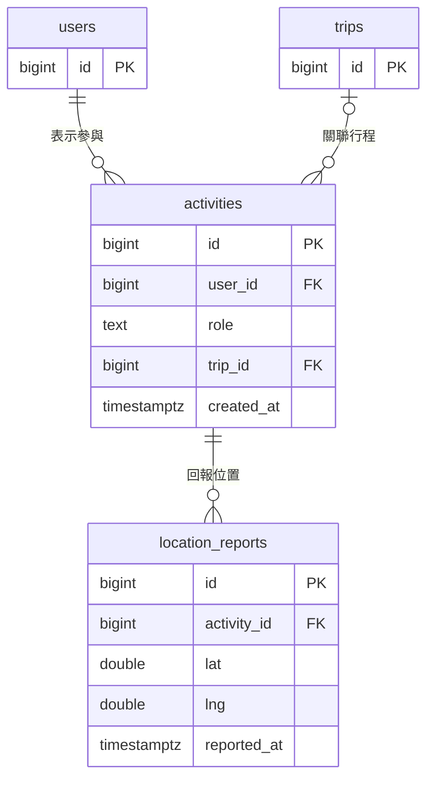

- `activities` 是位置回報的參與主檔（DD-25），每次表示參與建立一筆；每筆回報都歸入該使用者最新的主檔。
- `trip_id` 在有行程可關聯時才填入：駕駛的主檔建立時就關聯到出發的行程，乘客的主檔在請求被確認時關聯。一段行程因此關聯駕駛與各乘客的主檔；判斷是否經過上車點時只讀取 `role` 為駕駛的主檔的回報。
- `location_reports` 只新增、不修改或刪除，由觸發器強制（DD-06）。

#### DD-06 保存原始經緯度；以上車點範圍判斷是否經過，以當下位置估算 ETA

決定駕駛與乘客回報的每一筆位置都以原始經緯度與時間完整保存，歸入回報者的參與主檔（DD-25），不覆寫、不捨棄。車輛的進度只回答兩個問題，兩者都直接以經緯度判斷，不與任何預先規劃的路徑比對：

- **是否已經過上車點**：車輛實際回報的經緯度曾進入上車點周圍的範圍（距上車點不超過範圍半徑），之後又離開到範圍加「離開緩衝」之外（距上車點超過範圍半徑＋離開緩衝）。落在兩者之間的回報不改變判斷。一旦判定經過，就不再改變。離開緩衝是系統設定（4.14），每次判斷時讀取，修改後立即生效。
- **尚未經過時，離上車點多遠**：從車輛當下的經緯度，由路線與旅行時間估算計算到上車點的行車時間（ETA），不以已行駛的時間或距離推估。

車輛到上車點之前怎麼開、是否繞路都不影響判斷，因此不需要偵測是否偏離原本的路線。上車點之後沿途會經過哪些公車站與先後順序，以保存的行程路線（DD-21）判斷。

- 理由：媒合只關心車輛是否已經過上車點，以及還要多久才會到；兩者都能由經緯度直接得到，車輛改道或塞車時也正確。原始經緯度是唯一真實的資料，服務紀錄的實際路徑與日後的分析也需要它。離開緩衝避免車輛停在範圍邊緣等乘客時，定位誤差讓回報稍微跑出範圍，就被誤判為已經過；而「已經過」一旦判定就不再改變，誤判無法回復。
- 考慮過的替代方案：
  - 進入與離開使用同一個門檻（只看範圍半徑）：停在範圍邊緣的車，定位誤差就可能讓它被判定已經過，之後不再被媒合。
  - 把位置投影到預先規劃的路徑上，以沿路徑的距離判斷進度，並偵測偏離後重新規劃：車輛到上車點前的路徑與媒合無關，卻要處理偏離判斷、重新規劃與定位誤差，增加複雜度。
  - 以已行駛的時間或距離推算位置與 ETA：車輛繞路、塞車或停等時就不準。
  - 只保存推算後的結果：無法事後重建實際行駛的路線。
- 需求連結：
  - REQ-023
  - REQ-037
  - REQ-041
  - REQ-055

#### DD-08 位置來源抽象化

決定位置追蹤只透過一個「位置回報」API 接收駕駛與乘客的位置，以呼叫者的 token 區分是誰的位置，不區分來源；模擬器與日後的真實定位都是這個 API 的使用者。回報歸入呼叫者最新的參與主檔（DD-25），從未表示過參與的呼叫者，回報會被拒絕。乘客送出搭車請求時附上的位置只用來檢查送出請求距離（DD-25），同一位置仍經位置回報 API 回報。

- 理由：PoC 的駕駛與乘客位置都是模擬的，但其餘系統不應因此改變；日後換成真實定位時只需換掉位置來源。
- 考慮過的替代方案：
  - 由模擬器直接寫入 ETA：繞過位置追蹤，換成真實定位時要重寫；也無法驗證 ETA 估算本身。
  - 由用戶端計算 ETA：不同用戶端的結果可能不一致，媒合無法依賴。
- 需求連結：
  - REQ-023
  - REQ-034
  - REQ-061

#### DD-25 位置回報歸屬於參與主檔

決定使用者表示今天要參與時，建立一筆參與主檔（`activities`）：駕駛在出發時（表示今天要載人），乘客在按下「今天我要搭」時（表示今天要搭車）。之後的每筆位置回報都歸入該使用者最新的主檔；從未建立過主檔的使用者，回報會被拒絕。主檔在有行程可關聯時關聯到行程：駕駛的主檔建立時就關聯到出發的行程，乘客的主檔在請求被確認時才關聯。伺服器不追蹤主檔何時結束；再次表示參與就建立新的主檔，舊的主檔自然不再使用。

- 乘客按下「今天我要搭」時，乘客介面依序：
  1. 建立參與主檔，並等待完成；
  2. 送出搭車請求，附上乘客當下的位置；同時以非同步方式，把同一位置回報為主檔的第一筆回報。
- 送出請求距離（REQ-034）以請求附上的位置檢查，並保存在請求上（`ride_requests.submitted_lat`、`submitted_lng`），不依賴位置回報，因此不需要位置的有效時限。
- 判斷是否經過上車點（DD-06）只讀取駕駛主檔的回報；同一行程關聯的乘客主檔不影響判斷。
- 理由：駕駛與乘客以同一種方式歸屬回報，只在使用者表示參與之後才記錄位置；乘客要搭車時才開始收集位置。請求附上的位置就是送出當下的位置，送出請求距離的檢查不會用到舊的位置。主檔先建立完成，請求被確認時關聯到行程的就是這次的主檔。以「最新的主檔」取代結束狀態，不需要處理關閉頁面、逾時等結束時機。服務紀錄也能由主檔取得駕駛與乘客的實際路徑（REQ-055）。
- 考慮過的替代方案：
  - 駕駛的回報歸入行程、乘客的回報不歸屬任何紀錄：乘客前一次搭車留下的位置也可能通過送出請求距離的檢查，同一帳號以不同角色的回報也無法區分。
  - 乘客在查看供給之前就開始回報，以最新回報檢查送出請求距離：較早收集乘客位置，還要另訂位置的有效時限，Demo 時表示參與與送出請求之間也要等第一筆回報。
  - 主檔也以非同步方式建立：請求可能在主檔建立前就被確認，使乘客較舊的主檔被關聯到行程。
  - 回報歸入乘客請求（`ride_requests`）：請求必須在送出前就建立，要多一個「尚未送出」的狀態，送出請求距離的檢查與分配時機也要跟著改變（REQ-036）。
  - 由伺服器追蹤主檔的開啟與結束（關閉頁面、關閉按鈕、逾時）：關閉頁面難以可靠偵測，重新整理頁面也會被誤判；沒有任何功能需要知道主檔是否結束。
- 需求連結：
  - REQ-023
  - REQ-034
  - REQ-037
  - REQ-055

#### DD-30 車輛抵達目的地時，行程自動結束

決定車輛經過上車點之後，駕駛回報的經緯度進入駕駛目的地「抵達距離」之內（系統設定，預設 50 公尺），即判定抵達並結束行程（REQ-070）；駕駛介面不提供結束行程的操作。結束時在同一個交易內：

- 車上仍未結束的共乘（已確認或已上車）一併完成，建立服務紀錄並更新常用資料（REQ-067、DD-23）。
- 仍在等待該駕駛回應的請求釋放座位，改配給排序中的下一台車（REQ-050）。

- 理由：駕駛到了目的地自然就是行程結束，不需要多一個操作；行程中畫面維持極簡（REQ-066、DD-04）。判斷沿用 DD-06 的位置判斷，不需要新的資料來源。結束時一併收尾：PoC 沒有取消（1.1），乘客介面又不讓已有請求的乘客再送出（REQ-069），共乘不收尾，乘客就無法再叫車。已確認但沒標記上車的共乘也一併完成，和 DD-23 允許從已確認直接結束一致。只在經過上車點之後判斷，避免目的地離上車點很近時一出發就結束。抵達距離放在系統設定，和其他距離門檻一樣可以調整（DD-20）。
- 考慮過的替代方案：
  - 行程中放「結束行程」按鈕：增加行車中的操作與誤觸風險，違反 REQ-066。
  - 車上沒乘客時才顯示結束按鈕：畫面依情況變動，駕駛要多看一眼。
  - 行程結束時只完成已上車的共乘，已確認的改為未完成：要多一個狀態；乘客又無法取消或再送出。
  - 由 SQL 或模擬器結束行程：Demo 重來時要另外操作，也不代表真實使用情境。
- 影響：定位一直沒有進入抵達距離時，行程不會結束；PoC 的模擬器路徑開到目的地（DD-14），Demo 不受影響，Demo 重設（DD-29）也會結束行程。服務紀錄可能包含沒有標記上車的共乘。
- 需求連結：
  - REQ-050
  - REQ-066
  - REQ-067
  - REQ-070

### 4.9 路線與旅行時間估算

**職責：** 提供四種結果：行程路線（上車點 → 目的地，DD-21）、公車站到乘客最終目的地的步行時間、上車點到下車點的乘車時間、車輛到上車點的行車時間。每個結果都標記來源是真實資料或模擬估算。

**負責需求：** REQ-003、REQ-027、REQ-063；REQ-026 為 Phase 2

**互動：** 呼叫外部的路線規劃服務（Google Routes，carpool-oi-02）；供行程管理、位置追蹤、供給查詢與媒合引擎使用。

#### DD-09 以轉接介面隔離外部資料來源，並提供模擬備援

決定路線與旅行時間估算以統一介面對內提供路徑與時間，對外透過可替換的轉接器呼叫各資料來源；外部來源不可用時，改用簡化估算（例如直線路徑、以直線距離估算時間）並把結果標記為模擬。估算結果可以快取。

對內有三個窄介面，各自都有真實來源與模擬備援兩種實作：

- `RouteProvider`（上車點、目的地 → 路線）：行程管理取得行程路線（DD-21）。
- `DriveTimer`（起點、終點 → 行車時間）：只回傳時間，不產生整條路線。媒合引擎以它取得上車點到下車點的乘車時間，位置追蹤以它取得車輛到上車點的 ETA（DD-06）。
- `WalkProvider`（下車點、最終目的地 → 步行時間）：媒合引擎取得步行時間。

真實來源是 Google Routes（carpool-oi-02）：行程路線與行車時間考慮即時路況，步行時間使用步行模式。模擬備援：路線為兩點間的直線，距離取直線距離 × 1.3；行車速度取時速 20 公里（約每分鐘 333 公尺），步行速度取每分鐘 80 公尺；結果標記為模擬。這些數字是設計取值。

三個介面都包上同一套保護：

- **逾時與斷路器**：每次呼叫外部來源有逾時；錯誤、逾時或斷線就改用模擬備援並標記為模擬。連續失敗數次後暫停呼叫外部來源一段時間，期間直接用模擬備援，之後再試。
- **時間預算**：一次排序（媒合引擎）有總時間預算，約 2 秒。預算用完後，剩下的估算一律用模擬備援，不再呼叫外部來源，也不算作外部來源失敗。預算只用於估算，不用於資料庫操作。行程路線（DD-21）的規劃不計入排序的時間預算：路線會永久保存，若因預算用完而改用模擬，模擬路線會一直留著；路線規劃只受每次呼叫的逾時與斷路器限制。
- **快取**：真實結果放在記憶體快取，依種類、起點與終點區分；車輛位置先對齊到約 50 公尺的格子。行車時間的有效期限短（反映路況），步行時間長；模擬結果不快取，外部來源恢復後立即用回真實資料。

同一次排序可能混用真實時間與模擬估算，每個估算各自標記是否為模擬（REQ-063）。

- 理由：外部來源有費用與頻率限制，Demo 現場也可能斷線；隔離後可以替換來源（[carpool-oi-02](#7-待討論議題)），且 Demo 不因外部服務中斷而失敗。上車點固定且少、目的地都在內科，快取效果好。媒合與 ETA 只需要時間，另立 `DriveTimer` 避免每次都產生整條路線。排序時持有上車點的鎖（DD-12），只有每次呼叫的逾時不夠：多台車、多個下車點的呼叫累加起來會讓後面的請求等很久，因此要有總時間預算；外部來源整個壞掉時，斷路器避免每個請求都等到逾時。
- 考慮過的替代方案：
  - 各元件直接呼叫外部 API：來源一換就要改多處；外部服務失敗會直接讓媒合失敗。
  - 全部預先計算成固定表：無法反映即時路況；最終目的地是任意地址，無法事先算好。
  - 只設每次呼叫的逾時，不設總時間預算與斷路器：外部來源變慢但不逾時，或整個壞掉時，排序會持有上車點的鎖很久，後面的請求全部卡住。
- 影響：混用時，用模擬估算計分的車可能排得比實際前面或後面；每個估算保留模擬標記，畫面依此標示（REQ-063）。
- 需求連結：
  - REQ-003
  - REQ-023
  - REQ-027
  - REQ-042
  - REQ-043
  - REQ-063

### 4.10 供給查詢

**職責：** 乘客到站前的即時供給：依乘客選定的上車點、最終目的地、可接受公車站與篩選條件，找出相關車輛，產生該上車點的卡片（數量、最快到達、剩餘座位）與時間軸（範圍為「等待上限」）。每次乘客介面輪詢時重新計算。各車 ETA 標示是否為模擬（REQ-063、DD-09）。依步行時間建議公車站（REQ-026）為 Phase 2。

**負責需求：** REQ-024、REQ-025、REQ-028、REQ-029、REQ-030、REQ-032、REQ-033、REQ-063；REQ-026 為 Phase 2

**互動：** 使用媒合引擎的資格篩選（DD-10）找出相關車輛；從帳號與身分取得乘客的常用資料作為預設值。

### 4.11 媒合引擎

**職責：** 無狀態的判斷邏輯，提供兩項能力：
1. **資格篩選**：硬性條件
   - 行程的上車點與乘客相同，且車輛尚未經過該上車點
   - 目的地相關：駕駛目的地與乘客最終目的地相距在「地址相符距離」內，或行程路線沿途會經過乘客任一可接受的公車站
   - 扣除已暫留與已確認的乘客後仍有空位
   - 雙向強制標籤都符合
   - 等待時間不超過「等待上限」
2. **排序**：對通過篩選的車計算感受成本（含乘客建議標籤的優先幅度），在駕駛目的地與沿途可接受公車站中選定乘車加步行最短的下車點，依成本與同分規則排序。

**負責需求：** REQ-004、REQ-037、REQ-038、REQ-039、REQ-040、REQ-041、REQ-042、REQ-043、REQ-044、REQ-045

**互動：** 從位置追蹤取得位置與 ETA；從上車點與站點取得沿途公車站；從路線與旅行時間估算取得步行與乘車時間；向標籤判斷篩選；從系統設定讀取參數；被供給查詢與請求流程呼叫。

#### DD-10 供給查詢與媒合共用同一套資格篩選

決定「相關車輛」的判斷只在媒合引擎實作一次，供給查詢與請求流程都呼叫同一套資格篩選；供給查詢只是不做排序與分配。

- 理由：乘客看到的車必須和實際可能被分配的車一致（REQ-028、REQ-030、REQ-033 與 REQ-037～REQ-041 使用同一組條件）；兩處各寫一套，很容易出現「看得到卻配不到」的情況。
- 考慮過的替代方案：
  - 供給查詢自行實作簡化篩選：實作較快，但兩套規則會慢慢不一致。
- 需求連結：
  - REQ-028
  - REQ-030
  - REQ-033
  - REQ-037
  - REQ-038
  - REQ-039
  - REQ-040
  - REQ-041

#### DD-11 媒合引擎不保存狀態

決定媒合引擎只根據呼叫當下的輸入（請求、車輛狀態、參數）產出排序結果，不保存請求或分配狀態；分配、逾時、改配由請求流程負責。

- 理由：排序規則需要依實際情境反覆調整（α、β、標籤加分上限），無狀態的計算最容易測試與用模擬情境驗證（proposal 7.3 的模擬表可以直接當成測試案例）。
- 考慮過的替代方案：
  - 由媒合引擎同時管理請求的生命週期：計分邏輯與逾時、座位等狀態混在一起，難以單獨驗證。
- 需求連結：
  - REQ-042
  - REQ-043
  - REQ-044
  - REQ-045
  - REQ-060

### 4.12 請求流程

**職責：** 每一筆搭車請求的生命週期：檢查送出距離與最終目的地位於園區內（DD-32）、取得排序、立即分配給第一台車或回覆無車可配、等待駕駛回應（含駕駛介面的自動接受，DD-33）、逾時、婉拒或行程結束時改配、未符合全部建議標籤時標示「已放寬」、乘客或駕駛標記乘客已上車（DD-27）、乘客或駕駛結束共乘或行程結束時完成（DD-23、DD-30）、完成後建立服務紀錄並通知帳號與身分更新常用資料。提供駕駛「待回應的請求」與乘客「請求狀態」（已確認時附上車輛位置、行進方向與是否已經過上車點，DD-31）的查詢，供兩個介面輪詢。乘客上車後，若下車點需要調整，由駕駛與乘客自行協商，平台不介入。

**負責需求：** REQ-001、REQ-006、REQ-007、REQ-034、REQ-035、REQ-036、REQ-047、REQ-048、REQ-049、REQ-050、REQ-052、REQ-053、REQ-055、REQ-067、REQ-068、REQ-070

**互動：** 以請求附上的乘客位置檢查送出請求距離（DD-25）；向上車點與站點檢查最終目的地是否在園區內；呼叫媒合引擎排序；向行程管理暫留、確認與釋放座位；請求確認時通知位置追蹤把乘客的參與主檔關聯到該行程；向位置追蹤取得車輛的最新位置與行進方向；完成時寫入服務紀錄，並通知帳號與身分更新駕駛與乘客的常用資料。

**資料表：**

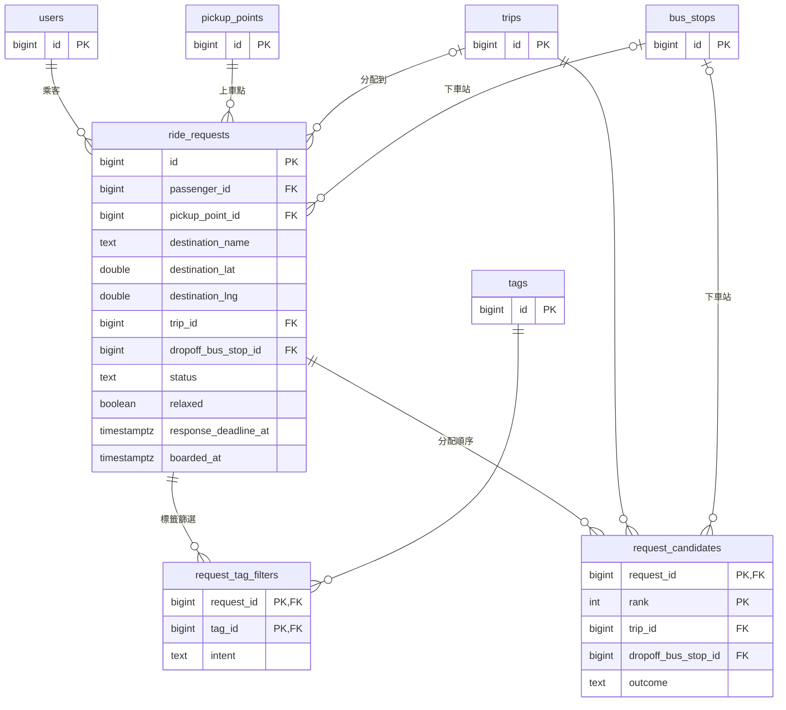

`boarded_at` 記錄標記已上車的時間，共乘完成時複製到服務紀錄的 `picked_up_at`（未標記則為空）。

請求的狀態轉移：

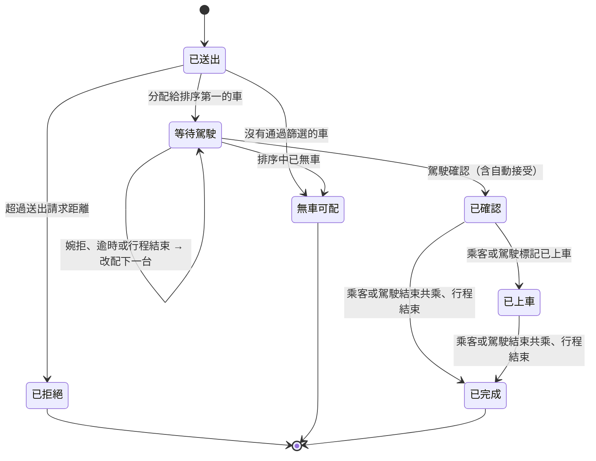

#### DD-27 上車由乘客或駕駛標記

決定乘客上車時，由乘客在乘客介面、或駕駛在行程畫面標記該乘客「已上車」。兩邊的操作都送到請求流程，同一筆請求只會標記一次，先到的操作生效，後到的直接視為已上車。標記不是結束共乘的前提：未標記上車的已確認請求仍可直接結束（DD-23）。已上車不改變座位的佔用，座位維持正式佔用直到共乘完成。

- 理由：讓雙方與系統都知道等待階段已結束，乘客介面不再顯示 ETA 與上車資訊，駕駛也知道哪些已確認乘客已在車上。比照 DD-23 讓雙方都能操作，任一方忘記時另一方仍可標記；不強制先上車再結束，避免漏標記時共乘無法收尾。
- 考慮過的替代方案：
  - 依位置自動判定：Demo 中乘客的位置由除錯模式手動設定（DD-26），而且位置追蹤在車輛經過上車點後就不再追蹤（DD-06），無法可靠判斷乘客是否已在車上。
  - 只讓乘客標記：乘客忘記操作時，駕駛無法更正，雙方對乘客是否已上車的認知不一致。
- 需求連結：
  - REQ-053
  - REQ-066
  - REQ-068

#### DD-23 共乘由乘客或駕駛結束，以乘客為主

決定每位乘客的共乘由乘客在下車後按「結束共乘」完成；駕駛也可以在行程畫面替車上的某位乘客結束。兩邊的操作都送到請求流程，同一筆請求只會完成一次，先到的操作生效，後到的直接視為已完成。行程結束時仍未結束的共乘，由請求流程一併完成（DD-30）。完成時建立服務紀錄，並更新駕駛與乘客的常用資料（DD-19）。

- 理由：共乘何時結束只有當事人知道；以乘客為主，因為乘客下車後有空操作手機，駕駛則正在開車（G5）。保留駕駛的操作，避免乘客忘記結束時共乘一直未完成、座位一直被佔用。
- 考慮過的替代方案：
  - 依車輛到達下車點自動完成：位置追蹤在車輛經過上車點後就不再追蹤（DD-06），而且下車點可能由雙方臨時協商改變。
  - 只讓乘客結束：乘客忘記操作時，座位與共乘狀態無法收尾。
  - 只讓駕駛結束：駕駛正在開車，增加行車中的操作。
- 需求連結：
  - REQ-006
  - REQ-007
  - REQ-055
  - REQ-066
  - REQ-067

#### DD-12 分配時即暫留座位

決定請求分配給某台車時，立即在該行程暫留一個座位；駕駛婉拒或逾時就釋放，確認後轉為正式佔用。座位的暫留與釋放依請求送出的先後順序處理。改配時，請求以改配當下競爭下一台車的座位，而非原本送出的時間；已暫留的座位不會被收回。

- 理由：保證「先送出請求的先」（REQ-048）；也讓其他乘客看到的剩餘座位與實際一致。
- 考慮過的替代方案：
  - 駕駛確認時才佔用座位：兩位乘客可能同時被分配到最後一個座位，後確認的一方會被拒絕，違反先到先得。
- 需求連結：
  - REQ-039
  - REQ-048

#### DD-13 逾時由後端計時

決定駕駛確認時限由後端為每一筆等待中的請求計時，時間到即改配，不依賴駕駛介面回報。

- 理由：駕駛可能沒開 App、網路中斷或根本沒看到請求，這正是逾時要處理的情況；改用輪詢後（DD-03），駕駛介面沒有輪詢時後端仍必須推進流程。
- 考慮過的替代方案：
  - 由駕駛介面倒數後回報逾時：駕駛介面失聯時請求會永遠卡住。
- 需求連結：
  - REQ-050

#### DD-31 已確認的請求狀態附上車輛位置、行進方向與是否已經過上車點

決定乘客的請求狀態在已確認、尚未上車時，附上分配車輛的最新位置、回報時間、行進方向，以及車輛是否已經過上車點（DD-06）。行進方向由後端的位置追蹤計算、不另外保存：取駕駛主檔最近兩筆位置不同的回報，正北為 0 度、順時針；只有一筆回報時為空。車輛尚無回報，或乘客已上車之後，位置為空。請求狀態與供給查詢回傳的 ETA 一併標示是否為模擬（DD-09）。

- 理由：乘客站在路邊要知道車到哪了、哪台是自己的車（REQ-052）。只看 ETA 為空，分不出「已經過上車點」和「還沒有位置」。DD-09 在內部已經標記模擬，只差回傳給介面（REQ-063）。方向要由後端計算：後端保有完整的回報紀錄，乘客介面剛打開或重新整理時只拿到一個位置，無從得知車頭方向。由回報計算，位置回報 API（DD-08）不用改，模擬器和日後的真實定位也不必多送欄位。
- 考慮過的替代方案：
  - 位置回報 API 加方向欄位：所有位置來源都要提供，等於改動 DD-08 的約定。
  - 由乘客介面比較兩次輪詢的位置自己算方向：第一次輪詢時沒有方向，車停住時車頭會亂轉。
  - 不提供車輛位置：乘客看不到車在哪。
  - 介面一律把 ETA 標示為模擬：接上真實來源後就會標錯。
- 影響：已確認的乘客在上車前看得到駕駛的即時位置，上車後就不再提供。駕駛介面不受影響（REQ-066）。
- 需求連結：
  - REQ-052
  - REQ-053
  - REQ-063

### 4.13 服務紀錄

**職責：** 保存每次完成的共乘（駕駛、乘客、行程路線、上車點、下車點、時間）。實際行駛路線可由保存的經緯度紀錄重建（DD-06）。

**負責需求：** REQ-055

**互動：** 由請求流程寫入；帳號與身分讀取以累積常用資料，Phase 2 起依服務紀錄記點（DD-34）；市府管理介面讀取今日完成的共乘數（DD-39）；日後的點數分配、供需統計與「減少車次」統計讀取。

**資料表：**

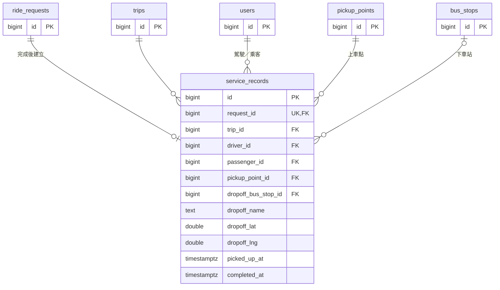

### 4.14 系統設定

**職責：** 保存媒合參數（送出請求距離、地址相符距離、等待上限、等待加重、步行加重、標籤加分上限、駕駛確認時限、離開緩衝、抵達距離），供媒合引擎、供給查詢、請求流程與位置追蹤讀取。Phase 2 加入每次共乘點數（`points_per_ride`，DD-34）與 Demo 模擬時間（`demo_clock`，DD-41）。

**負責需求：** REQ-060

**互動：** 媒合引擎、供給查詢、請求流程與位置追蹤（離開緩衝、抵達距離）讀取參數；Phase 2 的車流與天氣、供需統計與市府管理介面讀取 Demo 模擬時間（DD-41）。

**資料表：** 沒有外鍵，是獨立的參考資料（DD-20）。

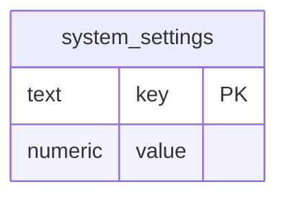

#### DD-20 系統設定以 SQL 維護

決定系統設定在 API 上只供後端元件讀取；營運者以 SQL 直接修改，修改後在之後的媒合中生效，不需重啟服務。

- 理由：PoC 不交付營運設定介面（DD-02）；Demo 前調參數只需改資料庫，仍滿足營運者可以設定參數（REQ-060）。
- 考慮過的替代方案：
  - 寫死在程式碼或設定檔：每次調整都要重新部署，無法在 Demo 前快速調校 α、β 等參數。
  - 提供營運設定介面：PoC 時程內不划算。
- 需求連結：
  - REQ-060

### 4.15 資料庫

**職責：** PostgreSQL（DD-15），保存帳號、標籤清單與使用者選擇的標籤、上車點與公車站、行程與其行程路線、車輛資訊、參與主檔與駕駛及乘客回報的完整經緯度紀錄、請求、服務紀錄、常用資料與系統設定。帳號、標籤清單、上車點、站點、系統設定與模擬行程由 SQL 腳本寫入；其餘由後端寫入。各元件只存取自己負責的資料。

**負責需求：** 無直接對應；支撐所有需求。

**互動：** 後端各元件讀寫；SQL 腳本寫入預先準備的資料。

#### 資料表歸屬

資料表定義於 `backend/migrations/20261018122058_create_schema.sql`。每張資料表由一個元件負責，資料表關聯圖（ERD）放在負責的元件下；圖中只列主鍵、外鍵與關鍵欄位，完整欄位以 migration 為準；本文件描述目標設計，尚未加入 migration 的資料表與欄位以本文件為準。屬於其他元件的資料表在圖中只列主鍵，表示跨元件的參考。

| 元件 | 資料表 |
|---|---|
| [4.4 帳號與身分](#44-帳號與身分) | `users`、`vehicles`、`driver_profiles`、`passenger_profiles`、`passenger_accepted_stops`、`driver_point_ledger`（Phase 2） |
| [4.5 標籤](#45-標籤) | `tags`、`user_tags` |
| [4.6 上車點與站點](#46-上車點與站點) | `pickup_points`、`bus_stops` |
| [4.7 行程管理](#47-行程管理) | `trips`、`trip_route_stops`、`trip_tag_filters`、`route_previews`、`route_preview_stops` |
| [4.8 位置追蹤](#48-位置追蹤) | `activities`、`location_reports` |
| [4.12 請求流程](#412-請求流程) | `ride_requests`、`request_tag_filters`、`request_candidates` |
| [4.13 服務紀錄](#413-服務紀錄) | `service_records` |
| [4.14 系統設定](#414-系統設定) | `system_settings` |
| [4.18 車流與天氣](#418-車流與天氣phase-2) | `traffic_detectors`、`traffic_observations`（Phase 2） |
| [4.19 供需統計](#419-供需統計phase-2) | `supply_demand_stats`（Phase 2） |

### 4.16 模擬器

**職責：** Demo 用，做在駕駛介面的除錯模式中：替選定的每個駕駛帳號，沿預先定義的路徑、以設定的速度前進，並持續回報模擬位置。該駕駛有進行中的行程時（包括 SQL 預先建立的模擬行程，以及真人從駕駛介面出發的行程；兩者都已有關聯到行程的參與主檔，DD-25），沿「出發位置 → 上車點 → 目的地」的路徑回報位置，抵達路徑終點即停止。主畫面的駕駛與其他模擬駕駛各自沿自己的路徑移動，互不影響。模擬狀態不保存，重新整理後須重新啟動，從路徑起點開始。乘客的位置不由模擬器提供，改由乘客介面的除錯模式提供（DD-26）。

這些路徑只供模擬器產生位置，後端不據此追蹤（DD-06）。模擬器另外替 SQL 預先建立的模擬行程（`driver1`～`driver3`）輪詢待回應的請求，行程啟用自動接受時送出確認，與駕駛介面的自動接受相同（DD-33）；從駕駛介面出發的行程由駕駛介面自己確認。模擬器不負責出發、送出請求、婉拒或其他操作。

**負責需求：** REQ-022、REQ-061、REQ-063、REQ-064、REQ-065

**互動：** 以各帳號的 token 透過 API 層得知該駕駛是否有進行中的行程與待回應的請求，透過位置回報 API（DD-08）回報位置，並替 SQL 預先建立的模擬行程在自動接受時呼叫確認 API。

#### DD-14 模擬器是駕駛介面的除錯模式，沿預先定義的路徑回報位置，走公開 API

決定模擬器做在駕駛介面的除錯模式中，只做兩件事：替選定的駕駛帳號，沿預先定義的路徑、以設定的速度前進，並透過位置回報 API 持續回報位置；以及替 SQL 預先建立的模擬行程（`driver1`～`driver3`）依自動接受送出確認（DD-33）；從駕駛介面出發的行程由駕駛介面自己確認，模擬器不替它們確認，以免重複確認。每個帳號的路徑與速度寫在駕駛介面的靜態設定中；只在駕駛有進行中的行程、已有參與主檔時回報（DD-25）。乘客的位置改由乘客介面的除錯模式提供（DD-26）。SQL 預先建立的模擬行程（上車點、內科內的目的地、座位）同時建立駕駛的參與主檔，並啟用自動接受，使它們不需人工操作即可被媒合。

- 理由：PoC 沒有真實定位，所有駕駛的位置都必須由模擬器提供，包括真人操作的帳號；預先定義路徑，Demo 每次的行為都可以重現。模擬器的範圍越小越可靠；位置、ETA、送出請求距離、媒合與座位都經過正式路徑；之後換成真實定位，系統不需要任何改動。啟用自動接受並由模擬器送出確認，模擬駕駛被分配時就不會一路逾時。與乘客介面的除錯模式（DD-26）同一模式，Demo 時不必多啟動、操作一個程式；身分本來就由 token 決定（DD-18），除錯模式可以直接代表多個駕駛帳號。
- 影響：頁面開著即可持續移動，不需保持在前景；位置依經過時間計算。瀏覽器可能降低背景分頁的計時頻率，模擬器須確保回報不會跳過上車點範圍（DD-06）。
- 考慮過的替代方案：
  - 獨立的 Go 模擬器程式：Demo 時要多啟動一個程式，也要另外處理與駕駛介面的帳號對應；好處是不受瀏覽器分頁限制，但 Demo 本來就在同一台機器上開著視窗（DD-24）。
  - 模擬器也模擬出發、送出請求、婉拒等操作：範圍擴大，且與駕駛、乘客介面重複；Demo 時真人操作介面就能展示這些流程。確認是例外：模擬行程沒有人操作駕駛介面，只能由模擬器依自動接受送出。
  - 由使用者在地圖上手動指定位置：Demo 時要多操作，位置也不會持續變化，看不出車輛接近。
  - 由模擬器向路線規劃服務即時取得路徑：每次 Demo 的路徑可能不同，也多依賴外部服務。上車點之後的路徑即使與後端保存的行程路線不同也無妨，後端在車輛經過上車點後不再追蹤（DD-06）。
  - 直接寫入資料庫或在後端內建假資料：快，但繞過位置追蹤，Demo 看到的行為不代表真實系統。
- 需求連結：
  - REQ-022
  - REQ-061
  - REQ-065

### 4.17 PoC 不交付的元件

以下元件屬於完整系統，但 PoC 不交付（見 [1.1](#11-poc-交付範圍)）：

- **企業管理介面**：邀請、移除員工與企業標籤（REQ-009～REQ-012），Phase 2。
- **營運設定介面**：PoC 以 SQL 修改系統設定（DD-20）。
- **供需統計**：REQ-056、REQ-057，Phase 2，見 [4.19](#419-供需統計phase-2)；以歷史統計呈現（[carpool-oi-01](#7-待討論議題)）。
- **車流與天氣**：REQ-076、REQ-077，Phase 2，見 [4.18](#418-車流與天氣phase-2)。
- **市府管理介面**：REQ-078～REQ-082，Phase 2，見 [4.20](#420-市府管理介面phase-2)。
- **駕駛點數與駕駛資訊**：REQ-071～REQ-075，Phase 2，屬於帳號與身分與駕駛介面（DD-34、DD-35）。
- **模擬資料的產生**：REQ-083、REQ-084，Phase 2，見 DD-40、DD-41。
- **下車公車站建議**：REQ-026，Phase 2。

### 4.18 車流與天氣（Phase 2）

**職責：** 保存內湖地區車輛偵測器（VD）的靜態資料，以及每個偵測器每 15 分鐘的車流彙總與該時段的天氣；提供駕駛與乘客的通勤資訊（過去 10 個上班日的車流與天氣、今天的天氣，DD-38）以及市府管理介面的車流熱力圖（DD-39）。

**負責需求：** REQ-063、REQ-076、REQ-077、REQ-079、REQ-083、REQ-084

**互動：** 駕駛介面與乘客介面經 API 層讀取 `GET /api/commute/traffic`（過去 10 個上班日每個時段所有偵測器的總車流量、平均速度與天氣，每天附星期幾）與 `GET /api/commute/weather`（今天在現在之前最新的一筆天氣，並附上現在與今天的日期，DD-41）；市府管理介面讀取 `GET /api/city/traffic`（指定時段每個偵測器的位置與車流量，未指定時為最新時段，即現在之前最後一個完整的 15 分鐘時段（DD-41）；並附主要道路目前與過去 10 個上班日同時段的平均車速）。載客統計（[4.19](#419-供需統計phase-2)）的天氣也從這裡取得。第一版的資料由 SQL 種子寫入（DD-40），日後由轉接介面寫入（DD-36）。

**資料表：**

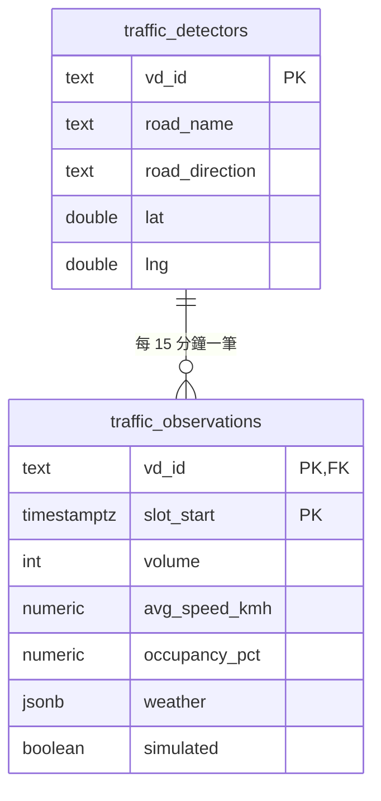

- `traffic_detectors` 對應 TDX「縣市車輛偵測器」靜態資料（`/v2/Road/Traffic/VD/City/Taipei`）的 `VDID`、`RoadName`、`RoadDirection`、`PositionLat`、`PositionLon`。只收內科附近的偵測器：TDX 在內湖範圍約有 63 支，種子取堤頂大道、內湖路一段、環東大道、民權東路六段、成功路四段等主要道路上的 10～15 支。
- `slot_start` 是時段開始的時間，對齊台北時間的 :00、:15、:30、:45；只保存上班時段（07:00–10:00），本服務只處理上班進內科的方向。
- `volume`、`avg_speed_kmh`、`occupancy_pct` 由 TDX 即時資料（`/v2/Road/Traffic/Live/VD/City/Taipei`，每分鐘一筆，每個車道、每種車型各有 `Volume`、`Speed`，每個車道另有 `Occupancy`）彙總：車流量為時段內所有車道、所有車型的加總；速度以車流量加權平均；佔有率為各車道的平均。
- `weather` 保存該時段的天氣，格式取自中央氣象署自動氣象站觀測（O-A0001-001）：`{"station_id", "station_name", "obs_time", "weather", "air_temperature", "precipitation"}`。同一時段的每個偵測器存同一份。
- `simulated` 標示以模擬方式產生的資料，畫面依此標示模擬（REQ-063）。

#### DD-36 車流以偵測器每 15 分鐘彙總保存，欄位對齊 TDX，天氣存在同一列

決定車流以「偵測器 × 15 分鐘」為一筆保存彙總後的數值，欄位對齊 TDX 的車輛偵測器資料；天氣存在同一列的 `weather` 欄位。第一版只有模擬資料，由 DD-40 的產生函式以今天（DD-41）為基準，產生過去 10 個上班日（週一到週五，不扣國定假日）與今天在現在（DD-41）之前的時段的資料，Demo 重設（DD-29）時重新產生，所以任何一天開啟都有過去 10 個上班日與今天的資料。日後以轉接介面（與 DD-09 相同的做法）接入真實資料：`TrafficSource` 每 5 分鐘向 TDX 取得即時資料，彙總成 15 分鐘寫入；`WeatherSource` 向中央氣象署取得天氣。換成真實資料時不需修改資料表與 API。TDX 的金鑰只放在 `.env`，不進入程式碼與文件。

- 理由：TDX 的原始資料每分鐘一筆、細到車道與車型，畫面只需要每 15 分鐘的總量；彙總後保存，查詢簡單、資料量小。欄位對齊 TDX，接真實資料時不必改表。天氣依開發者決定存在車流表：查詢車流時一併取得，不需另外關聯；代價是同一時段的天氣在每個偵測器重複一份，資料量小，可以接受。種子以今天（DD-41）為基準產生，避免固定日期的資料過了幾天就不在「過去 10 個上班日」內。
- 考慮過的替代方案：
  - 保存每分鐘的原始資料：資料量大，畫面用不到這麼細。
  - 天氣另開一張表、每個時段一筆：不重複，但開發者決定存在車流表中。
  - 第一版就接入即時 TDX：要處理金鑰、頻率限制與排程；第一版先以模擬資料驗證畫面與用途。
  - 種子寫死日期：過了幾天就沒有「過去 10 個上班日」的資料。
- 需求連結：
  - REQ-063
  - REQ-076
  - REQ-077
  - REQ-079
  - REQ-083

### 4.19 供需統計（Phase 2）

**職責：** 保存各上車點每 15 分鐘時段的駕駛人數、乘客人數與載客次數（過去 10 個上班日與今天在現在（DD-41）之前的時段，上班時段 07:00–10:00）；提供駕駛與乘客的載客次數，以及市府管理介面的完整統計。

**負責需求：** REQ-056、REQ-063、REQ-080、REQ-082、REQ-083、REQ-084

**互動：** 駕駛介面與乘客介面經 API 層讀取 `GET /api/commute/pickup-rides?pickup_point_id=&from=&to=`：指定上車點過去 10 個上班日每個時段的載客次數，每天附星期幾與天氣（取自 [4.18](#418-車流與天氣phase-2)），以及 `from`～`to` 時段的每日平均與今天同一個星期幾的平均。市府管理介面讀取所有上車點過去 10 個上班日平均每天的駕駛人數、乘客人數與載客次數（DD-39）。今天的數字加上今天實際完成的共乘（服務紀錄，DD-40）。

**資料表：**

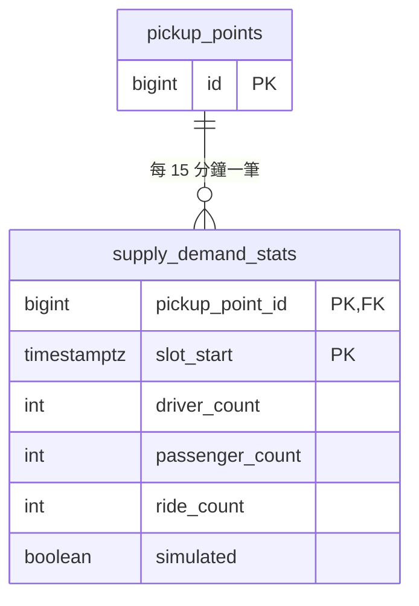

#### DD-37 供需統計以上車點、15 分鐘時段為單位，駕駛與乘客只看載客次數

決定供需統計的單位是「上車點 × 15 分鐘時段」：駕駛人數是該時段從此上車點出發的行程數，乘客人數是該時段在此上車點送出的請求數，載客次數是在此上車點完成的共乘數，歸入該次共乘的請求送出時所在的時段（與乘客人數相同），每個請求只計一次（改配的請求只計最後完成的那一次共乘），所以每一格的載客次數不超過乘客人數，也不會因為完成時間落在時段之外而漏算。駕駛與乘客介面只顯示載客次數（REQ-056）；市府管理介面另外顯示駕駛人數與乘客人數（REQ-080），乘客人數減去載客次數就是沒有搭到車的人。統計不另存天氣，API 依時段從車流表取得同一份天氣（DD-36、DD-40）。第一版只有模擬資料，由 DD-40 的產生函式產生，`simulated` 為 true；日後改由行程、請求與服務紀錄以批次彙整。

- 理由：路線不預先定義（REQ-001），無法依路線統計；公車站是下車點，看不出上車的供需；上車點是駕駛與乘客相遇的地方，正好回答「在這個上車點有沒有生意」。對駕駛與乘客來說，過去真的有人搭成的次數最直接，比駕駛與乘客人數的比較好懂。15 分鐘時段與車流（DD-36）一致，畫面可以並排比較。天氣只存在一處，不會出現兩份對不起來的天氣。系統還沒有足夠的真實歷史資料（OI-05），第一版以模擬資料展示用途。
- 考慮過的替代方案：
  - 依路線統計：路線由上車點與目的地動態決定，沒有固定的路線可以統計。
  - 依公車站統計：公車站只是下車點，不能說明上車點的供需。
  - 查詢時即時由行程與請求彙整：目前沒有足夠的真實資料，模擬資料又不應寫進行程與請求。
  - 依駕駛與乘客人數的比例提示「好載」「好搭」：開發者決定不需要，已從需求中撤回。
  - 統計表也存一份天氣：與車流表的天氣可能對不起來（REQ-083）。
- 影響：統計不分標籤，無法滿足 REQ-057 的標籤篩選（[carpool-oi-14](#7-待討論議題)）。
- 需求連結：
  - REQ-001
  - REQ-056
  - REQ-063
  - REQ-080
  - REQ-083

#### DD-38 通勤資訊是駕駛與乘客介面共用的畫面

決定駕駛與乘客介面共用同一個「通勤資訊」畫面元件（放在 `ui/shared`），由上到下：

1. 今天的天氣。
2. 所選上車點的載客次數：一句摘要（例如「過去 10 個上班日，松山車站 08:00–08:30 平均每天載客 6 次；星期五平均 9 次」），下面是格狀熱力圖，列為日期、欄為 15 分鐘時段，格子是載客次數。上車點預設：駕駛為常用上車點，乘客為目前選擇的上車點；時段預設為現在（DD-41）前後 30 分鐘，Demo 時為 07:45–08:45；現在不在上班時段時（只在沒有設定模擬時間時發生）預設為 08:00–08:30；都可以改選。
3. 過去 10 個上班日的車流格狀熱力圖，列與欄和載客次數相同，顏色深淺表示總車流量。

兩張熱力圖的每一列都標示日期、星期幾與天氣；天氣以該列中雨量最大的那一格代表。模擬資料依 REQ-063 標示。駕駛介面從駕駛資訊抽屜進入（DD-35），乘客介面從最終目的地輸入畫面進入。

- 理由：駕駛與乘客需要的資訊相同。手機寬度上，格狀熱力圖能在一個畫面同時比較多天、多個時段；兩張圖的列與欄相同，載客次數可以和車流、天氣直接對照；地圖熱力圖一次只能看一個時段，留給市府管理介面（DD-39）。駕駛只能從抽屜進入，行程中看不到（REQ-066）。
- 考慮過的替代方案：
  - 手機上也用地圖熱力圖：一次只能看一個時段，看不出每天的尖峰。
  - 折線圖：10 天的線重疊在一起不易閱讀。
  - 駕駛與乘客各自實作：內容相同，重複實作沒有好處。
- 需求連結：
  - REQ-056
  - REQ-063
  - REQ-066
  - REQ-077

### 4.20 市府管理介面（Phase 2）

**職責：** 桌機版面的唯讀儀表板，以輪詢（DD-03）更新，分成四區：

- **即時**：地圖上行程中共乘車輛的不具名位置；路上的共乘車輛數、車上的乘客人數、等待配對的乘客人數、已配對但尚未上車的乘客人數；各上車點等待配對的人數（REQ-078）。
- **車流**：地圖上的內湖車流熱力圖，可選擇歷史時段；主要道路目前與過去 10 個上班日同時段的平均車速（REQ-079）。
- **今日成效**：完成的共乘數、成功配對的比例、無車可配的次數、估計減少的車次（標示為估算）；各上車點今日完成的共乘數（REQ-080）。
- **歷史**：過去 10 個上班日每天的共乘數，附星期幾與天氣（REQ-082）；各上車點過去 10 個上班日平均每天的駕駛人數、乘客人數與載客次數，即 10 天的加總除以 10，與今日成效同樣以一天為單位（REQ-080）。

**負責需求：** REQ-063、REQ-078、REQ-079、REQ-080、REQ-081、REQ-082、REQ-083、REQ-084

**互動：** 以 `city:<帳號>` token 呼叫 `/api/city/live`（即時）、`/api/city/traffic`（車流）、`/api/city/today`（今日成效）、`/api/city/history`（歷史）。即時的資料來自位置追蹤（行程中車輛的最新位置）與請求流程（等待配對、已配對、已上車的請求）；今日成效與歷史來自供需統計（[4.19](#419-供需統計phase-2)）加上服務紀錄與請求（今天實際的共乘，DD-40）；車流與天氣來自 [4.18](#418-車流與天氣phase-2)。

#### DD-39 市府管理介面是獨立的桌機介面，只讀彙總與不具名資料

決定新增第三個使用者介面（`ui/city`），與駕駛、乘客介面分開（DD-02）。新增角色 `city`：`users.is_city_admin`，`users` 的角色限制放寬為駕駛、乘客、市府管理者至少其一；帳號由 SQL 預先建立（DD-19）。`/api/city/*` 只回傳彙總數字與不具名的車輛位置，不含駕駛、乘客的帳號、名稱與車牌（REQ-081）。熱力圖以每個偵測器為一點、以車流量為權重；Google Maps JavaScript API 的 HeatmapLayer 已被 Google 標為淘汰，熱力圖的繪製方式（例如在 Google 地圖上疊 deck.gl 的 HeatmapLayer）由實作者決定。

- 理由：市府管理者在桌機或大螢幕上使用，版面與手機的駕駛、乘客介面不同，依角色分開（DD-02）。只讀、以輪詢更新，不需要新的即時機制（DD-03）。另立角色，即時車輛位置不會被駕駛或乘客 token 取得。
- 考慮過的替代方案：
  - 放在駕駛或乘客介面的除錯模式：儀表板是市府的產品，不是 Demo 工具。
  - 以 WebSocket 推送：DD-03 已決定輪詢，儀表板不需要更即時。
  - 不建角色、免 token：任何人都能取得即時的車輛位置。
- 需求連結：
  - REQ-063
  - REQ-078
  - REQ-079
  - REQ-080
  - REQ-081
  - REQ-082

#### DD-40 模擬資料由同一個產生函式依序產生，彼此一致

決定車流、天氣與上車點統計的模擬資料由同一個 SQL 產生函式依序產生，Demo 重設（DD-29）時整批重新產生：

1. **天氣**：先產生過去 10 個上班日與今天每 15 分鐘的天氣；下雨以連續數小時的降雨呈現，10 天中約 2～3 天下雨。之後的每一步都依這一份天氣。
2. **車流**：每個偵測器依時段呈現尖峰形狀；星期五最多；下雨的時段車流量增加、車速下降；加上隨機變化。天氣寫入同一列（DD-36）。
3. **上車點統計**：乘客人數與駕駛人數依時段、星期幾與天氣變化（星期五最多，下雨時乘客人數增加）；載客次數不超過乘客人數，也不超過駕駛人數乘以平均可載人數。
4. **今天**：只產生今天在現在（DD-41）之前的時段，Demo 時為 07:00–08:15 的 5 格。駕駛、乘客與市府看到的今天的數字，都是今天的模擬統計加上今天實際的共乘（服務紀錄與請求），所以 Demo 現場完成一趟共乘，該上車點的載客次數與儀表板的今日完成數都會加一。Demo 現場的請求計入現在所在的時段（Demo 時為 08:15–08:30，DD-41）；沒有設定模擬時間時，上班時段以外完成的共乘只計入當天的總數（各上車點今日完成數與每天的共乘數），不計入任何時段的格子。

5. **儀表板的即時模擬**：查詢 `/api/city/live` 時，由後端依實際經過的時間計算模擬的車輛與等待的乘客，不寫入資料庫：約 30～40 台車沿模擬器預先定義的路徑（DD-14）從三個上車點駛向內科，各有不同的出發時間；以現在（DD-41，Demo 時為 08:15）的早上尖峰規模呈現，不依實際時鐘；模擬車輛以固定的一輪呈現：一輪約 30～40 台，從最近一次 Demo 重設後第一次查詢儀表板時開始（當天沒有重設時，從當天第一次查詢開始），在約 15 分鐘內依序出發，跑完一輪後不再產生新的車，所以 Demo 最後打開儀表板時，地圖上正好是一輪尖峰。每台模擬車輛載 1～3 位模擬乘客，車輛到達上車點前，這些乘客顯示為等待配對或已配對。車輛抵達目的地時，它的每位乘客同時計為今天該上車點一筆送出且配對成功的請求，以及一次完成的共乘；所以今天的總數只加上這一輪中已抵達的車，成功配對的比例與無車可配的次數照常計算。回應中的模擬部分標示為模擬（REQ-063），並與真實的行程、請求、位置紀錄合併。

即時模擬不寫入行程與請求，所以不影響媒合與乘客介面的供給；代價是儀表板即時區的車比駕駛、乘客介面看得到的多。Demo 最後才展示儀表板，那時駕駛與乘客的操作已經結束，這是開發者接受的唯一例外（REQ-083）。模擬的歷史資料把配對視同完成：每天的共乘數、成功配對的比例與無車可配的次數都由上車點統計加總或相減而來（無車可配 = 乘客人數 − 載客次數），不另外產生。今天實際的部分依請求狀態計算：無車可配 = 結果為無車可配的請求數，成功配對 = 已確認、已上車或已完成的請求數；尚未結束的請求不算無車可配。

隨機變化以今天（DD-41）的日期作為亂數種子：同一天重設多次，模擬資料都相同，所以預演與正式 Demo 看到的數字一樣。

- 理由：觀眾會在駕駛、乘客畫面與儀表板之間對照數字（REQ-083）；所有數字從同一份天氣與同一張統計表推導，加總與天氣一定對得起來，星期與天氣的影響也合理。即時模擬依時間計算、亂數以日期為種子，同一時刻查詢結果相同，不必儲存。
- 考慮過的替代方案：
  - 每張表各自隨機產生：天氣、星期的變化在不同表之間對不起來。
  - 即時區只顯示真實的行程：和駕駛、乘客介面完全一致，但 Demo 只有幾台車，看不出尖峰的樣貌；開發者決定加入模擬車輛。
  - 把模擬車輛寫成真的行程：乘客介面會看到這些車並向它們叫車，干擾 Demo 的媒合流程。
  - 今天的數字只用模擬資料：Demo 現場完成共乘後，儀表板沒有變化。
  - 每次重設都重新隨機：預演與正式 Demo 看到的數字不同，不容易準備講稿。
- 影響：上車點統計不分帳號，與模擬駕駛的點數紀錄（DD-34）沒有對應關係；儀表板不顯示個別駕駛的點數，所以不會對不起來。
- 需求連結：
  - REQ-056
  - REQ-063
  - REQ-076
  - REQ-080
  - REQ-082
  - REQ-083

#### DD-41 Phase 2 的資料以 Demo 模擬時間作為現在

決定車流與天氣、供需統計與市府管理介面的後端，都由同一個函式取得「現在」，不直接讀取系統時鐘。系統設定（DD-20）有 `demo_clock`（以當天 0 點起的分鐘數保存，預設 495，即 08:15）時，現在是今天的 08:15；今天的日期是實際的日期，遇到星期六或星期日時改為下一個星期一。沒有這一列時使用實際的日期與時間。

- **最新時段**：現在之前最後一個完整的 15 分鐘時段，Demo 時為 08:00–08:15。
- **過去 10 個上班日**：從今天的前一個上班日往前算。10/24（星期六）Demo 時，今天是 10/26（星期一），過去 10 個上班日是 10/12～10/23。
- **今天實際的共乘**：實際日期為當天的服務紀錄與請求，不論實際的送出時間，都計入今天、現在所在的時段（Demo 時為 08:15–08:30）。
- **亂數種子**：DD-40 使用今天的日期；10/24 與 10/25 的今天都是 10/26，所以 Demo 當天的預演與正式 Demo 看到相同的數字。
- **範圍**：只用在 Phase 2 的資料與畫面；媒合、行程、請求流程、逾時（DD-13）與 Demo 重設仍使用實際時鐘。
- **前端**：不自行計算現在；通勤資訊的預設時段依 `/api/commute/weather` 回應中的現在決定。

- 理由：Demo 的情境是上班日早上的尖峰，但 10/24 是星期六，Demo 也可能在下午；依實際時鐘，今天沒有上班時段的資料，車流地圖也只能顯示 09:45 那一格。固定在 08:15，預演與正式 Demo 看到的畫面相同；所有元件從同一個函式取得現在，數字才對得起來（REQ-083）。
- 考慮過的替代方案：
  - 從 Demo 重設時的 08:15 開始隨實際時間往前走：比較真實，但 Demo 拖長就會超出上班時段，每次預演的數字也不同；開發者決定固定。
  - 整個系統都使用模擬時間：會動到 PoC 已交付的媒合與逾時，影響 10/24 的 Demo；開發者決定只用在 Phase 2。
  - 週末時把星期六當成上班日：違反資料只有上班日的設計，星期幾的規律也會顯得奇怪。
  - 週末時改為前一個上班日（星期五）：星期五是一週車流與共乘最多的一天，Demo 的數字會偏高；開發者決定改為下一個上班日。
- 影響：行程畫面上的時間（實際時鐘）與通勤資訊的「今天」可能不是同一天；兩者分屬不同畫面，Demo 不會並排呈現。
- 需求連結：
  - REQ-056
  - REQ-060
  - REQ-079
  - REQ-083
  - REQ-084

## 5. 主要互動流程

### 5.1 駕駛出發與車輛移動

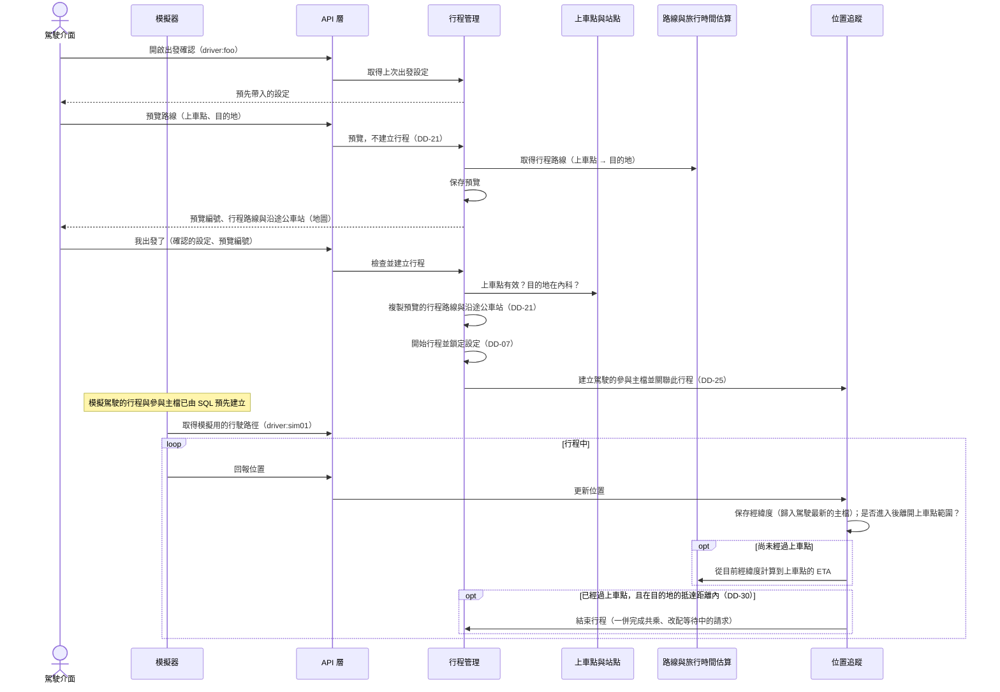

### 5.2 乘客查看供給

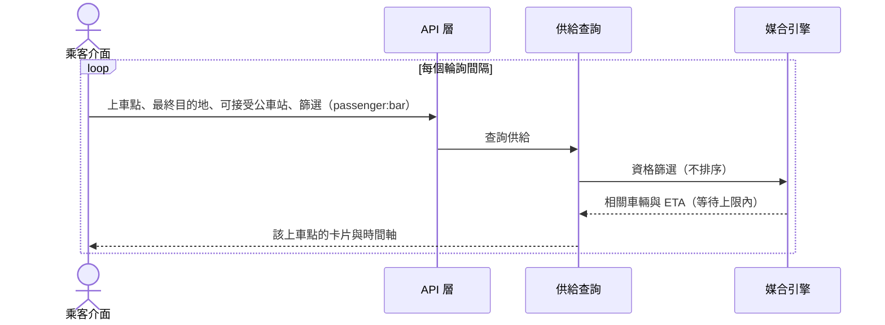

### 5.3 搭車請求、媒合與確認

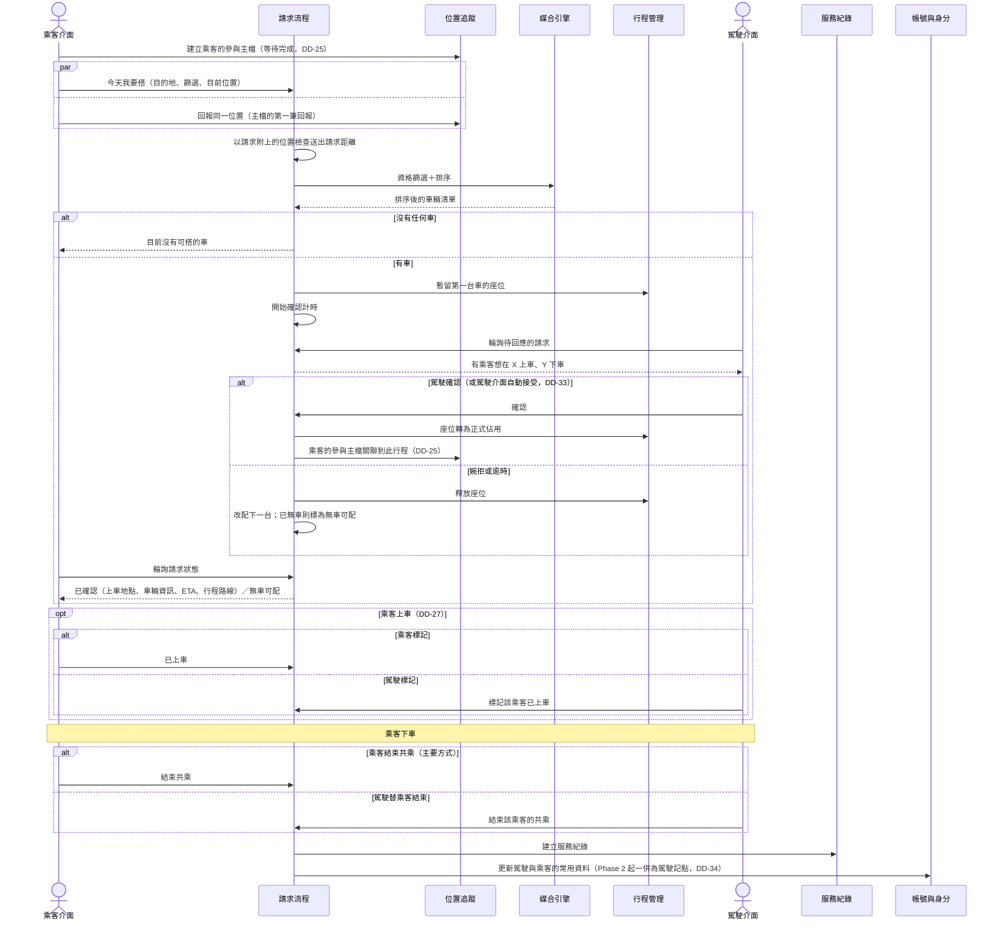

## 6. 需求對應

| 主題（requirement.md） | 主要負責元件 | PoC |
|---|---|---|
| 4. 路線與站點 | 上車點與站點、行程管理、請求流程、路線與旅行時間估算、駕駛介面、乘客介面 | 交付 |
| 5. 帳號與身分 | 帳號與身分、請求流程、駕駛介面（駕駛資訊抽屜） | 交付（帳號由 SQL 預先建立）；US-25 為 Phase 2 |
| 6. 標籤與企業認證 | 標籤、駕駛介面、乘客介面 | 交付使用者自選標籤；US-04 為 Phase 2 |
| 7. 駕駛出發 | 行程管理、駕駛介面（含自動接受）、模擬器（模擬行程的自動接受） | 交付 |
| 8. 乘客查看供給 | 供給查詢、位置追蹤、路線與旅行時間估算、媒合引擎（資格篩選） | 交付；REQ-026 為 Phase 2 |
| 9. 搭車請求與媒合 | 請求流程、媒合引擎、乘客介面 | 交付；REQ-051 依範圍決定不交付；REQ-069 只由乘客介面防止 |
| 10. 確認與行程 | 請求流程、行程管理、位置追蹤（抵達判定）、服務紀錄、帳號與身分（點數） | 交付（輪詢）；US-24 為 Phase 2 |
| 11. 供需狀況 | 供需統計、車流與天氣、市府管理介面、駕駛介面與乘客介面（通勤資訊） | Phase 2 |
| 12. 系統設定 | 系統設定 | 交付（SQL 維護）；Phase 2 的參數隨各功能交付 |
| 13. Demo 與模擬資料 | 駕駛介面與乘客介面（同企業標示，DD-43）、模擬器、路線與旅行時間估算（模擬標記）、SQL 腳本、Demo 重設（DD-29）、模擬資料產生函式（DD-40）、Demo 模擬時間（DD-41） | 交付；REQ-062 只在介面呈現（DD-43）；REQ-083、REQ-084 為 Phase 2 |

## 7. 待討論議題

| ID | 標題 | 說明 | 狀態 | 決定 |
|---|---|---|---|---|
| carpool-oi-01 | 供需統計的資料來源 | 使用登記資料、服務紀錄，或使用者事先登記隔天的角色？ | 已決定 | 依歷史資料預測，Phase 2 交付；冷啟動時的呈現仍待確認（requirement OI-05） |
| carpool-oi-02 | 路線、步行時間與路況的資料來源 | 路線規劃：地圖服務的路線 API；步行：Google Maps Routes、OpenRouteService、自架 OSRM／Valhalla 或簡化估算；路況：TDX 即時車速或路線規劃 API。需考慮費用、頻率限制與 Demo 穩定度。 | 已決定 | 採用 Google Routes：一個 API 涵蓋行程路線、考慮路況的行車時間與步行時間，前端也已使用 Google Maps；路況不另外接 TDX。外部來源不可用時改用模擬備援（DD-09） |
| carpool-oi-03 | App 不在前景時的駕駛通知 | 駕駛開車時 App 可能在背景，是否需要手機系統推播或語音提示？ | 已決定 | PoC 以輪詢取得狀態（DD-03），App 必須在前景；手機推播日後再評估 |
| carpool-oi-04 | 乘客與駕駛位置的取得方式 | 真實定位不在範圍內，但送出請求距離（REQ-034）需要乘客位置，是否經過上車點與 ETA（DD-06）需要車輛位置。 | 已決定 | 模擬器替駕駛與乘客沿預先定義的路徑持續回報位置（DD-14）；乘客的位置後來改由乘客介面的除錯模式提供（DD-26）；模擬器後來改做在駕駛介面的除錯模式（DD-14） |
| carpool-oi-05 | 共乘完成的判定 | 由駕駛、乘客、車輛到達下車點，或其他事件觸發完成並建立服務紀錄？常用資料的更新（DD-19）也依此觸發。 | 已決定 | 乘客或駕駛都可以結束乘客的共乘，以乘客為主（REQ-067、DD-23） |
| carpool-oi-06 | 指定標籤請求的優先順序 | 「有指定標籤的請求優先媒合」是否仍存在？若存在，會影響請求流程的座位暫留順序（DD-12）。 | 已決定 | 沒有另外的優先規則。強制標籤篩選是硬性條件（REQ-040），建議標籤篩選是計分因素、會影響排序（REQ-045）；座位競爭仍依送出順序（REQ-048、DD-12） |
| carpool-oi-07 | 技術選型 | 後端與前端的語言、框架與資料儲存。 | 已決定 | 後端 Go、資料庫 PostgreSQL、前端 React + Tailwind（DD-15～DD-17） |
| carpool-oi-08 | 部署平台 | 後端、資料庫與前端部署在哪裡，Demo 當天如何讓觀眾開啟。 | 已決定 | Demo 時全部在同一台機器上本地執行（DD-24） |
| carpool-oi-09 | 輪詢間隔與確認時限 | 駕駛介面、乘客介面的輪詢間隔，以及對應的駕駛確認時限預設值（DD-03）。 | 已決定 | 駕駛確認時限預設 60 秒（REQ-060），以 SQL 調整（DD-20）；輪詢間隔駕駛介面 2 秒、乘客介面 3 秒 |
| carpool-oi-10 | REQ-062 與範圍決定衝突 | REQ-062 要求模擬企業與企業標籤，但 OVERVIEW 第 9 節決定 PoC 只有使用者自選的標籤，且企業標籤（US-04）已移到 Phase 2。REQ-062 是否也應移到 Phase 2？ | 已決定 | REQ-062 改為只在介面上以模擬企業呈現「同企業」標示，不建立企業標籤、不影響媒合（DD-43）；企業標籤仍為 Phase 2 |
| carpool-oi-11 | 位置回報歸屬於哪個主檔 | 駕駛開始行程後才回報位置（DD-14），回報歸入該行程；乘客的回報目前不屬於任何主檔。送出請求距離（REQ-034）在送出請求當下就需要乘客位置，因此乘客必須在請求建立前就開始回報。可能做法：(A) 回報歸入乘客請求（ride_requests）：乘客表示要搭車時就建立請求，送出時再檢查距離與媒合，需要多一個「尚未送出」的狀態；(B) 新增「活動」主檔：使用者表示參與時建立（駕駛在出發並表示今天要載人時，乘客在表示今天要搭車時），之後的每筆回報都歸入該使用者最新的主檔，從未建立過主檔就拒絕回報。主檔在有行程可關聯時關聯到行程：駕駛的主檔建立時就關聯到出發的行程，乘客的主檔在請求被確認時關聯。伺服器不追蹤主檔是否結束：再次表示參與就建立新的主檔，舊的主檔自然不再使用。送出請求距離（REQ-034）以目前主檔的最新回報檢查，且該回報必須夠新（時間待定）。 | 已決定 | 採做法 B，新增參與主檔（DD-25）；乘客在按下「今天我要搭」時才建立主檔，送出請求距離以請求附上的位置檢查 |
| carpool-oi-12 | PoC 乘客位置的來源 | 乘客送出請求時要附上當下的位置（DD-25），但 PoC 沒有真實定位，乘客介面不知道自己的位置；瀏覽器定位會得到 Demo 現場的位置。可能做法：(a) 乘客介面從網址參數取得 Demo 位置（與目前從網址取得帳號的方式相同），日後換成真實定位；(b) 向後端查詢模擬器回報的最新位置，但乘客又要在送出前就開始回報；(c) 瀏覽器定位加上 Demo 用的覆寫。另需決定：送出請求之後，模擬器是否還替乘客沿路徑回報位置（只影響服務紀錄中乘客的實際路徑）。 | 已決定 | 乘客介面的除錯模式設定目前位置，並在參與主檔建立後持續送出位置（DD-26）；日後換成真實定位 |
| carpool-oi-13 | 乘客取消請求 | 需求與設計都沒有乘客取消搭車請求的操作；乘客介面又不讓已有尚未結束請求的乘客再送出（REQ-069）。 | 已決定 | 範圍決定，PoC 不提供取消功能：等待駕駛的請求一定會經確認、逾時改配或無車可配結束（DD-13）；已確認或已上車的請求可以結束共乘（DD-23）。乘客介面在請求尚未結束時顯示「取消請求」按鈕作為示意，按下不做任何事 |
| carpool-oi-14 | 供需統計的標籤篩選 | REQ-057 要求套用標籤篩選檢視供需狀況，但上車點統計（DD-37）以上車點與時段彙總，不分標籤。可能做法：(A) 統計多一個標籤維度；(B) 查詢時由行程與請求即時彙整，有足夠的真實資料後才可行；(C) REQ-057 延後到有真實資料之後。 | 待討論 | Phase 2 第一版不支援標籤篩選 |
