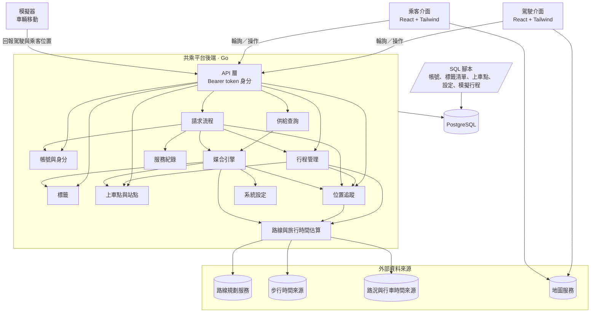
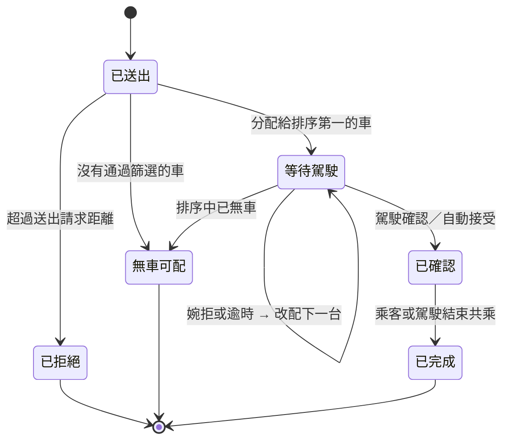
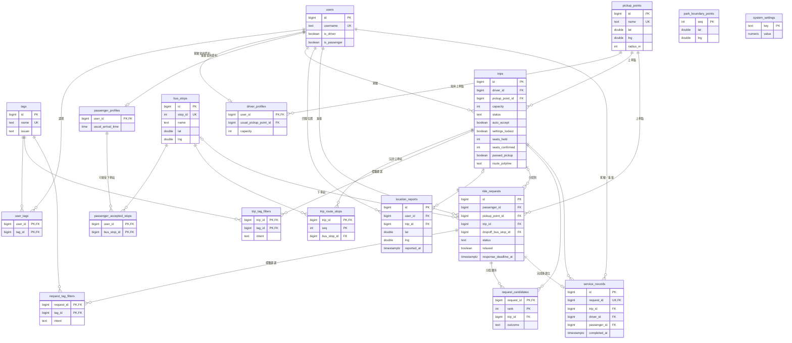
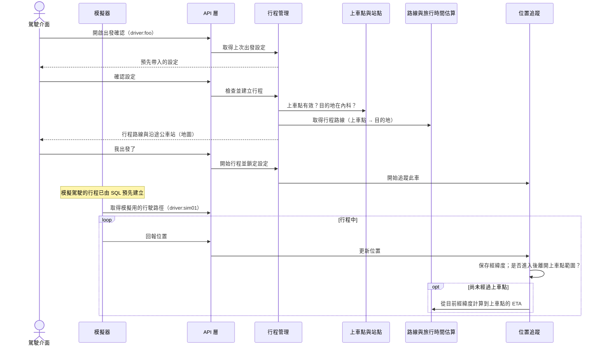
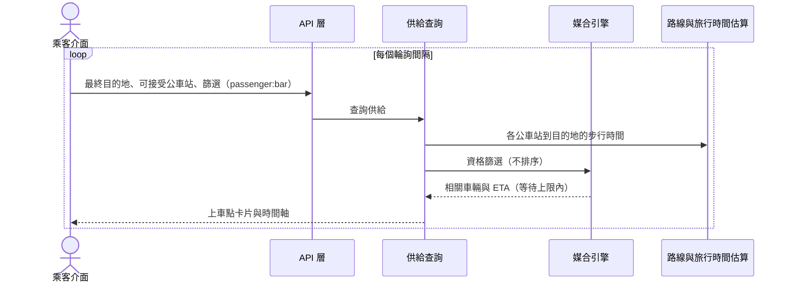
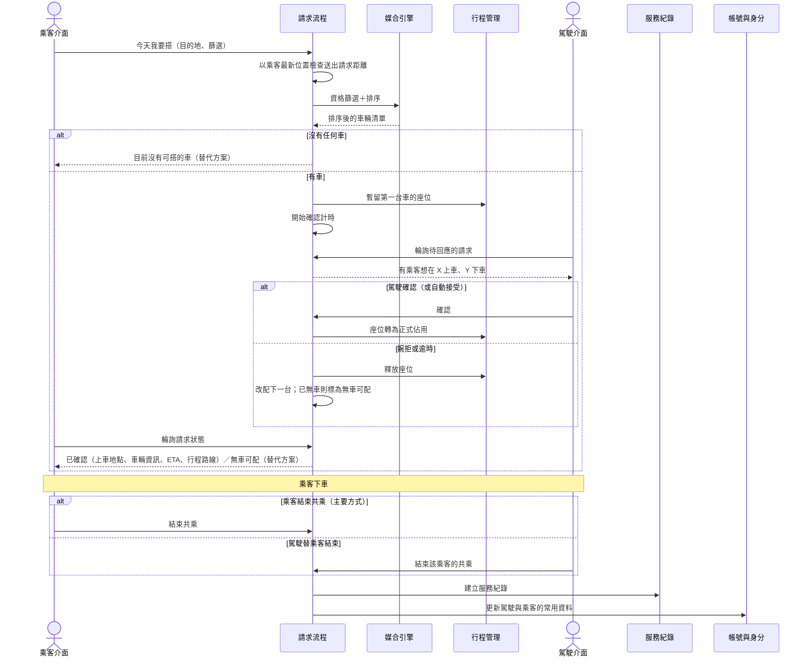

# 內科順路共乘 — 第一層設計：系統架構

議題 #4 · 來源文件：[點子發想（proposal.md）](proposal.md)、[需求規格（requirement.md）](requirement.md)、[範圍決定（OVERVIEW.md 第 9 節）](../OVERVIEW.md#9-範圍決定)

> [!NOTE]
> **第一層設計**只描述系統架構、元件與元件之間的互動。各元件的細部設計（資料結構、演算法細節、介面規格）之後另外補上。

## 目錄

1. [設計範圍與前提](#1-設計範圍與前提)
   - [1.1 PoC 交付範圍](#11-poc-交付範圍)
2. [文件慣例](#2-文件慣例)
3. [系統架構](#3-系統架構)
   - [3.1 架構圖](#31-架構圖)
   - [3.2 架構層級的設計決定](#32-架構層級的設計決定)
4. [元件](#4-元件)
   - [4.1 駕駛介面](#41-駕駛介面)
   - [4.2 乘客介面](#42-乘客介面)
   - [4.3 API 層](#43-api-層)
   - [4.4 帳號與身分](#44-帳號與身分)
   - [4.5 標籤](#45-標籤)
   - [4.6 上車點與站點](#46-上車點與站點)
   - [4.7 行程管理](#47-行程管理)
   - [4.8 位置追蹤](#48-位置追蹤)
   - [4.9 路線與旅行時間估算](#49-路線與旅行時間估算)
   - [4.10 供給查詢](#410-供給查詢)
   - [4.11 媒合引擎](#411-媒合引擎)
   - [4.12 請求流程](#412-請求流程)
   - [4.13 服務紀錄](#413-服務紀錄)
   - [4.14 系統設定](#414-系統設定)
   - [4.15 資料庫](#415-資料庫)
     - [資料表關聯圖（ERD）](#資料表關聯圖erd)
   - [4.16 模擬器](#416-模擬器)
   - [4.17 PoC 不交付的元件](#417-poc-不交付的元件)
5. [主要互動流程](#5-主要互動流程)
   - [5.1 駕駛出發與車輛移動](#51-駕駛出發與車輛移動)
   - [5.2 乘客查看供給](#52-乘客查看供給)
   - [5.3 搭車請求、媒合與確認](#53-搭車請求媒合與確認)
6. [需求對應](#6-需求對應)
7. [待討論議題](#7-待討論議題)

## 1. 設計範圍與前提

- **時程**：10/24 一天內做出可現場操作的 PoC（G6），架構要簡單、能快速完成。
- **技術選型**：後端 Go、資料庫 PostgreSQL、前端 React + Tailwind（DD-15～DD-17）。
- **資料**：帳號、預先定義的標籤、上車點與系統設定由 SQL 腳本預先建立；駕駛與乘客都是模擬帳號（2 個乘客、5 個駕駛）。不使用真實個資（REQ-063、REQ-064）。
- **範圍外**：金流與點數、真實定位、真實身分驗證、法規處理。服務紀錄要保留足夠資訊，讓之後的點數分配可以建立在上面。
- **上車點固定，路線動態決定**：預先定義的只有上車點；每段行程的路線由上車點與內科內的終點決定（REQ-001）。媒合只需比對「同一個上車點、時間接近、目的地相關」，不需要任意地點叫車。

### 1.1 PoC 交付範圍

PoC 只交付**駕駛介面**與**乘客介面**。Phase 1 的需求全部由本設計滿足；以下需求不在 PoC 中交付：

| 需求 | 原因 | 說明 |
|---|---|---|
| REQ-009～REQ-012 | Phase 2 | 企業標籤（US-04）；標籤模型保留發行者，日後加入時媒合不需改動（DD-05） |
| REQ-026 | Phase 2 | 不建議下車公車站，由乘客自行選擇 |
| REQ-056～REQ-059 | Phase 2 | 依歷史資料預測的供需狀況（US-19） |
| REQ-062 | 範圍決定 | OVERVIEW 第 9 節決定 PoC 只有使用者自選的標籤，因此不建立模擬企業；與 REQ-062 衝突（[carpool-oi-10](#7-待討論議題)） |

## 2. 文件慣例

- **元件**：第 4 節逐一說明每個元件的職責、負責的需求與互動對象。
- **設計決定**：編號為 `DD-nn`，放在所屬的元件下（架構層級的決定放在 [3.2](#32-架構層級的設計決定)）。每個決定的句子以「**決定**」開頭，並列出理由、考慮過的替代方案（含未採用原因）與需求連結。編號是永久的，不會重新編號。
- **待討論議題**：編號為 `carpool-oi-nn`，見 [第 7 節](#7-待討論議題)。
- 顯而易見、沒有實際替代方案的做法不另立設計決定；實作細節由實作者決定。

## 3. 系統架構

### 3.1 架構圖

**分層說明：**

- **用戶端**：駕駛介面與乘客介面是兩個分開的介面，都以輪詢向後端取得狀態。
- **模擬器**：Demo 用的獨立程式，只負責沿預先定義的路徑，持續回報駕駛與乘客的模擬位置，以和真實定位相同的方式回報。
- **後端**：單一 Go 服務，內部依職責切成元件。核心是兩條鏈：
  - **供給鏈**：行程管理（含行程路線）→ 位置追蹤（位置與 ETA）
  - **媒合鏈**：請求流程 → 媒合引擎
  - **參考資料**：帳號與身分、標籤、上車點與站點、系統設定、路線與旅行時間估算
- **資料層**：單一 PostgreSQL 資料庫。帳號、標籤清單、上車點、系統設定與模擬行程由 SQL 腳本寫入；使用者選擇的標籤、從共乘累積的常用資料、行程與請求由後端寫入。
- **外部資料來源**：路線規劃、步行時間、路況與行車時間由路線與旅行時間估算存取；地圖底圖由用戶端直接取得。

### 3.2 架構層級的設計決定

#### DD-01 單一後端服務

決定後端以單一可部署的 Go 服務實作，內部依第 4 節的元件切分模組，模組之間只透過明確的介面互動。

- 理由：一天內要完成並部署；單一服務最容易開發、除錯與 Demo。依元件切分模組，日後仍可拆分。
- 考慮過的替代方案：
  - 微服務：部署、服務間通訊與除錯的成本，在黑客松時程內不划算。
  - 只用後端即服務（BaaS）加用戶端邏輯：媒合、逾時改配、座位競爭需要伺服器端一致的判斷，放在用戶端無法保證先到先得與公平性。
- 需求連結：
  - REQ-036
  - REQ-048
  - REQ-065

#### DD-02 依角色分開的使用者介面，PoC 只交付駕駛與乘客

決定每種角色各有自己的介面，不在同一個介面中切換角色；PoC 只交付駕駛介面與乘客介面。企業管理介面屬於 Phase 2，營運設定以 SQL 處理（DD-20）。兩個介面是否共用程式碼由實作者決定。

- 理由：每個介面只需處理一種角色的流程，畫面與狀態都更單純；駕駛介面尤其需要極簡（G5、REQ-066）。PoC 只需展示駕駛與乘客的共乘流程。
- 考慮過的替代方案：
  - 單一介面依角色切換：要處理角色切換與兩套流程並存的狀態，對 PoC 沒有額外價值。
  - 交付全部四種介面：企業標籤屬於 Phase 2，營運設定以 SQL 處理即可，做介面會排擠核心流程的時間。
- 需求連結：
  - REQ-019
  - REQ-066
  - REQ-065

#### DD-03 用戶端輪詢取得狀態

決定用戶端以固定間隔向後端輪詢取得狀態：駕駛介面輪詢是否有待回應的搭車請求，乘客介面輪詢供給狀態與請求狀態。後端不主動推送事件，也不使用發布／訂閱機制。

- 理由：輪詢只需要一般的 HTTP API，實作與除錯最簡單；所有狀態都保存在後端，用戶端斷線重連後下一次輪詢即可恢復。
- 考慮過的替代方案：
  - 發布／訂閱或持久連線（WebSocket、SSE）推送：延遲較低，但要處理連線管理與重連，PoC 時程內不划算。
  - 手機系統推播：需要推播服務設定與使用者授權，風險高。
- 影響：通知最多延遲一個輪詢間隔；「駕駛確認時限」必須明顯大於駕駛介面的輪詢間隔，否則駕駛來不及看到請求就逾時（[carpool-oi-09](#7-待討論議題)）。App 不在前景時不會收到通知，PoC 接受此限制。
- 需求連結：
  - REQ-029
  - REQ-030
  - REQ-036
  - REQ-049
  - REQ-050
  - REQ-052
  - REQ-053

#### DD-15 資料庫使用 PostgreSQL

決定所有後端資料存放在單一 PostgreSQL 資料庫。

- 理由：帳號、行程、請求、座位之間是關聯式資料；座位暫留（DD-12）需要交易保證一致；預先建立的資料以 SQL 維護（DD-19、DD-20）也最直接。上車點、公車站與內科範圍的地理判斷可加上 PostGIS。
- 考慮過的替代方案：
  - 記憶體內資料：最快，但服務重啟就遺失，Demo 時風險高，也無法以 SQL 寫入資料。
  - SQLite：單機簡單，但多個連線同時寫入座位時的交易能力較弱。
- 需求連結：
  - REQ-048
  - REQ-055

#### DD-16 後端使用 Go

決定後端 API 服務以 Go 實作。

- 理由：單一執行檔容易部署；內建的並行能力適合處理每筆請求的確認計時（DD-13）與多個用戶端同時輪詢。
- 考慮過的替代方案：
  - Node.js、Python：同樣可行，團隊選擇以 Go 統一後端。
- 需求連結：
  - REQ-050
  - REQ-065

#### DD-17 前端使用 React + Tailwind

決定駕駛介面與乘客介面以 React 搭配 Tailwind 實作，以行動裝置優先的版面設計。

- 理由：元件化適合上車點卡片、時間軸、請求狀態等重複出現的畫面；Tailwind 能快速做出一致的行動版樣式。
- 考慮過的替代方案：
  - 原生 App：開發與發佈時間不允許，Demo 也不方便讓觀眾使用。
  - 其他前端框架或純 HTML：同樣可行，團隊選擇 React + Tailwind。
- 需求連結：
  - REQ-003
  - REQ-065

#### DD-18 以簡化的 Bearer token 表示身分

決定 API 只以 `Authorization: Bearer <角色>:<帳號>` 判斷呼叫者，例如 `driver:foo` 代表以駕駛角色操作帳號 `foo`。API 只檢查帳號存在、具備該角色，且呼叫的是該角色可用的 API，不做其他驗證。

- 理由：PoC 不做真實身分驗證；這個格式足以讓後端知道「誰、以什麼角色」呼叫，Demo 時也能快速切換帳號，模擬器也用同樣方式代表模擬駕駛。
- 考慮過的替代方案：
  - 帳號密碼登入加簽章 token（例如 JWT）：要做登入流程與金鑰管理，對 PoC 沒有價值。
  - 完全不辨識呼叫者：無法知道請求屬於哪位乘客、哪位駕駛。
- 影響：任何人都可以冒用任何帳號，只能用在不含真實資料的 Demo 環境（REQ-064）。
- 需求連結：
  - REQ-005
  - REQ-064

#### DD-24 Demo 時所有元件在同一台機器上本地執行

決定 Demo 時後端服務、PostgreSQL（docker-compose）、駕駛介面、乘客介面與模擬器全部在同一台機器上本地執行，不部署到雲端；駕駛與乘客介面以瀏覽器開啟本機網址操作。

- 理由：Demo 由團隊現場操作，不需要讓觀眾連線；本地執行不必處理部署、網域與網路，現場斷網也不影響 Demo，重設資料也最簡單。
- 考慮過的替代方案：
  - 部署到雲端平台：觀眾可以用手機開啟，但要多處理部署、設定與費用，現場網路不穩時 Demo 會失敗。
  - 前端部署到雲端、後端留在本機：仍需處理跨網路連線，沒有實際好處。
- 影響：觀眾無法自行開啟操作；要同時展示駕駛與乘客畫面，需在同一台機器開兩個瀏覽器視窗。外部資料來源（路線規劃、步行時間、路況）仍需網路，斷線時改用模擬備援（DD-09）。
- 需求連結：
  - REQ-064
  - REQ-065

## 4. 元件

### 4.1 駕駛介面

**職責：**

- **出發前**：選擇適用於自己的標籤；出發確認（目的地、可載人數、上車點、標籤篩選與意圖、自動接受），預先帶入上次的設定，不需修改時一次操作即可出發；確認時在地圖上顯示由上車點到目的地的行程路線與沿途公車站。
- **行程中**：只呈現是否有搭車請求、該請求的上車點與下車點、已確認乘客的下車點，以及確認／婉拒與替乘客結束共乘的操作（DD-04）。

**負責需求：** REQ-003、REQ-008、REQ-015、REQ-017、REQ-019、REQ-020、REQ-021、REQ-063、REQ-066、REQ-067

**互動：** 以駕駛 token 呼叫 API 層；行程中輪詢待回應的搭車請求。

#### DD-04 駕駛行程中只呈現單一極簡畫面

決定駕駛介面在行程進行中只呈現一個畫面，內容只有「有沒有搭車請求」、該請求的上車點與下車點、已確認乘客的下車點，以及確認／婉拒、替乘客結束共乘的單一操作；不顯示地圖、統計、提示或動畫，也不提供任何設定的入口。所有設定與路線顯示集中在出發確認畫面。

- 理由：駕駛安全原則已定（G5）；從介面結構上就移除行程中的其他資訊與設定入口，比在每個畫面加上限制更可靠。路線在出發確認時已經顯示（REQ-003），行程中不需要再顯示。
- 考慮過的替代方案：
  - 行程中保留地圖與設定入口但加警告：仍然讓駕駛在開車時分心，違反 REQ-066。
- 需求連結：
  - REQ-003
  - REQ-019
  - REQ-020
  - REQ-066

### 4.2 乘客介面

**職責：**

- 選擇適用於自己的標籤。
- 最終目的地與可接受的下車公車站輸入（預先帶入從共乘累積的常用設定）、標籤篩選與意圖。
- 每個上車點的卡片（相關車輛數量、最快到達時間、剩餘座位）與時間軸（範圍為「等待上限」）；不提供選車操作。
- 「今天我要搭」：送出時可再調整篩選；立即顯示分配結果或「目前沒有可搭的車」。
- 請求狀態：等待中、已確認（上車地點、車輛資訊、ETA，並在地圖上顯示該行程路線與沿途公車站）、已放寬標示、無車可配（接駁公車或步行的替代方案）。
- 下車後的「結束共乘」操作，這是結束共乘的主要方式（DD-23）。

**負責需求：** REQ-003、REQ-008、REQ-024、REQ-025、REQ-029、REQ-030、REQ-031、REQ-032、REQ-035、REQ-036、REQ-047、REQ-051、REQ-052、REQ-053、REQ-063、REQ-067

**互動：** 以乘客 token 呼叫 API 層；輪詢供給狀態與請求狀態。

### 4.3 API 層

**職責：** 駕駛介面、乘客介面與模擬器的唯一入口。依 Bearer token 辨識帳號與角色（DD-18），把請求轉給對應元件。

**負責需求：** 無直接對應；支撐所有需求。

**互動：** 用戶端、模擬器 → API 層 → 後端各元件。

### 4.4 帳號與身分

**職責：** 帳號與角色（駕駛、乘客或兩者）的查詢；保存並提供從共乘紀錄累積的常用資料：

- **駕駛**：常用上車點、常用的最終目的地、可載人數
- **乘客**：平常抵達時段、常用的最終目的地、可接受的下車公車站

**負責需求：** REQ-005、REQ-006、REQ-007、REQ-025

**互動：** 供 API 層辨識身分；行程管理與供給查詢取得常用資料作為預設值；請求流程在共乘完成時通知更新常用資料。

#### DD-19 帳號由 SQL 預先建立，常用資料由共乘紀錄累積

決定帳號與角色只由 SQL 腳本預先建立，API 不提供註冊或編輯帳號的功能；常用資料由後端在每次共乘完成時，依該使用者累積的服務紀錄重新計算並保存，使用者不能直接填寫。

- 理由：需求已決定不提供註冊（US-02），而常用資料必須由共乘累積（REQ-006、REQ-007）。在完成時更新一次，查詢預設值時只需讀取，不必每次輪詢都重新彙整。
- 考慮過的替代方案：
  - 提供註冊與個人資料編輯：違反 US-02 與 REQ-006、REQ-007 的「不由使用者直接提供」。
  - 每次查詢時才從服務紀錄即時彙整：結果相同，但乘客介面每次輪詢都要重算，負擔較重。
- 影響：Demo 一開始沒有共乘紀錄時，常用資料是空的，第一次出發或查詢不會有預先帶入的值。
- 需求連結：
  - REQ-005
  - REQ-006
  - REQ-007
  - REQ-025

### 4.5 標籤

**職責：** 預先定義的標籤清單；每位使用者選擇適用於自己的標籤；「某人是否符合某組標籤篩選條件」的判斷。

**負責需求：** REQ-008、REQ-013、REQ-014；REQ-009～REQ-012 為 Phase 2

**互動：** 駕駛與乘客介面取得標籤清單並選擇或取消選擇自己的標籤；媒合引擎向標籤元件詢問篩選是否符合。

#### DD-05 標籤以預先定義的清單提供，使用者自選；模型保留發行者

決定標籤清單由 SQL 預先建立，使用者只能從清單中選擇或取消選擇適用於自己的標籤，不能新增標籤內容。每個標籤記錄發行者；PoC 只有「使用者自選」一種，篩選比對只看標籤本身、不看發行者。

- 理由：REQ-008 要求預先定義的清單與使用者自選；共用同一份清單，篩選時雙方的標籤才比對得起來。保留發行者，Phase 2 加入企業標籤（US-04）時，只需加入新的發行者與已認證的呈現（REQ-012），媒合不需改動，也維持標籤一視同仁（REQ-014）。
- 考慮過的替代方案：
  - 自由輸入的標籤：同一意思會有不同寫法，篩選比對不起來，也違反 REQ-008。
  - 標籤全部由 SQL 指派給使用者：使用者無法自己選擇，違反 REQ-008。
  - 把公司當成使用者欄位、標籤另存：媒合要分兩套邏輯，容易違反 REQ-014。
- 需求連結：
  - REQ-008
  - REQ-013
  - REQ-014
  - REQ-040
  - REQ-045

### 4.6 上車點與站點

**職責：** 預先定義的上車點（REQ-002）、內湖科學園區的範圍，以及園區內的公車站；判斷一個地點是否在園區內，以及哪些公車站位在某段行程路線的沿途。

**負責需求：** REQ-001、REQ-002、REQ-004

**互動：** 行程管理在出發時檢查上車點與目的地；媒合引擎判斷下車點；用戶端取得上車點清單與地圖標示。

### 4.7 行程管理

**職責：**

- 駕駛當天的行程：出發（目的地、可載人數、上車點、標籤篩選與意圖、自動接受），預先帶入上一次的出發設定。
- 出發時檢查上車點是預先定義的上車點之一、目的地位於內科園區內，並建立「上車點 → 目的地」的行程路線（DD-21）。
- 行程狀態、已確認的乘客與剩餘座位。

**負責需求：** REQ-001、REQ-003、REQ-015、REQ-016、REQ-019、REQ-021、REQ-039

**互動：** 出發時從帳號與身分取得常用資料、從上一次行程取得預設值；向上車點與站點檢查地點；向路線與旅行時間估算取得行程路線；開始行程後交給位置追蹤；請求流程向行程管理暫留、確認與釋放座位。

#### DD-07 行程開始後設定即鎖定

決定行程一經開始，其標籤篩選、意圖與自動接受設定在後端即鎖定，任何修改請求都會被拒絕。

- 理由：駕駛介面不提供行程中的設定入口（DD-04）只是介面層的保護；後端鎖定才能保證媒合依據在行程中不變，也讓媒合結果可以預期。
- 考慮過的替代方案：
  - 只在用戶端限制：其他呼叫者仍可修改，無法保證 REQ-019。
- 需求連結：
  - REQ-019

#### DD-21 出發時建立「上車點 → 目的地」的行程路線並保存

決定每段行程在出發時，由路線與旅行時間估算向路線規劃服務取得「上車點 → 目的地」的行程路線，並保存在行程中。行程路線用來在地圖上顯示（REQ-003），以及判斷沿途會經過哪些公車站、先後順序（REQ-004、REQ-038、REQ-043）。車輛從出發位置到上車點怎麼開不在規劃之內（DD-06）。由 SQL 預先建立的模擬行程，在第一次被使用時補建路線。

- 理由：路線不預先定義，而是由上車點與終點決定（REQ-001）；在出發時建立一次並保存，媒合、地圖顯示都使用同一條路線，結果一致，也不必每次查詢都呼叫外部服務。媒合只考慮尚未經過上車點的車，所以只需要上車點之後的路線。
- 考慮過的替代方案：
  - 預先定義固定路線：違反 REQ-001。
  - 每次查詢時重新規劃路線：慢、花錢，而且同一台車在不同查詢中可能得到不同路線，媒合結果不一致。
  - 連同「出發位置 → 上車點」一起規劃並追蹤：到上車點前怎麼開與媒合無關，只會多出偏離偵測與重新規劃的負擔。
- 需求連結：
  - REQ-001
  - REQ-003
  - REQ-004
  - REQ-038
  - REQ-043

### 4.8 位置追蹤

**職責：**

- 接收並完整保存行程中車輛回報的每一筆經緯度與時間（DD-06）。
- 以實際的經緯度判斷車輛是否已經過上車點（DD-06）。
- 尚未經過上車點時，從車輛當下的經緯度估算到達上車點的時間（ETA）。
- 接收並保存乘客回報的經緯度與時間，提供乘客的最新位置，供請求流程檢查送出請求距離。

**負責需求：** REQ-023、REQ-034、REQ-037

**互動：** 從行程管理得知哪些車在行程中及其上車點；從模擬器（日後為真實定位）接收駕駛與乘客的位置；提供乘客最新位置給請求流程；向路線與旅行時間估算取得行車時間；提供位置與 ETA 給供給查詢與媒合引擎。

#### DD-06 保存原始經緯度；以上車點範圍判斷是否經過，以當下位置估算 ETA

決定車輛回報的每一筆位置都以原始經緯度與時間完整保存，不覆寫、不捨棄。車輛的進度只回答兩個問題，兩者都直接以經緯度判斷，不與任何預先規劃的路徑比對：

- **是否已經過上車點**：車輛實際回報的經緯度曾進入上車點周圍的範圍，之後又離開。一旦判定經過，就不再改變。
- **尚未經過時，離上車點多遠**：從車輛當下的經緯度，由路線與旅行時間估算計算到上車點的行車時間（ETA），不以已行駛的時間或距離推估。

車輛到上車點之前怎麼開、是否繞路都不影響判斷，因此不需要偵測是否偏離原本的路線。上車點之後沿途會經過哪些公車站與先後順序，以保存的行程路線（DD-21）判斷。

- 理由：媒合只關心車輛是否已經過上車點，以及還要多久才會到；兩者都能由經緯度直接得到，車輛改道或塞車時也正確。原始經緯度是唯一真實的資料，服務紀錄的實際路徑與日後的分析也需要它。
- 考慮過的替代方案：
  - 把位置投影到預先規劃的路徑上，以沿路徑的距離判斷進度，並偵測偏離後重新規劃：車輛到上車點前的路徑與媒合無關，卻要處理偏離判斷、重新規劃與定位誤差，增加複雜度。
  - 以已行駛的時間或距離推算位置與 ETA：車輛繞路、塞車或停等時就不準。
  - 只保存推算後的結果：無法事後重建實際行駛的路線。
- 需求連結：
  - REQ-023
  - REQ-037
  - REQ-041
  - REQ-055

#### DD-08 位置來源抽象化

決定位置追蹤只透過一個「位置回報」API 接收駕駛與乘客的位置，以呼叫者的 token 區分是誰的位置，不區分來源；模擬器與日後的真實定位都是這個 API 的使用者。

- 理由：PoC 的駕駛與乘客位置都是模擬的，但其餘系統不應因此改變；日後換成真實定位時只需換掉位置來源。
- 考慮過的替代方案：
  - 由模擬器直接寫入 ETA：繞過位置追蹤，換成真實定位時要重寫；也無法驗證 ETA 估算本身。
  - 由用戶端計算 ETA：不同用戶端的結果可能不一致，媒合無法依賴。
- 需求連結：
  - REQ-023
  - REQ-034
  - REQ-061

### 4.9 路線與旅行時間估算

**職責：** 提供四種結果：行程路線（上車點 → 目的地，DD-21）、公車站到乘客最終目的地的步行時間、上車點到下車點的乘車時間、車輛到上車點的行車時間。每個結果都標記來源是真實資料或模擬估算。

**負責需求：** REQ-003、REQ-027、REQ-063；REQ-026 為 Phase 2

**互動：** 呼叫外部的路線規劃服務、步行時間來源與路況來源；供行程管理、位置追蹤、供給查詢與媒合引擎使用。

#### DD-09 以轉接介面隔離外部資料來源，並提供模擬備援

決定路線與旅行時間估算以統一介面對內提供路徑與時間，對外透過可替換的轉接器呼叫各資料來源；外部來源不可用時，改用簡化估算（例如直線路徑、以直線距離估算時間）並把結果標記為模擬。估算結果可以快取。

- 理由：路線規劃、步行與路況來源尚未定案（[carpool-oi-02](#7-待討論議題)），有費用與頻率限制，Demo 現場也可能斷線；隔離後可以替換來源，且 Demo 不因外部服務中斷而失敗。上車點固定且少、目的地都在內科，快取效果好。
- 考慮過的替代方案：
  - 各元件直接呼叫外部 API：來源一換就要改多處；外部服務失敗會直接讓媒合失敗。
  - 全部預先計算成固定表：無法反映即時路況；最終目的地是任意地址，無法事先算好。
- 需求連結：
  - REQ-003
  - REQ-027
  - REQ-042
  - REQ-063

### 4.10 供給查詢

**職責：** 乘客到站前的即時供給：依乘客的最終目的地、可接受公車站與篩選條件，找出相關車輛，產生每個上車點的卡片（數量、最快到達、剩餘座位）與時間軸（範圍為「等待上限」）。每次乘客介面輪詢時重新計算。依步行時間建議公車站（REQ-026）為 Phase 2。

**負責需求：** REQ-024、REQ-025、REQ-028、REQ-029、REQ-030、REQ-032、REQ-033；REQ-026 為 Phase 2

**互動：** 使用媒合引擎的資格篩選（DD-10）找出相關車輛；向路線與旅行時間估算取得步行時間；從帳號與身分取得乘客的常用資料作為預設值。

### 4.11 媒合引擎

**職責：** 無狀態的判斷邏輯，提供兩項能力：
1. **資格篩選**：硬性條件
   - 行程的上車點與乘客相同，且車輛尚未經過該上車點
   - 目的地相關：駕駛目的地與乘客最終目的地相距在「地址相符距離」內，或行程路線沿途會經過乘客任一可接受的公車站
   - 扣除已確認乘客後仍有空位
   - 雙向強制標籤都符合
   - 等待時間不超過「等待上限」
2. **排序**：對通過篩選的車計算感受成本（含建議標籤的優先幅度；駕駛的建議篩選不影響），在駕駛目的地與沿途可接受公車站中選定乘車加步行最短的下車點，依成本與同分規則排序。

**負責需求：** REQ-004、REQ-037、REQ-038、REQ-039、REQ-040、REQ-041、REQ-042、REQ-043、REQ-044、REQ-045、REQ-046

**互動：** 從位置追蹤取得位置與 ETA；從上車點與站點取得沿途公車站；從路線與旅行時間估算取得步行與乘車時間；向標籤判斷篩選；從系統設定讀取參數；被供給查詢與請求流程呼叫。

#### DD-10 供給查詢與媒合共用同一套資格篩選

決定「相關車輛」的判斷只在媒合引擎實作一次，供給查詢與請求流程都呼叫同一套資格篩選；供給查詢只是不做排序與分配。

- 理由：乘客看到的車必須和實際可能被分配的車一致（REQ-028、REQ-030、REQ-033 與 REQ-037～REQ-041 使用同一組條件）；兩處各寫一套，很容易出現「看得到卻配不到」的情況。
- 考慮過的替代方案：
  - 供給查詢自行實作簡化篩選：實作較快，但兩套規則會慢慢不一致。
- 需求連結：
  - REQ-028
  - REQ-030
  - REQ-033
  - REQ-037
  - REQ-038
  - REQ-039
  - REQ-040
  - REQ-041

#### DD-11 媒合引擎不保存狀態

決定媒合引擎只根據呼叫當下的輸入（請求、車輛狀態、參數）產出排序結果，不保存請求或分配狀態；分配、逾時、改配由請求流程負責。

- 理由：排序規則需要依實際情境反覆調整（α、β、標籤加分上限），無狀態的計算最容易測試與用模擬情境驗證（proposal 7.3 的模擬表可以直接當成測試案例）。
- 考慮過的替代方案：
  - 由媒合引擎同時管理請求的生命週期：計分邏輯與逾時、座位等狀態混在一起，難以單獨驗證。
- 需求連結：
  - REQ-042
  - REQ-043
  - REQ-044
  - REQ-045
  - REQ-046
  - REQ-060

### 4.12 請求流程

**職責：** 每一筆搭車請求的生命週期：檢查送出距離、取得排序、立即分配給第一台車或回覆無車可配、等待駕駛回應或自動接受、逾時或婉拒時改配、未符合全部建議標籤時標示「已放寬」、完成後建立服務紀錄並通知帳號與身分更新常用資料。提供駕駛「待回應的請求」與乘客「請求狀態」的查詢，供兩個介面輪詢。乘客上車後，若下車點需要調整，由駕駛與乘客自行協商，平台不介入。

**負責需求：** REQ-006、REQ-007、REQ-022、REQ-034、REQ-035、REQ-036、REQ-047、REQ-048、REQ-049、REQ-050、REQ-051、REQ-052、REQ-053、REQ-055、REQ-067

**互動：** 向位置追蹤取得乘客最新位置以檢查送出請求距離；呼叫媒合引擎排序；向行程管理暫留、確認與釋放座位；完成時寫入服務紀錄，並通知帳號與身分更新駕駛與乘客的常用資料。

#### DD-23 共乘由乘客或駕駛結束，以乘客為主

決定每位乘客的共乘由乘客在下車後按「結束共乘」完成；駕駛也可以在行程畫面替車上的某位乘客結束。兩邊的操作都送到請求流程，同一筆請求只會完成一次，先到的操作生效，後到的直接視為已完成。完成時建立服務紀錄，並更新駕駛與乘客的常用資料（DD-19）。

- 理由：共乘何時結束只有當事人知道；以乘客為主，因為乘客下車後有空操作手機，駕駛則正在開車（G5）。保留駕駛的操作，避免乘客忘記結束時共乘一直未完成、座位一直被佔用。
- 考慮過的替代方案：
  - 依車輛到達下車點自動完成：位置追蹤在車輛經過上車點後就不再追蹤（DD-06），而且下車點可能由雙方臨時協商改變。
  - 只讓乘客結束：乘客忘記操作時，座位與共乘狀態無法收尾。
  - 只讓駕駛結束：駕駛正在開車，增加行車中的操作。
- 需求連結：
  - REQ-006
  - REQ-007
  - REQ-055
  - REQ-066
  - REQ-067

#### DD-12 分配時即暫留座位

決定請求分配給某台車時，立即在該行程暫留一個座位；駕駛婉拒或逾時就釋放，確認後轉為正式佔用。座位的暫留與釋放依請求送出的先後順序處理。

- 理由：保證「先送出請求的先」（REQ-048）；也讓其他乘客看到的剩餘座位與實際一致。
- 考慮過的替代方案：
  - 駕駛確認時才佔用座位：兩位乘客可能同時被分配到最後一個座位，後確認的一方會被拒絕，違反先到先得。
- 需求連結：
  - REQ-039
  - REQ-048

#### DD-13 逾時由後端計時

決定駕駛確認時限由後端為每一筆等待中的請求計時，時間到即改配，不依賴駕駛介面回報。

- 理由：駕駛可能沒開 App、網路中斷或根本沒看到請求，這正是逾時要處理的情況；改用輪詢後（DD-03），駕駛介面沒有輪詢時後端仍必須推進流程。
- 考慮過的替代方案：
  - 由駕駛介面倒數後回報逾時：駕駛介面失聯時請求會永遠卡住。
- 需求連結：
  - REQ-050

### 4.13 服務紀錄

**職責：** 保存每次完成的共乘（駕駛、乘客、行程路線、上車點、下車點、時間）。實際行駛路線可由保存的經緯度紀錄重建（DD-06）。

**負責需求：** REQ-055

**互動：** 由請求流程寫入；帳號與身分讀取以累積常用資料；日後的點數分配、供需預測與「減少車次」統計讀取。

### 4.14 系統設定

**職責：** 保存媒合參數（送出請求距離、地址相符距離、等待上限、等待加重、步行加重、標籤加分上限、駕駛確認時限），供媒合引擎、供給查詢與請求流程讀取。

**負責需求：** REQ-060

**互動：** 媒合引擎、供給查詢、請求流程讀取參數。

#### DD-20 系統設定以 SQL 維護

決定系統設定在 API 上只供後端元件讀取；營運者以 SQL 直接修改，修改後在之後的媒合中生效，不需重啟服務。

- 理由：PoC 不交付營運設定介面（DD-02）；Demo 前調參數只需改資料庫，仍滿足營運者可以設定參數（REQ-060）。
- 考慮過的替代方案：
  - 寫死在程式碼或設定檔：每次調整都要重新部署，無法在 Demo 前快速調校 α、β 等參數。
  - 提供營運設定介面：PoC 時程內不划算。
- 需求連結：
  - REQ-060

### 4.15 資料庫

**職責：** PostgreSQL（DD-15），保存帳號、標籤清單與使用者選擇的標籤、上車點、內科範圍與公車站、行程與其行程路線、車輛回報的完整經緯度紀錄、請求、服務紀錄、常用資料與系統設定。帳號、標籤清單、上車點與站點、系統設定與模擬行程由 SQL 腳本寫入；其餘由後端寫入。各元件只存取自己負責的資料。

**負責需求：** 無直接對應；支撐所有需求。

**互動：** 後端各元件讀寫；SQL 腳本寫入預先準備的資料。

#### 資料表關聯圖（ERD）

資料表定義於 `backend/migrations/20261018122058_create_schema.sql`。圖中只列主鍵、外鍵與關鍵欄位，完整欄位以 migration 為準。

- `system_settings` 與 `park_boundary_points` 沒有外鍵，是獨立的參考資料（DD-20）。
- `service_records` 另外參考 `pickup_points`、`bus_stops`（下車站），圖中省略以免過於雜亂。
- `location_reports` 只新增、不修改或刪除，由觸發器強制（DD-06）；座位以 `trips.seats_held`、`seats_confirmed` 計數，並以 `CHECK` 限制總和不超過 `capacity`，使暫留在單一交易內完成（DD-12）。

### 4.16 模擬器

**職責：** Demo 用：替每個駕駛與乘客帳號，沿模擬器設定中預先定義的路徑、以設定的速度前進，並持續回報模擬位置。

- **駕駛**：該駕駛有進行中的行程時（包括 SQL 預先建立的模擬行程，以及真人從駕駛介面出發的行程），沿「出發位置 → 上車點 → 目的地」的路徑回報位置。
- **乘客**：沿乘客的路徑（例如從捷運出口走到上車點）回報位置。

這些路徑只供模擬器產生位置，後端不據此追蹤（DD-06）。模擬器只負責回報位置，不負責出發、送出請求、確認、婉拒或其他操作。

**負責需求：** REQ-061、REQ-063、REQ-064、REQ-065

**互動：** 透過 API 層得知哪些行程正在進行；以各帳號的 token 透過位置回報 API（DD-08）回報位置。

#### DD-14 模擬器沿預先定義的路徑持續回報位置，走公開 API

決定模擬器是獨立的程式，只做一件事：替每個駕駛與乘客帳號，沿模擬器設定中預先定義的路徑、以設定的速度前進，並透過位置回報 API 持續回報位置。每個帳號的路徑與速度寫在模擬器的設定中；駕駛只在有進行中的行程時回報。SQL 預先建立的模擬行程（上車點、內科內的目的地、座位）啟用自動接受，使它們不需人工操作即可被媒合。

- 理由：PoC 沒有真實定位，所有駕駛與乘客的位置都必須由模擬器提供，包括真人操作的帳號；預先定義路徑，Demo 每次的行為都可以重現。模擬器的範圍越小越可靠；位置、ETA、送出請求距離、媒合與座位都經過正式路徑；之後換成真實定位，系統不需要任何改動。啟用自動接受，模擬駕駛被分配時就不會一路逾時。
- 考慮過的替代方案：
  - 模擬器也模擬出發、送出請求、確認、婉拒等操作：範圍擴大，且與駕駛、乘客介面重複；Demo 時真人操作介面就能展示這些流程。
  - 由使用者在地圖上手動指定位置：Demo 時要多操作，位置也不會持續變化，看不出車輛接近。
  - 由模擬器向路線規劃服務即時取得路徑：每次 Demo 的路徑可能不同，也多依賴外部服務。上車點之後的路徑即使與後端保存的行程路線不同也無妨，後端在車輛經過上車點後不再追蹤（DD-06）。
  - 直接寫入資料庫或在後端內建假資料：快，但繞過位置追蹤，Demo 看到的行為不代表真實系統。
- 需求連結：
  - REQ-022
  - REQ-034
  - REQ-061
  - REQ-065

### 4.17 PoC 不交付的元件

以下元件屬於完整系統，但 PoC 不交付（見 [1.1](#11-poc-交付範圍)）：

- **企業管理介面**：邀請、移除員工與企業標籤（REQ-009～REQ-012），Phase 2。
- **營運設定介面**：PoC 以 SQL 修改系統設定（DD-20）。
- **供需統計與供需狀況頁**：REQ-056～REQ-059，Phase 2。依歷史資料預測（[carpool-oi-01](#7-待討論議題)）。
- **下車公車站建議**：REQ-026，Phase 2。

## 5. 主要互動流程

### 5.1 駕駛出發與車輛移動

### 5.2 乘客查看供給

### 5.3 搭車請求、媒合與確認

## 6. 需求對應

| 主題（requirement.md） | 主要負責元件 | PoC |
|---|---|---|
| 4. 路線與站點 | 上車點與站點、行程管理、路線與旅行時間估算、駕駛介面、乘客介面 | 交付 |
| 5. 帳號與身分 | 帳號與身分、請求流程 | 交付（帳號由 SQL 預先建立） |
| 6. 標籤與企業認證 | 標籤、駕駛介面、乘客介面 | 交付使用者自選標籤；US-04 為 Phase 2 |
| 7. 駕駛出發 | 行程管理、駕駛介面、請求流程（自動接受） | 交付 |
| 8. 乘客查看供給 | 供給查詢、位置追蹤、路線與旅行時間估算、媒合引擎（資格篩選） | 交付；REQ-026 為 Phase 2 |
| 9. 搭車請求與媒合 | 請求流程、媒合引擎 | 交付 |
| 10. 確認與行程 | 請求流程、行程管理、服務紀錄 | 交付（輪詢） |
| 11. 供需狀況 | 供需統計 | Phase 2 |
| 12. 系統設定 | 系統設定 | 交付（SQL 維護） |
| 13. Demo 與模擬資料 | 模擬器、路線與旅行時間估算（模擬標記）、SQL 腳本 | 交付；REQ-062 依範圍決定不交付 |

## 7. 待討論議題

| ID | 標題 | 說明 | 狀態 | 決定 |
|---|---|---|---|---|
| carpool-oi-01 | 供需統計的資料來源 | 使用登記資料、服務紀錄，或使用者事先登記隔天的角色？ | 已決定 | 依歷史資料預測，Phase 2 交付；冷啟動時的呈現仍待確認（requirement OI-05） |
| carpool-oi-02 | 路線、步行時間與路況的資料來源 | 路線規劃：地圖服務的路線 API；步行：Google Maps Routes、OpenRouteService、自架 OSRM／Valhalla 或簡化估算；路況：TDX 即時車速或路線規劃 API。需考慮費用、頻率限制與 Demo 穩定度。 | 待討論 | – |
| carpool-oi-03 | App 不在前景時的駕駛通知 | 駕駛開車時 App 可能在背景，是否需要手機系統推播或語音提示？ | 已決定 | PoC 以輪詢取得狀態（DD-03），App 必須在前景；手機推播日後再評估 |
| carpool-oi-04 | 乘客與駕駛位置的取得方式 | 真實定位不在範圍內，但送出請求距離（REQ-034）需要乘客位置，是否經過上車點與 ETA（DD-06）需要車輛位置。 | 已決定 | 模擬器替駕駛與乘客沿預先定義的路徑持續回報位置（DD-14） |
| carpool-oi-05 | 共乘完成的判定 | 由駕駛、乘客、車輛到達下車點，或其他事件觸發完成並建立服務紀錄？常用資料的更新（DD-19）也依此觸發。 | 已決定 | 乘客或駕駛都可以結束乘客的共乘，以乘客為主（REQ-067、DD-23） |
| carpool-oi-06 | 指定標籤請求的優先順序 | 「有指定標籤的請求優先媒合」是否仍存在？若存在，會影響請求流程的座位暫留順序（DD-12）。 | 已決定 | 沒有另外的優先規則。強制標籤篩選是硬性條件（REQ-040），建議標籤篩選是計分因素、會影響排序（REQ-045）；座位競爭仍依送出順序（REQ-048、DD-12） |
| carpool-oi-07 | 技術選型 | 後端與前端的語言、框架與資料儲存。 | 已決定 | 後端 Go、資料庫 PostgreSQL、前端 React + Tailwind（DD-15～DD-17） |
| carpool-oi-08 | 部署平台 | 後端、資料庫與前端部署在哪裡，Demo 當天如何讓觀眾開啟。 | 已決定 | Demo 時全部在同一台機器上本地執行（DD-24） |
| carpool-oi-09 | 輪詢間隔與確認時限 | 駕駛介面、乘客介面的輪詢間隔，以及對應的駕駛確認時限預設值（DD-03）。 | 待討論 | – |
| carpool-oi-10 | REQ-062 與範圍決定衝突 | REQ-062 要求模擬企業與企業標籤，但 OVERVIEW 第 9 節決定 PoC 只有使用者自選的標籤，且企業標籤（US-04）已移到 Phase 2。REQ-062 是否也應移到 Phase 2？ | 待討論 | PoC 暫依範圍決定不交付 |
