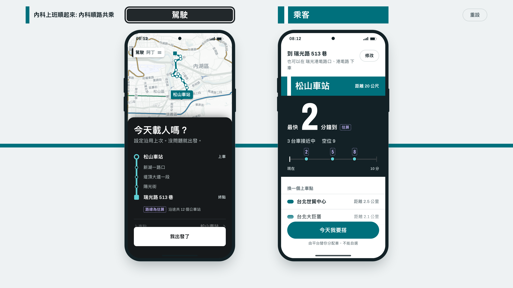
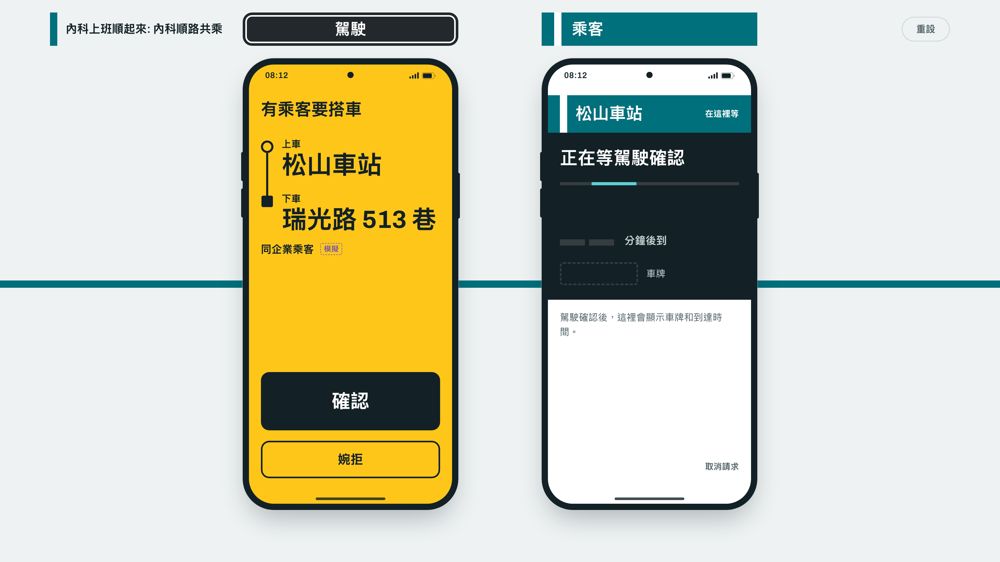
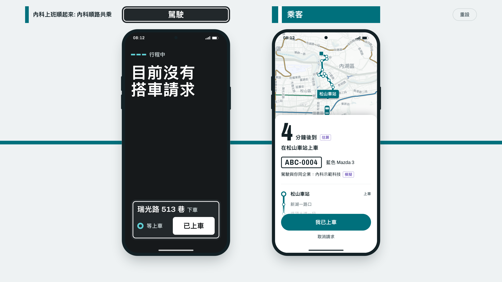

# 內科上班順起來: 內科順路共乘 - Demo 截圖

[簡報大綱](pitch-outline.md)〈我們的做法〉前三步的畫面：左邊是駕駛 App，右邊是乘客 App，兩支手機並排在展示頁上。截圖接示範後端，3840×2160（16:9），可以直接放進投影片。

## 1. 出發前

駕駛還沒出發，畫面問「今天載人嗎？」；乘客要到瑞光路 513 巷，在松山車站看附近的車，最快 2 分鐘到。

## 2. 乘客送出請求

駕駛出發後，乘客送出請求。平台把請求配給駕駛，駕駛畫面變黃，只需要按「確認」；乘客在等駕駛確認。

## 3. 駕駛確認

駕駛確認後，乘客看到車牌、車型與到達時間，車子在地圖上開過來。

