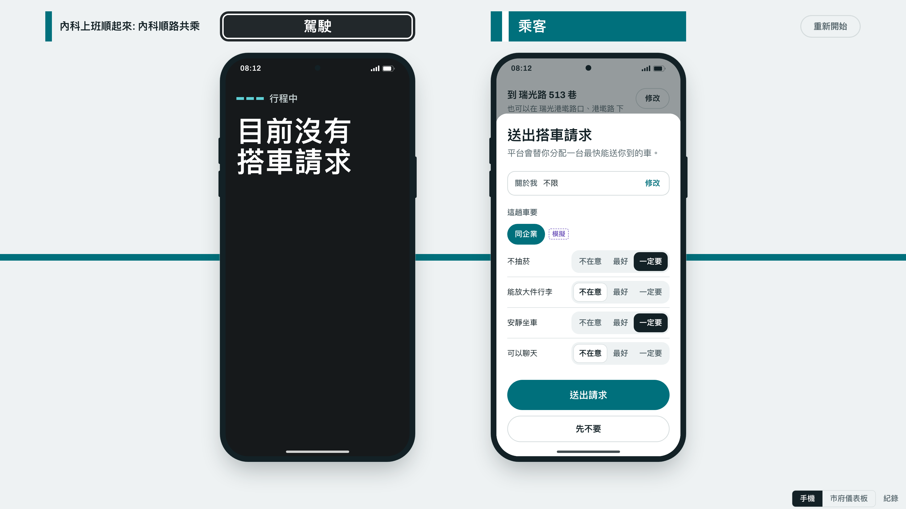
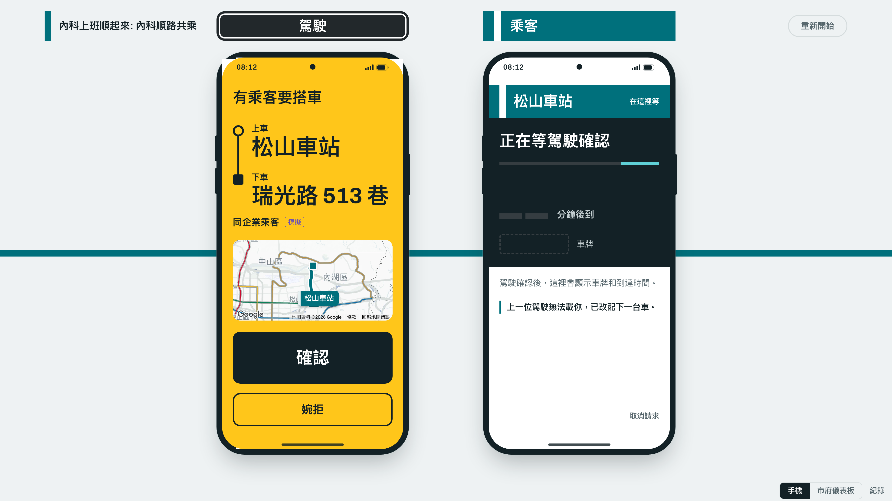
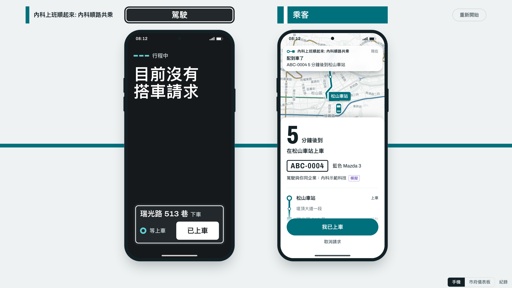
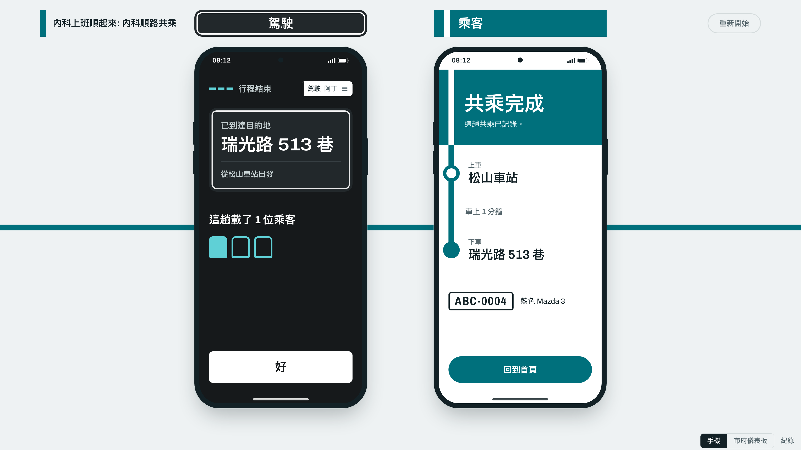
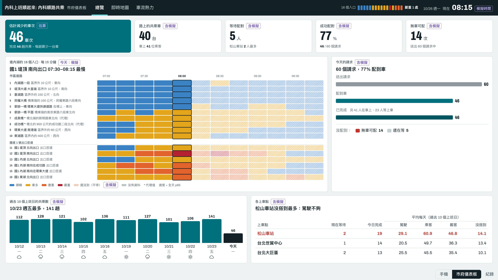
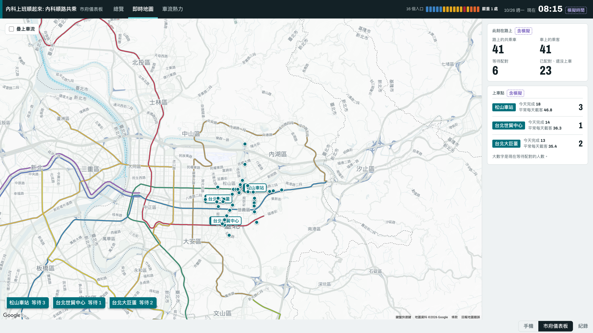
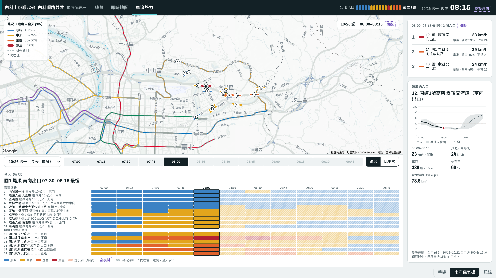

# 內科上班順起來: 內科順路共乘 - Demo 截圖

[簡報大綱](pitch-outline.md)〈我們的做法〉的畫面。前五張是展示頁的「手機」畫面：左邊是駕駛 App，右邊是乘客 App；後三張是展示頁的「市府儀表板」。截圖接示範後端，照 `docs/demo-script.md` 跑一次 Demo 時拍下，3840×2160（16:9），可以直接放進投影片。

## 1. 出發前

駕駛還沒出發，畫面問「今天載人嗎？」；乘客要到瑞光路 513 巷，在松山車站看附近的車，最快 5 分鐘到。

## 2. 乘客選條件

駕駛出發後，乘客按「今天我要搭」，把不抽菸、安靜坐車設成「一定要」，再送出請求。

## 3. 駕駛收到請求

第一位駕駛不符合條件而婉拒，平台改配給下一台車。駕駛畫面變黃，只需要按「確認」；乘客在等駕駛確認。

## 4. 駕駛確認

駕駛確認後，乘客看到車牌、車型與到達時間，車子在地圖上開過來。

## 5. 共乘完成

乘客上車，車開到目的地，行程自己結束：駕駛看到「這趟載了 1 位乘客」，乘客看到「共乘完成」。

## 6. 市府儀表板：總覽

估計減少的車次、路上的共乘車、配對成功率，16 個進內湖入口的路況，以及過去 10 個上班日的共乘數與各上車點的情況。

## 7. 市府儀表板：即時地圖

此刻路上的共乘車與各上車點等待配對的人數。

## 8. 市府儀表板：車流熱力

各入口每 15 分鐘的路況，以及最慢入口的車速、車流與佔有率。

