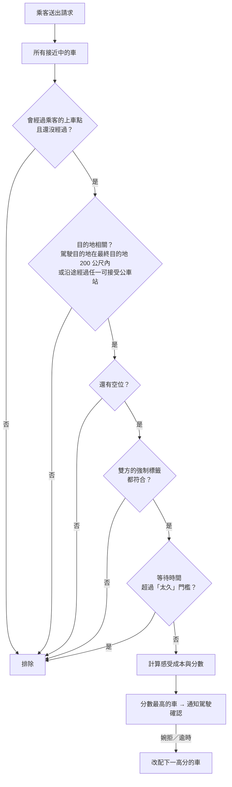

# 內科順路共乘 — 點子發想

議題 #4 · 讓「本來就要開車進內科的人」順路載「從大眾運輸站出來的人」

> [!TIP]
> **這是發想文件**：內容都還可以改，歡迎直接加註解、補點子、打槍。

## 目錄

1. [一句話說明](#1-一句話說明)
2. [為什麼可能有用](#2-為什麼可能有用)
3. [核心概念](#3-核心概念)
4. [兩種參與者](#4-兩種參與者)
5. [使用流程草稿](#5-使用流程草稿)
6. [畫面發想](#6-畫面發想)
7. [媒合怎麼做](#7-媒合怎麼做)
   - [7.1 標籤與篩選](#71-標籤與篩選)
   - [7.2 供需狀況](#72-供需狀況)
   - [7.3 請求媒合計算](#73-請求媒合計算)
8. [和議題 4 的關係](#8-和議題-4-的關係)
9. [疑問風險與待驗證](#9-疑問風險與待驗證)
10. [黑客松 MVP 範圍](#10-黑客松-mvp-範圍)
11. [延伸點子](#11-延伸點子)

## 1. 一句話說明

在幾條**固定的通勤路線**上，讓本來就要開車進內科的人（駕駛），順路載剛從大眾運輸站出來、要進內科的人（乘客）；平台**即時媒合**。

## 2. 為什麼可能有用

- 晨峰塞車的主因之一是**一人一車**：每台進內科的車，大多只坐一個人。
- 「最後一哩」是很多人不搭大眾運輸的原因：捷運、火車到了，但離公司還有一段，接駁公車又擠又慢。
- 有些駕駛本來就會經過這些站。**多載一個人，幾乎沒有額外成本**。
- 每成功媒合一次，路上可能就少一台車，或至少少一位擠接駁公車的人。

## 3. 核心概念

- **預先定義幾條通勤路線**
  - 一端：主要大眾運輸站附近的上車點
  - 另一端：內湖科學園區內
  - 中途可以有停靠點
- 路線**固定、數量少**，媒合會簡單很多：不用做任意地點的叫車，只要比對「同一條路線、時間接近」。
- **上車點（已定義）：**
  - 松山車站附近：大型公車站
  - 台北世貿中心附近：通往停車場的車道
  - 台北大巨蛋：通往停車場的車道
- **下車點：**
  - 駕駛的最終目的地
  - 沿途經過的公車站

## 4. 兩種參與者

**🚗 駕駛**

- 開車上班，願意走（或本來就在走）其中一條路線
- 註冊時提供：路線、平常出發時段、可載人數（每天出發時可再調整）
- 每天可以決定「今天有沒有要開放載人」

**🧍 乘客**

- 需要從大眾運輸站進內科
- 註冊時提供：常用路線、平常抵達時段、常用的最終目的地（確切地址）與可接受的下車公車站

**兩者都是「登記自己能提供／需要什麼」**，平台再當天動態媒合。

🏷️ 兩種參與者都可以有**標籤**，可以是自己填的，也可以是公司替員工標的（見 [7.1](#71-標籤與篩選)）。

🤔 同一個人有沒有可能兩種身分都有？例如今天開車、明天搭捷運。→ 看來是：使用者可以依供需狀況決定隔天要開車還是搭車（見 [7.2](#72-供需狀況)），註冊時要能同時登記兩種身分。

## 5. 使用流程草稿

1. **駕駛出發**：在 App 按「我出發了」，並確認今天的設定（預先帶入上次的值）：
   - **今天的目的地**
   - **可載人數**
   - **會經過哪個上車點**（松山車站、世貿或大巨蛋）
   - 標籤篩選（強制／建議，見 [7.1](#71-標籤與篩選)）

   出發後，平台開始掌握他在路線上的位置和預計抵達時間。
2. **乘客快到站**：例如捷運還有兩站，打開 App 看**即時供給狀態**。查看前要先提供**最終目的地（確切地址）**和**可接受的下車公車站**，平台會估算從各公車站走到目的地要多久。平台用這些判斷哪些接近中的車是相關的（駕駛目的地在最終目的地 200 公尺內，或沿途會經過任一可接受的公車站），只顯示這些車：幾分鐘後到、還剩幾個座位。查看時也可以**先設定標籤篩選**（強制／建議），例如只看同公司同事的車。
3. **乘客表示「今天要搭」**：送出請求時**仍可設定或調整標籤篩選**（強制／建議），例如「只搭同公司同事的車」，但**不能自己選車**，由平台分配。**只有在距離上車點 200 公尺內（系統設定）才能送出請求**，所以乘客送出請求時基本上已經在上車點，不會讓駕駛在路邊等。
4. **平台通知駕駛**：駕駛**確認**（或婉拒、逾時未回）。
5. **乘客收到確認**：看到上車地點、車輛資訊、預計到達時間。
6. **上車 → 在駕駛目的地或乘客可接受的公車站下車 → 完成**：留下一筆服務紀錄。

**例外狀況：**

- 駕駛沒回應或婉拒 → 平台自動改配下一台；都沒有的話，顯示接駁公車或步行的替代方案。
- 乘客沒出現 → 駕駛等多久？要不要記點？
- 駕駛臨時不開 → 通知已確認的乘客。

> [!NOTE]
> **不在本次範圍內：金流。** 乘客先在平台儲值點數，平台依實際服務分配給駕駛。這部分先不做，但設計時要記得之後會有。

## 6. 畫面發想

**乘客端**

- 目的地輸入：最終目的地（確切地址）＋ 可接受的下車公車站（可帶入常用設定，平台也可依步行時間建議公車站）
- 路線卡片：「松山車站 → 你的目的地　🚗 3 台相關的車接近中 · 最快 4 分鐘 · 5 個空位」
- 時間軸：接下來 30 分鐘內會經過的相關車輛（只供參考，不能選車）
- 一顆大按鈕：**「今天我要搭」**

**駕駛端**

- 一顆按鈕：「我出發了」／「今天不載」
- 出發前確認：今天的目的地、可載人數、上車點、標籤篩選（都預先帶入上次的值，按一下就能出發）
- 通知：「有一位乘客想在松山車站上車」→ **確認／婉拒**
- ⚠️ 開車中操作要非常簡單，例如語音或只按一下，甚至可以在出發前預先設定「自動接受」。

**所有註冊使用者**

- 供需狀況頁：自己路線、時段的駕駛與乘客數量，例如「平日 08:00 松山車站：駕駛偏少，開車的話很可能載得到人」（見 [7.2](#72-供需狀況)）

**大螢幕／市府端（可選）**

- 今天各路線媒合幾次、估計少了幾台車

## 7. 媒合怎麼做

- 先用**硬性條件**排除不合的車（順路、目的地相關、有空位、強制標籤、等待不太久），再依**總時間加上等車與走路的額外負擔**計分排序（詳細計算見 [7.3](#73-請求媒合計算)）
- 路線固定，所以可以直接用「沿著路線的距離」排序，不需要複雜的路徑規劃。
- ✅ **已決定｜下車點**：限定為駕駛目的地或沿途公車站。乘客查看供給前要提供最終目的地（確切地址）與可接受的下車公車站，平台據此判斷哪些車相關：駕駛目的地在最終目的地 200 公尺內，或沿途會經過任一可接受的公車站。
- ✅ **已決定｜地址相符**：乘客給的是確切地址時，與駕駛目的地相距 **200 公尺以內**就算相符。
- ✅ **已決定｜由平台分配**：乘客可以提供篩選條件，但不能自己選車。
- 「動態」的意思：乘客出捷運的時間不確定，所以不做前一天的預約，而是快到站的時候才媒合。

### 7.1 標籤與篩選

**想法：** 每位駕駛、乘客都可以有標籤，駕駛和乘客都可以用標籤篩選對方，篩選可以是「強制」或「建議」；有指定標籤的請求優先媒合。

**標籤從哪裡來：**

- **自己填的**：例如「不抽菸」「可載行李」「安靜車廂」
- **第三方提供的**：主要是**內科企業**，替自家員工標記，例如「XX 公司員工」
- 兩者**可信度不同**：自己填的是自我宣告，企業標的是經過驗證的。畫面上要分得出來，例如企業標籤加上 ✅ 認證符號。

**怎麼用：**

- **駕駛和乘客都可以設定篩選條件**：
  - 駕駛：**出發時**設定，例如「只載同公司同事」
  - 乘客：**查看供給狀態時**就可以先設定，**送出搭車請求時**仍可設定或調整，例如「只搭企業認證的駕駛」
- **每個篩選都要選一種意圖**：
  - **強制**：一定要符合，不符合就不媒合
  - **建議**：平台會盡量找符合標籤的對象。符合建議標籤的車在計分時有**標籤加分**（以分鐘計，見 [7.3](#73-請求媒合計算)），所以稍晚到的同公司車仍可能勝出；沒有符合的車，或差距太大時，就照一般計分媒合
- **媒合規則**：雙方的強制條件都符合才能配對；建議條件只影響優先順序。
- **有指定標籤的請求優先媒合**，例如同公司的駕駛先收到通知。
- **例子**：
  - 乘客設「同公司・建議」→ 同公司駕駛的車在計分時扣 4 分鐘成本（預設值）；只要不會因此讓乘客多等、多走太多，就會優先配給他，否則配給分數最高的一般駕駛
  - 駕駛設「同公司・強制」→ 只會收到同公司乘客的請求
- ✅ **已決定｜時間門檻**：以時間計算。等待超過「太久」門檻（系統設定，例如 10 分鐘）的車一律不分配；門檻內由 [7.3](#73-請求媒合計算) 的分數決定，取代原本「符合標籤的車在門檻內就配給它」的規則。**目前先用固定時間**，之後再考慮依路線、時段調整。
- ✅ **已決定｜放寬方式**：~~由參與者自己決定，在偏好設定中選擇「一次放寬到全部」或「分階段放寬」（同公司 → 企業認證 → 一般）。~~ 已由 [7.3](#73-請求媒合計算) 取代：標籤之間不分高低，建議標籤是否符合直接反映在計分裡，不再有分階段放寬的設定。
- ✅ **已決定｜放寬後的告知**：要告知乘客，但不跳顯眼的通知，例如只在請求狀態上標示。乘客選擇「建議」時，就已經接受可能會放寬。
- ✅ **已決定｜駕駛端**：ETA 門檻只用在乘客端，與駕駛無關。駕駛的篩選與意圖在**出發時就設定好**，路上不再調整；之後怎麼媒合**完全由平台決定**，沒有媒合到就是今天不載。理由：不在路上製造安全風險，駕駛在路上**只需要面對一件事：有沒有人叫車**。

**為什麼好：**

- **更安全**：知道對方是誰、在哪家公司，有問題找得到人
- **更方便**：同公司的人目的地一樣，下車點不用喬
- **企業有誘因加入**：員工福利、減少停車位需求、ESG；也跟議題 #4「市府與企業協商」的方向一致

**企業端需要什麼：**

- 企業管理後台：邀請、移除員工；員工離職時標籤要能撤銷
- 驗證方式：公司 email 網域？企業批次匯入？

**待討論：**

- ❓ 篩選太嚴會讓媒合率下降，初期供給本來就少，要怎麼取捨？→「建議」意圖會自動放寬，可以減輕這個問題；「強制」則由使用者自己承擔不一定搭得到。
- ❓ 隱私：對方看到的是公司名稱，還是只看到「同公司」？員工要不要自己同意公開標籤？
- ❓ 除了企業，還有誰可以當第三方？例如內科園區協會、辦公大樓管委會
- ✅ **已決定｜標籤不分高低**：不論標籤是「同公司」還是「企業認證」，強制標籤一律是硬性條件；建議標籤一律使用相同的加分（見 [7.3](#73-請求媒合計算)）。

### 7.2 供需狀況

**想法：** 所有註冊使用者都可以查看**與自己相關**的供需狀況，幫助他決定**隔天要開車還是搭車**。

- **「與自己相關」指的是：** 自己登記的路線、平常的時段、上下車點，以及自己的標籤篩選條件（例如同公司）
- **看得到什麼（發想）：**
  - 某路線、某時段平常有多少駕駛、多少乘客
  - 駕駛少、乘客多 →「明天開車的話，很可能載得到人」
  - 駕駛多、乘客少 →「明天搭車的話，很容易搭得到」
  - 套用自己的篩選後的數字，例如「同公司的駕駛平常有幾位」
- **幫助平衡供需：** 讓使用者自己調整隔天的角色，平台不用強制分配
- 🤔 資料從哪裡來：歷史媒合紀錄？還是使用者事先登記「明天會開車／搭車」？
- 🤔 隱私：只顯示統計數字，不顯示個別使用者？
- 🤔 冷啟動時資料很少，數字可能不準，要怎麼呈現？

### 7.3 請求媒合計算

**做法：規則式媒合（rule-based）。** 乘客送出請求後，平台對每一台接近中的車做兩步驟：

1. **硬性條件**：任何一項不符合，這台車就直接排除，不計分。
2. **計分排序**：通過的車計算「感受成本」，再換算成 **0–100 分**，平台依分數高低分配。

**核心想法：** 人的感受很複雜，**坐在車上的時間、等車的時間、走路的時間不是等價的**。所以分數不只看總共花多久，也要把等車和走路的額外負擔算進去。

#### 乘客提供的資料

- **最終目的地**：確切地址
- **可接受的下車公車站**：一個或多個，也可以由平台建議路線上步行幾分鐘內的公車站
- 平台在請求時用步行路線 API 估算**每個可接受公車站走到最終目的地要幾分鐘**。路線固定、公車站不多，每次請求只要查幾筆，也可以快取。



#### 第一步：硬性條件（不可忽略）

| # | 條件 | 說明 |
|---|---|---|
| H1 | **順路** | 這台車會經過乘客的上車點，而且還沒經過 |
| H2 | **目的地相關** | 駕駛目的地在乘客最終目的地 200 公尺內，或駕駛沿途會經過乘客任一個可接受的公車站 |
| H3 | **還有空位** | 扣掉已確認的乘客後，仍有座位 |
| H4 | **強制標籤** | 乘客的強制篩選、駕駛的強制篩選都要符合（雙向） |
| H5 | **等待不是「太久」** | 車輛到上車點的 ETA 超過門檻（系統設定，例如 10 分鐘）就不分配。這條**永遠不變** |

#### 第二步：感受成本

每台車先算出三段時間（單位：分鐘）：

- **等待**：車輛到上車點的 ETA
- **乘車**：上車點 → 下車點
- **步行**：下車點 → 最終目的地
  - 完全相符（駕駛目的地在 200 公尺內）：步行約 0–3 分鐘
  - 在公車站下車：用步行 API 估算的時間
  - 一台車會經過多個可接受公車站時，選「乘車 + 步行」最短的那一站

```
感受成本 = 總時間（等待 + 乘車 + 步行）     ← 乘客實際多久到
         + α × 等待                       ← 等車的額外負擔
         + β × 步行                       ← 走路的額外負擔
         − 標籤加分                        ← 標籤加分上限 × 符合的建議標籤數 ÷ 乘客設定的建議標籤數

分數 = 100 × max(0, 1 − 感受成本 ÷ C_ref)   ← 分數越高越好
```

展開來看：感受成本 = (1+α)·等待 + 1·乘車 + (1+β)·步行 − 標籤加分。也就是**坐車 1 分鐘算 1，等車 1 分鐘算 1+α，走路 1 分鐘算 1+β**。

**系統設定（預設值）：**

| 參數 | 預設 | 意義 |
|---|---|---|
| α | 1 | 等車的額外負擔：等 1 分鐘感覺像 2 分鐘 |
| β | 0.5 | 走路的額外負擔：走 1 分鐘感覺像 1.5 分鐘 |
| 標籤加分上限 | 4 分鐘 | 全部建議標籤都符合時扣 4 分鐘；部分符合時依比例，例如 3 個符合 2 個 → 4 × 2/3 ≈ 2.7 分鐘 |
| 送出請求的距離 | 200 公尺 | 乘客離上車點這個距離內才能送出請求 |
| C_ref | 50 分鐘 | 換算分數用的基準，成本達到 C_ref 時為 0 分 |
| 「太久」門檻 | 10 分鐘 | 等待超過就不分配（H5） |

- **同分時**：等待時間短的優先。
- 預設值只是起點，要用實際情境調整（見下方「怎麼調」）。

#### 模擬

乘客在**松山車站**，最終目的地是瑞光路上某個地址，建議篩選「同公司」。可接受的公車站：**S1 走 4 分鐘**、**S2 走 9 分鐘**。

| 車 | 狀況 | 等待 | 乘車 | 步行 | 標籤 | 總時間 | **感受成本** | **分數** |
|---|---|---|---|---|---|---|---|---|
| A | 完全相符 | 8 | 15 | 1 | – | 24 | 24 + 8 + 0.5 = **32.5** | **35** |
| B | 在 S1 下車 | 2 | 13 | 4 | – | 19 | 19 + 2 + 2 = **23** | **54** |
| C | 在 S2 下車 | 1 | 11 | 9 | – | 21 | 21 + 1 + 4.5 = **26.5** | **47** |
| D | 完全相符、同公司 | 6 | 15 | 1 | −4 | 22 | 22 + 6 + 0.5 − 4 = **24.5** | **51** |
| E | 完全相符 | 12 | – | – | – | – | 等待太久 → **排除** | – |

**分配順序：B（54）→ D（51）→ C（47）→ A（35）**

- **D 是同公司、完全相符的車，但排在 B 後面**：乘客要在上車點等 6 分鐘。B 只要等 2 分鐘、走 4 分鐘，感覺比較好，雖然 D 扣掉標籤加分後的總時間少 1 分鐘。這就是「坐車、等車、走路不等價」的效果。
- **C 雖然 1 分鐘就到，但排在 B 後面**：下車後要走 9 分鐘。

#### 怎麼調：α 與 β

**情境：** S1 改成要走 10 分鐘，完全相符的 A 會不會勝出？

| 設定 | B（在 S1 下車，走 10 分鐘） | A（完全相符，等 8 分鐘） | 結果 |
|---|---|---|---|
| α = 1，β = 0.5 | 25 + 2 + 5 = 32 | 32.5 | B 小勝 |
| α = 1，**β = 1** | 25 + 2 + 10 = 37 | 33 | **A 勝出** |

- **β 調高**：越不想讓乘客走路，越願意等完全相符的車。
- **α 調高**：越不想讓乘客等車，越偏好馬上會到的車。
- 「晚到的完全相符車值不值得等」就是由這兩個參數決定。

#### 為什麼不用其他算法

討論過但沒採用的做法：

- **固定分數（時間分段 50／20 分 + 目的地 30 分 + 標籤 20 分）**：2 分鐘與 3 分鐘到的車分數一樣；目的地的價值是固定的，不管下車後要走 1 分鐘還是 10 分鐘。
- **只看總時間**：把等車、走路當成和坐車一樣，不符合人的感受。上面的例子裡，只看總時間會選 D，讓乘客在路邊等 6 分鐘。

#### 需要的外部資料

| 資料 | 選項 |
|---|---|
| 步行時間 | Google Maps Routes API（步行模式，付費但有每月免費額度）、OpenRouteService（`foot-walking`，免費金鑰、有頻率限制）、自架 OSRM／Valhalla；黑客松備案：直線距離 × 1.3 ÷ 每分鐘 80 公尺（標示為模擬） |
| 乘車時間 | TDX 即時路況車速，或考慮路況的路線規劃 API |
| 等待時間 | 駕駛的即時位置 + 路線，推算到上車點的 ETA |

TDX 是否提供步行路線規劃還沒確認。

#### 之後可以考慮

- 💡 **舒適門檻**：目前每多等或多走 1 分鐘的成本都一樣。實際上前幾分鐘大家不太在意，超過之後越來越煩。可以設「等超過 3 分鐘」「走超過 5 分鐘」之後每分鐘再加重。先用線性版本，確認排序合理後再決定要不要加。

#### 決定與待確認

- ✅ **已決定｜標籤不分高低**：不需要依標籤種類給不同分數。強制標籤不論內容（同公司、企業認證⋯）都是硬性條件（H4）；所有建議標籤共用同一個標籤加分。
- ✅ **已決定｜多個建議標籤**：所有建議標籤共用同一個加分，**上限固定**，依符合的比例計算：標籤加分 = 上限 × 符合數 ÷ 乘客設定的建議標籤數。例如上限 10、乘客設了 3 個建議標籤、車輛符合 2 個 → 10 × 2/3 ≈ 6.7。不論設了幾個標籤，加分都不會超過上限。
- ✅ **已決定｜駕駛的建議篩選**：目前不加分。駕駛本來就可以婉拒，不需要讓流程更複雜。
- ✅ **已決定｜座位不夠時**：多位乘客同時要搭同一台車、座位不夠時，**先送出請求的先**。
- ✅ **已決定｜乘客比車晚到**：乘客只有在接近上車點時（約 200 公尺內，系統設定）才能送出請求，所以等待時間用車輛到上車點的 ETA 即可，不另外計算乘客到上車點的時間。

## 8. 和議題 4 的關係

- 議題 #4 要的是「晨尖峰內科車流熱力儀表板」，作為協商彈性工時的依據。
- 這個點子換一個角度：**不只看塞車，而是直接減少進內科的車**。
- 可以和儀表板結合：
  - 用 VD 資料標出最塞的入口和時段 → 決定先開哪幾條路線
  - 把共乘媒合數換算成「減少的車次」，放到熱力圖上
  - 捷運分時進出量 → 估計各站潛在的乘客數
- 對企業的說法：鼓勵員工當駕駛、補貼點數，跟彈性工時一樣都是企業可以做的事。

## 9. 疑問風險與待驗證

- ❓ **法規**：收費載客是否碰到「白牌車」問題？分攤油錢式的共乘界線在哪？要先查清楚。
- ❓ **安全與信任**：身分驗證（公司 email？）、評價、緊急聯絡人。限定「內科企業員工」會不會比較好推？→ 部分由企業標籤處理，見 [7.1](#71-標籤與篩選)
- ❓ **冷啟動**：一開始駕駛和乘客都很少，怎麼讓第一批人用起來？先從一家大企業、一條路線開始？
- ❓ **駕駛誘因**：只有點數夠嗎？有沒有企業停車位優惠、碳排獎勵之類的？
- ❓ **上下車點**：三個上車點已定義，但能不能臨停？松山車站的公車站區、世貿與大巨蛋的停車場車道，可能都有場館或交通管理上的限制；沿途公車站臨停也要確認。
- ❓ **時間不準**：乘客晚到、駕駛遇到塞車，都會讓媒合失敗。
- ❓ **開車中操作 App 的安全問題** → 原則已定：所有設定在出發前完成，路上只處理「有沒有人叫車」（見 [7.1](#71-標籤與篩選)）
- ❓ 這和現有的共乘 App 差在哪？目前想到的是：固定路線、即時、只針對內科。

## 10. 黑客松 MVP 範圍

**要做的（Demo 能現場操作）：**

- [ ] 2–3 條預先定義的路線（地圖 + 上車點、下車點）
- [ ] 駕駛／乘客註冊：選身分、路線、時段、座位數
- [ ] 乘客端即時供給看板
- [ ] 「今天要搭」→ 通知駕駛 → 駕駛確認 → 乘客收到確認
- [ ] **請求媒合計算**：硬性條件 + 感受成本計分（見 7.3）；步行時間可先用直線距離估算（標示為模擬）
- [ ] **模擬駕駛**：用模擬資料讓多台車沿著路線移動，Demo 時看得到供給變化
- [ ] **標籤與篩選**：自填標籤 + 模擬 1–2 家企業替員工標記；駕駛（出發時）與乘客（查看供給時、請求時）都可篩選「同公司」並選強制／建議；建議意圖以標籤加分反映、放寬時狀態上低調標示；指定標籤優先媒合

**不做的：**

- 金流、點數分配
- 真實定位、真實身分驗證
- 法規處理

**README 要記得寫：**

- 哪些是模擬資料（駕駛、乘客、車輛位置），哪些是真實資料（路線、VD、捷運進出量）
- 「市府上任 100 天內要落地需要做什麼」：例如交通局、企業合作、試辦路線

## 11. 延伸點子

先放著，之後再看：

- 💡 晚上下班反方向也能用
- 💡 企業專屬路線或企業包車
- 💡 和接駁公車整合：沒有共乘車時，直接顯示下一班公車
- 💡 用歷史媒合紀錄預測「明天 8:15 松山車站大概有幾台車」→ 基本版已納入 [7.2](#72-供需狀況)
- 💡 把「減少的車次」算成減碳量，給企業做 ESG 報告
