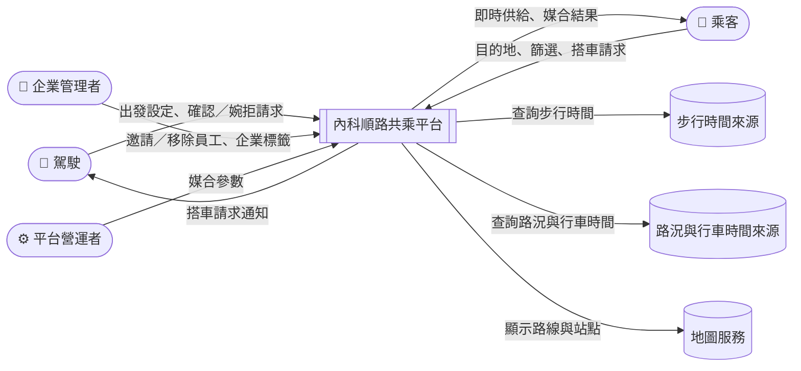

# 內科順路共乘 — 需求規格

議題 #4 · 來源文件：[點子發想（proposal.md）](proposal.md)

> [!NOTE]
> 本文件只描述系統**要做到什麼**，不描述**怎麼做**。演算法、資料來源、技術選型等屬於設計文件的範圍。

## 目錄

1. [問題與目標](#1-問題與目標)
   - [1.1 問題](#11-問題)
   - [1.2 目標](#12-目標)
   - [1.3 範圍](#13-範圍)
2. [系統情境](#2-系統情境)
3. [文件慣例](#3-文件慣例)
4. [路線與站點](#4-路線與站點)
5. [帳號與身分](#5-帳號與身分)
6. [標籤與企業認證](#6-標籤與企業認證)
7. [駕駛出發](#7-駕駛出發)
8. [乘客查看供給](#8-乘客查看供給)
9. [搭車請求與媒合](#9-搭車請求與媒合)
10. [確認與行程](#10-確認與行程)
11. [供需狀況](#11-供需狀況)
12. [系統設定](#12-系統設定)
13. [Demo 與模擬資料](#13-demo-與模擬資料)
14. [待確認事項](#14-待確認事項)

## 1. 問題與目標

### 1.1 問題

- **一人一車**：平日晨峰 07:00–09:30，大量汽車擠進成美橋、民權大橋與堤頂大道；每台進內科的車大多只坐一個人。
- **最後一哩**：捷運、火車到站後離公司還有一段距離，接駁公車又擠又慢，使很多人放棄大眾運輸、改開車。
- **閒置的座位**：有些駕駛本來就會經過大眾運輸站附近，多載一個人幾乎沒有額外成本，但目前沒有管道把他們和需要最後一哩的人接起來。
- **信任門檻**：和陌生人共乘有安全疑慮，降低了使用意願。

### 1.2 目標

- **G1 減少進內科的車**：每一次成功共乘，路上可能就少一台車，或少一位擠接駁公車的人。
- **G2 解決最後一哩**：讓從大眾運輸站出來的人，能在幾分鐘內搭上本來就要進內科的車。
- **G3 可信任的共乘**：讓使用者知道對方是誰，並能選擇只和信任的對象（例如同公司同事）共乘。
- **G4 供需自我平衡**：讓使用者看得到供需狀況，自行決定隔天開車或搭車，平台不強制分配角色。
- **G5 駕駛安全**：駕駛在開車途中只需面對「有沒有人叫車」這一件事。
- **G6 黑客松 Demo**：10/24 Demo 時能現場操作完整流程。

### 1.3 範圍

**範圍內：**

- 固定、少量的通勤路線：大眾運輸站附近的上車點 → 內湖科學園區
- 駕駛與乘客的註冊、標籤與篩選
- 乘客到站前的即時供給查看、到站後的即時媒合
- 駕駛確認、乘客確認、例外處理與服務紀錄
- 供需狀況查看
- Demo 用的模擬駕駛與模擬企業

**範圍外：**

- 金流與點數分配（之後會有，服務紀錄要能支援）
- 真實定位、真實身分驗證
- 法規處理（例如「白牌車」界線）
- 市府端大螢幕、反方向（下班）路線、企業專屬路線等延伸點子（見 [proposal 第 11 節](proposal.md#11-延伸點子)）

## 2. 系統情境

| 參與者／外部系統 | 說明 |
|---|---|
| 駕駛 | 本來就要開車進內科，願意順路載人的通勤者 |
| 乘客 | 從大眾運輸站出來、要進內科的通勤者 |
| 企業管理者 | 內科企業的窗口，替自家員工標記與撤銷企業標籤 |
| 平台營運者 | 調整媒合參數的管理者 |
| 步行時間來源 | 提供公車站到乘客最終目的地的步行時間 |
| 路況與行車時間來源 | 提供車輛到上車點、上車點到下車點的時間估算所需資料 |
| 地圖服務 | 顯示路線、上車點與下車點 |

同一位使用者可以同時是駕駛與乘客，依每天狀況切換。

## 3. 文件慣例

**層級：** 主題 > 使用者故事（US）> 需求（REQ）。

**編號：** 使用者故事為 `US-nn`，需求為 `REQ-nnn`，待確認事項為 `Q-nn`。編號是永久的：刪除項目不會重新編號。

**需求格式（EARS）：** 每條需求都是一個 EARS 句型。

| 句型 | 中文寫法 | 用途 |
|---|---|---|
| 通用（Ubiquitous） | 系統應⋯ | 永遠成立的需求 |
| 事件（Event-driven） | 當⋯時，系統應⋯ | 某事件發生時的回應 |
| 狀態（State-driven） | 在⋯期間，系統應⋯ | 某狀態持續時成立 |
| 選用（Optional） | 在⋯的情況下，系統應⋯ | 某功能或設定啟用時成立 |
| 非期望（Unwanted） | 如果⋯，則系統應⋯ | 對異常或不想要情況的回應 |

每條需求都附上**理由**與**驗證方式**（設計審查、測試、分析之一或多項），必要時附**說明**。

**名詞：**

- **上車點**：路線起點附近、乘客上車的地點
- **下車點**：駕駛的目的地，或路線沿途的公車站
- **最終目的地**：乘客要去的確切地址
- **可接受的下車公車站**：乘客願意在該處下車、再走到最終目的地的公車站
- **相關車輛**：會經過乘客上車點且尚未經過，並且駕駛目的地與乘客最終目的地相距在「地址相符距離」內，或沿途會經過乘客任一可接受的下車公車站的車
- **等待時間**：車輛到達上車點的預計時間
- **感受成本**：乘客到達最終目的地的總時間，再額外加重等待與步行的部分
- 引號標示的參數（例如「等待上限」）定義在 [第 12 節](#12-系統設定)

## 4. 路線與站點

### US-01 了解有哪些通勤路線

身為通勤者，我想要知道有哪些固定的通勤路線及其上下車點，以便判斷這個服務適不適合我。

- **REQ-001** 系統應提供預先定義的通勤路線，每條路線包含一個大眾運輸站附近的上車點、位於內湖科學園區內的終點區域，以及沿途的公車站。
  - 理由：路線固定且數量少，媒合只需比對「同一條路線、時間接近」，不必處理任意地點叫車。
  - 驗證方式：設計審查、測試
- **REQ-002** 系統應支援以下上車點：松山車站附近的大型公車站、台北世貿中心附近通往停車場的車道、台北大巨蛋通往停車場的車道。
  - 說明：各上車點能否臨停尚待確認（見 [Q-10](#14-待確認事項)）。
  - 理由：這三處是已選定、靠近大眾運輸且車輛容易進出的地點。
  - 驗證方式：設計審查
- **REQ-003** 系統應在地圖上顯示每條路線及其上車點與沿途公車站。
  - 理由：使用者需要直觀理解路線範圍；Demo 也需要看得到路線。
  - 驗證方式：測試
- **REQ-004** 系統應將乘客的下車點限定為駕駛的目的地或路線沿途的公車站。
  - 理由：駕駛不需要為乘客繞路，乘客在可預期的地點下車。
  - 驗證方式：測試

## 5. 帳號與身分

### US-02 註冊並登記身分

身為通勤者，我想要註冊並登記自己是駕駛、乘客或兩者，以便依每天的狀況選擇開車或搭車。

- **REQ-005** 系統應允許使用者在註冊時登記駕駛身分、乘客身分或兩者。
  - 理由：使用者可能今天開車、明天搭捷運，並依供需狀況決定隔天的角色（見 [US-19](#us-19-查看供需狀況)）。
  - 驗證方式：測試
- **REQ-006** 當使用者登記駕駛身分時，系統應記錄其路線、平常出發時段與可載人數。
  - 理由：這些資料是出發設定的預設值，也是供需狀況的依據。
  - 驗證方式：測試
- **REQ-007** 當使用者登記乘客身分時，系統應記錄其常用路線、平常抵達時段、常用的最終目的地（確切地址）與可接受的下車公車站。
  - 理由：讓乘客到站前能快速帶入設定，也是供需狀況的依據。
  - 驗證方式：測試

## 6. 標籤與企業認證

### US-03 為自己加上標籤

身為使用者，我想要為自己加上標籤（例如「不抽菸」「可載行李」），讓對方更了解我。

- **REQ-008** 系統應允許使用者為自己新增與移除自填標籤。
  - 理由：自我宣告的偏好與特性可以作為篩選依據。
  - 驗證方式：測試

### US-04 替員工標記企業標籤

身為內科企業的管理者，我想要替自家員工加上企業標籤，並在員工離職時撤銷，以便員工能安心地和同事共乘。

- **REQ-009** 系統應允許企業管理者邀請員工，並為其加上該企業的企業標籤。
  - 說明：員工身分的驗證方式尚待確認（見 [Q-02](#14-待確認事項)）。
  - 理由：經企業驗證的身分提供安全與信任（G3），也讓企業有誘因加入。
  - 驗證方式：測試
- **REQ-010** 系統應允許企業管理者移除員工並撤銷其企業標籤。
  - 理由：員工離職後不應再被視為該企業員工。
  - 驗證方式：測試
- **REQ-011** 當企業標籤被撤銷時，系統應在之後的篩選與媒合中不再將該標籤視為該使用者所有。
  - 理由：避免已離職者仍通過「同公司」等篩選。
  - 驗證方式：測試
- **REQ-012** 系統應以已認證標示呈現企業標籤，使其與自填標籤有明顯區別。
  - 理由：自填標籤是自我宣告，企業標籤經過驗證，兩者可信度不同。
  - 驗證方式：測試

### US-05 用標籤篩選對方

身為駕駛或乘客，我想要用標籤篩選對方，並指定「強制」或「建議」，以便只和信任的人共乘，或在可能時優先和他們共乘。

- **REQ-013** 系統應要求每一個標籤篩選條件指定一種意圖：強制或建議。
  - 說明：強制＝一定要符合，否則不媒合；建議＝盡量找符合的對象，沒有時照一般方式媒合。
  - 理由：篩選太嚴會降低媒合率；讓使用者自己決定要嚴格還是可放寬。
  - 驗證方式：測試
- **REQ-014** 系統應對所有標籤一視同仁，不依標籤種類（例如同公司、企業認證、自填）給予不同的媒合效果。
  - 理由：已決定標籤不分高低；強制標籤一律是硬性條件，建議標籤一律使用相同的優先幅度。
  - 驗證方式：設計審查、測試

## 7. 駕駛出發

### US-06 一鍵出發

身為駕駛，我想要出發時快速確認今天的設定並開放載人，以便不花時間就能開始順路載客。

- **REQ-015** 當駕駛表示出發時，系統應要求駕駛確認當天的目的地、可載人數、會經過的上車點，以及標籤篩選條件與意圖。
  - 理由：這些是當天媒合所需的條件，可能每天不同。
  - 驗證方式：測試
- **REQ-016** 系統應以駕駛上一次出發的設定，預先帶入出發確認的各項內容。
  - 理由：大部分駕駛每天的設定相同，減少操作。
  - 驗證方式：測試
- **REQ-017** 當預先帶入的設定不需修改時，系統應讓駕駛以單一操作完成出發。
  - 理由：出發時的操作越少，駕駛越願意每天使用。
  - 驗證方式：測試

### US-07 今天不載

身為駕駛，我想要表示今天不載人，以便不會收到任何搭車請求。

- **REQ-018** 當駕駛表示今天不載時，系統應不將該駕駛納入當天的媒合。
  - 理由：駕駛可以每天決定要不要開放載人。
  - 驗證方式：測試

### US-08 開車途中只處理叫車

身為駕駛，我想要開車途中只需要處理「有沒有人叫車」，以便不因操作 App 影響行車安全。

- **REQ-019** 在駕駛行程進行期間，系統應不提供修改標籤篩選條件與意圖的操作。
  - 理由：所有設定在出發前完成，不在路上製造安全風險（G5）。
  - 驗證方式：測試
- **REQ-020** 在駕駛行程進行期間，系統應讓駕駛以單一操作或語音回應搭車請求。
  - 理由：開車中的操作必須極簡。
  - 驗證方式：測試
- **REQ-021** 系統應允許駕駛在出發前啟用自動接受搭車請求。
  - 理由：讓駕駛在路上完全不用操作。
  - 驗證方式：測試
- **REQ-022** 在駕駛已啟用自動接受的情況下，當系統將請求分配給該駕駛時，系統應不等待駕駛回應即確認該請求。
  - 理由：同 REQ-021。
  - 驗證方式：測試

## 8. 乘客查看供給

### US-09 到站前查看相關的車

身為快到站的乘客，我想要看到有哪些和我相關的車正在接近，以便決定要不要等共乘。

- **REQ-023** 在駕駛行程進行期間，系統應持續掌握該車在路線上的位置，以及到達尚未經過之上車點的預計時間。
  - 理由：即時供給與媒合都依賴車輛的位置與預計到達時間。
  - 驗證方式：測試
- **REQ-024** 當乘客要查看供給狀態時，系統應先要求乘客提供最終目的地（確切地址）與一個或多個可接受的下車公車站。
  - 理由：沒有目的地就無法判斷哪些車和乘客相關。
  - 驗證方式：測試
- **REQ-025** 系統應以乘客登記的常用設定，預先帶入最終目的地與可接受的下車公車站。
  - 理由：減少乘客在車站內的操作。
  - 驗證方式：測試
- **REQ-026** 系統應依步行時間，向乘客建議路線上可作為下車點的公車站。
  - 理由：乘客不一定熟悉沿途公車站與目的地的距離。
  - 驗證方式：測試
- **REQ-027** 系統應估算從每個可接受的下車公車站步行到乘客最終目的地所需的時間。
  - 理由：步行時間影響哪台車對乘客最有利（見 REQ-042）。
  - 驗證方式：測試、分析
- **REQ-028** 系統應只向乘客顯示相關車輛。
  - 說明：「相關車輛」的定義見 [第 3 節](#3-文件慣例)。
  - 理由：顯示無法載乘客到目的地附近的車沒有意義，只會造成誤解。
  - 驗證方式：測試
- **REQ-029** 系統應為每條路線顯示接近中相關車輛的數量、最快到達上車點的時間，以及剩餘座位總數。
  - 理由：讓乘客一眼判斷今天搭得到的機會。
  - 驗證方式：測試
- **REQ-030** 系統應以時間軸顯示接下來 30 分鐘內會經過乘客上車點的相關車輛。
  - 理由：讓乘客了解接下來的供給變化。
  - 驗證方式：測試
- **REQ-031** 系統應不提供讓乘客選擇特定車輛的操作。
  - 理由：已決定由平台分配；供給資訊只供參考。
  - 驗證方式：測試

### US-10 查看時先篩選

身為乘客，我想要在查看供給時就先設定標籤篩選，以便只看到我願意搭的車。

- **REQ-032** 系統應允許乘客在查看供給狀態時，設定標籤篩選條件及其意圖。
  - 理由：例如只看同公司同事的車。
  - 驗證方式：測試
- **REQ-033** 系統應不向乘客顯示不符合乘客或駕駛任一方強制標籤篩選的車輛。
  - 理由：這些車在媒合時一定會被排除（REQ-040），顯示出來會誤導乘客。
  - 驗證方式：測試

## 9. 搭車請求與媒合

### US-11 送出搭車請求

身為已在上車點的乘客，我想要送出「今天我要搭」的請求，並由平台替我分配一台車，以便不用自己挑車。

- **REQ-034** 如果乘客與上車點的距離超過「送出請求距離」，則系統應拒絕該乘客的搭車請求並告知原因。
  - 理由：乘客送出請求時基本上已在上車點，不會讓駕駛在路邊等；也因此等待時間只需看車輛到上車點的時間。
  - 驗證方式：測試
- **REQ-035** 系統應允許乘客在送出搭車請求時，設定或調整標籤篩選條件及其意圖。
  - 理由：乘客到站時的考量可能和查看時不同。
  - 驗證方式：測試
- **REQ-036** 當乘客送出搭車請求時，系統應立即為其分配一台車。
  - 說明：乘客出站時間不確定，因此不做事前預約，而是在請求當下媒合。
  - 理由：已決定由平台分配，乘客不能自己選車。
  - 驗證方式：測試

### US-12 分配感覺上最好的車

身為乘客，我想要平台分配給我「感覺上最快到」的車，而不只是總時間最短的車，以便少在路邊等、少走路。

- **REQ-037** 系統應排除不會經過乘客上車點，或已經過該上車點的車。
  - 理由：硬性條件，不順路的車無法載客。
  - 驗證方式：測試
- **REQ-038** 系統應排除目的地與乘客不相關的車。
  - 說明：即駕駛目的地與乘客最終目的地相距超過「地址相符距離」，且沿途不經過乘客任一可接受的下車公車站。
  - 理由：硬性條件，無法把乘客載到可接受的下車點。
  - 驗證方式：測試
- **REQ-039** 系統應排除扣除已確認乘客後沒有空位的車。
  - 理由：硬性條件。
  - 驗證方式：測試
- **REQ-040** 系統應排除不符合乘客強制標籤篩選，或乘客不符合駕駛強制標籤篩選的車。
  - 理由：硬性條件，強制篩選雙向都必須符合。
  - 驗證方式：測試
- **REQ-041** 系統應排除等待時間超過「等待上限」的車。
  - 說明：這條規則在任何情況下都不放寬，包括符合建議標籤的車。
  - 理由：讓乘客等太久，不如改搭接駁公車或步行。
  - 驗證方式：測試
- **REQ-042** 系統應依感受成本由低到高，排序通過所有硬性條件的車。
  - 說明：總時間＝等待＋乘車＋步行；等待與步行各自的加重程度由系統設定。參考模型見 [proposal 7.3](proposal.md#73-請求媒合計算)。
  - 理由：坐車、等車、走路的感受不等價；只看總時間會讓乘客在路邊等太久或走太遠。
  - 驗證方式：測試、分析
- **REQ-043** 當一台車有多個可用的下車點時，系統應為乘客選定使乘車加步行時間最短的下車點。
  - 理由：讓乘客最快到達最終目的地。
  - 驗證方式：測試
- **REQ-044** 當多台車的感受成本相同時，系統應優先分配等待時間較短的車。
  - 理由：等待是乘客最在意的部分。
  - 驗證方式：測試

### US-13 優先分配符合標籤的車

身為乘客，我想要在不讓自己多等、多走太多的前提下，優先搭上符合我建議標籤的車（例如同公司同事），以便共乘更安心、更方便。

- **REQ-045** 在乘客設定了建議標籤篩選的情況下，系統應依車輛符合乘客建議標籤的比例降低該車的感受成本，降低幅度不超過「標籤加分上限」。
  - 說明：例如上限 4 分鐘、乘客設了 3 個建議標籤、車輛符合 2 個 → 降低約 2.7 分鐘。不論設了幾個標籤，降低幅度都不超過上限。
  - 理由：稍晚到的同公司車仍有機會勝出，但差距太大時仍以乘客的時間為優先。
  - 驗證方式：測試、分析
- **REQ-046** 系統應不讓駕駛的建議標籤篩選影響媒合結果。
  - 說明：已決定目前不加分（見 [Q-07](#14-待確認事項)）。
  - 理由：駕駛本來就可以婉拒，不需要讓媒合更複雜。
  - 驗證方式：測試
- **REQ-047** 如果分配到的車不符合乘客全部的建議標籤，則系統應在請求狀態上標示此情況，且不發出顯眼的通知。
  - 理由：乘客選擇「建議」時就已接受可能放寬；告知但不打擾。
  - 驗證方式：測試

### US-14 座位競爭

身為乘客，我想要在多人搶同一台車時有公平的分配規則，以便結果可以預期。

- **REQ-048** 當多位乘客的請求同時需要同一台車而座位不足時，系統應依請求送出的先後順序分配座位。
  - 理由：已決定先送出請求的先。
  - 驗證方式：測試

## 10. 確認與行程

### US-15 確認或婉拒請求

身為駕駛，我想要收到搭車請求通知並決定確認或婉拒，以便自己掌握是否載人。

- **REQ-049** 當系統將請求分配給駕駛時，系統應通知該駕駛乘客的上車點，並讓駕駛確認或婉拒。
  - 理由：駕駛保有最後決定權。
  - 驗證方式：測試
- **REQ-050** 如果駕駛婉拒，或在「駕駛確認時限」內未回應，則系統應將請求改分配給排序中的下一台車。
  - 理由：乘客不應因單一駕駛沒回應而落空。
  - 驗證方式：測試
- **REQ-051** 如果沒有任何車可以分配，則系統應告知乘客，並顯示接駁公車或步行的替代方案。
  - 理由：讓乘客能立刻改用其他方式。
  - 驗證方式：測試

### US-16 收到確認

身為乘客，我想要在駕駛確認後知道上車資訊，以便找到車。

- **REQ-052** 當駕駛確認請求時，系統應通知乘客上車地點、車輛資訊與車輛預計到達時間。
  - 理由：乘客需要辨認車輛並知道要等多久。
  - 驗證方式：測試
- **REQ-053** 在搭車請求尚未完成期間，系統應向乘客顯示請求目前的狀態。
  - 理由：讓乘客知道平台正在找車、已改配，或已確認。
  - 驗證方式：測試

### US-17 駕駛臨時不開

身為已確認的乘客，我想要在駕駛臨時不開時立刻知道，以便改用其他方式。

- **REQ-054** 當駕駛在有已確認乘客的情況下取消行程時，系統應通知所有已確認的乘客。
  - 理由：避免乘客在上車點空等。
  - 驗證方式：測試

### US-18 留下服務紀錄

身為使用者，我想要每次共乘都留下紀錄，以便日後查詢。

- **REQ-055** 當共乘完成時，系統應建立一筆服務紀錄，包含駕駛、乘客、路線、上車點、下車點與時間。
  - 理由：服務紀錄是日後點數分配、供需狀況與成效統計（例如減少的車次）的依據。
  - 驗證方式：測試

## 11. 供需狀況

### US-19 查看供需狀況

身為已註冊使用者，我想要看到和我相關的路線、時段的供需狀況，以便決定隔天要開車還是搭車。

- **REQ-056** 系統應向使用者顯示其登記路線與平常時段的駕駛人數與乘客人數。
  - 說明：資料來源與冷啟動時的呈現方式尚待確認（見 [Q-05](#14-待確認事項)）。
  - 理由：讓使用者自己調整隔天的角色，平台不需強制分配（G4）。
  - 驗證方式：測試
- **REQ-057** 系統應允許使用者套用自己的標籤篩選條件檢視供需狀況。
  - 理由：例如「同公司的駕駛平常有幾位」，才是對使用者有意義的數字。
  - 驗證方式：測試
- **REQ-058** 當某路線時段的駕駛相對乘客偏少時，系統應提示使用者開車很可能載得到人。
  - 理由：引導供給補上缺口。
  - 驗證方式：測試
- **REQ-059** 當某路線時段的駕駛相對乘客偏多時，系統應提示使用者搭車很容易搭得到。
  - 理由：引導需求補上缺口，同時減少開車人數（G1）。
  - 驗證方式：測試

## 12. 系統設定

### US-20 調整媒合參數

身為平台營運者，我想要調整媒合參數，以便依實際情境調校媒合結果。

- **REQ-060** 系統應允許平台營運者設定下表所列的參數。
  - 說明：

    | 參數 | 預設 | 意義 |
    |---|---|---|
    | 送出請求距離 | 200 公尺 | 乘客離上車點這個距離內才能送出請求（REQ-034） |
    | 地址相符距離 | 200 公尺 | 駕駛目的地與乘客最終目的地相距這個距離內視為相符 |
    | 等待上限 | 10 分鐘 | 等待時間超過就不分配（REQ-041） |
    | 等待加重 | 等 1 分鐘視同 2 分鐘 | 感受成本中等待的加重程度（REQ-042） |
    | 步行加重 | 走 1 分鐘視同 1.5 分鐘 | 感受成本中步行的加重程度（REQ-042） |
    | 標籤加分上限 | 4 分鐘 | 建議標籤全部符合時降低的感受成本（REQ-045） |
    | 駕駛確認時限 | 待定 | 駕駛未在時限內回應即改配（REQ-050） |

  - 理由：預設值只是起點，需要依實際情境調整；目前先用固定值，之後可能依路線、時段調整。
  - 驗證方式：測試

## 13. Demo 與模擬資料

### US-21 看到服務實際運作

身為 Demo 的觀眾，我想要看到車輛沿著路線移動、供給即時變化，並看到完整的媒合流程，以便理解這個服務如何運作。

- **REQ-061** 系統應提供模擬駕駛，讓多台車沿預先定義的路線移動並參與媒合。
  - 理由：Demo 時沒有真實駕駛，仍要看得到供給變化。
  - 驗證方式：測試
- **REQ-062** 系統應提供一到兩家模擬企業，並為其員工加上企業標籤。
  - 理由：展示企業標籤與「同公司」篩選。
  - 驗證方式：測試
- **REQ-063** 系統應在畫面上標示以模擬方式產生的資料與估算值。
  - 說明：例如模擬車輛、以簡化方式估算的步行時間。
  - 理由：活動規則要求清楚區分真實資料與模擬資料。
  - 驗證方式：設計審查、測試
- **REQ-064** 系統應不使用任何真實個人資料。
  - 理由：活動規則。
  - 驗證方式：設計審查
- **REQ-065** 系統應能在 Demo 現場即時操作完整流程：駕駛出發、乘客查看供給、乘客送出請求、駕駛確認、乘客收到確認。
  - 理由：活動規則要求 Demo 必須現場操作，簡報或設計稿不算（G6）。
  - 驗證方式：測試

## 14. 待確認事項

以下事項在 proposal 中尚未決定，決定後再補成需求或併入現有需求。

- **Q-01 乘客未出現**：駕駛要等多久？要不要記點？
- **Q-02 企業員工驗證方式**：公司 email 網域、企業批次匯入，或其他方式？
- **Q-03 標籤隱私**：對方看到的是公司名稱，還是只看到「同公司」？員工是否要自己同意公開企業標籤？
- **Q-04 第三方標籤來源**：除了企業，內科園區協會、辦公大樓管委會等能否標記標籤？
- **Q-05 供需狀況的資料來源**：使用歷史媒合紀錄，還是使用者事先登記隔天的角色？冷啟動時資料很少，要如何呈現？
- **Q-06 供需狀況的隱私**：是否只顯示統計數字，不顯示個別使用者？
- **Q-07 駕駛的建議篩選**：目前不影響媒合（REQ-046），駕駛端是否還需要「建議」這個意圖？
- **Q-08 「有指定標籤的請求優先媒合」**：proposal 7.1 提到有指定標籤的請求優先媒合，但 7.3 已改為以標籤加分（REQ-045）、座位競爭以先到先得（REQ-048）處理。這條規則是否仍然存在？若存在，與 REQ-048 的優先順序為何？
- **Q-09 駕駛取消後的乘客**：駕駛臨時取消時（REQ-054），已確認的乘客是否自動重新媒合？
- **Q-10 上下車點臨停**：松山車站公車站區、世貿與大巨蛋停車場車道，以及沿途公車站，是否允許臨停？
- **Q-11 共乘完成的判定**：由誰、以什麼事件標記一次共乘已完成（REQ-055）？
- **Q-12 法規**：分攤費用式共乘與「白牌車」的界線（本次範圍外，但影響後續金流設計）。
