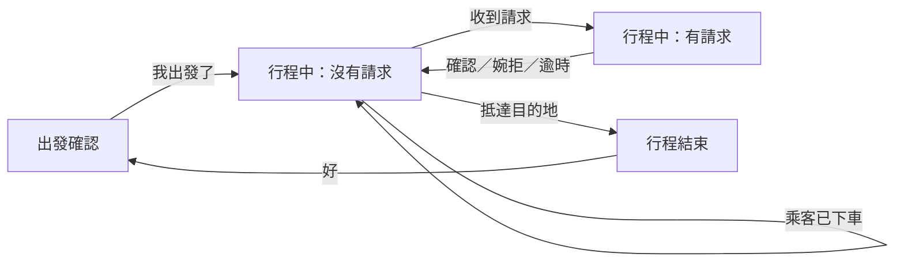
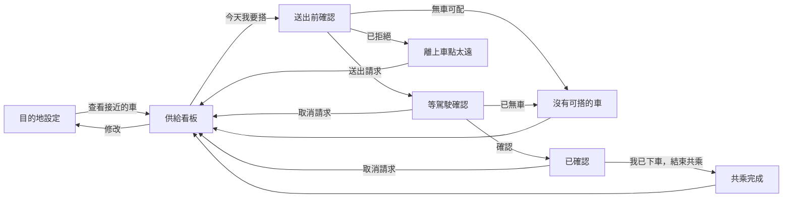
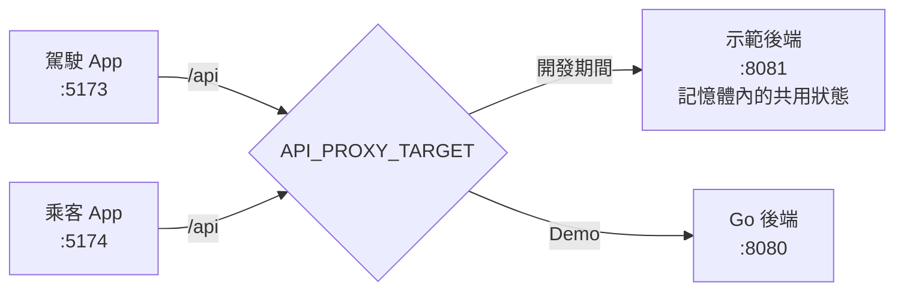

# 內科順路共乘 — UI 設計（草案）

議題 #4 · 來源文件：[需求規格（requirement.md）](requirement.md)、[第一層設計（design.md）](design.md) 4.1～4.2、[範圍決定（OVERVIEW.md 第 9 節）](../OVERVIEW.md#9-範圍決定)

> [!IMPORTANT]
> **這是討論用的草案。** 所有設計決定都還是「提案」狀態，要討論後才定案。需要大家表態的問題整理在 [第 12 節](#12-待討論議題)。

## 目錄

1. [目的與範圍](#1-目的與範圍)
2. [使用者與使用情境](#2-使用者與使用情境)
3. [設計原則](#3-設計原則)
4. [設計方向](#4-設計方向)
5. [畫面流程](#5-畫面流程)
6. [駕駛畫面](#6-駕駛畫面)
   - [6.1 出發確認](#61-出發確認)
   - [6.2 行程中：沒有請求](#62-行程中沒有請求)
   - [6.3 行程中：有請求](#63-行程中有請求)
   - [6.4 行程結束](#64-行程結束)
7. [乘客畫面](#7-乘客畫面)
   - [7.1 目的地設定](#71-目的地設定)
   - [7.2 供給看板](#72-供給看板)
   - [7.3 送出前確認](#73-送出前確認)
   - [7.4 請求狀態](#74-請求狀態)
8. [視覺系統](#8-視覺系統)
   - [8.1 色彩](#81-色彩)
   - [8.2 字體與字級](#82-字體與字級)
   - [8.3 共用元件](#83-共用元件)
   - [8.4 動態](#84-動態)
   - [8.5 文字語氣](#85-文字語氣)
   - [8.6 完成度提升項目](#86-完成度提升項目)
   - [8.7 地圖上的車輛](#87-地圖上的車輛)
9. [無障礙與可用性](#9-無障礙與可用性)
10. [各畫面需要的資料](#10-各畫面需要的資料)
    - [10.1 資料內容](#101-資料內容)
    - [10.2 開發期間的示範後端](#102-開發期間的示範後端)
11. [需求對應](#11-需求對應)
12. [待討論議題](#12-待討論議題)

## 1. 目的與範圍

**目的：** 定出駕駛介面與乘客介面的資訊架構、畫面、視覺語言與互動規則，讓前端、後端和 Demo 劇本有共同的依據。

**品質目標：** 以 Awwwards、Webby、FWA 得獎作品的完成度為標準。這裡指的是「有明確觀點、細節到位、一眼就認得出來」，不是加特效。駕駛安全（G5）優先於任何視覺表現。

**範圍：**

- 包含：駕駛介面、乘客介面的所有 PoC 畫面（[design.md 1.1](design.md#11-poc-交付範圍)）。
- 不包含：企業管理、營運設定、供需狀況頁（Phase 2）；市府儀表板。

**呈現形式：** PoC 用網頁假裝手機 App。畫面要看起來、用起來都像 App，不像網站（UD-11）。

#### UD-11 以網頁模擬手機 App

狀態：提案

- **做法：**
  - 沒有網站的元素：沒有頁首導覽列、頁尾、超連結樣式，也沒有只在滑鼠移上去才出現的東西。
  - 全螢幕版面，避開瀏海與底部的手勢區。
  - 停用下拉重新整理與橡皮筋捲動；按鈕上的文字不能被選取；點擊時不出現瀏覽器的反白。
  - 可以「加到主畫面」，從主畫面以全螢幕開啟，有自己的 App 圖示與名稱（網頁 App 設定檔 manifest）。
  - App 才有、網頁做不到的系統功能（例如推播通知），用畫面模擬出來（UD-12）。Demo 時口頭說明這是模擬的。
- **理由：** 我們要展示的是一個 App 的體驗；活動規則只要求能現場操作（REQ-065），用網頁最快做出可操作的作品，但觀眾應該把它想成 App。
- **考慮過的替代方案：** 做原生 App：開發與發佈時間不允許（DD-17）。做成一般網站的樣子：觀眾會把它當成網站，想像不到實際使用情境。
- **需求連結：** REQ-065

#### UD-13 電腦上以手機外框呈現，手機上全螢幕

狀態：提案

- **做法：**
  - **何時顯示外框：** 瀏覽器畫面寬度 600px 以上時，App 畫在一支手機外框裡；寬度小於 600px（真的手機）時全螢幕顯示，不畫外框。只看畫面寬度，不從瀏覽器型號判斷。
  - **被展示頁嵌入時：** 展示頁（ui-oi-14）用網址參數 `?embed=1` 明確告訴 App「不要畫外框」，外框由展示頁畫。嵌入時的寬度本來就是手機寬度，參數只是保險，避免嵌入尺寸調整後誤判。
  - **外框造型：** 通用的手機造型（圓角機身、細邊框），不仿製特定品牌的手機。高度不夠時整支手機等比例縮小，完整放進畫面。
  - **狀態列：** 手機頂端的狀態列（時間、訊號、電量）是畫面的一部分。時間固定顯示早上上班時間 **08:12**，不隨真實時間走，讓 Demo（下午 16:30）時仍是晨峰情境。
  - **版面以手機螢幕為準：** 底部固定的按鈕、底部面板、模擬推播通知（UD-12）都對齊手機螢幕的邊緣，不對齊瀏覽器視窗。
  - **外框外面：** 單獨開啟一個 App 時，外框外面只放 App 名稱與目前角色（駕駛／乘客）。「重設」放在展示頁（UD-18），因為它同時影響兩個 App。
- **理由：** Demo 用電腦投影與直播，外框讓觀眾一眼看出這是手機 App（UD-11）；畫面固定為手機尺寸，不會因視窗大小變形；模擬推播從手機頂端滑下才像真的。真的手機上再畫外框會變成「手機裡的手機」，所以手機上全螢幕。
- **考慮過的替代方案：** 一律畫外框：用手機開時很奇怪。一律不畫外框：投影時看起來像網站，瀏覽器視窗拉寬時版面也會變形。
- **需求連結：** REQ-065

#### UD-18 展示頁：Demo 的主畫面

狀態：提案

- **做法：** 一個桌面網頁，Demo 與直播時只開這一頁。

  ```
  ┌──────────────────────────────────────────────────────
  │ 內科順路共乘                               [ 重設 ]
  │
  │      ╭──────────╮                ╭──────────╮
  │      │ 08:12  ▮ │                │ 08:12  ▮ │   ← 狀態列（UD-13）
  │      │          │                │          │
  │      │ 駕駛 App │                │ 乘客 App │
  │      │          │                │          │
  │      ╰──────────╯                ╰──────────╯
  │          駕駛                         乘客
  └──────────────────────────────────────────────────────
  ```

  - **兩支手機：** 左邊駕駛、右邊乘客，各自用 UD-13 的手機外框與狀態列。手機螢幕裡嵌入真正的駕駛 App 與乘客 App（帶 `?embed=1`），在框裡可以直接操作。
  - **兩個 App 各自獨立運行：** 各有自己的網址、帳號與輪詢，彼此不直接溝通，只透過後端互相影響（駕駛按「確認」→ 後端 → 乘客下一次輪詢看到「已確認」）。
  - **重設（ui-oi-19）：** 右上角一個「重設」按鈕，把所有資料回到初始狀態（帳號、標籤、模擬行程保留；行程、請求、服務紀錄清空）。
    - 按一下後按鈕變成「再按一次確定重設」，3 秒內再按才執行，避免 Demo 中誤觸。不用彈出對話框。
    - 執行後兩支手機的畫面一起重新載入，回到起始畫面（駕駛回到出發確認，乘客回到供給看板）。
    - 呼叫 `POST /api/demo/reset`（見 [10.2](#102-開發期間的示範後端)）。
  - **大小：** 兩支手機加上中間的間距要能放進 1920×1080 的直播畫面；螢幕較小時整頁等比例縮小。
  - **其他：** 頁面背景用 `paper`，除了 App 名稱、角色名稱與「重設」以外不放其他東西，讓觀眾的目光留在兩支手機上。
- **理由：** Demo 只有約 2 分鐘，觀眾要同時看到「駕駛按確認」與「乘客畫面變化」才看得懂因果；一頁並排也不會在 Demo 時切錯視窗。重設影響兩個 App，放在兩支手機之外的同一個地方最合理。
- **考慮過的替代方案：** 兩個瀏覽器視窗並排：視窗邊框、網址列都會進到直播畫面，也可能切錯視窗。每個 App 各放一個重設：按一邊會影響另一邊，容易搞混。
- **需求連結：** REQ-065

**文件慣例：**

- UI 設計決定編號為 `UD-nn`，狀態一律先標「提案」。
- 待討論議題編號為 `ui-oi-nn`。
- 畫面草圖用文字線框表示，只表達位置和層級，不代表實際比例。

## 2. 使用者與使用情境

| | 駕駛 | 乘客 |
|---|---|---|
| 時間 | 平日 07:00–09:30 | 平日 07:00–09:30 |
| 地點 | 出發前：停在家門口或停車場；行程中：在車上 | 捷運上快到站；出站後站在上車點路邊 |
| 姿勢 | 行程中手機在支架上，只能瞄一眼 | 站著、單手拿手機、可能提著包包 |
| 注意力 | 行程中幾乎為零 | 分散，趕時間 |
| 最想知道 | 有沒有人要搭？在哪上、在哪下？ | 有沒有車？要等多久？哪台車？ |
| 最怕 | 開車時被迫看手機、按很多下 | 白等；不知道系統在做什麼；認不出車 |

**Demo 情境（REQ-065、DD-24）：** 前端與後端全部在本機執行。同一台電腦開兩個瀏覽器視窗，各自以手機外框呈現（UD-13），一邊駕駛、一邊乘客，透過 YouTube 直播，每組約 2 分鐘。觀眾要在幾秒內看懂「發生了什麼事」，所以狀態變化要大、要明顯。

## 3. 設計原則

- **P1 一眼看懂。** 每個畫面只有一個最重要的資訊，用最大的字呈現。其他資訊退後。
- **P2 駕駛只面對一件事。** 行程中只回答「有沒有人要搭」。用畫面結構保證，而不是靠提醒（DD-04）。
- **P3 預設值就是答案。** 設定沿用上次，大多數早上一個動作就完成（REQ-016、REQ-017、REQ-025）。
- **P4 不能選車，但要讓人安心。** 乘客不能挑車（REQ-031），所以要讓他看到「車正在來」和「系統在處理」。
- **P5 誠實標示模擬。** 模擬或估算的資料一律標示，而且標示方式全站一致（REQ-063）。

## 4. 設計方向

距離 Demo 還有約一週，時間足夠把畫面做到位，所以選方向時不考慮「做得快」，只看哪個最適合題目與使用情境。考慮過兩個方向：

| 方向 | 說明 | 優點 | 缺點 |
|---|---|---|---|
| **A. 交通標誌語言**（推薦） | 把共乘畫成台北交通標誌裡的「另一條線」：路線色、站名牌、路線圖、到站看板、路面標線黃 | 通勤者每天看，不用教；和題目（交通、內湖、捷運）直接相關；有辨識度 | 要克制，不能變成模仿捷運；路線色不能和捷運任何一條線撞色 |
| B. 地圖為主 | 像叫車 App，全螢幕地圖加底部面板 | 大家熟悉 | 駕駛行程中不能有地圖（DD-04），兩邊會變成兩套語言；沒有地圖金鑰時整個畫面失效；和一般叫車 App 分不出來 |

### UD-01 採用「交通標誌語言」作為視覺方向

狀態：提案

- **做法：** 只借四樣東西，其他保持安靜：
  1. **路線色**：共乘線專屬的綠色（見 [8.1](#81-色彩)），捷運沒有用過。
  2. **路線圖**：像捷運車廂裡的直式路線圖，畫出「上車點 → 沿途公車站 → 終點」。
  3. **站名牌與到站看板**：上車點用路線色色帶、白色大字；等待時間用看板式的大數字。
  4. **路面標線黃**：只在駕駛收到搭車請求時使用。
- **理由：** 符合 P1；和議題主題連在一起，Demo 時一看就知道是「交通」的作品；路線圖不依賴地圖金鑰，地圖失效時仍能看懂路線。
- **需求連結：** REQ-003、REQ-063、REQ-066

## 5. 畫面流程

**駕駛：**



- 重新整理頁面時，如果行程進行中，直接回到行程中畫面，不會掉回設定畫面。
- 行程中沒有任何回到設定的入口（REQ-019），也沒有「結束行程」按鈕：抵達目的地時行程自動結束（UD-16）。

**乘客：**



- 已經有常用設定時，打開 App 直接進供給看板，跳過目的地設定（REQ-025）。
- 重新整理頁面時，如果有進行中的請求，直接回到請求狀態。

## 6. 駕駛畫面

### 6.1 出發確認

```
│ ▌駕駛 driver4                    ← 帳號標示，疊在地圖上
│
│        [ 地圖：上車點、行程路線、沿途公車站、目的地 ]
│
╭──────────────────────────────── ← 白色面板蓋住地圖下緣
│ 今天載人嗎？
│ 設定沿用上次。沒問題就出發。
│
│ ◯ 松山車站                上車   ← 路線圖：今天的行程
│ ┃
│ ○ 堤頂大道一段
│ ┃
│ ○ 陽光街
│ ┃
│ ■ 瑞光路 513 巷           終點
│   ┆路線為估算┆                  ← 模擬標示
│ ─────────────────────────────
│ 上車點          松山車站    ›   ← 收合時顯示目前的值
│ 目的地          瑞光路 513 巷 ›
│ 可載人數        (−)  3  (+)
│ 自動接受                   ( ○)
│ 篩選乘客        強制：不抽菸 ›
│ 我的標籤        不抽菸、安靜 ›
│
│ ┌───────────────────────────
│ │          我出發了            ← 固定在底部
│ └───────────────────────────
```

- 第一次出發（沒有上次設定）時，上車點和目的地預設展開，「我出發了」在填好目的地前不能按。
- 改了上車點或目的地，路線圖和地圖會更新。

#### UD-02 設定收合，收合時直接顯示目前的值

狀態：提案

- **做法：** 每一項設定是一列，收合時右邊顯示目前的值；點了才展開編輯。
- **理由：** 駕駛不用展開任何東西就能確認今天的設定（P3），沒問題就直接按「我出發了」（REQ-017）。
- **考慮過的替代方案：** 全部展開成表單：一眼看不完，要捲動，違反「一個動作出發」的精神。分成多步驟：操作更多。
- **需求連結：** REQ-015、REQ-016、REQ-017

#### UD-03 出發確認畫面用淺色，行程中畫面用深色

狀態：提案

- **做法：** 出發確認是一般淺色畫面；按下「我出發了」後整個畫面變成深色柏油底。
- **理由：** 兩種模式一看就分得出來，駕駛知道「現在是開車模式」；深色在清晨車內比較不刺眼。
- **需求連結：** REQ-066

### 6.2 行程中：沒有請求

```
│ 行程中                           ← 深色柏油底、白字
│
│ 目前沒有
│ 搭車請求                         ← 48px
│
│
│
│ 車上乘客
│ ─────────────────────────────
│ 瑞光路 下車            [已下車]   ← 替乘客結束共乘（DD-23）
│ ─────────────────────────────
│ 陽光街 下車            [已下車]
```

- 沒有地圖、統計、提示、動畫或設定入口（DD-04）。
- 沒有乘客時，下方是空的。
- 「已下車」按鈕高度 64px，按鈕的無障礙名稱是「瑞光路的乘客已下車」，避免多位乘客時按錯。

### 6.3 行程中：有請求

```
│ 有乘客要搭車                     ← 整個畫面變成路面標線黃
│
│ ◯ 上車
│ ┃ 松山車站                       ← 48px
│ ┃
│ ■ 下車
│   瑞光路                         ← 48px
│
│ 車上乘客在 陽光街 下車            ← 只有在車上有乘客時
│
│ ┌───────────────────────────
│ │            確認               ← 最大的按鈕，高 112px
│ └───────────────────────────
│ ┌───────────────────────────
│ │            婉拒               ← 次要，高 72px
│ └───────────────────────────
```

#### UD-04 收到請求時整個畫面換色，不用動畫或彈窗

狀態：提案

- **做法：** 有請求時，整個畫面從深色變成路面標線黃；請求處理完再變回深色。沒有動畫、閃爍、彈窗或聲音。
- **理由：** 駕駛用餘光就能察覺狀態變了（P1、P2），不需要讀任何字；不用動畫，符合 REQ-066「不顯示動畫」。Demo 時觀眾也能一眼看到變化。
- **考慮過的替代方案：** 彈出對話框：遮住內容，還要多一個關閉動作。閃爍或動畫提醒：違反 REQ-066，也會讓駕駛分心。
- **需求連結：** REQ-020、REQ-049、REQ-066

#### UD-05 「確認」放在拇指最好按的位置，而且最大

狀態：提案

- **做法：** 「確認」在下方、最大；「婉拒」在它下面、較小，用外框樣式。兩個按鈕中間有間距，避免誤觸。
- **理由：** 單一操作就能回應（REQ-020）；停紅燈時一手就能按。
- **考慮過的替代方案：** 左右並排：按鈕變窄，容易按錯。滑動確認：要看著畫面操作。
- **需求連結：** REQ-020

### 6.4 行程結束

```
│ 已到達目的地                     ← 深色柏油底、白字
│ 瑞光路 513 巷
│
│ 今天載了 2 位乘客                 ← 行程已結束，不在行車中
│
│ [             好              ]   ← 回到出發確認
```

#### UD-16 抵達駕駛目的地時，行程自動結束

狀態：提案

- **做法：**
  - 後端依車輛回報的位置，判斷車輛進入目的地周圍的範圍後，結束這段行程。駕駛介面下一次輪詢看到行程已結束，就換到「行程結束」畫面。
  - 行程中畫面**不放**「結束行程」按鈕。
  - 結束時車上還沒結束共乘的乘客，由後端一併標記完成（REQ-067），座位釋放。
  - 結束時若有待回應的請求，後端取消它並改配給下一台車，乘客端看到「已改配」。
  - 「行程結束」畫面已經不在行車中，可以顯示今天載了幾位乘客；按「好」回到出發確認。
- **理由：** 駕駛到了目的地自然就是行程結束，不需要多一個操作；行程中畫面也維持 REQ-066 的極簡。判斷放在後端（DD-06 已用位置判斷是否經過上車點，做法相同）。
- **考慮過的替代方案：** 行程中放「結束行程」按鈕：增加行車中的操作與誤觸風險。車上沒乘客時才顯示按鈕：畫面會依情況變動，駕駛要多看一眼。
- **影響：** 後端要以位置判斷是否抵達目的地；模擬器的駕駛路徑要開到目的地。
- **需求連結：** REQ-055、REQ-066、REQ-067

## 7. 乘客畫面

### 7.1 目的地設定

```
│ 要去內科哪裡？
│ 用來找順路的車，下次會自動帶入。
│
│ 目的地地址
│ [ 瑞光路 513 巷                ]
│
│ 也可以在這些公車站下車
│ 至少選一站，再走路到目的地。
│ (堤頂大道一段) (陽光抽水站) (●陽光街)
│ (●瑞光路) (港墘路) (瑞光港墘路口)
│
│ 篩選駕駛
│ 不抽菸        [不限|建議|強制]
│ 安靜          [不限|建議|強制]
│ ⋯
│ 強制：不符合就不配對。建議：盡量配對符合的駕駛，沒有時照常配對。
│
│ 我的標籤
│ (不抽菸) (●安靜) (可載行李) ⋯
│
│ [        查看接近的車         ]   ← 地址與至少一站都有才能按
```

- 公車站清單只列內科園區內、會有行程經過的站（REQ-001）。不做依步行時間建議（REQ-026，Phase 2）。

#### UD-06 標籤篩選用「不限／建議／強制」三段切換

狀態：提案

- **做法：** 每個標籤一列，右邊是三段切換。駕駛端和乘客端用同一個元件。
- **理由：** REQ-013 要求每個篩選都指定意圖；把「沒有篩選」也放進同一個控制項，一次操作就能設定，不用先勾標籤再選意圖。
- **考慮過的替代方案：** 先勾選標籤、再出現強制／建議：要兩步，畫面會跳動。
- **需求連結：** REQ-013、REQ-032、REQ-035

### 7.2 供給看板

```
│ 到 瑞光路 513 巷                 [修改]
│ 也可以在 陽光街、瑞光路 下車
│
│████ ▌松山車站           你在這裡 █ ← 站名牌：路線色色帶、白字
│
│ 最快  3  分鐘到                  ← 數字 104px，畫面上唯一的大數字
│ 3 台車接近中    空位 6
│
│        3        6     9
│ ├──────●────────●─────●──┤        ← 時間軸：0 到「等待上限」
│ 現在                    10 分
│
│ 其他上車點
│ ─────────────────────────────
│ ▌台北世貿中心   1 台  最快 5 分  空位 2
│ ▌台北大巨蛋     3 台  最快 1 分  空位 6
│
│ ┆模擬車輛┆ 車輛位置與到站時間由模擬器產生
│
│ [         今天我要搭           ]   ← 固定在底部
│   由平台替你分配車，不能自選
```

- 數字隨輪詢更新（DD-03），時間軸上的車點滑到新位置。
- 時間軸上的車點**不是按鈕**，點了沒有反應（REQ-031）。
- 所在上車點沒有車時，大數字改成「10 分鐘內沒有車」，「今天我要搭」仍可按，送出後會立即得到「沒有可搭的車」與替代方案（REQ-036）。
- 離上車點太遠時，站名牌右側顯示「距離 420 公尺」，底部說明改成「走到上車點附近才能送出」。

#### UD-07 只有「你所在的上車點」用到站看板與時間軸，其他上車點只列三個數字

狀態：提案

- **做法：** 後端依乘客位置判斷最近的上車點，放在最上面，給大數字和時間軸；其他上車點只列「幾台、最快幾分、空位」。
- **理由：** 乘客只能在所在的上車點送出請求（REQ-034），那裡的資訊最重要（P1）。三個上車點都給時間軸，畫面會變成三張一樣的卡片，看不出重點。其他上車點仍符合 REQ-029 的三個數字。
- **考慮過的替代方案：** 三個上車點都用相同卡片：資訊平均，看不出該看哪裡。只顯示所在上車點：還沒到站的乘客看不到其他選擇。
- **需求連結：** REQ-029、REQ-030、REQ-031

### 7.3 送出前確認

```
│ （供給看板變暗）
╭────────────────────────────────  ← 底部面板
│ 送出搭車請求
│ 平台會替你分配一台最快能送你到的車。
│
│ 篩選駕駛
│ 不抽菸        [不限|建議|強制]   ← 預先帶入目前的篩選
│ 安靜          [不限|●建議|強制]
│ ⋯
│
│ [          送出請求            ]
│ [           先不要             ]
```

#### UD-08 「今天我要搭」先開底部面板，再送出

狀態：提案

- **做法：** 按「今天我要搭」開出底部面板，帶入目前的篩選，可以調整，按「送出請求」才送出。
- **理由：** REQ-035 要求送出時可以調整篩選；多一步也避免在口袋裡誤觸送出。
- **考慮過的替代方案：** 按下就送出，篩選放在供給看板上：供給看板會太擠；而且誤觸就直接送出。
- **需求連結：** REQ-035、REQ-036

### 7.4 請求狀態

**等駕駛確認：**

```
│████ ▌松山車站           在這裡等 █
│
│ 正在等駕駛確認
│ ━━━━━░░░░░░░░░░░░░░░░░░░░░       ← 路線色光點沿線移動
│ 駕駛確認後，這裡會顯示車牌和到達時間。
│
│ ▌上一位駕駛沒有回應，已改配下一台車。  ← 只有改配時出現
│
│                                    取消請求   ← 文字按鈕，見 UD-17
```

**已確認：**

```
│        [ 地圖：行程路線、上車點、沿途公車站、目的地，
│          以及分配到的車正開向上車點（UD-15） ]
╭────────────────────────────────
│ 3 分鐘後到                       ← 數字 88px
│ 在松山車站上車
│
│ ┏━━━━━━━━━━┓
│ ┃ BKR-5821 ┃  白色 Toyota Corolla Altis   ← 台灣車牌樣式
│ ┗━━━━━━━━━━┛
│ 這台車不完全符合你的建議標籤      ← 已放寬：小字，不跳通知（REQ-047）
│ ─────────────────────────────
│ ◯ 松山車站                上車
│ ○ 堤頂大道一段
│ ◉ 陽光街                  下車   ← 乘客的下車站
│ ○ 瑞光路
│ ■ 瑞光路 513 巷           終點
│
│ [     我已下車，結束共乘       ]
│              取消請求              ← 上車前才顯示，見 UD-17
```

**沒有可搭的車：**

```
│ 目前沒有可搭的車
│ 從松山車站可以這樣去：
│ ─────────────────────────────
│ [藍7]     松山車站（八德）上車，瑞光路下車    24 分 ┆估算┆
│ [東環幹線] 松山車站（松隆）上車，瑞光路下車    27 分 ┆估算┆
│ [步行]    經塔悠路、堤頂大道                 62 分 ┆估算┆
│
│ [       回去看接近的車          ]
```

- 公車路線名稱用真實資料（`docs/data/busstop`）；時間是估算，要標示。

**離上車點太遠（已拒絕）／共乘完成：** 一個標題、一句說明、一個按鈕。

- 已拒絕：「還不能送出」／「你離松山車站約 420 公尺，走到 200 公尺內再送出。」／「回去看接近的車」
- 完成：「共乘完成」／「這趟共乘已記錄。路上少了一台車。」／「回到首頁」

#### UD-17 乘客可以在上車前取消請求

狀態：提案

- **做法：**
  - 「等駕駛確認」與「已確認」畫面都有「取消請求」，用文字按鈕，放在主要按鈕下方，不搶主要操作。
  - 按一下後變成「再按一次確定取消」，3 秒內再按才執行，不用彈出對話框（和重設相同的做法）。
  - 取消後回到供給看板，顯示一行「已取消請求」。
  - 上車後（乘客按「結束共乘」之前）不能取消；後端以車輛已經過上車點判斷（DD-06），之後「取消請求」不再顯示。
  - **駕駛端：** 待回應的請求被取消時，畫面從黃色變回深色；已確認的乘客取消時，從「車上乘客」清單消失。不另外提示（REQ-066）。座位由後端釋放。
- **理由：** 乘客可能臨時改搭其他交通工具；沒有取消，座位會一直被佔用，駕駛也會白跑一趟上車點。
- **考慮過的替代方案：** 用對話框確認：多一個彈窗；而且全站其他確認都用「再按一次」，保持一致。
- **影響：** 後端要提供取消請求的 API，並在取消時釋放座位、更新駕駛端的資料。
- **需求連結：** REQ-039、REQ-053

#### UD-09 已確認畫面以「幾分鐘後到」最大，車牌第二

狀態：提案

- **做法：** 層級依序是：幾分鐘後到 → 在哪上車 → 車牌與車型 → 路線圖與下車站 → 地圖。
- **理由：** 乘客站在路邊最在意的是「還要等多久」和「哪台是我的車」（REQ-052）。車牌用台灣車牌樣式，對照路上的車最快。
- **需求連結：** REQ-003、REQ-047、REQ-052

## 8. 視覺系統

### 8.1 色彩

| 名稱 | Token | 色碼 | 用途 |
|---|---|---|---|
| 共乘路線色 | `brand` | `#0a7a68` | 主要按鈕、路線、站名牌 |
| 路線色（按下） | `brand-dark` | `#065a4d` | 主要按鈕按下 |
| 路線色（淡） | `brand-soft` | `#d9efe9` | 時間軸底線、地圖底色 |
| 柏油 | `ink` | `#1a242c` | 內文；駕駛行程中背景；強制篩選 |
| 柏油（淡） | `ink-soft` | `#55626c` | 次要文字 |
| 晨間 | `paper` | `#edf1ef` | 乘客畫面背景，冷色調 |
| 分隔線 | `rule` | `#c9d2cf` | 分隔線、未選取外框 |
| 路面標線黃 | `signal` | `#ffc61a` | **只用在**駕駛收到搭車請求 |
| 錯誤 | `danger` | `#c0362c` | 錯誤訊息 |
| 模擬 | `simulated` | `#6a4fb8` | 模擬資料標示 |

- 所有文字與背景的對比至少 4.5:1；`brand` 配白字約 5.3:1。
- 路線色要避開台北捷運六條線的顏色（紅、藍、綠、橘、棕、黃），以免被誤認為捷運路線。
- `signal` 黃不能拿來當一般強調色，駕駛才會把「變黃」和「有人要搭」連在一起。

### 8.2 字體與字級

- **Barlow**：拉丁字母與數字。造型來自美國加州的公路標誌，和道路情境一致。
- **Barlow Condensed**：分鐘數、車牌，像到站看板。
- **中文**：系統字（iPhone 是蘋方，其他平台是 Noto Sans TC）。中文字型檔很大，不另外載入。

| 用途 | 大小 |
|---|---|
| 乘客到站看板的分鐘數 | 104px（全站唯一的大數字） |
| 已確認畫面的分鐘數 | 88px |
| 駕駛行程中的地名、標題 | 48px |
| 駕駛「確認」按鈕 | 36px |
| 畫面標題 | 30–36px |
| 內文 | 16–18px |
| 補充說明 | 14px（最小） |

### 8.3 共用元件

駕駛與乘客都會用到的元件放在 `ui/shared`：

| 元件 | 說明 |
|---|---|
| 路線圖 `RouteStrip` | 上車點是空心大圓、沿途公車站是小圓、乘客下車站是實心圓、終點是方塊；路線色實線連接 |
| 路線地圖 `RouteMap` | 地圖上的上車點、行程路線、沿途公車站、目的地 |
| 標籤篩選 `TagFilterEditor` | 見 UD-06 |
| 多選標籤 `ChipSelect` | 我的標籤、可接受的下車公車站 |
| 模擬標示 `SimulatedBadge` | 紫色虛線外框，代表「估算，不是量測」 |
| 錯誤訊息 `ErrorNote` | 左側紅線、短句；保留上一次的資料 |
| 按鈕 `Button` | 最小高度 56px |

乘客專用：站名牌 `StationSign`、時間軸 `ArrivalTimeline`、車牌 `Plate`。

**圓角規則：** 按鈕與輸入框 16px、底部面板 24px；清單列不加圓角、不加陰影，用分隔線分開。避免整頁都是一樣的圓角卡片。

### 8.4 動態

- **駕駛行程中：完全沒有動畫**，包括轉場（REQ-066）。
- 乘客畫面只有以下動態：
  - 等駕駛確認時，光點沿線移動。這是全站唯一不是使用者觸發的持續動態，用來表示「系統正在處理」。
  - 時間軸上的車點在每次輪詢後滑到新位置，表示車正在接近。
  - 駕駛確認時，路線圖畫到下車站（UD-10）。
  - 配對成功時，模擬的推播通知從頂端滑下（UD-12）。
  - 地圖上的車輛平滑移動、轉向（UD-15）。
- 尊重系統的「減少動態效果」設定：開啟時上述動態全部停止，車輛直接跳到新位置。

### 8.5 文字語氣

- 按鈕寫出按下後會發生什麼，而且同一個動作從頭到尾用同一個詞：「我出發了」「今天我要搭」「送出請求」「我已下車，結束共乘」。
- 錯誤說清楚發生什麼、怎麼處理，不道歉。
- 沒有車時給下一步（替代方案），不只說「沒有」。
- 不用全大寫英文、不用「→」當裝飾、不在每個標題上加小標籤。

### 8.6 完成度提升項目

時間足夠，以下項目可以把畫面從「能用」推到「得獎作品的完成度」。依對 Demo 的影響排序；要做哪些待討論（[ui-oi-13](#12-待討論議題)）。駕駛行程中畫面維持極簡，以下項目都不會加到那裡。

| 優先 | 項目 | 說明 | 影響的畫面 |
|---|---|---|---|
| 1 | 自訂地圖樣式 | 用 Google Maps 的雲端地圖樣式（Map ID），淡化商家與地標，只讓路線色的行程路線跳出來。三個候選見 [map-styles](data/map-styles/README.md) | 駕駛出發確認、乘客已確認 |
| 2 | 自訂地圖標記 | 上車點用站名牌樣式、公車站用路線圖的小圓、目的地用方塊，取代 Google 預設圖釘；和路線圖用同一套符號 | 同上 |
| 3 | 「已確認」的一次性轉場 | 駕駛確認的那一刻，路線圖從上車點一路畫到乘客的下車站，接著分鐘數出現。全站唯一經過編排的動態（UD-10） | 乘客已確認 |
| 4 | 展示頁 | 一個桌面頁面，並排放兩支手機外框與「重設」，直播畫面一次看到雙方（UD-18） | Demo 專用 |
| 5 | 載入與空狀態 | 載入時用路線圖的灰色骨架代替空白；第一次使用的空狀態也用路線圖語言 | 全部 |
| 6 | App 圖示 | 路線圖符號做成的 App 圖示，加到主畫面與瀏覽器分頁時使用（UD-11） | 全部 |

#### UD-10 乘客端只保留一個編排過的動態：「已確認」

狀態：提案

- **做法：** 等待中的光點在駕駛確認時停下，路線圖從上車點畫到下車站（約 0.6 秒），接著分鐘數與車牌淡入。其他畫面不加進場動畫。
- **理由：** 「配到車了」是整個服務最重要的時刻，也是 Demo 時觀眾最需要看懂的一刻。只在這裡用動態，效果最強；到處都有動畫反而沒有重點。
- **考慮過的替代方案：** 每個畫面都加進場動畫：顯得廉價，也拖慢操作。完全不用動態：最重要的時刻和其他狀態看起來一樣。
- **需求連結：** REQ-052、REQ-065

#### UD-12 配對成功時，用畫面模擬手機的推播通知

狀態：提案

- **做法：** 乘客的請求變成「已確認」時，畫面頂端滑下一則仿手機系統的通知，同時下方播放 UD-10 的轉場。

  ```
  │ ╭───────────────────────────────╮
  │ │ [圖示] 內科順路共乘        現在 │   ← 半透明白底、圓角，仿手機系統通知
  │ │ 配到車了                       │
  │ │ BKR-5821 3 分鐘後到松山車站     │
  │ ╰───────────────────────────────╯
  │
  │ （下方：已確認畫面，路線圖畫到下車站）
  ```

  - 停留約 5 秒後自動收起；往上滑或點一下也會收起。點一下會停在已確認畫面。
  - 只有「配對成功」會出現通知。駕駛端收到請求時整個畫面已經變黃（UD-04），不另外模擬通知。
  - 不加提示音：Demo 現場與直播不一定播得出聲音。
  - 開啟「減少動態效果」時，通知直接出現、不滑動。
- **理由：** 真正的 App 在配到車時會推播，乘客不必一直盯著畫面。PoC 不推播（DD-03），但 Demo 要讓觀眾看到這個體驗（UD-11）。
- **考慮過的替代方案：** 真的推播：違反 DD-03，iPhone 還要先加到主畫面才能收。加提示音：Demo 時可能播不出來。只有畫面轉場：看不出「App 在背景也會通知你」。
- **需求連結：** REQ-052、REQ-065

### 8.7 地圖上的車輛

地圖上出現車輛的地方**只有**乘客「已確認」畫面上分配到的那台車，正開向上車點（已確認）。駕駛行程中沒有地圖（DD-04）；供給看板不加地圖，用時間軸表達（UD-07）；之後若做展示頁的大地圖（ui-oi-14），也照這裡的規則。

#### UD-15 車輛在地圖上平滑移動，車頭朝向行進方向

狀態：提案

- **做法：**
  - **圖示：** 由上往下看的車子剪影，路線色車身、白色外框；圖示的車頭朝上代表朝北。
  - **平滑移動：** 每次輪詢拿到新位置後，車子從畫面上的舊位置，在一個輪詢間隔內等速移動到新位置。畫面上的車因此比實際位置晚約一個輪詢間隔（約 3 秒），但不會跳動，也不會倒退。
  - **車頭方向：** 用 API 回傳的行進方向（以正北為 0 度、順時針的角度）旋轉圖示。API 沒有給方向時，用前後兩個位置算出方向；移動不到 5 公尺（例如停紅燈）時保持原來的方向，避免定位誤差讓車頭亂轉。
  - **轉向：** 車頭轉到新方向時走較短的那一邊（例如 350 度轉到 10 度是順時針轉 20 度，不是逆時針轉 340 度），約 0.3 秒轉完。
  - **地圖固定朝北：** 地圖不旋轉、不傾斜，圖示的旋轉角度就等於行進方向。
  - **不做動畫的情況：** 兩次位置相距超過 300 公尺，或中間斷了 3 次以上輪詢（例如網路中斷、Demo 重設）時，直接跳到新位置，不畫一條穿過房子的直線。開啟「減少動態效果」時也直接跳。
- **理由：** 車子一格一格跳會讓人覺得系統卡住；平滑移動加上正確的車頭方向，乘客一看就知道車正朝自己開過來（P4），Demo 時也最有說服力。晚 3 秒顯示換來不跳動，對「還要等幾分鐘」的判斷沒有影響。
- **考慮過的替代方案：**
  - 依速度預測車子接下來的位置：沒有延遲，但預測錯時車子會往回退，或衝過轉角再彈回來。
  - 讓車子沿著行程路線移動：車子到上車點之前不一定走行程路線（DD-06），會畫在錯的路上。
  - 每次輪詢直接跳到新位置：最簡單，但看起來卡頓。
- **影響：** 位置回報的間隔要不大於輪詢間隔，否則車子會停住再前進。示範後端（UD-14）與模擬器（DD-14）要沿真實道路產生位置與方向。後端已確認可以提供行進方向與符合間隔的位置回報。
- **需求連結：** REQ-003、REQ-023、REQ-052

## 9. 無障礙與可用性

- 觸控目標至少 44×44px；駕駛行程中的按鈕至少 64px 高。
- 以 390px 寬度設計；所有主要操作都在螢幕下半部，單手可及。
- 鍵盤焦點清楚可見（路線色外框）。
- 狀態不只靠顏色表達：駕駛畫面換色的同時，標題文字也改變。
- 時間軸對螢幕閱讀器提供文字摘要，例如「接近中的車：3、6、9 分鐘後到」。
- 地圖金鑰沒有設定或載入失敗時，路線圖仍能表達路線，其他功能照常運作。

## 10. 各畫面需要的資料

### 10.1 資料內容

給後端參考：畫面需要的資料。名稱與格式待和後端討論（[ui-oi-10](#12-待討論議題)）。

| 畫面 | 需要的資料 |
|---|---|
| 出發確認 | 上次的出發設定（沒有時為空）、上車點清單、標籤清單、我的標籤、指定上車點與目的地的行程路線與沿途公車站（是否為估算） |
| 駕駛行程中 | 待回應的請求（上車點、下車點）、已確認乘客的下車點；確認、婉拒、替乘客結束共乘的操作；行程是否已結束 |
| 行程結束 | 目的地、這趟載了幾位乘客 |
| 目的地設定 | 常用設定（目的地、可接受公車站、篩選）、內科公車站清單、標籤清單、我的標籤 |
| 供給看板 | 等待上限、最近的上車點與距離、是否在可送出範圍內、每個上車點的車數／最快到達／空位／各車 ETA、是否為模擬 |
| 請求狀態 | 狀態（等待中、已確認、無車可配、已拒絕、已完成）、上車點、是否改配、是否已放寬、拒絕原因、車輛資訊、ETA、下車點、行程路線、替代方案；已確認時另加車輛的目前位置、行進方向（正北為 0 度、順時針）與回報時間（UD-15） |
| 展示頁的「重設」 | 重設所有 Demo 資料的操作（`POST /api/demo/reset`） |
| 取消請求 | 取消請求的操作；請求狀態多一個「已取消」 |

### 10.2 開發期間的示範後端

Demo 時接真正的後端（Go）。後端完成前，前端接一個**示範後端**開發，兩者提供同一套 API，切換時前端程式不用改。



#### UD-14 開發期間用獨立的示範後端，讓駕駛與乘客共用同一份狀態

狀態：提案

- **做法：**
  - 示範後端是 `ui/` 下一支獨立的小程式，實作和 Go 後端相同的 API（路徑、格式、`Bearer <角色>:<帳號>` 身分、錯誤碼），所有狀態放在記憶體裡。駕駛和乘客兩個 App 都連到它，所以駕駛按「確認」，乘客下一次輪詢就會看到「已確認」。
  - 帳號與 Go 後端的種子資料一致：2 位乘客、5 位駕駛（[OVERVIEW 第 9 節](../OVERVIEW.md#9-範圍決定)，`seed_test_users` 與 `seed_reference_data` 兩個 migration）。**全部都是 Demo 用的模擬帳號**（REQ-064），沒有真實使用者：
    - `driver1`～`driver3`：預先建立的模擬行程，從松山車站出發、啟用自動接受，車輛 ETA 隨時間遞減。
    - `driver4`、`driver5`：沒有預先建立的行程，Demo 時在駕駛介面上操作出發。
    - `passenger1`、`passenger2`：Demo 時在乘客介面上操作。
  - **切換方式：** 只改連線目標，不改程式。兩個指令各自啟動一種組合：

    | 指令 | 連到 | 用途 |
    |---|---|---|
    | `just ui dev-mock` | 示範後端 `:8081` | 開發期間 |
    | `just ui dev` | Go 後端 `:8080` | 後端完成後、Demo |

  - **一次全部切換：** 不做「部分 API 用後端、部分用示範」的混合模式。兩邊的資料不一致時（例如行程在示範後端、請求在 Go 後端），流程會壞掉，問題也很難查。
  - **Demo 用的控制 API：** 「重設」（UD-18）用 `POST /api/demo/reset`，示範後端與 Go 後端**都要**提供。切換示範情境只有示範後端有（`/api/_mock/…`），開發時用指令操作，不放在介面上。
  - **介面不處理切換：** Demo 時前端與後端全部在本機執行（DD-24），連哪個後端由啟動指令決定，介面上不顯示資料來源，也沒有切換控制項。App 畫面裡的模擬標示仍依 API 回傳的「是否為模擬」顯示（REQ-063）。
- **理由：** 兩個 App 在不同的連接埠上，瀏覽器裡的資料（例如 localStorage）無法互通，只有放在伺服器端才能共用狀態。示範後端走真正的 HTTP 與身分格式，開發期間就會碰到和 Go 後端相同的情況（延遲、錯誤、輪詢），切換時風險最小；它也等於一份「能執行的 API 規格」，後端可以對照。
- **考慮過的替代方案：**
  - 兩個 App 各自在瀏覽器裡放示範資料：狀態不共用，駕駛和乘客無法互動。
  - 把兩個 App 放在同一個網址下，用瀏覽器內的廣播共用狀態：要改開發架構；換到不同瀏覽器或手機就不共用了。
  - 部分 API 先切到後端：資料不一致，見上方「一次全部切換」。
- **影響：** API 格式（ui-oi-10）要先和後端講定，示範後端照它實作；格式之後若有變動，示範後端要跟著改。後端完成後，示範後端仍保留作為後端出問題時的 Demo 備援。
- **需求連結：** REQ-061、REQ-063、REQ-065

**示範情境：** 情境是示範後端的全域設定，同時影響兩個 App，所以兩個視窗看到的永遠是同一個故事。

| 情境 | 發生什麼 |
|---|---|
| 一般（預設） | 乘客送出請求後分配給在駕駛介面上出發的駕駛（`driver4` 或 `driver5`），駕駛畫面變黃；駕駛確認後乘客收到模擬推播與已確認畫面 |
| 改配 | 介面上的駕駛婉拒或逾時後，改配給 `driver1`～`driver3` 的模擬行程並自動接受，乘客看到「已改配」 |
| 沒車 | 等待上限內沒有車，乘客立即看到替代方案 |
| 太遠 | 乘客離上車點太遠，請求被拒絕並說明原因 |

**Demo 用的控制 API：**

| 方法 | 路徑 | 誰提供 | 說明 |
|---|---|---|---|
| POST | `/api/demo/reset` | 示範後端、Go 後端 | 重設成初始狀態；展示頁的「重設」按鈕呼叫（UD-18） |
| GET | `/api/_mock` | 只有示範後端 | 目前的情境 |
| POST | `/api/_mock/scenario` | 只有示範後端 | 切換情境，同時重設狀態；開發時用指令呼叫 |

## 11. 需求對應

| 需求 | 畫面／決定 |
|---|---|
| REQ-003 | 6.1、7.4 地圖與路線圖；UD-01 |
| REQ-008 | 6.1、7.1「我的標籤」 |
| REQ-013 | UD-06 |
| REQ-015、REQ-016、REQ-017 | 6.1；UD-02 |
| REQ-019 | 5 流程（行程中沒有設定入口） |
| REQ-020 | 6.3；UD-04、UD-05（語音見 ui-oi-03） |
| REQ-021 | 6.1「自動接受」 |
| REQ-024、REQ-025 | 7.1；5 流程（有常用設定時跳過） |
| REQ-029、REQ-030、REQ-031 | 7.2；UD-07 |
| REQ-032、REQ-035 | 7.1、7.3；UD-06、UD-08 |
| REQ-034 | 7.2 距離提示、7.4 已拒絕 |
| REQ-036、REQ-051 | 7.4 沒有可搭的車 |
| REQ-047 | 7.4 已確認的小字標示 |
| REQ-049、REQ-050 | 6.3；7.4 改配提示 |
| REQ-052、REQ-053 | 7.4；UD-09、UD-10、UD-12、UD-15 |
| REQ-063 | 8.3 模擬標示 |
| REQ-065 | 8.6；UD-10、UD-11、UD-12、UD-13、UD-14、UD-18 |
| REQ-066 | 6.2、6.3；UD-03、UD-04；8.4 |
| REQ-067 | 6.2「已下車」、7.4「結束共乘」；UD-16 抵達目的地時一併完成 |
| REQ-039 | UD-17 取消後釋放座位 |

## 12. 待討論議題

每一項都附上我的建議，方便直接表態。

| ID | 問題 | 選項 | 建議 |
|---|---|---|---|
| ui-oi-01 | 駕駛要怎麼結束行程？REQ-066 沒有列出「結束行程」，但 Demo 要重來時需要。 | (a) 行程中畫面最下方加一個小的「結束行程」；(b) 不在介面上做，由 SQL 或模擬器結束；(c) 車上沒乘客時才顯示 | **已決定**：抵達駕駛目的地時行程自動結束，不放「結束行程」按鈕（UD-16） |
| ui-oi-02 | 要不要讓駕駛看到「確認時限」倒數？ | (a) 顯示倒數；(b) 不顯示 | (b)：倒數是會變動的提示，違反 REQ-066，也會催促駕駛 |
| ui-oi-03 | REQ-020 的「語音回應」要不要做？ | (a) PoC 只做單一點擊；(b) 加語音指令 | (a)：語音辨識在現場直播環境不穩，風險高 |
| ui-oi-04 | 乘客送出請求的上車點由誰決定？ | (a) 後端依乘客位置判斷最近的上車點；(b) 乘客自己選 | (a)：乘客本來就要在上車點附近才能送出（REQ-034），少一個操作 |
| ui-oi-05 | 乘客等待中能不能取消請求？需求沒有提到。 | (a) 不能；(b) 加「取消請求」 | **已決定**：(b)，上車前可以取消（UD-17） |
| ui-oi-06 | 已確認時要給乘客哪些「車輛資訊」？ | (a) 車牌、車色、車型；(b) 再加駕駛暱稱與標籤 | (a)：足以認車，也避開標籤隱私問題（requirement OI-03） |
| ui-oi-07 | 「已放寬」要不要也告訴駕駛？ | (a) 不告訴；(b) 告訴 | (a)：駕駛畫面只能有 REQ-066 列出的內容 |
| ui-oi-08 | Demo 怎麼切換帳號？ | (a) 只用網址參數 `?account=`；(b) 做帳號切換器（#14） | (a)：PoC 只有 2 位乘客、5 位駕駛，網址就夠了；切換器會出現在畫面上，Demo 時多一個要解釋的東西 |
| ui-oi-09 | 英文字型要不要從 Google Fonts 載入？ | (a) 載入 Barlow；(b) 只用系統字 | (a)：數字是看板感的關鍵；離線時會退回系統字，不會壞 |
| ui-oi-10 | 第 10 節的資料要用什麼 API 格式？ | 和後端（#5、#11、#13）一起定 | **已決定**：後端完成前，前端自己定義 API 格式與假資料（示範後端，UD-14）；後端完成後再一起調整 |
| ui-oi-11 | 等待上限內完全沒有車時，「今天我要搭」要不要停用？ | (a) 仍可按，送出後立即顯示替代方案；(b) 停用 | (a)：符合 REQ-036「立即告知」，乘客也能馬上看到替代方案 |
| ui-oi-12 | 駕駛和乘客是否跟隨系統深色模式？ | (a) 固定配色；(b) 跟隨系統 | (a)：駕駛畫面的淺色／深色有意義（UD-03），跟隨系統會破壞這個訊號 |
| ui-oi-13 | [8.6](#86-完成度提升項目) 的完成度提升項目要做哪些？ | 依優先序挑選 | 至少做 1～4：地圖樣式和標記讓整體一致，「已確認」轉場和 展示頁直接影響直播效果 |
| ui-oi-14 | 要不要做展示頁？ | (a) 做：一頁並排兩支手機；(b) 不做：兩個瀏覽器視窗並排 | **已決定**：(a)，做展示頁，同時放「重設」（UD-18） |
| ui-oi-16 | 配對成功時要怎麼通知乘客？ | (a) 只有畫面轉場（UD-10）；(b) 畫面轉場加一聲短提示音；(c) 系統推播通知 | **已決定**：(a) 加上用畫面模擬的 (c)，不加聲音（UD-10、UD-12） |
| ui-oi-17 | 地圖樣式選哪一個？ | 晨霧、路網、柏油（[map-styles](data/map-styles/README.md)） | 待調整：已用路網樣式建立 Map ID 並實測，捷運線顏色與路線色衝突，見 [map-styles](data/map-styles/README.md) |
| ui-oi-18 | Demo 時駕駛和乘客畫面要能互相影響，示範資料做得到嗎？ | (a) 接真正的後端；(b) 讓兩個 App 的示範資料共用同一份狀態 | **已決定**：Demo 接真正的後端；開發期間用 (b)，做法見 UD-14 |
| ui-oi-19 | 手機外框外面的 Demo 控制項要放什麼？ | (a) 不放控制項，只顯示 App 名稱與角色；(b) 放「重設」，Demo 重來時一鍵回到初始狀態（Go 後端要提供重設 API）；(c) 放帳號切換 | **已決定**：(b)，放在展示頁，做法見 UD-18；Go 後端要提供 `POST /api/demo/reset` |
