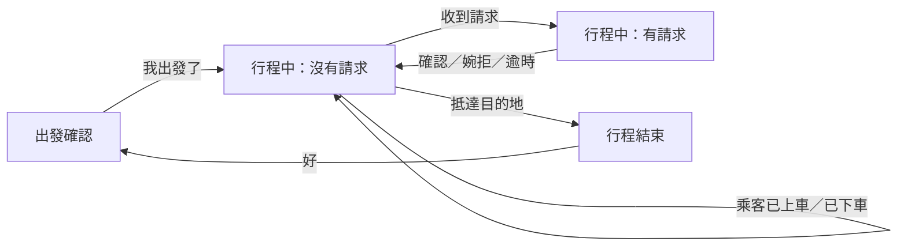
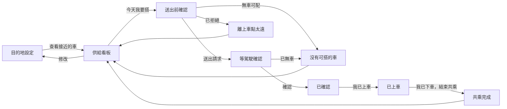
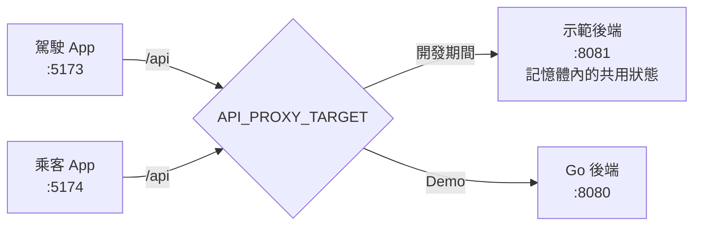

# 內科上班順起來: 內科順路共乘 — UI 設計（草案）

議題 #4 · 來源文件：[需求規格（requirement.md）](requirement.md)、[第一層設計（design.md）](design.md) 4.1～4.2、[範圍決定（OVERVIEW.md 第 9 節）](../OVERVIEW.md#9-範圍決定)

> [!IMPORTANT]
> **這是討論用的草案。** 所有設計決定都還是「提案」狀態，要討論後才定案。需要大家表態的問題整理在 [第 13 節](#13-待討論議題)。
>
> **以 `main` 的後端與文件為準。** 這份文件裡的 API 格式是後端完成前的預想；和 `main` 的後端（`DEV.md`〈後端 API〉）、`requirement.md`、`design.md` 不一致時，一律以 `main` 為準。

## 目錄

1. [目的與範圍](#1-目的與範圍)
2. [使用者與使用情境](#2-使用者與使用情境)
3. [設計原則](#3-設計原則)
4. [設計方向](#4-設計方向)
5. [畫面流程](#5-畫面流程)
6. [駕駛畫面](#6-駕駛畫面)
   - [6.1 出發確認](#61-出發確認)
   - [6.2 行程中：沒有請求](#62-行程中沒有請求)
   - [6.3 行程中：有請求](#63-行程中有請求)
   - [6.4 行程結束](#64-行程結束)
7. [乘客畫面](#7-乘客畫面)
   - [7.1 目的地設定](#71-目的地設定)
   - [7.2 供給看板](#72-供給看板)
   - [7.3 送出前確認](#73-送出前確認)
   - [7.4 等駕駛確認](#74-等駕駛確認)
   - [7.5 已確認](#75-已確認)
   - [7.6 已上車](#76-已上車)
   - [7.7 沒有可搭的車](#77-沒有可搭的車)
   - [7.8 離上車點太遠](#78-離上車點太遠)
   - [7.9 共乘完成](#79-共乘完成)
8. [視覺系統](#8-視覺系統)
   - [8.1 色彩](#81-色彩)
   - [8.2 字體與字級](#82-字體與字級)
   - [8.3 共用元件](#83-共用元件)
   - [8.4 動態](#84-動態)
   - [8.5 文字語氣](#85-文字語氣)
   - [8.6 完成度提升項目](#86-完成度提升項目)
   - [8.7 地圖上的車輛](#87-地圖上的車輛)
   - [8.8 除錯模式](#88-除錯模式)
   - [8.9 駕駛與乘客的視覺區分](#89-駕駛與乘客的視覺區分)
9. [無障礙與可用性](#9-無障礙與可用性)
10. [各畫面需要的資料](#10-各畫面需要的資料)
    - [10.1 資料內容](#101-資料內容)
    - [10.2 開發期間的示範後端](#102-開發期間的示範後端)
11. [需求對應](#11-需求對應)
12. [與 design.md 的差異](#12-與-designmd-的差異)
13. [待討論議題](#13-待討論議題)
14. [Phase 2 畫面](#14-phase-2-畫面)
    - [14.1 駕駛資訊抽屜](#141-駕駛資訊抽屜)
    - [14.2 通勤資訊](#142-通勤資訊)
    - [14.3 市府管理介面](#143-市府管理介面)

## 1. 目的與範圍

**目的：** 定出駕駛介面與乘客介面的資訊架構、畫面、視覺語言與互動規則，讓前端、後端和 Demo 劇本有共同的依據。

**品質目標：** 以 Awwwards、Webby、FWA 得獎作品的完成度為標準。這裡指的是「有明確觀點、細節到位、一眼就認得出來」，不是加特效。駕駛安全（G5）優先於任何視覺表現。

**範圍：**

- 包含：駕駛介面、乘客介面的所有 PoC 畫面（[design.md 1.1](design.md#11-poc-交付範圍)）；Phase 2 的駕駛資訊抽屜、通勤資訊與市府管理介面（[第 14 節](#14-phase-2-畫面)）。
- 不包含：企業管理、營運設定（Phase 2）。

**呈現形式：** PoC 用網頁假裝手機 App。畫面要看起來、用起來都像 App，不像網站（UD-11）。

#### UD-11 以網頁模擬手機 App

狀態：提案

- **做法：**
  - 沒有網站的元素：沒有頁首導覽列、頁尾、超連結樣式，也沒有只在滑鼠移上去才出現的東西。
  - 全螢幕版面，避開瀏海與底部的手勢區。
  - 停用下拉重新整理與橡皮筋捲動；按鈕上的文字不能被選取；點擊時不出現瀏覽器的反白。
  - 可以「加到主畫面」，從主畫面以全螢幕開啟，有自己的 App 圖示與名稱（網頁 App 設定檔 manifest）。
  - App 才有、網頁做不到的系統功能（例如推播通知），用畫面模擬出來（UD-12）。Demo 時口頭說明這是模擬的。
- **理由：** 我們要展示的是一個 App 的體驗；活動規則只要求能現場操作（REQ-065），用網頁最快做出可操作的作品，但觀眾應該把它想成 App。
- **考慮過的替代方案：** 做原生 App：開發與發佈時間不允許（DD-17）。做成一般網站的樣子：觀眾會把它當成網站，想像不到實際使用情境。
- **需求連結：** REQ-065

#### UD-13 電腦上以手機外框呈現，手機上全螢幕

狀態：提案

- **做法：**
  - **何時顯示外框：** 瀏覽器畫面寬度 600px 以上時，App 畫在一支手機外框裡；寬度小於 600px（真的手機）時全螢幕顯示，不畫外框。只看畫面寬度，不從瀏覽器型號判斷。
  - **被展示頁嵌入時：** 展示頁（ui-oi-14）用網址參數 `?embed=1` 明確告訴 App「不要畫外框」，外框由展示頁畫。嵌入時的寬度本來就是手機寬度，參數只是保險，避免嵌入尺寸調整後誤判。
  - **外框造型：** 通用的手機造型（圓角機身、細邊框），不仿製特定品牌的手機。高度不夠時整支手機等比例縮小，完整放進畫面。
  - **狀態列：** 手機頂端的狀態列（時間、訊號、電量）是畫面的一部分。時間固定顯示早上上班時間 **08:12**，不隨真實時間走，讓 Demo（下午 16:30）時仍是晨峰情境。
  - **版面以手機螢幕為準：** 底部固定的按鈕、底部面板、模擬推播通知（UD-12）都對齊手機螢幕的邊緣，不對齊瀏覽器視窗。
  - **外框外面：** 單獨開啟一個 App 時，外框外面只放 App 名稱與目前角色（駕駛／乘客）。「重設」放在展示頁（UD-18），因為它同時影響兩個 App。
    - App 名稱自成頂端一列（全名、不換行），手機外框與角色名稱在名稱下方的空間裡置中，並依這個空間等比例縮小（2026-10-23，T58）。原本名稱疊在左上角，視窗寬 600px、高 900px 以下時會壓到外框；現在任何視窗大小都不重疊。
- **理由：** Demo 用電腦投影與直播，外框讓觀眾一眼看出這是手機 App（UD-11）；畫面固定為手機尺寸，不會因視窗大小變形；模擬推播從手機頂端滑下才像真的。真的手機上再畫外框會變成「手機裡的手機」，所以手機上全螢幕。
- **考慮過的替代方案：** 一律畫外框：用手機開時很奇怪。一律不畫外框：投影時看起來像網站，瀏覽器視窗拉寬時版面也會變形。App 名稱仍疊在左上角、窄視窗時縮小字或改用主名：名稱要維持一行全名，字縮小後在投影上不易讀；把名稱移到外框下方：會和角色名稱擠在一起。
- **需求連結：** REQ-065

#### UD-18 展示頁：Demo 的主畫面

狀態：提案

- **畫面：** SC-X1 展示頁
  - 需求：REQ-065
  - 設計決定：UD-13、UD-18、UD-23；DD-24
  - 工作單：T17
- **做法：** 一個桌面網頁，Demo 與直播時開這一頁；不開展示頁、直接開兩個瀏覽器視窗也能操作（第 2 節）。

  ```
  ┌──────────────────────────────────────────────────────
  │ ▌內科上班順起來: 內科順路共乘  [   駕駛   ]      [▌ 乘客    ]      [ 重設 ]   ← 角色名稱在手機正上方，與手機同寬（UD-23）
  │                ╭──────────╮      ╭──────────╮
  │                │ 08:12  ▮ │      │ 08:12  ▮ │   ← 狀態列（UD-13）
  │                │          │      │          │
  │━━━━━━━━━━━━━━━━│ 駕駛 App │━━━━━━│ 乘客 App │━━━━━━━━━━━   ← 路線色橫線（UD-23）
  │                │          │      │          │
  │                ╰──────────╯      ╰──────────╯
  └──────────────────────────────────────────────────────
  ```

  - **兩支手機：** 左邊駕駛、右邊乘客，各自用 UD-13 的手機外框與狀態列。手機螢幕裡嵌入真正的駕駛 App 與乘客 App（帶 `?embed=1`），在框裡可以直接操作。
  - **兩個 App 各自獨立運行：** 各有自己的網址、帳號與輪詢，彼此不直接溝通，只透過後端互相影響（駕駛按「確認」→ 後端 → 乘客下一次輪詢看到「已確認」）。
  - **重設（ui-oi-19）：** 右上角一個「重設」按鈕，把所有資料回到初始狀態（帳號、標籤、模擬行程保留；行程、請求、服務紀錄清空）。
    - 按一下後按鈕變成「再按一次確定重設」，3 秒內再按才執行，避免 Demo 中誤觸。不用彈出對話框。
    - 執行後兩支手機的畫面一起重新載入，回到起始畫面（駕駛回到出發確認，乘客回到供給看板）。
    - 呼叫 `POST /api/demo/reset`（見 [10.2](#102-開發期間的示範後端)）。
  - **大小：** 兩支手機加上中間的間距要能放進 1920×1080 的直播畫面；螢幕較小時整頁等比例縮小。
  - **其他：** 除了 App 名稱、角色名稱與「重設」以外不放其他東西，讓觀眾的目光留在兩支手機上。背景、標題與角色名稱的樣式見 UD-23。
  - **實作：** `ui/showcase`（:5170），`just ui dev-mock`／`just ui dev` 一起啟動。預設嵌入 `driver4` 與 `passenger1`，可用 `?driver=…&passenger=…` 換帳號。
- **理由：** Demo 只有約 2 分鐘，觀眾要同時看到「駕駛按確認」與「乘客畫面變化」才看得懂因果；一頁並排也不會在 Demo 時切錯視窗。重設影響兩個 App，放在兩支手機之外的同一個地方最合理。
- **考慮過的替代方案：** 兩個瀏覽器視窗並排：視窗邊框、網址列都會進到直播畫面，也可能切錯視窗。每個 App 各放一個重設：按一邊會影響另一邊，容易搞混。
- **需求連結：** REQ-065

**文件慣例：**

- UI 設計決定編號為 `UD-nn`，狀態一律先標「提案」。
- 畫面編號為 `SC-Dn`（駕駛）、`SC-Pn`（乘客）、`SC-Xn`（展示頁與除錯模式）。每個畫面開頭列出它滿足的需求、套用的設計決定與負責的工作單；[第 11 節](#11-需求對應)由這些清單反推。
- 編號是永久的：刪除項目不會重新編號。
- 待討論議題編號為 `ui-oi-nn`。
- 畫面草圖用文字線框表示，只表達位置和層級，不代表實際比例。

## 2. 使用者與使用情境

| | 駕駛 | 乘客 |
|---|---|---|
| 時間 | 平日 07:00–09:30 | 平日 07:00–09:30 |
| 地點 | 出發前：停在家門口或停車場；行程中：在車上 | 捷運上快到站；出站後站在上車點路邊 |
| 姿勢 | 行程中手機在支架上，只能瞄一眼 | 站著、單手拿手機、可能提著包包 |
| 注意力 | 行程中幾乎為零 | 分散，趕時間 |
| 最想知道 | 有沒有人要搭？在哪上、在哪下？ | 有沒有車？要等多久？哪台車？ |
| 最怕 | 開車時被迫看手機、按很多下 | 白等；不知道系統在做什麼；認不出車 |

**Demo 情境（REQ-065、DD-24）：** 前端與後端全部在本機執行。駕駛與乘客 App 各有自己的網址，可以開兩個瀏覽器視窗並排操作，各自以手機外框呈現（UD-13）；直播時用展示頁（UD-18）把兩支手機並排在同一頁，展示頁只是把兩個 App 嵌入，不改變它們的行為。透過 YouTube 直播，每組約 2 分鐘。觀眾要在幾秒內看懂「發生了什麼事」，所以狀態變化要大、要明顯。

## 3. 設計原則

- **P1 一眼看懂。** 每個畫面只有一個最重要的資訊，用最大的字呈現。其他資訊退後。
- **P2 駕駛只面對一件事。** 行程中只回答「有沒有人要搭」。用畫面結構保證，而不是靠提醒（DD-04）。唯一的地圖是回應請求時標出下車點的小地圖，回應後就消失（UD-29）。
- **P3 預設值就是答案。** 設定沿用上次，大多數早上一個動作就完成（REQ-016、REQ-017、REQ-025）。
- **P4 不能選車，但要讓人安心。** 乘客不能挑車（REQ-031），所以要讓他看到「車正在來」和「系統在處理」。
- **P5 誠實標示模擬。** 模擬或估算的資料一律標示，而且標示方式全站一致（REQ-063）。

## 4. 設計方向

距離 Demo 還有約一週，時間足夠把畫面做到位，所以選方向時不考慮「做得快」，只看哪個最適合題目與使用情境。考慮過兩個方向：

| 方向 | 說明 | 優點 | 缺點 |
|---|---|---|---|
| **A. 交通標誌語言**（推薦） | 把共乘畫成台北交通標誌裡的「另一條線」：路線色、站名牌、路線圖、到站看板、路面標線黃 | 通勤者每天看，不用教；和題目（交通、內湖、捷運）直接相關；有辨識度 | 要克制，不能變成模仿捷運；路線色不能和捷運任何一條線撞色 |
| B. 地圖為主 | 像叫車 App，全螢幕地圖加底部面板 | 大家熟悉 | 駕駛行程中只有回應請求時的小地圖（DD-04），兩邊會變成兩套語言；沒有地圖金鑰時整個畫面失效；和一般叫車 App 分不出來 |

### UD-01 採用「交通標誌語言」作為視覺方向

狀態：提案

- **做法：** 只借四樣東西，其他保持安靜：
  1. **路線色**：共乘線專屬的青色（見 [8.1](#81-色彩)；原本的綠色由 UD-21 取代），捷運沒有用過。
  2. **路線圖**：像捷運車廂裡的直式路線圖，畫出「上車點 → 沿途公車站 → 終點」。
  3. **站名牌與到站看板**：上車點用路線色色帶、白色大字；等待時間用看板式的大數字。
  4. **路面標線黃**：只在駕駛收到搭車請求時使用。
- **理由：** 符合 P1；和議題主題連在一起，Demo 時一看就知道是「交通」的作品；路線圖不依賴地圖金鑰，地圖失效時仍能看懂路線。
- **需求連結：** REQ-003、REQ-063、REQ-066

## 5. 畫面流程

**駕駛：**



- 重新整理頁面時，如果行程進行中，直接回到行程中畫面，不會掉回設定畫面。
- 行程中沒有任何回到設定的入口（REQ-019），也沒有「結束行程」按鈕：抵達目的地時行程自動結束（UD-16、DD-30）。

**乘客：**



- 已經有常用設定時，打開 App 直接進供給看板，跳過目的地設定（REQ-025）。
- 重新整理頁面時，如果有進行中的請求，直接回到請求狀態。
- 已有尚未結束的請求（等駕駛確認、已確認、已上車）時，不提供送出，打開 App 直接顯示該請求（REQ-069）。後端不檢查，只由介面防止（design.md 1.1）。

## 6. 駕駛畫面

### 6.1 出發確認

**SC-D1**

- 需求：REQ-001、REQ-002、REQ-003、REQ-008、REQ-013、REQ-015、REQ-016、REQ-017、REQ-021、REQ-062、REQ-063、REQ-085、REQ-086
- 設計決定：UD-02、UD-06、UD-21；DD-04、DD-07、DD-21、DD-42、DD-43
- 工作單：T15、T42

```
│ ▌駕駛 driver4                    ← 帳號標示，疊在地圖上
│
│        [ 地圖：上車點、行程路線、沿途公車站、目的地 ]
│
╭──────────────────────────────── ← 白色面板蓋住地圖下緣
│ 今天載人嗎？
│ 設定沿用上次。沒問題就出發。
│
│ ◯ 松山車站                上車   ← 路線圖：今天的行程
│ ┃
│ ○ 堤頂大道一段
│ ┃
│ ○ 陽光街
│ ┃
│ ■ 瑞光路 513 巷           終點
│   ┆路線為估算┆                  ← 模擬標示
│ ─────────────────────────────
│ 上車點          松山車站    ›   ← 收合時顯示目前的值
│ 目的地          瑞光路 513 巷 ›
│ 可載人數        (−)  3  (+)
│ 自動接受                   ( ○)
│ 關於我和車      同企業、我不抽菸、車上能放大件行李 ›   ← 「同企業」一定在最前面
│ 只載            不抽菸的乘客 ›   ← 沒有開任何一項時顯示「不限」
│
│ ┌───────────────────────────
│ │          我出發了            ← 固定在底部
│ └───────────────────────────
```

- 面板是柏油底、白字，路線用深底路線色（UD-21）；地圖維持路網樣式。
- 第一次出發（沒有上次設定）時，上車點和目的地預設展開，「我出發了」在填好目的地前不能按。
- 改了上車點或目的地，路線圖和地圖會更新。
- 「關於我和車」展開是多選標籤，只列適用於駕駛的標籤，用駕駛描述自己的用語；下方小字「乘客要的條件會對照這些。」「只載」展開是每個標籤一列開關，只列適用於乘客的標籤，用駕駛篩選乘客的用語；下方小字「打開的條件，不符合的乘客不會配給你。」（UD-06、DD-42）
- 「關於我和車」展開後，可選的標籤上方是已選取的「同企業・內科示範科技」與模擬標示；它是文字、不能點選，不送進任何 API（DD-43）。

#### UD-02 設定收合，收合時直接顯示目前的值

狀態：提案

- **做法：** 每一項設定是一列，收合時右邊顯示目前的值；點了才展開編輯。標籤的兩列用該方的用語顯示值，例如「只載　不抽菸的乘客」，不顯示意圖，因為駕駛的篩選一律是強制（REQ-013）。
- **理由：** 駕駛不用展開任何東西就能確認今天的設定（P3），沒問題就直接按「我出發了」（REQ-017）。
- **考慮過的替代方案：** 全部展開成表單：一眼看不完，要捲動，違反「一個動作出發」的精神。分成多步驟：操作更多。
- **需求連結：** REQ-015、REQ-016、REQ-017

#### UD-03 出發確認畫面用淺色，行程中畫面用深色

狀態：已由 UD-21 取代。駕駛端所有畫面（含出發確認、載入、行程結束）都用柏油底；「進入開車模式」改由出發確認畫面的地圖與設定消失來表達，不再靠淺色變深色。

- **做法：** 出發確認是一般淺色畫面；按下「我出發了」後整個畫面變成深色柏油底。
- **理由：** 兩種模式一看就分得出來，駕駛知道「現在是開車模式」；深色在清晨車內比較不刺眼。
- **需求連結：** REQ-066

### 6.2 行程中：沒有請求

**SC-D2**

- 需求：REQ-019、REQ-022、REQ-066、REQ-067、REQ-068
- 設計決定：UD-20、UD-21；DD-04、DD-23、DD-27
- 工作單：T15

```
│ ━ ━ ━ 行程中                     ← 柏油底；三段路線色標線
│
│ 目前沒有
│ 搭車請求                         ← 60px
│
│
│ ╔═════════════════════════════╗
│ ║ 瑞光路 下車                  ║  ← 路標牌：一位乘客一塊
│ ║ ○ 等上車        [ 已上車 ]   ║  ← 標記乘客已上車（DD-27）
│ ╚═════════════════════════════╝
│ ╔═════════════════════════════╗
│ ║ 陽光街 下車                  ║
│ ║ ● 在車上        [ 已下車 ]   ║  ← 替乘客結束共乘（DD-23）
│ ╚═════════════════════════════╝
```

- 沒有地圖、統計、提示、動畫或設定入口（DD-04）。
- 沒有乘客時，下方是空的。
- 每位已確認的乘客一列，一次只有一個按鈕：還沒上車時是「已上車」，上車後是「已下車」（UD-20）。
- 每位乘客一塊路標牌（UD-21）：空心圈是等上車、實心是在車上，旁邊的文字說同一件事（第 9 節：不只靠顏色或形狀）。
- 按鈕是白色實心、68px 高、160px 寬；無障礙名稱寫出是哪位乘客，例如「瑞光路的乘客已上車」，避免多位乘客時按錯。

#### UD-20 駕駛端每位乘客一次只有一個按鈕：先「已上車」，再「已下車」

狀態：提案

- **做法：** 已確認的乘客一塊路標牌（UD-21，原本是一列），標題是下車點，下方一行小字「等上車」或「在車上」。還沒上車時，按鈕是「已上車」（DD-27）；上車後同一個位置換成「已下車」（DD-23）。乘客在乘客端先按了「我已上車」時，駕駛端下一次輪詢就換成「已下車」。
- **理由：** 行車中每位乘客只需要回答「現在要按哪一個」（P2）；兩個按鈕並排容易按錯。標記上車不是結束共乘的前提（DD-27），但駕駛端照順序操作最直覺；乘客忘了標記上車時，駕駛多按一下即可。
- **考慮過的替代方案：** 每列同時放「已上車」與「已下車」：按鈕變窄，行車中容易誤觸。上車只由乘客標記：乘客忘記時駕駛無法更正（DD-27）。
- **需求連結：** REQ-066、REQ-067、REQ-068

### 6.3 行程中：有請求

**SC-D3**

- 需求：REQ-019、REQ-020、REQ-049、REQ-062、REQ-063、REQ-066
- 設計決定：UD-04、UD-05、UD-29；DD-04、DD-43
- 工作單：T15、T42、T60

```
│ 有乘客要搭車                     ← 整個畫面變成路面標線黃
│
│ ◯ 上車
│ ┃ 松山車站                       ← 48px
│ ┃
│ ● 下車                           ← 公車站實心圓，目的地方塊（UD-29）
│   瑞光路                         ← 48px
│ 同企業乘客 ┆模擬┆                ← 一行文字，不能點選（DD-43）
│
│ 其他乘客在 陽光街 下車            ← 只有在有已確認乘客時
│ ╭───────────────────────────╮
│ │ [ 地圖：上車點、路線、      │  ← 填滿按鈕上方的空間（UD-29）；
│ │   這位乘客的下車點、目的地 ] │     地圖無法載入時整塊不出現
│ ╰───────────────────────────╯
│ ┌───────────────────────────
│ │            確認               ← 最大的按鈕，高 112px
│ └───────────────────────────
│ ┌───────────────────────────
│ │            婉拒               ← 次要，高 72px
│ └───────────────────────────
```

#### UD-29 回應請求時用一張小地圖標出下車點

狀態：提案（2026-10-23，Marcus 決定；DD-04 的例外）

- **做法：** 「有請求」畫面在文字與按鈕之間放一張圓角小地圖，填滿剩下的空間。地圖畫上車點（站名牌）、行程路線、這位乘客的下車點（實心圓，與 8.3 路線圖 `RouteStrip` 的符號相同）與駕駛目的地（方塊）；乘客在目的地下車時，方塊就是下車點。文字的「下車」用同一套符號：公車站是實心圓，目的地是方塊，文字與地圖的同一個地方只有一種符號。不畫其他沿途公車站，不能拖曳、縮放或點選。路線取自行程已保存的路線（DD-21）。駕駛回應（確認、婉拒、自動接受）後畫面離開，地圖跟著消失。沒有地圖金鑰或地圖載入失敗（斷網、金鑰被拒）時，整塊地圖不出現、也不顯示「地圖未設定」的提示，畫面和純文字版相同；確認與婉拒的位置和大小不變（UD-05）。
- **理由：** 下車點只有名稱時，駕駛不知道確切位置，例如路線上有兩個同名的公車站；回應請求時要判斷的是乘客停在路線哪一段，看圖比讀字快（REQ-066）。地圖只畫判斷需要的四個點與路線，不能操作，駕駛不會停下來研究地圖。地圖放在按鈕上方的彈性空間，有沒有地圖都不會移動按鈕，駕駛靠位置記憶按鍵（UD-05）。
- **考慮過的替代方案：** 以一行文字說明位置（「沿途第 3 站」）：不必破例顯示地圖，但仍要讀字換算位置。畫出所有沿途公車站：下車點不夠醒目。可以拖曳、縮放：駕駛會在開車時操作地圖。
- **需求連結：** REQ-066

#### UD-04 收到請求時整個畫面換色，不用動畫或彈窗

狀態：提案

- **做法：** 有請求時，整個畫面從深色變成路面標線黃；請求處理完再變回深色。沒有動畫、閃爍、彈窗或聲音。
- **理由：** 駕駛用餘光就能察覺狀態變了（P1、P2），不需要讀任何字；不用動畫，符合 REQ-066「不顯示動畫」。Demo 時觀眾也能一眼看到變化。
- **考慮過的替代方案：** 彈出對話框：遮住內容，還要多一個關閉動作。閃爍或動畫提醒：違反 REQ-066，也會讓駕駛分心。
- **需求連結：** REQ-020、REQ-049、REQ-066

#### UD-05 「確認」放在拇指最好按的位置，而且最大

狀態：提案

- **做法：** 「確認」在下方、最大；「婉拒」在它下面、較小，用外框樣式。兩個按鈕中間有間距，避免誤觸。
- **理由：** 單一操作就能回應（REQ-020）；停紅燈時一手就能按。
- **考慮過的替代方案：** 左右並排：按鈕變窄，容易按錯。滑動確認：要看著畫面操作。
- **需求連結：** REQ-020

### 6.4 行程結束

**SC-D4**

- 需求：REQ-067、REQ-070
- 設計決定：UD-16、UD-21、UD-22；DD-30
- 工作單：T15

```
│ ━ ━ ━ 行程結束                   ← 柏油底
│ ╔═════════════════════════════╗
│ ║ 已到達目的地                 ║  ← 路標牌
│ ║ 瑞光路 513 巷                ║
│ ║ ─────────────────────────   ║
│ ║ 從松山車站出發               ║  ← `pickup_point`
│ ╚═════════════════════════════╝
│
│ 這趟載了 2 位乘客                 ← `completed_rides`，0 位時顯示「這趟沒有載到乘客」
│ ▇ ▇ ▢                             ← 座位格：格數＝`capacity`，亮的格數＝`completed_rides`
│
│ [             好              ]   ← 回到出發確認
```

#### UD-16 抵達駕駛目的地時，行程自動結束

狀態：提案。後端規則見 REQ-070、DD-30，實作在 [#31 T21](https://github.com/sohoffice/debugthon-carpool/issues/31)。

- **做法：**
  - 後端的規則見 DD-30：車輛經過上車點後進入目的地「抵達距離」（系統設定，預設 50 公尺）內，就結束這段行程（Go 後端在 T21 實作，示範後端照同樣的規則）。駕駛介面下一次輪詢看到 `trip_id` 變成 `null`，讀 `GET /api/trips/:id`：`completed` 換到「行程結束」畫面；Demo 重設造成的 `cancelled`（DD-29）直接回到出發確認。
  - 行程中畫面**不放**「結束行程」按鈕。
  - 結束時車上還沒結束共乘的乘客，由後端一併標記完成（REQ-067），乘客端換到「共乘完成」（SC-P9）。
  - 結束時若有待回應的請求，後端改配給下一台車（REQ-050），乘客端看到「已改配」。
  - 「行程結束」畫面已經不在行車中，可以顯示這趟載了幾位乘客；按「好」回到出發確認。
- **理由：** 駕駛到了目的地自然就是行程結束，不需要多一個操作；行程中畫面也維持 REQ-066 的極簡。
- **考慮過的替代方案：**
  - 行程中放「結束行程」按鈕：增加行車中的操作與誤觸風險，違反 REQ-066。
  - 車上沒乘客時才顯示結束按鈕：畫面依情況變動，駕駛要多看一眼。
  - 由 SQL 或模擬器結束行程：Demo 重來時要另外操作。
- **需求連結：** REQ-050、REQ-066、REQ-067、REQ-070

## 7. 乘客畫面

### 7.1 目的地設定

**SC-P1**

- 需求：REQ-001、REQ-004、REQ-008、REQ-013、REQ-024、REQ-025、REQ-032、REQ-062、REQ-063、REQ-085、REQ-086
- 設計決定：UD-06；DD-19、DD-42、DD-43
- 工作單：T16、T42

```
│ 要去內科哪裡？
│ 用來找順路的車，下次會自動帶入。
│
│ 目的地地址
│ [ 瑞光路 513 巷                ]
│
│ 也可以在這些公車站下車
│ 至少選一站，再走路到目的地。
│ (堤頂大道一段) (陽光抽水站) (●陽光街)
│ (●瑞光路) (港墘路) (瑞光港墘路口)
│
│ 關於我
│ (●我不抽菸) (喜歡安靜) (可以聊天)
│ 有些駕駛只載符合條件的乘客。符合的都標上，配得到的車會比較多。
│
│ 這趟車要
│ (●同企業) ┆模擬┆                 ← 已選取、不能點選，不送出（DD-43）
│ 不抽菸        [不在意|最好|一定要]
│ 能放大件行李  [不在意|最好|一定要]
│ 安靜坐車      [不在意|最好|一定要]
│ 可以聊天      [不在意|最好|一定要]
│ 一定要：沒有這樣的車就不配。最好：盡量配到，沒有就照常配。
│
│ [        查看接近的車         ]   ← 地址與至少一站都有才能按
```

- 公車站清單列出目的地 1 公里內的園區公車站，依距離排序，同名的站（路的兩側）合併成一個選項，最多 8 個；已選過的站一定列出。介面無法事先知道哪些站會有行程經過，所以以距離列出（REQ-001）。不做依步行時間建議（REQ-026，Phase 2）。
- 篩選記在這台手機的瀏覽器裡（每個帳號分開），下次打開 App 時帶入，在送出前確認面板改過的也算。後端的常用資料只有目的地與可接受公車站（DD-19），沒有篩選；換一台手機就從「不在意」開始。
- 「關於我」放在「這趟車要」上面：駕駛的「只載」看的就是這些標籤（REQ-040），乘客要知道自己的標籤會影響配得到哪些車。只列適用於乘客的標籤，用乘客描述自己的用語；「這趟車要」只列適用於駕駛的標籤，用乘客篩選駕駛的用語（DD-42）。
- 「同企業」列在「這趟車要」可操作的篩選上方，沒有「不在意／最好／一定要」；查詢供給與送出請求的篩選條件都不含它（DD-43）。

#### UD-06 標籤分邊、用各自的話：乘客用「不在意／最好／一定要」，駕駛用「只載」開關

狀態：提案（2026-10-22 改寫，原本是兩邊共用「不限／建議／強制」三段切換）

- **做法：**
  - 每一方只看到適用的標籤：描述自己只列自己這一方適用的標籤，篩選只列對方適用的標籤（REQ-008、REQ-085）。
  - 不顯示標籤名稱（`name`），只顯示該方、該用途的用語（REQ-086、DD-42），例如同一個「可載行李」，駕駛看到「車上能放大件行李」，乘客看到「能放大件行李」。
  - 乘客的篩選：每個標籤一列，右邊是三段切換「不在意／最好／一定要」（對應不篩選、建議、強制）。標題是「這趟車要」。
  - 駕駛的篩選：每個標籤一列開關，標題是「只載」；開＝強制，沒有建議（REQ-013）。
  - 描述自己的標題，駕駛是「關於我和車」，乘客是「關於我」，都放在篩選上面。
  - 同一個元件 `TagFilterEditor`，由外部帶入每列的用語與模式（三段切換或開關）。
- **理由：**
  - 兩邊原本是同一份清單、同一組字，駕駛回頭看自己的「可載行李　不限／建議／強制」，會誤讀成乘客的要求；駕駛也可以要求乘客「可載行李」，這句話沒有意義。
  - 用語交代方向：「只載不抽菸的乘客」和「這趟車要不抽菸」一看就知道是誰對誰的要求。
  - 駕駛的建議不影響配對，留在畫面上只會讓駕駛以為有作用；開關一次操作，收合時直接讀成「只載　不抽菸的乘客」（UD-02）。
  - 「不在意／最好／一定要」是乘客自己會說的話，不用先懂「強制」「建議」是什麼。
  - REQ-013 仍要求每個篩選都有意圖，把「不篩選」放進同一個控制項，一次操作就能設定。
- **考慮過的替代方案：**
  - 只拿掉不適用的列，字和控制項不變：誤讀的問題還在，駕駛也還有沒有作用的「建議」。
  - 人和車分開（特質兩邊對稱一列；行李、寵物改成每趟出發與送出時才填，並帶進請求）：最貼近現實，但要改請求的內容與駕駛的請求畫面（REQ-066、DD-04），PoC 來不及。
  - 加一個「女性」標籤，讓使用者自己宣告：**不採用**。自我宣告性別會讓有心人用來鎖定特定對象，造成安全風險；任何標籤都不記錄使用者的性別。
  - 先勾選標籤、再出現強制／建議：要兩步，畫面會跳動。
- **需求連結：** REQ-008、REQ-013、REQ-032、REQ-035、REQ-085、REQ-086

### 7.2 供給看板

**SC-P2**

- 需求：REQ-028、REQ-029、REQ-030、REQ-031、REQ-033、REQ-034、REQ-063
- 設計決定：UD-07、UD-21；DD-10、DD-26
- 工作單：T16

```
│ 到 瑞光路 513 巷                 [修改]
│ 也可以在 陽光街、瑞光路 下車
│
│████ ▌松山車站       距離 20 公尺 █ ← 站名牌：選定的上車點；距離只是提示
│
│ 最快  3  分鐘到                  ← 到站看板（深色）裡；數字 144px，畫面上唯一的大數字
│ 3 台車接近中    空位 6
│
│        3        6     9
│ ├──────●────────●─────●──┤        ← 時間軸：0 到「等待上限」
│ 現在                    10 分
│
│ 換一個上車點
│ ─────────────────────────────
│ ▌台北世貿中心          距離 2.5 公里 ← 點了改選這個上車點
│ ▌台北大巨蛋            距離 2.1 公里
│
│ ┆模擬車輛┆ 車輛位置與到站時間由模擬器產生   ← 固定顯示：PoC 的車輛位置都來自模擬器（DD-14）；ETA 是否為估算另看 `fastest_eta_simulated`／`eta_simulated`，在時間旁標示「估算」
│
│ [         今天我要搭           ]   ← 固定在底部
│   由平台替你分配車，不能自選
```

- 數字隨輪詢更新（DD-03），時間軸上的車點滑到新位置。
- 時間軸上的車點**不是按鈕**，點了沒有反應（REQ-031）。
- 選定的上車點沒有車時，大數字改成「10 分鐘內沒有車」，「今天我要搭」仍可按，送出後會立即得到「目前沒有可搭的車」（REQ-036）。
- 站名牌右側顯示介面依目前位置（DD-26）算出的距離，只是提示。介面**不事先判斷**能不能送出：供給查詢不回傳送出請求距離，系統設定也沒有對外 API（DD-20）。「今天我要搭」一律可按，送出時由後端以請求附上的位置檢查（REQ-034、DD-25），太遠就顯示「離上車點太遠」（SC-P8）。

#### UD-07 只顯示選定上車點的看板；預設為最近的上車點，可改選

狀態：提案

- **做法：** 介面依乘客目前位置（除錯模式提供，DD-26）選出最近的上車點，查詢並顯示它的大數字、車數、空位與時間軸（REQ-029）。其他上車點只列名稱與距離，點了就改選，看板換成那個上車點。改變目前位置時，重新選最近的上車點。
- **理由：** 乘客通常在離自己最近的上車點搭車，而且只能在那裡送出請求（REQ-034），只顯示一個看板最清楚（P1）。改選讓還沒到站的乘客能比較其他上車點，但一次只看一個。
- **考慮過的替代方案：** 三個上車點都顯示數字：REQ-029 已改為只顯示選定的上車點，供給查詢也只查一個上車點（design.md 4.10）。只顯示最近的上車點、不能改選：還沒到站的乘客看不到其他選擇。
- **需求連結：** REQ-029、REQ-030、REQ-031

### 7.3 送出前確認

**SC-P3**

- 需求：REQ-013、REQ-035、REQ-036、REQ-062、REQ-063、REQ-086
- 設計決定：UD-06、UD-08；DD-25、DD-42、DD-43
- 工作單：T16、T42

```
│ （供給看板變暗）
╭────────────────────────────────  ← 底部面板
│ 送出搭車請求
│ 平台會替你分配一台最快能送你到的車。
│
│ ┌───────────────────────────
│ │ 關於我  我不抽菸         修改 │  ← 一行摘要，點「修改」展開多選
│ └───────────────────────────
│
│ 這趟車要
│ (●同企業) ┆模擬┆                 ← 與目的地設定相同（7.1）
│ 不抽菸        [不在意|最好|一定要]   ← 預先帶入目前的篩選
│ 安靜坐車      [不在意|●最好|一定要]
│ ⋯
│
│ [          送出請求            ]
│ [           先不要             ]
```

#### UD-08 「今天我要搭」先開底部面板，再送出

狀態：提案

- **做法：** 按「今天我要搭」開出底部面板，帶入目前的篩選，可以調整，按「送出請求」才送出。送出時依 DD-25：先建立參與主檔並等它完成，再送出請求並附上目前位置，同時把同一位置回報為第一筆位置；之後每 10 秒回報一次，直到請求結束。
- **理由：** REQ-035 要求送出時可以調整篩選；多一步也避免在口袋裡誤觸送出。
- **考慮過的替代方案：** 按下就送出，篩選放在供給看板上：供給看板會太擠；而且誤觸就直接送出。
- **需求連結：** REQ-035、REQ-036

### 7.4 等駕駛確認

**SC-P4**

- 需求：REQ-050、REQ-053、REQ-069
- 設計決定：UD-17、UD-21
- 工作單：T16

```
│████ ▌松山車站           在這裡等 █
│▓▓▓▓▓▓▓▓▓▓▓▓▓▓▓▓▓▓▓▓▓▓▓▓▓▓▓▓▓▓▓▓▓▓  ← 到站看板（深色）
│▓ 正在等駕駛確認
│▓ ━━━━━░░░░░░░░░░░░░░░░░░░░░      ← 路線色光點沿線移動
│▓ ── ──  分鐘後到                 ← 空的分鐘欄位
│▓ ┆      ┆ 車牌                    ← 空的車牌欄位（虛線）
│▓▓▓▓▓▓▓▓▓▓▓▓▓▓▓▓▓▓▓▓▓▓▓▓▓▓▓▓▓▓▓▓▓▓
│ 駕駛確認後，這裡會顯示車牌和到達時間。
│
│ ▌上一位駕駛無法載你，已改配下一台車。  ← 只有改配時出現；API 只有 reassigned_count，分不出是婉拒還是逾時，所以不說原因（REQ-053）
│
│                                    取消請求   ← 示意按鈕，按下不做任何事，見 UD-17
```

- **剛被改配時：** 在這個畫面上看到 `reassigned_count` 增加時，看板的標題先改成「駕駛無法載你／正在改配下一台車…」（標題用 `signal` 色）約 3 秒，期間不顯示底下那行小字；之後回到「正在等駕駛確認」，並顯示「上一位駕駛無法載你，已改配下一台車。」。後端在婉拒或逾時的當下就已改配（REQ-050），停留只在介面上，讓使用者（與 Demo 的觀眾）看得出有這一步。打開畫面時請求已經改配過，就直接顯示等待，不停留。

### 7.5 已確認

**SC-P5**

- 需求：REQ-003、REQ-047、REQ-052、REQ-053、REQ-062、REQ-063、REQ-068、REQ-069
- 設計決定：UD-09、UD-10、UD-12、UD-15、UD-17；DD-27、DD-43
- 工作單：T16、T42

```
│        [ 地圖：行程路線、上車點、沿途公車站、目的地，
│          以及分配到的車正開向上車點（UD-15） ]
╭────────────────────────────────
│ 3 分鐘後到                       ← 數字 88px
│ 在松山車站上車
│
│ ┏━━━━━━━━━━┓
│ ┃ ABC-0004 ┃  藍色 Mazda 3     ← 台灣車牌樣式；車輛描述來自 vehicles
│ ┗━━━━━━━━━━┛
│ 駕駛與你同企業：內科示範科技 ┆模擬┆  ← DD-43
│ 這台車沒有全部符合你選「最好」的條件 ← 已放寬：小字，不跳通知（REQ-047）
│ ─────────────────────────────
│ ◯ 松山車站                上車
│ ○ 堤頂大道一段
│ ◉ 陽光街                  下車   ← 乘客的下車站
│ ○ 瑞光路
│ ■ 瑞光路 513 巷           終點
│
│ [          我已上車            ]   ← 固定在底部（DD-27）
│              取消請求              ← 示意按鈕，見 UD-17
```

#### UD-17 「取消請求」只是示意按鈕

狀態：提案（依 design.md 1.1 與 carpool-oi-13 的範圍決定）

- **做法：**
  - 請求尚未結束時（等駕駛確認、已確認、已上車），畫面上有「取消請求」文字按鈕，放在主要按鈕下方，不搶主要操作。
  - **按下不做任何事**：PoC 不提供取消功能，介面不呼叫任何 API，請求與座位都不變。
  - 適用畫面：SC-P4、SC-P5、SC-P6。
- **理由：** PoC 不提供取消（carpool-oi-13）：等駕駛確認的請求一定會經確認、逾時改配或無車可配結束（DD-13）；已確認或已上車的請求可以結束共乘（DD-23）。保留按鈕讓 Demo 看得出正式版會有這個操作。
- **考慮過的替代方案：** 真的提供取消、釋放座位：PoC 範圍外（carpool-oi-13）。完全不放按鈕：乘客看不出之後能取消。
- **需求連結：** REQ-053、REQ-069

#### UD-09 已確認畫面以「幾分鐘後到」最大，車牌第二

狀態：提案

- **做法：** 層級依序是：幾分鐘後到 → 在哪上車 → 車牌與車型 → 路線圖與下車站 → 地圖。主要操作「我已上車」固定在底部，不必捲動就按得到；車已經過上車點但乘客還沒標記上車時，分鐘數改成「車已到上車點」；依 API 回傳的是否已經過上車點判斷（DD-31），不用 ETA 為空判斷。
- **理由：** 乘客站在路邊最在意的是「還要等多久」和「哪台是我的車」（REQ-052）。車牌用台灣車牌樣式，對照路上的車最快。
- **需求連結：** REQ-003、REQ-047、REQ-052

### 7.6 已上車

**SC-P6**

- 需求：REQ-067、REQ-068、REQ-069
- 設計決定：UD-17；DD-23、DD-27
- 工作單：T16

不再顯示到站時間、上車點與地圖（REQ-068），只剩下車點、「結束共乘」與示意用的「取消請求」（UD-17）。路線圖從乘客的下車站開始，不畫上車點。在駕駛的目的地下車時，下車點即終點，只顯示一列目的地並標「下車」。

```
│ 在車上
│ 在瑞光路下車
│ ┏━━━━━━━━━━┓
│ ┃ ABC-0004 ┃  藍色 Mazda 3
│ ┗━━━━━━━━━━┛
│ ─────────────────────────────
│ ◉ 瑞光路                  下車
│ ■ 瑞光路 513 巷           終點
│
│ [     我已下車，結束共乘       ]
│              取消請求              ← 示意按鈕，見 UD-17
```

### 7.7 沒有可搭的車

**SC-P7**

- 需求：REQ-036
- 設計決定：UD-21
- 工作單：T16

```
│████ ▌松山車站                    █
│▓▓▓▓▓▓▓▓▓▓▓▓▓▓▓▓▓▓▓▓▓▓▓▓▓▓▓▓▓▓▓▓▓▓  ← 到站看板：分鐘欄位是空的
│▓ ── ──
│▓ 目前沒有可搭的車
│▓▓▓▓▓▓▓▓▓▓▓▓▓▓▓▓▓▓▓▓▓▓▓▓▓▓▓▓▓▓▓▓▓▓
│ 等一下再看看，或改搭其他交通工具。
│
│ [       回去看接近的車          ]
```

- 不顯示接駁公車或步行的替代方案：REQ-051 依範圍決定不在 PoC 交付（design.md 1.1）。

### 7.8 離上車點太遠

**SC-P8**

- 需求：REQ-034
- 設計決定：UD-21；DD-25
- 工作單：T16

站名牌、標題「還不能送出」、後端拒絕時回傳的說明（例如「你離松山車站約 420 公尺，走到 200 公尺內再送出。」），下方用灰色圓點虛線畫出「送出時的位置 → 上車點」，最後是「回去看接近的車」。介面不知道送出請求距離，也不自己算距離，說明文字以後端回傳的為準；虛線只是示意，不按比例。

### 7.9 共乘完成

**SC-P9**

- 需求：REQ-055、REQ-067
- 設計決定：UD-16、UD-22；DD-23
- 工作單：T16

```
│█▌█████████████████████████████  ← 路線色色帶；站名牌的白條從頂端往下
│█▌ 共乘完成                       ← 48px
│█▌ 這趟共乘已記錄。
│ ▌
│ ◯  上車                          ← 白條變成路線，畫到下車點
│ ┃  松山車站
│ ┃
│ ┃  車上 14 分鐘                  ← `completed_at` − `boarded_at`；沒有上車時間時不顯示
│ ┃
│ ●  下車
│    瑞光港墘路口
│ ─────────────────────────────
│ ┏━━━━━━━━━━┓
│ ┃ ABC-0004 ┃  藍色 Mazda 3       ← 這趟的車
│ ┗━━━━━━━━━━┛
│
│ [          回到首頁            ]
```

乘客自己結束、駕駛替乘客結束，或行程結束時由系統完成（UD-16、DD-30），都顯示這個畫面。這是 Demo 的最後一幕（UD-22）。原本的說明文字「路上少了一台車。」拿掉：介面沒有資料支持這句話。

## 8. 視覺系統

### 8.1 色彩

依 UD-21 改版（取代原本的綠色 `#0a7a68` 與 `paper` 乘客底色）。基本色：

| 名稱 | Token | 色碼 | 用途 |
|---|---|---|---|
| 內科青（路線色） | `brand` | `#00707c` | 站名牌、乘客主要按鈕、路線、地圖上的路線 |
| 路線色（按下） | `brand-dark` | `#005660` | 主要按鈕按下 |
| 路線色（淡） | `brand-soft` | `#d6eef0` | 收尾畫面色帶上的說明、載入中的站名牌 |
| 路線色（深底） | `brand-glow` | `#5fd0d6` | 深色底上的路線、標線、座位格、時間軸車點 |
| 看板墨 | `ink` | `#132126` | 內文；乘客的到站看板 |
| 看板墨（淡） | `ink-soft` | `#56666c` | 淺色底上的次要文字 |
| 柏油 | `asphalt` | `#16191b` | 駕駛所有畫面的背景 |
| 路標牌面 | `asphalt-plate` | `#22282b` | 駕駛的路標牌 |
| 柏油上的線 | `asphalt-line` | `#353d41` | 深色底的分隔線、空的欄位 |
| 柏油上的次要字 | `asphalt-soft` | `#c4cfd1` | 深色底的次要文字 |
| 背景 | `paper` | `#eef2f3` | 手機外框外面（含展示頁）、分段切換的底 |
| 分隔線 | `rule` | `#d5dcdd` | 淺色底的分隔線、未選取外框 |
| 路面標線黃 | `signal` | `#ffc61a` | **只用在**駕駛收到搭車請求 |
| 錯誤 | `danger` | `#c0362c` | 錯誤訊息的左線；淺色底上的錯誤文字 |
| 模擬 | `simulated` | `#6a4fb8` | 淺色底的模擬標示 |
| 模擬（深底） | `simulated-light` | `#c8b9ff` | 深色底的模擬標示（同樣的虛線外框與文字） |
| 載客色階（淺底，Phase 2，T40 加入 `theme.css`） | `ride-1`～`ride-6` | `#7fc1c8` `#4ea6af` `#238a95` `#006e79` `#005159` `#00363c` | 通勤資訊的載客次數熱力圖（白底，UD-25） |
| 載客色階（深底） | `ride-dark-1`～`ride-dark-6` | `#1d5a60` `#237a83` `#2f9aa5` `#4fb9c3` `#7fd6dd` `#b5ecef` | 同上，駕駛的柏油底；由深到淺代表由少到多 |
| 車流色階（淺底） | `road-1`～`road-6` | `#8f999d` `#768186` `#5d686d` `#465055` `#30383c` `#1a2023` | 通勤資訊的車流熱力圖（白底） |
| 車流色階（深底） | `road-dark-1`～`road-dark-6` | `#4d575b` `#677276` `#848f93` `#a2adb0` `#c1cacc` `#e2e8e9` | 同上，駕駛的柏油底 |
| 路況色階（Phase 2，T55 加入 `theme.css`） | `congestion-1`～`congestion-4` | `#3b82c4` `#e3a51c` `#e2632c` `#b42232` | 市府戰情室的路況：順暢、車多、壅塞、嚴重（UD-28）；搭配線寬與文字，不單靠顏色 |
| 比平常色階（Phase 2，T56） | `vs-usual-1`～`vs-usual-4` | `#3b82c4` `#a3adb1` `#e2632c` `#b42232` | 市府戰情室「比平常」：快 10% 以上、差不多、慢 10–25%、慢 25% 以上（UD-28）；和路況色階共用藍、橘、深紅，中間是中性灰 |
| 沒有資料（Phase 2，T55） | `no-data` | `#a9b7ba`（同 `fog`） | 市府戰情室沒有資料的路段線與格子；線一律畫虛線、格子另加斜線，和 `vs-usual-2` 的灰靠形狀區分（UD-28） |

**角色色（role token）：** 共用元件（按鈕、路線圖、標籤篩選、地址搜尋、模擬標示、錯誤訊息）不直接用上面的色碼，而是用 `canvas`、`surface`、`sunk`、`fg`、`fg-soft`、`line`、`route`、`action`、`on-action`、`accent`、`sim`、`alert`。預設是淺色的值；元素加上 `ground-asphalt` 後換成深色的值。同一個元件放在乘客的白底或駕駛的柏油上都對，不必有兩個版本。除錯面板用 `ground-light` 換回淺色。

- 所有文字與背景的對比至少 4.5:1。量測值：白字在 `brand` 上 5.8:1；`brand-glow` 在柏油上 9.7:1；`ink-soft` 在白底上 6.0:1；`asphalt-soft` 在柏油上 11.1:1；`simulated-light` 在看板上 9.3:1；`ink` 在 `signal` 上 10.5:1；`brand-soft` 在 `brand` 上 4.8:1（共乘完成的副標，目前最低的一組）；`ink-soft` 在 `brand-soft` 上 4.9:1（地圖載入失敗時的說明）。
- 路線色要避開台北捷運六條線的顏色（紅、藍、綠、橘、棕、黃），以免被誤認為捷運路線。新的青色比原本的綠色離松山新店線的綠更遠；地圖上的行程路線仍加白色外框（ui-oi-17）。
- 路況與比平常兩組色階都不是單一色相，和下一條的熱力圖色階分開看：
  - 路況是有語意的狀態分級（像紅綠燈），由藍到深紅。以 dataviz 的色盲檢查（白底）量測相鄰兩色的差距：最小 ΔE 11.1（紅綠色盲）、15.6（一般視覺）。
  - 比平常是發散色階：兩端是藍（比平常快）與深紅（比平常慢），中間是中性灰（差不多）。量測值：最小 ΔE 13.8（紅綠色盲）、16.0（一般視覺）。灰色本來就沒有彩度，這是發散色階的中點，不是錯誤。
  - 和白色面板的對比都至少 2:1：最低的是 `congestion-2` 黃 2.2:1 與 `vs-usual-2` 灰 2.3:1，`no-data` 2.1:1；格子之間另有 2px 白色間隔。黃與灰低於 3:1，所以每個用到的地方都配文字或圖例（UD-28）。
- 四組熱力圖色階都是單一色相、亮度單調變化，最淺的一格和底色的對比至少 2:1（以 dataviz 的色階檢查驗證）。格子裡的數字：淺底上 `ride-1`、`ride-2` 用 `ink`，`ride-3` 以上用白字（`ride-3` 上白字 4.1:1，數字是粗體 10px 以上的補充資訊；主要讀法是顏色深淺）；深底反過來。
- `signal` 黃不能拿來當一般強調色，駕駛才會把「變黃」和「有人要搭」連在一起。改版後駕駛端其他畫面都是柏油底，黃色更醒目。

### 8.2 字體與字級

依 UD-21 改版（取代 Barlow 與 Barlow Condensed）。

- **Archivo**（可變寬度與字重，Google Fonts）：拉丁字母與數字，一個字型家族用兩種寬度。
  - 駕駛的標題與地名：寬度 112%（`lettering-sign`），像遠處看的路標字。
  - 乘客的分鐘數：寬度 70%、字重 800（`digits-board`），像到站看板。
  - 車牌：寬度 78%、字距加寬（`digits-plate`）。
- **中文**：系統字（iPhone 是蘋方，其他平台是 Noto Sans TC）。中文字型檔很大，不另外載入。中文標題用 600 字重，不用 700，避免蘋方粗體在小螢幕上糊成一團。

| 用途 | 大小 |
|---|---|
| 乘客到站看板的分鐘數 | 144px（全站唯一的大數字） |
| 已確認畫面的分鐘數 | 96px |
| 駕駛行程中的狀態（目前沒有搭車請求） | 60px |
| 駕駛「有乘客要搭車」的地名 | 48px（第二階段處理，不變） |
| 收尾畫面標題（共乘完成） | 48px |
| 駕駛「確認」按鈕 | 36px |
| 畫面標題 | 34px |
| 駕駛路標牌上的地名 | 28px |
| 內文 | 16–18px |
| 補充說明 | 14px（最小） |

### 8.3 共用元件

駕駛與乘客都會用到的元件放在 `ui/shared`：

| 元件 | 說明 |
|---|---|
| 路線圖 `RouteStrip` | 上車點是空心大圓、沿途公車站是小圓、乘客下車站是實心圓、終點是方塊；路線色實線連接 |
| 路線地圖 `RouteMap` | 地圖上的上車點、行程路線、沿途公車站、目的地，自動縮放到整條路線 |
| 車輛 `VehicleMarker` | 地圖上平滑移動、轉向的車輛（UD-15） |
| 地址搜尋 `PlaceSearch` | 目的地地址輸入，列出園區內符合的地點 |
| 再按一次確定 `ConfirmTextButton` | 重設用的文字按鈕（UD-18） |
| 除錯模式外框 `DebugSheet` | 除錯模式的入口與面板（8.8） |
| 標籤篩選 `TagFilterEditor` | 乘客「這趟車要」用三段切換，駕駛「只載」用開關；每列的用語由外部帶入，見 UD-06 |
| 多選標籤 `ChipSelect` | 「關於我和車」「關於我」、可接受的下車公車站 |
| 同企業標示 `CompanyChip` | 已選取樣式、不能點選的「同企業」，附模擬標示；企業名稱是共用常數 `DEMO_COMPANY_NAME`（DD-43） |
| 模擬標示 `SimulatedBadge` | 紫色虛線外框，代表「估算，不是量測」；深色底用淺紫，形狀與文字不變（UD-21） |
| 錯誤訊息 `ErrorNote` | 左側紅線、短句；保留上一次的資料 |
| 通勤資訊 `CommuteInfo` | 駕駛與乘客共用的通勤資訊畫面（Phase 2，DD-38、UD-25）；依底色換色階 |
| 熱力圖格子 `HeatGrid` | 「日期 × 15 分鐘」的格狀熱力圖，通勤資訊的兩張圖共用（Phase 2，UD-25） |
| 按鈕 `Button` | 最小高度 56px；乘客端是膠囊、路線色；駕駛端（柏油底）是白色、10px 圓角 |

乘客專用：站名牌 `StationSign`、到站看板 `ArrivalBoard`、時間軸 `ArrivalTimeline`、車牌 `Plate`、共乘完成 `CompletedScreen`。Phase 2 駕駛資訊抽屜也用 `Plate`（UD-24），到時候搬到 `ui/shared`。

駕駛專用：路標牌 `RoadSign`、模式標示 `ModeLabel`（三段路線色標線＋「行程中」等字）。

**圓角規則（依角色，不是全站一種圓角）：** 站名牌與到站看板 0（色帶貼齊螢幕兩側）；駕駛路標牌 18px，內縮白邊；駕駛按鈕 10px；乘客主要按鈕與標籤是膠囊；輸入框與分段切換 16px；底部面板 24px；車牌 6px。清單列不加圓角、不加陰影，用分隔線分開。

### 8.4 動態

- **駕駛行程中：完全沒有動畫**，包括轉場（REQ-066）。
- 乘客畫面只有以下動態：
  - 等駕駛確認時，光點沿線移動。這是全站唯一不是使用者觸發的持續動態，用來表示「系統正在處理」。
  - 時間軸上的車點在每次輪詢後滑到新位置，表示車正在接近。
  - 駕駛確認時，路線圖畫到下車站（UD-10）。
  - 配對成功時，模擬的推播通知從頂端滑下（UD-12）。
  - 地圖上的車輛平滑移動、轉向（UD-15）。
- 尊重系統的「減少動態效果」設定：開啟時上述動態全部停止，車輛直接跳到新位置。

### 8.5 文字語氣

- 按鈕寫出按下後會發生什麼，而且同一個動作從頭到尾用同一個詞：「我出發了」「今天我要搭」「送出請求」「我已下車，結束共乘」。
- 錯誤說清楚發生什麼、怎麼處理，不道歉。
- 沒有車時說清楚，並給一個回去的按鈕；不顯示替代方案（REQ-051 不在 PoC 範圍）。
- 不用全大寫英文、不用「→」當裝飾、不在每個標題上加小標籤。

### 8.6 完成度提升項目

時間足夠，以下項目可以把畫面從「能用」推到「得獎作品的完成度」。依對 Demo 的影響排序；要做哪些待討論（[ui-oi-13](#13-待討論議題)）。駕駛行程中畫面維持極簡，以下項目都不會加到那裡。目前都已做好：第 1 項採用路網樣式的 Map ID，捷運線的顏色問題由介面替行程路線加白色外框處理（ui-oi-17 已決定）。

| 優先 | 項目 | 說明 | 影響的畫面 |
|---|---|---|---|
| 1 | 自訂地圖樣式 | 用 Google Maps 的雲端地圖樣式（Map ID），淡化商家與地標，只讓路線色的行程路線跳出來。三個候選見 [map-styles](data/map-styles/README.md) | 駕駛出發確認、乘客已確認 |
| 2 | 自訂地圖標記 | 上車點用站名牌樣式、公車站用路線圖的小圓、目的地用方塊，取代 Google 預設圖釘；和路線圖用同一套符號 | 同上 |
| 3 | 「已確認」的一次性轉場 | 駕駛確認的那一刻，路線圖從上車點一路畫到乘客的下車站，接著分鐘數出現。全站唯一經過編排的動態（UD-10） | 乘客已確認 |
| 4 | 展示頁 | 一個桌面頁面，並排放兩支手機外框與「重設」，直播畫面一次看到雙方（UD-18） | Demo 專用 |
| 5 | 載入與空狀態 | 駕駛載入時是柏油底與一塊空的路標牌；乘客載入時是沒亮的站名牌與空的到站看板（UD-21）；第一次出發的空狀態用路線圖語言 | 全部 |
| 6 | App 圖示 | 路線圖符號做成的 App 圖示，加到主畫面與瀏覽器分頁時使用（UD-11）；manifest 含 SVG、192／512 px PNG 與 Android 用的 maskable 版本，iOS 另有 `apple-touch-icon.png` | 全部 |

#### UD-10 乘客端只保留一個編排過的動態：「已確認」

狀態：提案

- **做法：** 等待中的光點在駕駛確認時停下，路線圖從上車點畫到下車站（約 0.6 秒），接著分鐘數與車牌淡入。其他畫面不加進場動畫。
- **理由：** 「配到車了」是整個服務最重要的時刻，也是 Demo 時觀眾最需要看懂的一刻。只在這裡用動態，效果最強；到處都有動畫反而沒有重點。
- **考慮過的替代方案：** 每個畫面都加進場動畫：顯得廉價，也拖慢操作。完全不用動態：最重要的時刻和其他狀態看起來一樣。
- **需求連結：** REQ-052、REQ-065

#### UD-12 配對成功時，用畫面模擬手機的推播通知

狀態：提案

- **做法：** 乘客的請求變成「已確認」時，畫面頂端滑下一則仿手機系統的通知，同時下方播放 UD-10 的轉場。

  ```
  │ ╭───────────────────────────────────────────╮
  │ │ [圖示] 內科上班順起來: 內科順路共乘  現在 │   ← 半透明白底、圓角，仿手機系統通知
  │ │ 配到車了                                  │
  │ │ ABC-0004 3 分鐘後到松山車站               │
  │ │                                ┆模擬推播┆ │   ← 模擬標示（REQ-063）
  │ ╰───────────────────────────────────────────╯
  │
  │ （下方：已確認畫面，路線圖畫到下車站）
  ```

  - 右下角用 `SimulatedBadge` 標示「模擬推播」，和通知一起出現、一起收起；這不是真的系統推播（REQ-063）。
  - 停留約 5 秒後自動收起；往上滑或點一下也會收起。點一下會停在已確認畫面。
  - 只有「配對成功」會出現通知。駕駛端收到請求時整個畫面已經變黃（UD-04），不另外模擬通知。
  - 不加提示音：Demo 現場與直播不一定播得出聲音。
  - 開啟「減少動態效果」時，通知直接出現、不滑動。
- **理由：** 真正的 App 在配到車時會推播，乘客不必一直盯著畫面。PoC 不推播（DD-03），但 Demo 要讓觀眾看到這個體驗（UD-11）。
- **考慮過的替代方案：** 真的推播：違反 DD-03，iPhone 還要先加到主畫面才能收。加提示音：Demo 時可能播不出來。只有畫面轉場：看不出「App 在背景也會通知你」。
- **需求連結：** REQ-052、REQ-063、REQ-065

### 8.7 地圖上的車輛

地圖上出現車輛的地方**只有**乘客「已確認」畫面上分配到的那台車，正開向上車點（已確認）。駕駛行程中只有回應請求時的小地圖（UD-29），上面不畫車輛；供給看板不加地圖，用時間軸表達（UD-07）；之後若做展示頁的大地圖（ui-oi-14），也照這裡的規則。

#### UD-15 車輛在地圖上平滑移動，車頭朝向行進方向

狀態：提案

- **做法：**
  - **圖示：** 由上往下看的車子剪影，路線色車身、白色外框；圖示的車頭朝上代表朝北。
  - **平滑移動：** 每次輪詢拿到新位置後，車子從畫面上的舊位置，在一個輪詢間隔內等速移動到新位置。畫面上的車因此比實際位置晚約一個輪詢間隔（約 1 秒），但不會跳動，也不會倒退。
  - **車頭方向：** 用 API 回傳的行進方向（以正北為 0 度、順時針的角度）旋轉圖示；方向由後端計算（DD-31），介面不自己算。API 沒有給方向時（只有一筆回報），保持原來的方向。
  - **轉向：** 車頭轉到新方向時走較短的那一邊（例如 350 度轉到 10 度是順時針轉 20 度，不是逆時針轉 340 度），約 0.3 秒轉完。
  - **地圖固定朝北：** 地圖不旋轉、不傾斜，圖示的旋轉角度就等於行進方向。
  - **不做動畫的情況：** 兩次位置相距超過 300 公尺，或中間斷了 3 次以上輪詢（例如網路中斷、Demo 重設）時，直接跳到新位置，不畫一條穿過房子的直線。開啟「減少動態效果」時也直接跳。
- **理由：** 車子一格一格跳會讓人覺得系統卡住；平滑移動加上正確的車頭方向，乘客一看就知道車正朝自己開過來（P4），Demo 時也最有說服力。晚 1 秒顯示換來不跳動，對「還要等幾分鐘」的判斷沒有影響。
- **考慮過的替代方案：**
  - 依速度預測車子接下來的位置：沒有延遲，但預測錯時車子會往回退，或衝過轉角再彈回來。
  - 讓車子沿著行程路線移動：車子到上車點之前不一定走行程路線（DD-06），會畫在錯的路上。
  - 每次輪詢直接跳到新位置：最簡單，但看起來卡頓。
- **影響：** 位置回報的間隔要不大於輪詢間隔，否則車子會停住再前進。示範後端（UD-14）與模擬器（DD-14）要沿真實道路產生位置與方向。行進方向由後端從最近兩筆回報計算（DD-31）。
- **需求連結：** REQ-003、REQ-023、REQ-052

### 8.8 除錯模式

除錯模式是 Demo 工具，不屬於產品（DD-04 的例外）：網址帶 `?debug=1` 才出現，標示為「Demo 工具」（REQ-063）。

| 畫面 | App | 內容 | 需求 | 設計決定 | 工作單 |
|---|---|---|---|---|---|
| SC-X2 | 駕駛 | 切換主畫面的駕駛帳號；模擬器：勾選要模擬的駕駛（預設 5 位都勾），按「開始模擬」後，有進行中行程的駕駛沿預先定義的路徑、以設定的速度回報位置，到終點就停止；每位駕駛顯示狀態（沒有行程、移動中幾 %、已到終點） | REQ-061、REQ-063、REQ-065 | UD-19；DD-14 | T08 |
| SC-X3 | 乘客 | 設定目前位置：松山車站旁、台北世貿中心旁、台北大巨蛋旁、離松山車站 420 公尺；顯示座標與是否正在回報；切換帳號 | REQ-034、REQ-063 | UD-19；DD-26 | T16 |

#### UD-19 除錯模式的入口是畫面左緣的小標籤，打開後是整頁面板

狀態：提案

- **做法：** 畫面左緣中間一個直書的「除錯」小標籤，紫色虛線外框（模擬標示的樣式）。點了打開整頁面板，按「關閉」回到原畫面；面板關閉時模擬器與位置回報照常運作。
- **理由：** 左緣在畫面的側邊留白內，不會蓋住任何按鈕或文字，手機外框、全螢幕與嵌入模式都一樣；整頁面板不必和產品畫面搶空間。
- **考慮過的替代方案：** 放在右上角：會蓋住乘客供給看板的「修改」。放在狀態列中間：真的手機上沒有模擬的狀態列，會蓋住內容。
- **需求連結：** REQ-063、REQ-065

**模擬器的路徑：** 寫在駕駛介面的靜態設定（`ui/driver/src/simulatorRoutes.ts`），每個帳號一條「出發位置 → 松山車站 → 目的地」的路徑與時速（預設 25 公里）。路徑沿真實道路（公車路線站序，和示範後端相同），各帳號從上車點前不同距離出發，到站時間錯開。位置依開始後經過的時間計算；每兩筆回報相距不超過 20 公尺，分頁在背景被瀏覽器降頻時也不會跳過上車點範圍（DD-06）。

**Demo 時的用法：** 展示頁的兩支手機不帶 `?debug=1`。模擬器由台下腳本 `just demo-offstage` 在背景開啟（T18E，`docs/demo-script.md`），不要再另開 `http://localhost:5173/?debug=1` 按「開始模擬」，否則兩個模擬器會同時回報同一批車；不跑台下腳本時才自己開這個分頁。要讓乘客離上車點太遠時，開 `http://localhost:5174/?debug=1` 改目前位置，同一帳號的其他分頁（包括展示頁裡的乘客）會立即跟著改。

**接 Go 後端時的分配：** 示範後端讓台上的駕駛（`driver4`、`driver5`）排在前面，Go 後端則完全依感受成本排序（REQ-042，design.md 4.11），通常是最近的模擬車（自動接受）先拿到請求。要讓台上的駕駛收到請求、畫面變黃，Demo 劇本讓乘客把「不抽菸」和「能放大件行李」都設成「一定要」：台上的兩位駕駛兩個都有，模擬車沒有一台兩個都有（`docs/demo-script.md`）。

### 8.9 駕駛與乘客的視覺區分

#### UD-21 駕駛看路標牌，乘客看站名牌與到站看板

狀態：提案（2026-10-22，視覺改版第一階段；取代 UD-03 與原本的 8.1～8.3）

- **做法：** 同一條路線色、同一個字型家族，兩個 App 用不同的元素與形狀：

  | | 駕駛（開車時瞄一眼） | 乘客（等車時盯著看） |
  |---|---|---|
  | 背景 | 所有畫面都是柏油 `asphalt` | 白色站壁；資訊放在深色到站看板裡 |
  | 字 | 中文 600 字重、60px 狀態；Archivo 寬體 | 一般字重；Archivo 窄體的 144px 分鐘數 |
  | 密度 | 一位乘客一塊路標牌，牌上只有地名、狀態、一顆按鈕 | 一屏放站名牌、看板、上車點清單 |
  | 元件形狀 | 路標牌：圓角牌面加內縮白邊；白色方角按鈕 | 站名牌：滿版色帶、零圓角、白條；膠囊按鈕 |
  | 路線色 | 只當標線：模式標示的三段線、狀態圈、座位格 | 當面積：站名牌、按鈕、收尾畫面的色帶 |

  - 駕駛的出發確認也改成柏油底（原本淺色）。地圖仍在上半部，用已定案的路網樣式；面板是柏油、設定列是白字。
  - 共用元件用角色色（8.1），放在哪個底上就自動換色。
  - 模擬標示在深色底上改用淺紫 `simulated-light`；虛線外框與文字和淺色底完全相同（REQ-063 的「一致」指形狀與文字）。
  - 駕駛收到請求的 signal 黃滿版（UD-04、SC-D3）這次不動，留給第二階段。
- **理由：**
  - 原本兩邊共用同一顆綠色按鈕、同一種圓角、同一種版面（上半地圖＋白色面板），只差背景深淺，看起來像同一個 App 的深淺色模式。
  - 路標牌與站名牌都在 UD-01 的交通標誌語言裡：駕駛在路上看路標，乘客在站上看站名牌與到站看板，兩邊的差別在形狀，不只在顏色；直播畫面縮小後也分得出來。
  - 駕駛端全部柏油底後，「變黃」是駕駛端唯一的亮色滿版，比以前更醒目（UD-04）。
  - UD-03 原本用「淺色變深色」表示進入開車模式；出發確認畫面有地圖、有設定，行程中沒有，這個差別已經夠明顯，不需要再靠底色。
- **考慮過的替代方案：**
  - 翻牌看板（台鐵翻牌）：記憶點最強，但翻牌格很佔空間，乘客畫面要捲動；和路網地圖的語言接不起來；工作量最大。
  - 路面標字（拉長的中文標字、帶顆粒的柏油）：最大膽，但拉長的中文在開車時不好讀，顆粒在直播壓縮後變成雜訊。
  - 只換顏色：兩邊仍是同一套元件，看起來像主題切換。
- **影響：** 路線色從 `#0a7a68` 改成 `#00707c`，地圖上的行程路線（`MAP_COLORS`）、App 圖示與 manifest 一起換；英文字型從 Barlow 換成 Archivo（ui-oi-09 的決定不變：仍從 Google Fonts 載入，離線時退回系統字）。
- **需求連結：** REQ-063、REQ-065、REQ-066

#### UD-22 收尾畫面用路線圖語言收束整趟

狀態：提案（2026-10-22）

- **畫面：** SC-P9 共乘完成、SC-D4 行程結束；也套用到 SC-P7 沒有可搭的車、SC-P8 離上車點太遠、SC-P4 等駕駛確認、兩端的載入畫面。
- **做法：**
  - **共乘完成（Demo 的最後一幕）：** 頂端是路線色色帶，站名牌的白條從色帶往下長成一段路線：上車點（空心圈）→ 下車點（實心圈）。中間寫「車上 N 分鐘」，下方是車牌與車型。
  - **時間：** 只顯示車上分鐘數（`completed_at` − `boarded_at`，四捨五入，至少 1 分鐘），不顯示時刻：狀態列固定在 08:12（UD-13），Demo 在下午，顯示真實時刻會穿幫。乘客沒按「我已上車」（`boarded_at` 為空）時不顯示這一行。
  - **行程結束（駕駛）：** 一塊路標牌寫目的地與上車點，下方「這趟載了 N 位乘客」配座位格：格數＝`capacity`，亮的格數＝`completed_rides`（超過座位數時多畫幾格）。
  - **沒有可搭的車：** 站名牌下的到站看板，分鐘欄位是兩條空槓，標題寫「目前沒有可搭的車」。
  - **離上車點太遠：** 站名牌、後端的說明，以及「送出時的位置 → 上車點」的灰色圓點虛線（不按比例）。
  - **等駕駛確認：** 到站看板已經出現，分鐘與車牌欄位是空的（虛線），光點沿線移動（8.4，不變）。
  - **載入：** 駕駛是柏油底與一塊空的路標牌；乘客是沒亮的站名牌與空的到站看板。
  - **只用 API 回傳的資料：** 上車點、下車點、車牌、車型、`capacity`、`completed_rides`、`boarded_at`、`completed_at`。不顯示減碳量、累計趟數、距離等沒有來源的數字；原本「路上少了一台車。」也拿掉。
- **理由：** 原本這些畫面都是「標題＋一句話＋按鈕」，中間空了一大片，Demo 最後一幕沒有東西可看。把整趟畫成一段路線，觀眾一眼看懂「從哪上、在哪下、搭哪台車」，也和供給看板的站名牌、看板呼應。
- **考慮過的替代方案：** 顯示上下車時刻：會和 08:12 的狀態列矛盾。顯示減碳或累計數字：沒有資料來源。完成時加動畫：留給第二階段。
- **需求連結：** REQ-055、REQ-067、REQ-070

#### UD-23 展示頁：一條路線穿過兩支手機

狀態：提案（2026-10-22）

- **做法：**
  - 整頁淺色 `paper` 底（UD-18 不變）。一條 14px 寬的路線色橫線在手機一半高度處穿過兩支手機背後，從頁面左緣延伸到右緣；寬度和站名牌的白條一樣。兩支手機的外框形狀與尺寸不變（UD-13）。
  - 角色名稱放在各自手機的正上方，做成和手機外框一樣寬的招牌，距手機 24px，高 64px、30px 字：
    - 「駕駛」是路標牌：`asphalt-plate` 牌面、`sign` 圓角、內縮的白色外框，字置中。
    - 「乘客」是站名牌：路線色色帶、零圓角、左邊白條，字靠左，和乘客 App 裡的站名牌一樣。
  - 左上角的 App 名稱是次要的標示：一條路線色短條加上 `ink` 文字，不做成站名牌。
  - App 名稱寫全名「內科上班順起來: 內科順路共乘」，字縮小到 22px、不換行（2026-10-23）：30px 時全名放不進左側欄（370px 寬），會換成兩行、在「內科順」中間斷開，高度也超出招牌那一列。22px 時 1920×1080 與 1280×720 實測都是一行，和駕駛招牌之間留 25～36px。
  - 「重設」在右上角，和招牌那一列垂直置中，膠囊外框；按一下變「再按一次確定重設」（UD-18，不變）。重設失敗的訊息出現在按鈕下方。
  - App 名稱與「重設」放在兩側欄裡，和手機一起等比例縮放，螢幕較小時也不會重疊。
  - 頁面上仍只有 App 名稱、角色名稱與「重設」（UD-18）。
- **理由：**
  - 直播畫面縮小後，原本灰色小字的角色名稱幾乎看不到，所以角色名稱改成路標牌與站名牌。
  - 放在手機正上方、與手機同寬，觀眾先看到「這是駕駛」再看到畫面；招牌像手機的頂蓋，不會被誤認成畫面裡的內容。
  - App 名稱降為次要：如果也做成站名牌，會和「乘客」在同一列出現兩塊一樣的青色牌，互相搶注意。
  - 兩個 App 的區分已經由手機畫面本身表達（UD-21），背景不必再分。背景只說一件事：兩支手機在同一條共乘路線上。
- **考慮過的替代方案：**
  - 左半柏油、右半白底（本提案的第一版）：一黑一白太突兀，畫面被切成兩半，看起來像兩個不相干的產品，搶走手機本身的注意。
  - 整頁路線色深底：手機外框和背景都偏深，兩支手機的輪廓不清楚，標題的站名牌也融進背景。
  - 整頁柏油灰：駕駛手機的柏油畫面和背景分不開，乘客的白色畫面變成一塊亮光。
  - 角色名稱放在手機下方（第一版）：觀眾看完畫面才看到是誰的手機，且在直播畫面底部容易被字幕或工具列擋住。
  - 橫線移到招牌那一列，串起標題與兩個角色名稱：上方太擠，三塊牌互相搶注意，手機也和路線脫節。
  - App 名稱放在中間的橫線上，像路線上的一站：和駕駛手機貼太近，螢幕較小時會壓到手機。
- **需求連結：** REQ-065

## 9. 無障礙與可用性

- 觸控目標至少 44×44px；駕駛行程中的按鈕至少 64px 高。
- 以 390px 寬度設計；所有主要操作都在螢幕下半部，單手可及。
- 鍵盤焦點清楚可見（路線色外框）。
- 狀態不只靠顏色表達：駕駛畫面換色的同時，標題文字也改變。
- 時間軸對螢幕閱讀器提供文字摘要，例如「接近中的車：3、6、9 分鐘後到」。
- 地圖金鑰沒有設定或載入失敗時，路線圖仍能表達路線，其他功能照常運作。

## 10. 各畫面需要的資料

### 10.1 資料內容

給後端參考：畫面需要的資料。

| 畫面 | 需要的資料 |
|---|---|
| 出發確認 | 上次的出發設定（沒有時為空）、上車點清單、標籤清單（駕駛的用語）、我的標籤、指定上車點與目的地的行程路線與沿途公車站（是否為估算） |
| 駕駛行程中 | 待回應的請求（上車點、下車點）、已確認乘客的下車點與是否已上車；確認、婉拒、標記已上車、替乘客結束共乘的操作；行程是否已結束 |
| 行程結束 | 目的地、這趟載了幾位乘客 |
| 目的地設定 | 常用設定（目的地、可接受公車站；篩選只記在瀏覽器）、內科公車站清單、標籤清單（乘客的用語）、我的標籤 |
| 供給看板 | 上車點清單（依目前位置選最近的）、等待上限、選定上車點的車數／最快到達／空位／各車 ETA |
| 送出請求 | 建立參與主檔、請求附上的目前位置、位置回報（DD-25） |
| 請求狀態 | 狀態（等待中、已確認、已上車、無車可配、已拒絕、已完成）、上車點、是否改配、是否已放寬、拒絕原因、車輛資訊、ETA、下車點、行程路線；已確認時另加車輛的目前位置、行進方向（正北為 0 度、順時針）、回報時間與是否已經過上車點（UD-09、UD-15、DD-31）；標記已上車的操作 |
| 展示頁的「重設」 | 重設所有 Demo 資料的操作（`POST /api/demo/reset`） |
| 取消請求 | 示意按鈕，不需要資料（UD-17） |

**API 清單（ui-oi-10）：** 欄位格式寫成 TypeScript 型別，放在 `ui/shared/src/api/types.ts`，介面與示範後端共用；欄位命名、錯誤格式（`{"error":{"code","message"}}`）和身分都沿用 Go 後端。**格式以 `main` 的後端為準**（`DEV.md`〈後端 API〉）：後端已有的 API，型別檔與示範後端照抄後端；後端還沒有的，才用這裡的前端提案，後端完成後改成後端的格式。

Go 後端已有的 API（介面照抄後端格式）：

| 方法 | 路徑 | 角色 | 回傳 | 介面用在哪裡 |
|---|---|---|---|---|
| GET | `/api/driver/trips/defaults` | 駕駛 | `TripDefaults` | 出發確認預先帶入上次的設定（REQ-016）；沒有出發過時全部為空 |
| POST | `/api/driver/trips` | 駕駛 | `201 TripView` | 「我出發了」；已有進行中的行程時回 `409 already_active`，介面改顯示行程中畫面；目的地不在園區內回 `400 destination_outside_park` |
| GET | `/api/driver/trips/current` | 駕駛 | `TripView` | 模擬器判斷駕駛有沒有進行中的行程；沒有時回 `404 not_found` |
| POST | `/api/activities` | 任一 | `201 Activity` | 乘客按「送出請求」時先建立參與主檔（DD-25）；駕駛的主檔由出發時建立 |
| POST | `/api/location` | 任一 | `201 LocationReport` | 乘客的位置回報（DD-26）、模擬器的駕駛位置回報（DD-14）；沒有參與主檔時回 `409 no_activity` |
| POST | `/api/passenger/requests` | 乘客 | `201 RequestView` | 「送出請求」（T12）：`pickup_point_id`、`location`（目前位置，DD-25），選填 `destination`、`stop_ids`、`tag_filters`。立即回傳結果：`rejected`（`reason: too_far` 與 `message`）、`no_match`、`waiting_driver` 或 `confirmed`。後端不檢查重複送出（REQ-069 只由介面防止）。完整格式見 `DEV.md` |
| GET | `/api/driver/requests` | 駕駛 | `DriverRequests` | 駕駛行程中的輪詢（T13）：`trip_id`、`pending`（待回應的請求：上車點、下車點 `dropoff`、`relaxed`）、`passengers`（已確認乘客的下車點與 `boarded`）。沒有進行中的行程時 `trip_id` 為 `null`。行程結束後 `trip_id` 變成 `null`，結束的行程與完成人數（`completed_rides`）由 `GET /api/trips/:id` 取得（SC-D4，T21） |
| POST | `/api/driver/requests/:id/accept`、`/decline` | 駕駛 | `200 RequestView` | 確認、婉拒（T13）；已不在等待回應時回 `409 not_waiting` |
| POST | `/api/driver/requests/:id/board`、`/complete` | 駕駛 | `200 RequestView` | 「已上車」「已下車」（T13，DD-27、DD-23）；重複操作直接回先到者的結果，狀態不對時回 `409 invalid_state` |
| GET | `/api/passenger/requests/current` | 乘客 | `{ request }` | 乘客尚未結束的請求，沒有時 `request` 為 `null`；打開 App 時帶出（REQ-069） |
| GET | `/api/passenger/requests/:id` | 乘客 | `RequestView` | 請求狀態的輪詢（T13）：已確認時含 `pickup_point`、`vehicle`、`eta_s`、`trip`（路線與沿途公車站）；改配次數是 `reassigned_count`。車輛位置、行進方向與是否已經過上車點由 DD-31 加入，實作在 [#33 T22](https://github.com/sohoffice/debugthon-carpool/issues/33)，目前還沒有（UD-15） |
| POST | `/api/passenger/requests/:id/board`、`/complete` | 乘客 | `200 RequestView` | 「我已上車」「我已下車，結束共乘」（T13） |
| GET | `/api/passenger/supply` | 乘客 | `Supply` | 供給看板（T11）。查詢參數 `pickup_point_id`（必填）、`dest_lat`＋`dest_lng`（選填 `dest_name`）、`stop_ids`、`required_tags`、`preferred_tags`（id 以逗號分隔）；目的地與公車站沒帶時後端用常用資料。回傳 `card`（`count`、`fastest_eta_s`、`seats_remaining`）、`cars`（`trip_id`、`eta_s`、`seats_available`，由近到遠）、`timeline_range_s`（等待上限，秒）與實際採用的 `destination`、`accepted_stop_ids`。完整的錯誤碼見 `DEV.md` |

前端提案的 API：`main` 的後端還沒有，只有示範後端提供。對應的工作單完成後一律改用後端的格式；接 Go 後端時，用到這些 API 的畫面不能用：

| 方法 | 路徑 | 角色 | 回傳 | 說明 |
|---|---|---|---|---|
| GET | `/api/park/check?lat=&lng=` | 任一 | `{inside: boolean}` | 選定的目的地是否在園區內，選定後即時提示；目的地本身以 Google Places 搜尋，後端沒有地點搜尋 API；DD-32，T20 |
| POST | `/api/driver/route-preview` | 駕駛 | `{route: Route}` | 指定上車點與目的地的行程路線與沿途公車站，出發前顯示在地圖上；目的地不在園區內時回 `400 destination_outside_park`；DD-21，T20 |
| POST | `/api/demo/reset` | 免身分 | `204` | 重設 Demo 資料（UD-18）；DD-29，T17 |

介面需要、但 `main` 的後端 API 還沒有的資料（都已有工作單）：

- **車輛的目前位置、行進方向與是否已經過上車點**（UD-15、UD-09，SC-P5）：DD-31，[#33 T22](https://github.com/sohoffice/debugthon-carpool/issues/33) 已合併，欄位見 `DEV.md`：`vehicle_position{lat,lng,heading_deg,reported_at}` 與 `passed_pickup`，介面照抄（[#57 T25](https://github.com/sohoffice/debugthon-carpool/issues/57)）。行進方向由後端計算，介面不自己算；沒有 ETA 時大字顯示「車子正在來」。「車已到上車點」依是否已經過上車點判斷，不用 `eta_s` 為 `null` 判斷（沒有位置時也是 `null`）。請求狀態與供給查詢的 ETA 以 `eta_simulated`、`fastest_eta_simulated` 標示是否為模擬（REQ-063）。

- 時間一律是 RFC 3339 字串；距離以公尺、時間長度以秒為單位（欄位名稱以 `_min` 結尾的除外）。
- 行程路線用 Google 的 encoded polyline（和 `trips.route_polyline` 相同），`RoutePolyline` 可以直接畫；沿途公車站的欄位是 `bus_stops`（和 Go 的 `routeView` 相同）。
- 車輛資訊是 `vehicles` 資料表的 `plate` 與 `description`（例如「藍色 Mazda 3」）。
- `submitted` 不會回傳給介面（送出時已經決定結果）；已上車是 `boarded`（DD-27）。PoC 沒有「已取消」狀態（UD-17）。已上車之後 `eta_s` 與車輛位置為 `null`（REQ-068）。
- 駕駛端不回傳確認期限，介面不顯示倒數（ui-oi-02）。
- 無車可配時只回「目前沒有可搭的車」，沒有替代方案（REQ-051 不在 PoC 範圍）。

### 10.2 開發期間的示範後端

Demo 時接真正的後端（Go）。後端完成前，前端接一個**示範後端**開發，兩者提供同一套 API，切換時前端程式不用改。



#### UD-14 開發期間用獨立的示範後端，讓駕駛與乘客共用同一份狀態

狀態：提案

- **做法：**
  - 示範後端是 `ui/` 下一支獨立的小程式，實作和 Go 後端相同的 API（路徑、格式、`Bearer <角色>:<帳號>` 身分、錯誤碼），所有狀態放在記憶體裡。駕駛和乘客兩個 App 都連到它，所以駕駛按「確認」，乘客下一次輪詢就會看到「已確認」。
  - 帳號與 Go 後端的種子資料一致：2 位乘客、5 位駕駛（[OVERVIEW 第 9 節](../OVERVIEW.md#9-範圍決定)，`seed_test_users` 與 `seed_reference_data` 兩個 migration）。**全部都是 Demo 用的模擬帳號**（REQ-064），沒有真實使用者：
    - `driver1`～`driver3`：預先建立的模擬行程，從松山車站出發、啟用自動接受，車輛 ETA 隨時間遞減。
    - `driver4`、`driver5`：沒有預先建立的行程，Demo 時在駕駛介面上操作出發。
    - `passenger1`、`passenger2`：Demo 時在乘客介面上操作。
  - **切換方式：** 只改連線目標，不改程式。兩個指令各自啟動一種組合：

    | 指令 | 連到 | 用途 |
    |---|---|---|
    | `just ui dev-mock` | 示範後端 `:8081` | 開發期間 |
    | `just ui dev` | Go 後端 `:8080` | 後端完成後、Demo |

  - **一次全部切換：** 不做「部分 API 用後端、部分用示範」的混合模式。兩邊的資料不一致時（例如行程在示範後端、請求在 Go 後端），流程會壞掉，問題也很難查。
  - **Demo 用的控制 API：** 「重設」（UD-18）用 `POST /api/demo/reset`；目前只有示範後端提供，Go 後端依 DD-29 在 T17 實作。切換示範情境只有示範後端有（`/api/_mock/…`），開發時用指令操作，不放在介面上。
  - **介面不處理切換：** Demo 時前端與後端全部在本機執行（DD-24），連哪個後端由啟動指令決定，介面上不顯示資料來源，也沒有切換控制項。App 畫面裡的模擬標示依 API 回傳的「是否為模擬」顯示（REQ-063）。
- **理由：** 兩個 App 在不同的連接埠上，瀏覽器裡的資料（例如 localStorage）無法互通，只有放在伺服器端才能共用狀態。示範後端走真正的 HTTP 與身分格式，開發期間就會碰到和 Go 後端相同的情況（延遲、錯誤、輪詢），切換時風險最小；它也等於一份「能執行的 API 規格」，後端可以對照。
- **考慮過的替代方案：**
  - 兩個 App 各自在瀏覽器裡放示範資料：狀態不共用，駕駛和乘客無法互動。
  - 把兩個 App 放在同一個網址下，用瀏覽器內的廣播共用狀態：要改開發架構；換到不同瀏覽器或手機就不共用了。
  - 部分 API 先切到後端：資料不一致，見上方「一次全部切換」。
- **影響：** API 格式（ui-oi-10）要先和後端講定，示範後端照它實作；格式之後若有變動，示範後端要跟著改。後端完成後，示範後端仍保留作為後端出問題時的 Demo 備援。
- **需求連結：** REQ-061、REQ-063、REQ-065

**示範情境：** 情境是示範後端的全域設定，同時影響兩個 App，所以兩個視窗看到的永遠是同一個故事。

| 情境 | 發生什麼 |
|---|---|
| 一般（預設） | 乘客送出請求後分配給在駕駛介面上出發的駕駛（`driver4` 或 `driver5`），駕駛畫面變黃；駕駛確認後乘客收到模擬推播與已確認畫面 |
| 改配 | 介面上的駕駛婉拒或逾時後，改配給 `driver1`～`driver3` 的模擬行程，由模擬器替它自動接受（DD-33，模擬器須已啟動），乘客看到「已改配」 |
| 沒車 | 等待上限內沒有車，乘客立即看到「目前沒有可搭的車」 |

「太遠」不是情境：在乘客介面的除錯模式選「離松山車站 420 公尺」（DD-26），送出的請求就會被拒絕並說明原因。

**Demo 用的控制 API：**

| 方法 | 路徑 | 誰提供 | 說明 |
|---|---|---|---|
| POST | `/api/demo/reset` | 示範後端（Go 後端：T17） | 重設成初始狀態；展示頁的「重設」按鈕呼叫（UD-18） |
| GET | `/api/_mock` | 只有示範後端 | 目前的情境 |
| POST | `/api/_mock/scenario` | 只有示範後端 | 切換情境（`normal`、`reassign`、`no_cars`），同時重設狀態；開發時用 `just ui mock-scenario` 呼叫 |
| POST | `/api/_mock/advance` | 只有示範後端 | 把時鐘往前撥幾秒（例如讓車開到目的地）；開發時用 `just ui mock-advance` 呼叫 |

**示範後端的做法：**

- 程式在 `ui/mock-server/`，只用 Node 內建模組，以 `just ui dev-mock` 啟動（同時啟動兩個介面）。
- 帳號、上車點、公車站、標籤、駕駛的標籤、車輛、系統設定（含離開緩衝）與 `driver1`～`driver3` 的模擬行程，啟動時直接讀 `backend/migrations/` 的種子 SQL，所以和 Go 後端的資料（包括編號）一致。
- 車輛沿真實道路移動：路徑由真實公車路線的站序組成（`docs/data/busstop`，公開資料），沒有存任何 Google 地圖的資料。車速約時速 13 公里；ETA、是否經過上車點（範圍半徑＋離開緩衝，DD-06）、是否抵達目的地都由位置算出。
- 示範後端的車輛依時間移動，不依位置回報：它照 Go 後端的規則收下並檢查參與主檔與位置回報（沒有主檔時回 `409 no_activity`），但不用回報移動車輛。駕駛的回報會照 DD-06 算出行程的 `passed_pickup`（進入範圍、再離開到範圍半徑＋離開緩衝之外），在位置回報的回應與行程上回傳，和 Go 後端相同，用來驗證模擬器；示範後端自己的媒合仍依時間判斷。乘客的送出請求距離則照 DD-25，以請求附上的位置檢查。
- 媒合是簡化版：條件和 design.md 4.11 相同（同上車點、未經過、有空位、雙向強制標籤、等待上限、目的地或沿途公車站相符），排序時在駕駛介面上出發的車優先，讓台上的駕駛收到請求。
- 模擬行程經過上車點後，車上沒有乘客就從頭再開一次，讓供給看板一直有車。
- 「改配」情境把駕駛確認時限縮短為 15 秒，不用操作就會逾時改配；其他情境用系統設定的 60 秒。

**Demo 種子補充：** 下列資料目前只有示範後端有。已決定作為 DD-19 的 Demo 例外，由 [#3 T03](https://github.com/sohoffice/debugthon-carpool/issues/3) 在 Go 後端的種子實作，內容同示範後端。

| 資料 | 內容 | 為什麼 |
|---|---|---|
| `passenger1` 的常用資料 | 目的地瑞光路 513 巷（25.0765, 121.5742），可接受公車站瑞光港墘路口（1013）、港墘路（1106） | 重設後乘客直接進供給看板（UD-18）；`passenger2` 沒有，用來展示目的地設定 |
| `driver4` 的上一趟行程（已結束） | 松山車站 → 瑞光路 513 巷，可載 3 人，不自動接受，「只載」都不開（原本的「不抽菸」建議依 DD-42 拿掉） | 出發確認畫面「設定沿用上次」，Demo 時一個動作就出發（REQ-017）；`driver5` 沒有，用來展示第一次出發 |

## 11. 需求對應

**畫面一覽：**

| 畫面 | 名稱 | 小節 | 工作單 |
|---|---|---|---|
| SC-D1 | 出發確認 | 6.1 | T15、T42 |
| SC-D2 | 行程中：沒有請求 | 6.2 | T15 |
| SC-D3 | 行程中：有請求 | 6.3 | T15、T42 |
| SC-D4 | 行程結束 | 6.4 | T15 |
| SC-P1 | 目的地設定 | 7.1 | T16、T42 |
| SC-P2 | 供給看板 | 7.2 | T16 |
| SC-P3 | 送出前確認 | 7.3 | T16、T42 |
| SC-P4 | 等駕駛確認 | 7.4 | T16 |
| SC-P5 | 已確認（含模擬推播） | 7.5 | T16、T42 |
| SC-P6 | 已上車 | 7.6 | T16 |
| SC-P7 | 沒有可搭的車 | 7.7 | T16 |
| SC-P8 | 離上車點太遠 | 7.8 | T16 |
| SC-P9 | 共乘完成 | 7.9 | T16 |
| SC-X1 | 展示頁 | UD-18 | T17 |
| SC-X2 | 駕駛除錯模式 | 8.8 | T08 |
| SC-X3 | 乘客除錯模式 | 8.8 | T16 |
| SC-D5 | 駕駛資訊抽屜（Phase 2） | 14.1 | T39 |
| SC-X4 | 通勤資訊（Phase 2，駕駛與乘客共用） | 14.2 | T40 |
| SC-C1 | 市府管理介面（Phase 2，桌機） | 14.3 | T41、T54～T56 |

**需求 → 畫面：** 由各畫面開頭的需求清單反推；要修改時改畫面開頭，再同步這張表。

| 需求 | 畫面 |
|---|---|
| REQ-001 | SC-D1、SC-P1 |
| REQ-002 | SC-D1 |
| REQ-003 | SC-D1、SC-P5 |
| REQ-004 | SC-P1 |
| REQ-008 | SC-D1、SC-P1 |
| REQ-013 | SC-D1、SC-P1、SC-P3 |
| REQ-085 | SC-D1、SC-P1 |
| REQ-086 | SC-D1、SC-P1、SC-P3 |
| REQ-015、REQ-016、REQ-017、REQ-021 | SC-D1 |
| REQ-019 | SC-D2、SC-D3 |
| REQ-020、REQ-049 | SC-D3 |
| REQ-022 | SC-D2 |
| REQ-024、REQ-025、REQ-032 | SC-P1 |
| REQ-028、REQ-029、REQ-030、REQ-031、REQ-033 | SC-P2 |
| REQ-034 | SC-P2、SC-P8、SC-X3 |
| REQ-035 | SC-P3 |
| REQ-036 | SC-P3、SC-P7 |
| REQ-047、REQ-052 | SC-P5 |
| REQ-050 | SC-P4 |
| REQ-053 | SC-P4、SC-P5 |
| REQ-069 | SC-P4、SC-P5、SC-P6 |
| REQ-055 | SC-P9 |
| REQ-061 | SC-X2 |
| REQ-062 | SC-D1、SC-D3、SC-P1、SC-P3、SC-P5 |
| REQ-063 | SC-D1、SC-D3、SC-P1、SC-P2、SC-P3、SC-P5、SC-X2、SC-X3、SC-X4、SC-C1 |
| REQ-065 | SC-X1、SC-X2 |
| REQ-066 | SC-D2、SC-D3、SC-D5、SC-X4 |
| REQ-067 | SC-D2、SC-D4、SC-P6、SC-P9 |
| REQ-070 | SC-D4 |
| REQ-068 | SC-D2、SC-P5、SC-P6 |
| REQ-074、REQ-075 | SC-D5 |
| REQ-056、REQ-077 | SC-X4 |
| REQ-078、REQ-079、REQ-080、REQ-081、REQ-082 | SC-C1 |
| REQ-083 | SC-X4、SC-C1 |
| REQ-084 | SC-X4、SC-C1 |

**跨畫面的設計決定：**

| 設計決定 | 適用畫面 |
|---|---|
| UD-01 交通標誌語言 | 全部 |
| UD-11 以網頁模擬手機 App | SC-D1～SC-D4、SC-P1～SC-P9 |
| UD-13 手機外框 | SC-D1～SC-D4、SC-P1～SC-P9、SC-X1 |
| UD-14 示範後端 | 不對應畫面，是開發期間的後端 |
| UD-19 除錯模式入口 | SC-X2、SC-X3 |
| UD-21 駕駛路標牌、乘客站名牌 | SC-D1～SC-D4、SC-P1～SC-P9 |
| UD-22 收尾畫面 | SC-D4、SC-P4、SC-P7～SC-P9 |
| UD-23 展示頁的背景、名稱與角色名稱位置 | SC-X1 |
| UD-24 駕駛資訊抽屜 | SC-D1、SC-D4、SC-D5 |
| UD-25 通勤資訊的兩張熱力圖 | SC-X4 |
| UD-26 市府管理介面的版面（已由 UD-27、UD-28 取代） | SC-C1 |
| UD-27 市府戰情室的三個分頁 | SC-C1 |
| UD-28 車流畫成路段線 | SC-C1 |

## 12. 與 design.md 的差異

以下是因 UI 而來、`design.md` 原本沒有寫到的內容，記在這裡供對照。介面與示範後端已經做了；Go 後端是否已有，見各列說明。已寫進 `requirement.md`、`design.md` 的項目，標出 REQ、DD 編號與工作單。

| 項目 | 在 ui-design 的位置 | 和 design.md 的關係 |
|---|---|---|
| 車輛的目前位置與行進方向 | UD-15；10.1 | 已決定為 DD-31（design.md 4.12）：已確認、尚未上車時，請求狀態附上車輛最新位置、回報時間、行進方向（後端計算）與是否已經過上車點，ETA 標示是否為模擬；實作在 [#33 T22](https://github.com/sohoffice/debugthon-carpool/issues/33)；Go 後端還沒有 |
| Demo 重設 `POST /api/demo/reset` | UD-18；10.2 | DD-29，實作在 [#17 T17](https://github.com/sohoffice/debugthon-carpool/issues/17)；Go 後端還沒有 |
| 展示頁 | UD-18 | DD-24 寫「開兩個瀏覽器視窗」；展示頁只是把兩個 App 並排嵌入，兩個視窗的做法仍然可用 |
| 行程抵達目的地時自動結束 | UD-16 | REQ-070、DD-30，[#31 T21](https://github.com/sohoffice/debugthon-carpool/issues/31) 已合併 |
| 目的地搜尋（Google Places）與園區範圍檢查、出發前的路線預覽 | 7.1、6.1；10.1 | DD-32 與修改後的 DD-21，實作在 [#30 T20](https://github.com/sohoffice/debugthon-carpool/issues/30)；Go 後端還沒有 |
| Demo 種子直接寫入常用資料 | 10.2〈Demo 種子補充〉 | 已決定為 DD-19 的 Demo 例外：由 [#3 T03](https://github.com/sohoffice/debugthon-carpool/issues/3) 在 Go 後端的種子實作 `passenger1` 的常用資料與 `driver4` 的上一趟行程，內容同示範後端；Go 後端還沒有 |
| 市府戰情室：三個分頁，車流改成每個入口沿路段畫線、依路況上色 | UD-27、UD-28；SC-C1 | 已決定為 DD-44（路況以速度 ÷ 全天 p85 分四級，另有「比平常」模式），並由 [PR #163](https://github.com/sohoffice/debugthon-carpool/pull/163) 修改 DD-36、DD-39、DD-40、4.18、4.20、REQ-076、REQ-079、REQ-083：16 個入口、過去用 TDX 實測、今天與沒有實測的上班日用模擬、天氣另標模擬、`/api/city/traffic` 新增的欄位與 `date`；實作在 T54～T56 |

## 13. 待討論議題

每一項都附上我的建議，方便直接表態。

| ID | 問題 | 選項 | 建議 |
|---|---|---|---|
| ui-oi-01 | 駕駛要怎麼結束行程？REQ-066 沒有列出「結束行程」，但 Demo 要重來時需要。 | (a) 行程中畫面最下方加一個小的「結束行程」；(b) 不在介面上做，由 SQL 或模擬器結束；(c) 車上沒乘客時才顯示 | **已決定**：抵達駕駛目的地時行程自動結束，不放「結束行程」按鈕（UD-16）；後端規則見 REQ-070、DD-30 |
| ui-oi-02 | 要不要讓駕駛看到「確認時限」倒數？ | (a) 顯示倒數；(b) 不顯示 | (b)：倒數是會變動的提示，違反 REQ-066，也會催促駕駛 |
| ui-oi-03 | REQ-020 的「語音回應」要不要做？ | (a) PoC 只做單一點擊；(b) 加語音指令 | **已決定**：(a)，不做語音；語音辨識在現場直播環境不穩，風險高（2026-10-20） |
| ui-oi-04 | 乘客送出請求的上車點由誰決定？ | (a) 後端依乘客位置判斷最近的上車點；(b) 乘客自己選 | **已決定**（REQ-029、DD-26）：預設為離目前位置最近的上車點，由介面依目前位置選出，乘客可以改選（UD-07）；送出時後端以請求附上的位置檢查距離（DD-25） |
| ui-oi-05 | 乘客等待中能不能取消請求？需求沒有提到。 | (a) 不能；(b) 加「取消請求」 | **已決定**（carpool-oi-13）：PoC 不提供取消，只顯示示意按鈕（UD-17） |
| ui-oi-06 | 已確認時要給乘客哪些「車輛資訊」？ | (a) 車牌、車色、車型；(b) 再加駕駛暱稱與標籤 | (a)：足以認車，也避開標籤隱私問題（requirement OI-03） |
| ui-oi-07 | 「已放寬」要不要也告訴駕駛？ | (a) 不告訴；(b) 告訴 | (a)：駕駛畫面只能有 REQ-066 列出的內容 |
| ui-oi-08 | Demo 怎麼切換帳號？ | (a) 只用網址參數 `?account=`；(b) 做帳號切換器（#14） | (a)：PoC 只有 2 位乘客、5 位駕駛，網址就夠了；切換器會出現在畫面上，Demo 時多一個要解釋的東西 |
| ui-oi-09 | 英文字型要不要從 Google Fonts 載入？ | (a) 載入；(b) 只用系統字 | (a)：數字是看板感的關鍵；離線時會退回系統字，不會壞。字型由 Barlow 改為 Archivo（UD-21） |
| ui-oi-10 | 第 10 節的資料要用什麼 API 格式？ | 和後端（#5、#11、#13）一起定 | **已決定**：後端完成前，前端自己定義 API 格式與假資料（示範後端，UD-14）；後端完成後再一起調整 |
| ui-oi-11 | 等待上限內完全沒有車時，「今天我要搭」要不要停用？ | (a) 仍可按，送出後立即告知沒有車；(b) 停用 | (a)：符合 REQ-036「立即告知」 |
| ui-oi-12 | 駕駛和乘客是否跟隨系統深色模式？ | (a) 固定配色；(b) 跟隨系統 | (a)：駕駛與乘客的底色有意義（UD-21：駕駛柏油、乘客站壁，取代 UD-03），跟隨系統會破壞這個區分 |
| ui-oi-13 | [8.6](#86-完成度提升項目) 的完成度提升項目要做哪些？ | 依優先序挑選 | 至少做 1～4：地圖樣式和標記讓整體一致，「已確認」轉場和 展示頁直接影響直播效果 |
| ui-oi-14 | 要不要做展示頁？ | (a) 做：一頁並排兩支手機；(b) 不做：兩個瀏覽器視窗並排 | **已決定**：(a)，做展示頁，同時放「重設」（UD-18） |
| ui-oi-16 | 配對成功時要怎麼通知乘客？ | (a) 只有畫面轉場（UD-10）；(b) 畫面轉場加一聲短提示音；(c) 系統推播通知 | **已決定**：(a) 加上用畫面模擬的 (c)，不加聲音（UD-10、UD-12） |
| ui-oi-17 | 地圖樣式選哪一個？ | 晨霧、路網、柏油（[map-styles](data/map-styles/README.md)） | **已決定**：採用路網樣式（已建立 Map ID 並實測），雲端樣式不再調整。捷運線以原本的顏色顯示，介面替行程路線加白色外框，和捷運線分得開；地圖也會自動縮放到整段路線（2026-10-20） |
| ui-oi-18 | Demo 時駕駛和乘客畫面要能互相影響，示範資料做得到嗎？ | (a) 接真正的後端；(b) 讓兩個 App 的示範資料共用同一份狀態 | **已決定**：Demo 接真正的後端；開發期間用 (b)，做法見 UD-14 |
| ui-oi-19 | 手機外框外面的 Demo 控制項要放什麼？ | (a) 不放控制項，只顯示 App 名稱與角色；(b) 放「重設」，Demo 重來時一鍵回到初始狀態（Go 後端要提供重設 API）；(c) 放帳號切換 | **已決定**：(b)，放在展示頁，做法見 UD-18；Go 後端的重設 API 見 DD-29，實作在 T17 |
| ui-oi-20 | SC-D4 沒有帳號標示，抽屜要從哪裡打開？ | (a) SC-D4 左上角加同一個帳號標示；(b) 只在 SC-D1 開抽屜 | **已決定**：(a)。DD-35 已涵蓋，design.md 不改；已寫進 [#115 T39](https://github.com/sohoffice/debugthon-carpool/issues/115) 的範圍（2026-10-22） |
| ui-oi-21 | 通勤資訊的車流格子要不要能看出平均速度？API 有回傳。 | (a) 不顯示；(b) 點一格，在圖下方顯示該格的車流量與平均速度 | **已決定**：(b)，細節見 SC-X4。DD-38 已涵蓋（`/api/commute/traffic` 有回傳平均速度），design.md 不改；驗收條件加在 [#116 T40](https://github.com/sohoffice/debugthon-carpool/issues/116)（2026-10-23） |
| ui-oi-22 | 市府車流地圖怎麼選歷史時段？共 10 天 × 12 格，加上今天到現在的格子。 | (a) 一條長滑桿；(b) 先選日期、再選時段（兩個選單） | **已決定**：(b)，細節見 SC-C1；戰情室改版後，時段選單換成 12 格的時間軸（UD-27），日期仍是選單。DD-39 已涵蓋，design.md 不改；驗收條件加在 [#117 T41](https://github.com/sohoffice/debugthon-carpool/issues/117)（2026-10-23） |
| ui-oi-23 | 各上車點表的駕駛、乘客、載客，是 10 天的合計還是每日平均？design.md 只寫「過去 10 個上班日」。 | (a) 合計；(b) 每日平均 | **已決定**：(b) 每日平均，和「今日完成」直接比較；REQ-080 與 design.md 4.19、4.20 的修改在 [PR #128](https://github.com/sohoffice/debugthon-carpool/pull/128)（2026-10-22） |

## 14. Phase 2 畫面

PoC 之後才交付的三個畫面。內容依 design.md 的 DD-35、DD-38、DD-39 與 4.20；這裡只決定怎麼呈現。14.3 的戰情室另依 DD-44 與修改後的 DD-36、DD-39。模型圖（示意資料，Demo 時間 10/26 星期一 08:15）在 `tmp/ui-redesign/phase2/phase2.html`，不進版本控制。

### 14.1 駕駛資訊抽屜

**SC-D5**

- 需求：REQ-066、REQ-074、REQ-075
- 設計決定：UD-24；DD-04、DD-35
- 工作單：T39

```
│ ▌駕駛 阿丁 ≡                       ← SC-D1、SC-D4 的帳號標示，可以點
                    ↓
┃ 駕駛 driver4                ×    ← 柏油底抽屜，從左邊滑出，寬 326px
┃ 阿丁                              ← 30px
┃ ┏━━━━━━━━━━┓
┃ ┃ ABC-0004 ┃  藍色 Mazda 3       ← 和乘客已確認畫面同一個車牌元件
┃ ┗━━━━━━━━━━┛
┃ ╔══════════════════════╗
┃ ║ 累積點數              ║          ← 路標牌樣式
┃ ║ 120 點                ║          ← 64px，抽屜裡唯一的大字
┃ ╚══════════════════════╝
┃ 最近的點數
┃ 10/26 08:52  共乘完成      +10    ← 最近 5 筆
┃ 10/23 08:40  共乘完成      +10
┃ ⋯
┃ 10/12 07:00  初始點數      +80
┃
┃ [ ▦ 通勤資訊              › ]     ← 固定在抽屜底部，進入 SC-X4
```

- SC-D4 左上角加同一個帳號標示，才有入口（ui-oi-20，已決定）。
- 抽屜右邊留 64px，看得到後面的畫面；點遮罩、點「×」或往左滑都會關上。
- 名稱取 `display_name`，帳號（`driver4`）用小字放在名稱上面。
- 點數紀錄的原因：`ride` 寫「共乘完成」，`seed` 寫「初始點數」。沒有紀錄時寫「還沒有點數紀錄」。
- 讀取失敗時，抽屜照常打開，內容區顯示錯誤訊息（`ErrorNote`），有上一次的資料就保留。

#### UD-24 駕駛資訊放在左側抽屜，入口是帳號標示

狀態：提案

- **做法：**
  - SC-D1 左上角的帳號標示右邊加「≡」，點了從左邊滑出抽屜。SC-D4 左上角加同一個帳號標示（目前沒有），兩個畫面都能打開（DD-35）。
  - 行程中的三個畫面（SC-D2、SC-D3）沒有帳號標示，所以沒有入口（DD-04、REQ-066）。
  - 由上到下：帳號與名稱、車牌與車輛描述、累積點數、最近的點數、通勤資訊入口。
  - 抽屜也是柏油底；點數框用路標牌的內縮白邊（UD-21）。
  - 滑出的動態 200ms；減少動態效果時直接出現（8.4）。
- **理由：**
  - 駕駛打開抽屜，多半是想確認「乘客看到的我對不對」（REQ-052）和「點數有沒有加」（REQ-074），所以這兩件事放最上面。
  - 帳號標示本來就在左上角，從左邊滑出最接近使用者點的位置。
  - 點數只在這裡出現，乘客的任何畫面都不顯示（REQ-075）。
- **考慮過的替代方案：**
  - 從下方滑出的面板：出發確認本身已經是下方面板，兩層面板疊在一起分不清。
  - 右上角放頭像按鈕：地圖右上角留給地圖控制項，而且多一個入口。
- **需求連結：** REQ-066、REQ-074、REQ-075

### 14.2 通勤資訊

**SC-X4**

- 需求：REQ-056、REQ-063、REQ-066、REQ-077、REQ-083、REQ-084
- 設計決定：UD-25；DD-36、DD-38、DD-41
- 工作單：T40、T57

```
│ ‹  通勤資訊
│ ┌───────────────────────────────
│ │ ☂ 小雨 18°C   ┆天氣模擬┆  今天   │  ← /api/commute/weather；依 weather_simulated
│ │   內湖站 08:10 觀測    10/26 週一 │
│ └───────────────────────────────
│ (上車點 松山車站) (時段 07:45–08:45)   ← 可以改選
│ 過去 10 個上班日，松山車站 07:45–08:45 平均每天載客 35.9 次；
│ 星期一平均 32.0 次。
│
│ 載客次數         少 ▢▣■ 多 ┆模擬┆┆天氣模擬┆   ← 載客次數仍是模擬（DD-40）
│           7:00  7:30  8:00  8:30  9:00  9:30
│ 10/23 週五 ☁ ▢ 3 4 8 [9 10 10 6 5] 3 ▢ 2   ← 所選時段框起來
│ 10/22 週四 ☂ 1 2 4 6 [10 10 8 7 3] 3 1 ▢
│ ⋯                                          ← 10 列，最近一天在最上面
│ 10/19 週一 ☁ …                              ← 和今天同一個星期幾，日期加粗
│
│ 內湖車流               順 ▢▣■ 塞 ┆天氣模擬┆   ← 車流不整張標模擬（DD-36）
│ （同樣的列與欄，只有顏色，沒有數字）
│ 10/23 週五 ☁┆模擬┆▒▒▓▓██▓▒▒░░░   ← 沒有實測的日子，這一列的車流是模擬
│ 10/22 週四 ☂      ▒▓▓██▓▓▒░░░░   ← TDX 實測，不標
│ ⋯                                ← 日期欄約 120px，兩張圖相同，格子對齊
│ 10/22 週四 08:15–08:30  車流 1,284 輛  平均 23 km/h   ← 點了一格；沒點時寫「點一格看車流量與平均速度」
```

- 共用元件放在 `ui/shared`（DD-38），駕駛和乘客的畫面只差底色與色階：駕駛柏油底用深底色階，乘客白底用淺底色階（8.1）。
- 入口：駕駛在抽屜底部（UD-24）；乘客在 SC-P1 最下面、「查看接近的車」上面，一張淺灰卡片「通勤資訊／過去 10 天這個上車點載客幾次、路上塞不塞」。返回鍵回到原畫面，駕駛回到出發確認，抽屜關上。
- 上車點與時段預設：駕駛是常用上車點，乘客是目前選的上車點；時段是現在前後 30 分鐘，現在取自 `/api/commute/weather`，不用裝置時鐘（DD-41）。Demo 時是 07:45–08:45。
- 改選時段：點「時段」打開底部面板，選開始與結束（15 分鐘一格，07:00～10:00）；改選上車點用 SC-D1 的上車點清單樣式。
- 讀取失敗時，失敗的那一塊顯示錯誤訊息，其他區塊照常顯示。
- 模擬標示（REQ-063、DD-36、UD-25）：車流與天氣各自標示，都依 API 回傳的旗標，不在前端判斷日期。
  - 天氣：今天的天氣卡片依 `/api/commute/weather` 的 `weather_simulated` 標「天氣模擬」。兩張熱力圖的標題列各標一次「天氣模擬」，都依 `/api/commute/traffic` 的 `weather_simulated`（任一天為 true 就標）：`/api/commute/pickup-rides` 沒有這個欄位，而兩張圖用的是同一份天氣（DD-36、REQ-083）。每一列的天氣圖示不另外加框。
  - 內湖車流：不再整張標「模擬」。某一天有任何一格的 `simulated` 為 true（例如 Demo 時的 10/23），那一列在日期與天氣圖示後面加完整的「模擬」標示（`SimulatedBadge`，和其他地方相同，UD-21）；TDX 實測的日子不標。為了放得下，兩張熱力圖的日期欄都從 80px 加寬到約 120px，12 格每格從約 20px 縮到約 17px；兩張圖仍用同一組欄寬，上下對齊。列上的標示用和列文字相近的字級（約 11px），形狀與文字不變，才不會撐高 18px 的列。標示寫的就是「模擬」，所以不另加圖例。所有日子都是模擬時（例如示範後端），每一列都標。
  - 載客次數：不變，上車點統計仍是模擬（DD-40），標題列標「模擬」。
- 車流格子的細節（ui-oi-21，已決定）：
  - 車流熱力圖的每一格都可以點；載客次數的格子已經寫了數字，不能點。
  - 還沒點任何格子時，車流熱力圖下方一行小字寫「點一格看車流量與平均速度」。
  - 點一格：那一格加上實線外框，和所選時段的外框分得開；下方那一行換成該格的日期、星期幾、時段、車流量與平均速度，例如「10/22 週四 08:15–08:30　車流 1,284 輛　平均 23 km/h」。數字取自 `/api/commute/traffic` 同一格的值；車流量是所有偵測器的合計，平均速度取整數。該格沒有車通過（`avg_speed_kmh` 為 null）時寫「平均 —」；沒有資料的空白格不能點。
  - 再點同一格、點熱力圖以外的地方，或改選上車點、時段：取消選取，下方回到提示文字。點另一格就換成那一格。
  - 點格子不改變所選時段，也不改變摘要。
  - 每一格都有朗讀標籤，內容和下方那一行相同；用鍵盤也能選格子。

#### UD-25 兩張熱力圖用同樣的格子，用不同的顏色

狀態：提案

- **做法：**
  - 兩張圖的欄都是 07:00～09:45 每 15 分鐘一格，共 12 格；列都是過去 10 個上班日，最近一天在最上面。欄標每 30 分鐘標一次。
  - 每列開頭是日期、星期幾與天氣圖示（晴、多雲、雨）。天氣取該列雨量最大的那一格（DD-38），所以同一天在兩張圖上是同一個圖示（REQ-083）。
  - 載客次數用路線色的色階，格子裡寫數字；0 次留空白格。車流用柏油灰的色階，不寫數字：載客要能讀出次數，車流只要看哪裡深。
  - 所選時段在兩張圖上用同一個外框框起來，摘要說的就是框裡的格子。
  - 和今天同一個星期幾的列，日期加粗，對應摘要裡的「星期一平均」。
  - 圖例只放「少／多」「順／塞」兩端與三格色塊，不放數值刻度。
  - 模擬標示（REQ-063）：載客次數整張是模擬，在標題列右邊標一次「模擬」。內湖車流的過去上班日有 TDX 實測、也有沒有實測而模擬的日子（DD-36），所以改成一列一列標：只有車流是模擬的那一天，在日期與天氣圖示後面加完整的「模擬」標示，和其他地方的模擬標示相同（UD-21）。為了放得下，兩張圖的日期欄都加寬到約 120px，12 格每格約 17px（原本日期欄 80px、每格約 20px）；開發者決定（2026-10-23）。天氣每天都是模擬，兩張圖的標題列各標一次「天氣模擬」，和車流的標示分開。（2026-10-23 修改，原本是每張圖標一次「模擬」。）
- **理由：**
  - 車流接上 TDX 實測後，整張標「模擬」會讓觀眾以為實測的車流是假的（DD-36）；標在列上，看得出哪一天是模擬。
  - 天氣每天都是模擬，一張圖標一次就夠；日期欄只要放得下車流的一個「模擬」標示。標示和其他地方一樣寫完整的「模擬」，觀眾不必讀圖例就懂（UD-21）。
  - 列與欄相同，同一格上下對照，就看得出塞車和共乘的關係（DD-38）。
  - 兩種量用不同色相，不會被讀成同一件事；載客用路線色，和「共乘」連在一起。
  - 手機寬 390px、左右各留 20px：約 120px 的日期欄加 12 格（每格約 17px、間隔 2px）剛好放得下；格子 18px 高，10 列兩張圖不用捲太多。載客次數格子裡的一、兩位數在 17px 寬仍放得下。
- **考慮過的替代方案：**
  - 兩張圖用同一組色階：一眼分不出哪張是車流。
  - 車流也寫數字：每格三位數放不下，也不是使用者要讀的。
  - 地圖熱力圖或折線圖：見 DD-38。
  - 每一列的天氣圖示也加「模擬」標示：一列要放兩個標示，日期欄要更寬、格子更窄；天氣每天都是模擬，每列都標只是重複。開發者決定標題列標一次（2026-10-23）。
  - 日期欄維持 80px，把列上的標示縮成一個字「模」、以圖例說明：格子不用變窄，但文字和其他地方的模擬標示不同，違反 UD-21「形狀與文字一致」，也要靠圖例才讀得懂。開發者決定用完整的「模擬」（2026-10-23）。
- **需求連結：** REQ-056、REQ-063、REQ-077、REQ-083

### 14.3 市府管理介面

**SC-C1**

- 需求：REQ-063、REQ-078、REQ-079、REQ-080、REQ-081、REQ-082、REQ-083、REQ-084
- 設計決定：UD-27、UD-28；DD-03、DD-36、DD-37、DD-39、DD-41、DD-44
- 工作單：T41（第一版，UD-26）；T54 車流改用 16 個入口的實測資料、T55 戰情室總覽、T56 車流熱力（工作單待建立）

模型圖（Demo 時間 10/26 星期一 08:15）在 `tmp/ui-redesign/city-warroom/warroom.html`，不進版本控制。過去的車流是 TDX 實測資料（10/12～10/22），今天與共乘數字是示意的模擬資料；模型圖沒有 10/23 的車流。

```
┌──────────────────────────────────────────────────────────────────────────┐
│▌內科上班順起來: 內科順路共乘 市府戰情室 [總覽][即時地圖][車流熱力]  16 個入口 ▮▮▮▮▮▮… 嚴重 1 處  10/26 週一 現在 08:15 ┆模擬時間┆│
├──────────────────────────────────────────────────────────────────────────┤ ← 看板墨頂列，三個分頁都在
│ 總覽（預設）                                                              │
│ ┌估計減少的車次 47┐┌路上的共乘車 14┐┌等待配對 9┐┌成功配對 80%┐┌無車可配 8┐ │ ← 每格附「平常」的比較
│ ├─────────────────┴┬──────────────┴──────────┴─┬──────────┴───────────┤ │
│ │ 今天的共乘進度    │ 入口 × 15 分鐘（16 列 × 12 欄）│ 現在要注意            │ │
│ │ （Demo 後）       │ 國1 堤頂 南向出口 07:30–09:15 最慢 │（Demo 後）           │ │
│ ├──────────────────┼──────────────┬─────────────┴──────────────────────┤ │
│ │ 上車點 × 時段     │ 今天的請求    │ 過去 10 個上班日的共乘數            │ │
│ │ （Demo 後）       │ 86 → 69 → 47  │ ▇ ▇ ▇ █ ▇ ▇ ▇ █ ▇ █ ▆(今天)         │ │
│ └──────────────────┴──────────────┴────────────────────────────────────┘ │
└──────────────────────────────────────────────────────────────────────────┘

┌ 即時地圖 ───────────────────────────────────┬ 右欄 360px ────────┐
│ （地圖：共乘車輛的不具名車點、三個上車點的站名牌與等待人數）│ 此刻在路上（四個數字）│
│ ☐ 疊上車流                                  │ 上車點：等待／今天完成／平常│
└─────────────────────────────────────────────┴───────────────────┘

┌ 車流熱力 ───────────────────────────────────┬ 右欄 360px ────────┐
│ 圖例            （地圖：16 個入口的路段線）   │ 此時段最慢的 3 個入口 │
│ ═══①══ ←⑫═══  依「速度 ÷ 全天 p85」上色       │                    │
│ [10/26 週一 ▾] [▶ 播放] [07:00 … 08:00 …] [路況|比平常] │ 選取的入口          │
│ 入口 × 15 分鐘格子（同一套顏色，所選時段框起來）│ 速度線：今天／其他天範圍│
└─────────────────────────────────────────────┴───────────────────┘
```

- 桌機版面，以 1440 × 900 設計，三個分頁都不捲動。1920 寬時，總覽的中間欄、即時地圖與車流熱力的地圖變寬，右欄（360px）與各列高度不變。不支援手機寬度。
- 以 `?account=city1` 開啟；不是市府管理者的帳號，整頁只顯示「這個帳號沒有市府管理的權限。」。
- 各區分別輪詢（DD-03），某一區讀取失敗時，只有那一區顯示錯誤訊息並保留上一次的資料。切換分頁不重新讀取，只換顯示。
- 只讀：畫面上沒有任何會改變資料的操作。
- 上車點的駕駛、乘客、載客是過去 10 個上班日的每日平均（ui-oi-23，已決定，PR #128）。
- **Demo 前的範圍**（2026-10-23 決定）：總覽的數字列、入口 × 時段格子、今天的請求、10 日歷史長條；即時地圖；車流熱力的路段線地圖、時間軸、格子圖、最慢的 3 個入口、選取入口的速度線。今天的共乘進度、上車點 × 時段、事件列表、播放鍵，Demo 後再做。
  - Demo 前的總覽：數字列下方，中間列左邊是入口 × 時段格子（佔約三分之二寬），右邊是今天的請求；下排左邊是 10 日歷史長條，右邊是各上車點表（沿用 T41 的欄位）。
  - 數字列「和平常的比較」需要 API 還沒有的數字時，Demo 前先不寫比較，只寫補充的數字。
- **總覽**
  - 數字列：估計減少的車次（路線色底、白字、最大，標「估算」）、路上的共乘車、等待配對、成功配對、無車可配。每格下方一行寫和平常的比較，例如「平常到這時候 5 次」；平常的數字沒有來源時，這一行只寫補充的數字（例如「車上 16 位乘客」）。
  - 入口 × 時段格子：列是 16 個入口，依 UD-28 的順序與分組；欄是 07:00～09:45 每 15 分鐘。今天在最新時段（DD-41）之後的格子，用斜線淡色畫其他天同時段的平均，標「還沒到」。標題寫結論，例如「國1 堤頂 南向出口 07:30–09:15 最慢」。點一格切到車流熱力的那個入口與時段（今天的未來時段改成最新時段）。
  - 今天的請求：三條水平長條「送出請求 → 配到車 → 已完成」，下面是沒配到的「無車可配」與「還在等」。
  - 過去 10 個上班日的共乘數：同 T41，今天接在最右邊、用看板墨。
- **即時地圖**
  - 地圖幾乎滿版，車點同 T41（不具名、路線色、白色外圈，REQ-081）。右欄是「此刻在路上」的四個數字，以及三個上車點的現在等待、今天完成。
  - 地圖左上的勾選框「疊上車流」：勾選後，車流熱力的路段線以 80% 不透明度畫在車點下面，時段固定為最新時段。預設不勾。
- **車流熱力**
  - 地圖上是 16 個入口的路段線（UD-28）；地圖左上是圖例，右上是所選的日期、時段與資料來源（今天「模擬」，過去「TDX 實測」）。
  - 地圖下方一列控制：日期選單、時間軸、「路況／比平常」切換。日期與時段的規則沿用 ui-oi-22：今天在最上面，再來是過去的上班日；今天只能選到最新時段；換日期時保留時段，新的日期沒有這個時段時改成那一天最後一個時段。時間軸是 12 格按鈕，取代原本的時段選單；今天還沒到的格子不能按。
  - 「路況」用 UD-28 的四級色階；「比平常」用和其他天同時段平均的比較，四級：快 10% 以上是藍、差不多（±10% 以內）是灰、慢 10–25% 是橘、慢 25% 以上是深紅（8.1 的 `vs-usual-1`～`4`）。路段線寬依序 4、4、7、9px，比平常越慢越粗；「差不多」是 4px 實線，和沒有資料的 3px 虛線分得開。今天還沒到的時段在「比平常」下一律畫「差不多」。
  - 控制列下方是同一套顏色的入口 × 時段格子，所選時段框起來。點格子換入口與時段；點列名只換入口。
  - 右欄上方：此時段最慢的 3 個入口（速度比由低到高），每列寫速度、等級、參考速度的百分比與平常的速度；點一列換入口。
  - 右欄下方：選取的入口。一張速度線圖：所選那天的速度（看板墨粗線），其他天同時段的最小到最大（灰色帶）與平均（灰色虛線），三條門檻虛線；所選時段標一個點。下面列出這個時段的速度、其他天同時段的平均、車流量（輛／15 分）、佔有率與參考速度。代理值的入口在最下面註明偵測器的實際位置。
  - 滑鼠移到路段線或格子上，顯示入口名稱、日期時段、資料來源、等級、速度、參考速度的百分比、其他天的平均與快慢、佔有率與車流量；資料不完整的格子加一行「這格只收到 N% 的資料，車流量按比例補足」。
  - 預設：今天、最新時段（Demo 時 08:00–08:15）、路況、選取速度比最低的入口。

#### UD-26 市府管理介面：地圖最大，今日成效在右，歷史在下

狀態：已由 UD-27、UD-28 取代。T41 依此實作的第一版：一張地圖切換「即時／車流」，車流是每個偵測器一團依車流量變大的紅色熱區。

- **做法：** 頂列下方，左上是一張最大的地圖（即時／車流），右上是今日成效與主要道路車速表，下排是 10 日歷史長條與各上車點表。
- **理由：** Demo 最後才打開儀表板，觀眾要先看到「路上有很多共乘車」。
- **需求連結：** REQ-063、REQ-078、REQ-079、REQ-080、REQ-081、REQ-082

#### UD-27 市府管理介面是三個分頁的戰情室，預設是總覽

狀態：提案（2026-10-23，Marcus 同意方向與 Demo 前的範圍）

- **做法：**
  - **頂列**（三個分頁共用）：看板墨底、白字。左邊是路線色線標、產品全名「內科上班順起來: 內科順路共乘」（17px）與「市府戰情室」（15px，`fog`），接著是三個分頁「總覽／即時地圖／車流熱力」，選取的分頁下方一條 `brand-glow` 底線。右邊是路網狀態燈：「16 個入口」與 16 個小色塊，各是一個入口在最新時段的路況等級（UD-28），旁邊只寫最嚴重的等級與處數，例如「嚴重 1 處」；再右邊是日期、「現在 08:15」與「模擬時間」（DD-41）。頂列 60px 高、不換行；1440 寬時，分頁和路網狀態燈之間約留 250px（以模型圖量測）。
  - **工作區**：`paper` 灰底，白色面板、1px `rule` 外框、8px 圓角。每個面板的第一行是小字的類別與資料標示（「含模擬」「TDX 實測」），第二行是一句寫結論的標題，例如「國1 堤頂 南向出口 07:30–09:15 最慢」，不寫「道路車速」這類名詞。
  - **顏色只給兩件事**：共乘用路線色，路況用 UD-28 的色階。其他都是灰與看板墨。紅色只出現在路況的「嚴重」、比平常的「慢 25% 以上」與錯誤訊息，紫色虛線只代表模擬或估算（REQ-063）。
  - **字級**：數字列的主數字 48px（估計減少的車次 58px），面板標題 18px，內文至少 13px，格子圖的列名 12px。Demo 會投影與直播，畫面會被縮小約一半。
  - **動態**：只有即時地圖的車點會移動。數字隨輪詢直接更新；不閃爍、不脈動，也不自動輪播分頁。
- **理由：**
  - 市府要先知道「共乘有沒有在發生、哪裡在塞」，再看細節：總覽回答前者，地圖分頁給細節（先總覽、需要時再看細節）。
  - 數字單獨放著，看的人不知道它算好還是算壞；每格附和平常的比較才能判斷。
  - 灰底、顏色只給異常，是控制室畫面的通用做法：正常的東西安靜，異常的東西一眼就看得到。
  - 淺灰而不是深色：深色在亮的會場會被投影機洗成霧灰，直播壓縮也會讓深色漸層出現色帶；看板墨頂列保留指揮中心的氣氛。
  - 分頁由講者手動切換，Demo 的節奏才能掌控。
- **考慮過的替代方案：**
  - 維持 UD-26 一個畫面放全部：地圖佔掉大半，數字與趨勢擠在邊上，看不出「比平常好還是壞」。
  - 深色主題：見理由。
  - 自動輪播分頁：講到一半畫面自己換掉。
  - 總覽放一張縮小的地圖：太小看不出東西，和地圖分頁重複。
- **需求連結：** REQ-063、REQ-078、REQ-079、REQ-080、REQ-081、REQ-082、REQ-084

#### UD-28 車流畫成路段線，顏色是速度相對參考速度，不用團塊熱力圖

狀態：提案（2026-10-23，Marcus 同意；參考速度用全天 p85，成美橋、成功橋保留並加註代理值）

- **做法：**
  - **畫什麼**：TDX 整理的 16 個進內湖的入口（市區道路 10 個、國道 1 號出口匝道 6 個），只有進內湖的方向。名稱用入口名稱（`gateway`），例如「民權大橋」「國道1號高架 堤頂交流道（南向出口）」。
  - **變數**（DD-44）：速度比 = 這個時段的平均速度 ÷ 這個入口的參考速度。參考速度是全天 p85：該入口 10/12～10/22 全天 15 分鐘速度中，最快 15% 的門檻（約 800 個時段）。
  - **四級**：≥ 75% 順暢、50–75% 車多、30–50% 壅塞、< 30% 嚴重。色票依序 `#3b82c4` 藍、`#e3a51c` 黃、`#e2632c` 橘、`#b42232` 深紅；線寬 4、5、7、9px，越塞越粗。沒有資料畫 3px 的 `no-data` 灰色虛線（線段 4px、間隔 4px），格子是 `no-data` 灰加斜線（8.1）。虛線與斜線讓「沒有資料」不靠顏色也認得出來：`no-data` 和「比平常」的「差不多」兩個灰幾乎同色。
  - **地圖上的線**：每個入口畫偵測器前後一小段。TDX 有路段線形（SectionShape）的 6 個入口，沿線形取前後約 320 公尺；其他 10 個依偵測方向（`bearing`）畫 520 公尺直線。線上兩個白色箭頭標行進方向（線形的點序就是行進方向）。偵測器位置是白底圓圈，寫入口編號；偵測器之間不畫，也不推估。
  - **格子圖的列**：市區道路由大直起順時針（內湖路一段、堤頂大道、基湖路、民權大橋、麥帥一橋快速道路、麥帥一橋平面、成美橋、成功橋、環東大道南港端、東湖路），再來是國道匝道由西到東（堤頂北向、堤頂南向、內湖北向、內湖南向往成功路、內湖南向往環東、東湖北向）；兩組之間一行小標題。每列開頭是編號、入口名稱與小字的位置說明。
  - **代理值**：成美橋、成功橋的偵測器不在橋上，用橋端附近路段代替。名稱後面加「*」，提示框與右欄註明偵測器的實際位置；圖例寫「* 代理值」。
  - **底圖**：Google Maps 灰階樣式，關掉 POI 與 Google 自己的路況圖層，不然兩套顏色會互相干擾。
  - **資料來源標示**：過去的上班日是 TDX 實測，標「TDX 實測」（路線色實線外框）；今天，以及沒有實測資料的上班日（例如 Demo 時的 10/23，實測資料只到 10/22），是模擬，標「模擬」（紫色虛線，REQ-063）。日期選單的每一天都寫來源，例如「10/22 週四 · 實測」「10/23 週五 · 模擬」。天氣一律是模擬，在天氣圖示旁另外標「模擬」，和車流的標示分開。
- **理由：**
  - 團塊熱力圖用車流量決定大小，但塞住的路車子過不去，車流量反而變少；最塞的入口會被畫成最淡的一團。TDX 實測也是這樣：國道匝道的車流在 07:00–07:45 最多，速度在 08:00–08:30 最慢。
  - 團塊忽略道路與方向，彼此重疊；只有紅色、沒有「正常」的顏色；每個時段除以當時段最大值，不同時段無法比較；熱力圖也暗示偵測器之間有資料。
  - Google Maps、TomTom、Waze、高公局都是沿道路畫線、用速度上色；「路段 × 時間」的格子圖是交通工程常用的速度等值圖，一眼看出哪裡先塞、塞多久，正是錯峰協商要看的。
  - 不用綠→紅：紅綠色盲看不出來。藍→黃→橘→深紅以 dataviz 的色盲檢查驗證，相鄰兩色在紅綠色盲下的差距 ΔE ≥ 11；線寬是第二種編碼。黃色在白底上對比不到 3:1，所以每個用到的地方都配文字（圖例、提示框、右欄）。
  - 全天 p85：樣本最多。尖峰 p85 拿尖峰比尖峰，近八成格子是藍色，會低估壅塞；夜間 p85 會被號誌停等拉低，例如民權大橋夜間 21.3 km/h，比尖峰 32.2 還低。
  - 代理值比拿掉誠實：成美橋、成功橋是議題點名的入口，橋上沒有偵測器是資料本身的缺口，畫面照實標示。
- **考慮過的替代方案：**
  - 維持團塊、改用速度決定顏色：仍然重疊、看不出方向。
  - 比例泡泡（大小是車流量、顏色是速度）：同一點兩個方向會重疊，又回到團塊的問題；車流量放在提示框與右欄。
  - 綠→紅色階：紅綠色盲讀不出來。
  - 絕對車速分級（例如高公局的 20／40／60／80 km/h）：快速道路與市區道路的正常速度差很多，同一個門檻不公平。
  - 預設「比平常」：回答「今天是不是特別塞」，但平常就塞的入口會顯示成灰色；做成切換。
- **需求連結：** REQ-063、REQ-079、REQ-083、REQ-084
